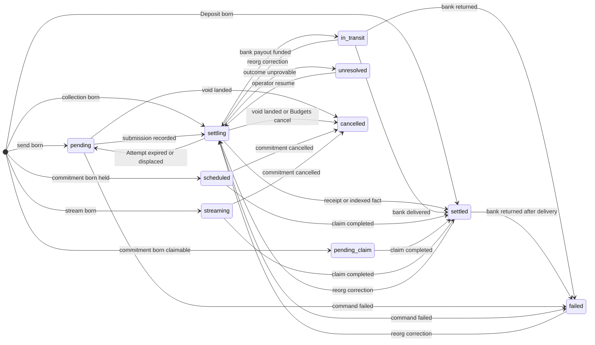
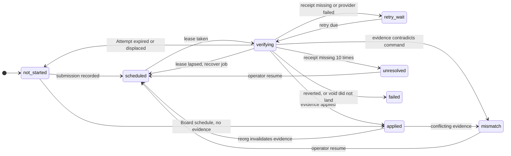

# The old payments concept: findings for the target design

For Aaron, to decide the target payments design. 7 November 2026.

This report reads the old system as it is. It is evidence, not a design.

- **Old code:** `/home/user/factory`, branch `integration/factory`, head
  `0d2be303e`. Every claim below was checked against it. Claims that could not
  be checked were dropped. A few claims from the review journals were wrong;
  they are listed in [Claims that did not survive the check](#claims-that-did-not-survive-the-check).
- **Paths:** a path that starts with a concept, `platform/` or `integrations/`
  is under `packages/backend/src/`. `payments/writes/rails.ts:33` means
  `packages/backend/src/payments/writes/rails.ts`, line 33. Other paths start
  at the repository root (`apps/cli/...`, `packages/sdk/...`,
  `packages/protocol/...`).
- **Sources:** the as-is book in `books/as-is/payments/` (13 files), the seven
  writer and reviewer journals that built it, the probe build of that book
  (503 records, 722 evals, 56 problems, 354 gaps) and the
  [policy pack](../decisions/policy-pack.md).
- **Confidence:** "seen in code" means the lines show it directly. "Inferred"
  means it follows from reading the code but was not reproduced on a devnet.

## Summary

- A payment is one chain of steps: prepare, sign, send, verify, settle. The old
  code spreads that chain over 82 Convex functions (17 public, 65 internal)
  and many separate transactions. A personal prepare alone makes at least seven
  Convex calls. Correctness rests on fences that each mutation re-checks
  (state, hash, claim token), not on transactions.
- There are two settlement paths, the receipt and the indexed `PaymentSent`
  fact. They check different terms and write different side effects, and
  whichever lands second replays. The settlement side effects (Payroll run,
  Request notice, Books fact, event) are hand-copied at five sites.
- One receipt-path settlement writes six concepts in one transaction:
  payments, banking, books, documents, payroll and requests.
- The README says one guarded writer writes every Payment. That is false: 13
  sites in 10 files patch the status directly. A reorg correction moves a
  Payment back to `settling` from any status, so `failed` and `in_transit`
  reopen.
- Coupling has no direction. 15 of the 17 concepts form one import cycle.
  Payments imports 11 concepts, and 9 of them import payments back. No import
  goes through the payments door. Payments reads six neighbours' tables
  directly, and neighbours read payments' tables at 19 sites.
- Several retries never end, and others stop without a trace. A non-conflict
  apply refusal is retried every 10 minutes forever. Provider failures retry
  with no limit. The Directors' dated payment and the Board schedule give up
  with nothing recorded.
- Telemetry is part of the ledger. The event writer is the only writer of a
  Payment's `terminalOutcome` and `lifecycleSequence`, and money code reads
  those fields to decide outcomes. 20 sites schedule telemetry from inside
  money writes.
- Error codes do not mean what they say. The admitted-code lists narrow
  nothing at the wire. A missing counterparty reaches callers as their own
  `INVALID_INPUT`. The book promises `INVALID_RECIPIENT`, which nothing
  produces. CLI exit codes are written twice and disagree.
- A likely books bug: an Organization's direct transfer to a Capxul Account is
  never booked as the Organization's outside money, because the receiving
  Deposit row makes it look explained. The code comment says the opposite.
- Keep the money behaviour: request-key idempotency, funding read before
  birth, one send per signed operation, exact settlement terms, single-use
  evidence, one live book fact per money fact, settle-once, Attempts ended
  only by chain proof, and reorg reversal. Remove the Convex plumbing: 1 emit,
  8 intent, 11 load and 3 record operations, 10 scheduler sites, 3 payment
  crons, and a "money writes off" switch whose 18 checks can never fire.

## How a payment actually flows today

### The path, step by step

| # | Step | What runs | What it writes | Evidence |
|---|---|---|---|---|
| 1 | Ask | The CLI's `payment send`, `retry`, `cancel` and `reschedule` all call `client.approvals.prepare`. It branches on the keys of its input: command approvals, invitations, Permission changes, Organization payments, else a personal payment. It makes a request key `pay_<uuid>` when the caller gives none. | nothing | `apps/cli/src/commands/payment/subcommands/send/execute.ts:94`; `packages/sdk/src/accounts/approvals.ts:106-152`, `:145` |
| 2 | Prepare | A public action, `payments.commands.prepare` (or `prepare-organization`, `prepare-request` and two checkouts). It reads funding (`loadBirthFunding`: allowance and Safe balance; skipped for a dated payment). Then the `*-intent` mutation births the command and its Payments in one transaction, or replays the same request key. The build reads fees and sponsorship from the AA gateway. Then `loadActive`, `linkObservation`, `loadActive` again, `store` (the money execution, `prepared`) and `claimInitiated`. That is at least seven Convex calls, each its own transaction. | `paymentCommands` (`prepared`, verification `not_started`), `payments` (`pending`), documents, `moneyExecutions` (`prepared`) | `payments/commands/operations/prepare.ts:20-37`; `payments/executions/external/builds.ts:76`, `:153`, `:223`, `:233`; `payments/executions/writes/stores.ts:78` |
| 3 | Sign | The approval page or the SDK signer (Openfort) signs the UserOperation hash. | nothing | `packages/sdk/src/payments/command-execution.ts:226` |
| 4 | Send | `payments.executions.submitCommand` (from `client.approvals.approve`) or `submit` (from `client.payments.pay`). Relayed approvals are sent by Accounts' `sendApproved`, which runs payments' own send code. The send loads the execution, claims it (`prepared` → `sending`, with a claim token), sends it to the bundler, records the provider attempt, then runs `complete`. | execution `sent`; Payment `pending` → `settling`; command `submitted`, verification `scheduled`; Payroll run → `authorized`; schedules `verify` | `packages/sdk/src/accounts/approvals.ts:217`; `packages/sdk/src/payments/execution.ts:269`; `accounts/approvals/operations/send-approved.ts:241-273`; `payments/executions/writes/claims.ts:116-121`; `payments/verifications/writes/submissions.ts:114-140` |
| 4b | Store a dated payment | If the signed operation carries a future window, `payments.schedules.store` keeps the signed bytes instead of sending them. | `paymentSchedules` (`waiting`) | `payments/schedules/external.ts:107-125`; `payments/schedules/writes.ts:67` |
| 5 | Verify | The workflow `payments.verifications.verify`, started by `runAfter`. `begin` takes a lease (`verifying`). `verifyPayment` reads the receipt (from Ponder unless `COMMAND_FATE_READ_SOURCE=rpc`). Then one of `apply`, `finish-retry` (backoff from 30 s, doubling, capped at 10 minutes), `finish-fate`, `finish-mismatch`, `finish-void` or `finish-budget-schedule`. | consumed evidence; Payment `settled`; verification `applied`; side effects in five concepts | `payments/verifications/writes/schedules.ts:27`; `payments/verifications/operations/verify.ts:121-158`; `integrations/chain-evidence/service.ts:201`; `payments/verifications/writes/finishes.ts:106` |
| 6 | Settle from the index | The workflow `payments.verifications.settle`, started with `runAfter(0)` when the Attempt succeeds. It reads the indexed `PaymentSent` fact by settlement id and applies `chain_settled` through `writePaymentInTx`. A minute cron sweeps up to 50 Payments still `settling`. | Payment `settled`, or `in_transit` for a bank payout; Payroll, Request notice, Books fact, event | `payments/executions/writes/lifecycles.ts:216`; `payments/verifications/writes/schedules.ts:56`; `payments/writes/settlements.ts:84-157`; `payments/reads/settlements.ts:8` |
| 7 | Bank payout | Banking's delivery journal decides: `in_transit` → `settled`, or → `failed` if the bank returns it, even after delivery. | Payment; Books fact on delivery | `payments/writes/rails.ts:13-79`; `payments/rules/transitions.ts:116-119` |
| 8 | Send a dated payment | The cron `send scheduled payments that are due`, every 5 minutes. It claims up to 25 due schedules under a 10-minute lease. A day ahead it checks the Budget and the balance. On the date it sends the stored operation. While funds are short it retries hourly inside the signed window, and it fails the schedule when the window closes. A Board budget payment is instead paid by `Budgets.execute`, which the backend signs with its own executor key, broadcasts and waits for inline. | schedule `sent`, `failed` or `cancelled` | `platform/jobs.ts:99-103`; `payments/schedules/operations/claim-due.ts:12`; `payments/schedules/writes.ts:20`, `:94-108`; `payments/schedules/rules.ts:25-27`; `payments/schedules/external/budget-executor.ts:75-104` |
| 9 | Recover | The cron `recover Payment settlement verification`, every 10 minutes. It returns commands whose `scheduled` or `verifying` lease is over 10 minutes old to `scheduled`, then runs the claim sweep inline. | verification `scheduled` | `payments/verifications/writes/recoveries.ts:12-15`, `:40-75`; `payments/verifications/operations/recover-job.ts:28-34` |

### State machines

These are the machines as the code writes them, not as the core function
`transitionPayment` (`payments/rules/transitions.ts:196`) describes them. The
book's full machines are in `books/as-is/payments/data.ts:860-1300`.

**Payment status** (`payments.status`). The main edges:

A commitment history replay can also restore any commitment status from
`cancelled`, `settled` or `unresolved` (`payments/verifications/writes/history.ts:165`).
That edge is not drawn.

These writers set the status without the guarded writer `writePaymentInTx`:

| Edge | Writer |
|---|---|
| `settling` → `pending` | `payments/commands/writes/links.ts:216`; `payments/verifications/writes/finishes.ts:223` |
| → `settling` | `payments/commands/writes/bindings.ts:131`; `payments/verifications/writes/recoveries.ts:140`; `payments/verifications/writes/history.ts:218`; `payments/schedules/writes.ts:250` |
| → `failed`, → `unresolved` | `payments/writes/outcomes.ts:99-100` |
| → `cancelled` | `payments/verifications/writes/endings.ts:59`; `payments/verifications/writes/voids.ts:116`; `payments/schedules/writes/board-cancels.ts:49`; `payments/verifications/writes/history.ts:66` |
| → any commitment status | `payments/verifications/writes/history.ts:165` |
| insert `in_transit` (devnet fixture) | `payments/writes/proofs.ts:44` |

**Money execution Attempt** (`moneyExecutions.state`). One execution is one
signed UserOperation and its one send. Only proof ends it.

| To | From | Writer |
|---|---|---|
| `prepared` | (insert) | `payments/executions/writes/stores.ts:78` |
| `sending` | `prepared` | the claim, `payments/executions/writes/claims.ts:116` |
| `sent` | `sending` | bundler accepted, `payments/executions/writes/acceptances.ts:58`, `:186` |
| `unknown` | `sent` | only when the command ends unresolved, `payments/executions/writes/lifecycles.ts:50-56` |
| `expired` | `prepared`, `sending`, `sent`, `unknown` | the classifier: sponsorship closed and the nonce lane unmoved, `payments/rules/attempts.ts:113-123` |
| `displaced` (terminal) | `prepared`, `sending`, `sent`, `unknown` | the classifier: another operation used the nonce, `payments/rules/attempts.ts:98-111` |
| `succeeded`, `reverted` (terminal) | the four above and `expired` | the classifier: chain proof overrides a ledger expiry |

**Payment command** has two fields. `state` moves `prepared` ⇄ `submitted`.
An expired or displaced Attempt returns it to `prepared`. `verificationState`
is the verification lease:

**Payment schedule** (`paymentSchedules.state`): `waiting` → `sent`, `failed`
or `cancelled`. All three are terminal.

**Movement** (`movements.canonicalState`): the scan inserts `included`; a reorg,
a memo conflict or a suppressed settlement marks it `removed`.

## Coupling

### Concept cycles

The graph was recomputed from every non-test `#<concept>` import under
`packages/backend/src/<concept>`.

- It has 108 edges. 15 of the 17 concepts form one strongly connected
  component. Only `indexing` and `operator` are outside it, and neither has a
  door. 29 concept pairs import each other.
- Payments imports 11 concepts: access, accounts, activity, banking, books,
  documents, organizations, parties, payroll, permissions and requests.
- 9 of those import payments back: accounts, activity, banking, books,
  documents, organizations, payroll, permissions and requests. Indexing and
  operator import payments too.
- **No import uses the door.** `payments/index.ts:1-4` says it is "the only
  thing another concept imports, as `#payments`". No non-test file imports
  `#payments`. 145 import statements from 11 concepts use deep paths such as
  `#payments/writes/settlements`. The policy pack counts 0 door imports
  backend-wide (P4).

### Direct reads of other concepts' tables

Payments reads these tables with `ctx.db`, not through the owner's door:

| Table | Owner | Read at |
|---|---|---|
| `identities` | profiles | `payments/views/recipients.ts:80` |
| `accounts` | accounts | `payments/views/recipients.ts:75`; `payments/commands/writes/requests.ts:31` |
| `orgs` | organizations | `payments/views/recipients.ts:88`; `payments/commands/reads/recipients.ts:24` |
| `counterpartyDestinations` | parties | `payments/views/recipients.ts:109` |
| `paymentRequests` | requests | `payments/writes/births.ts:45`, `:79` |
| `financialDocumentLinks` | documents | `payments/reads/participants.ts:125` |

Payments does not import `#profiles` at all, yet the wire Payment projection
reads Profiles' `identities` table. The build reports a `read-boundary`
problem on every record that reaches that projection: 27 records, which are
15 rpcs, 3 workflows and 9 procedures. Every public read and prepare that
returns a Payment is among them.

In the other direction, neighbours read payments' tables at 19 sites:
permissions 8 (all `moneyExecutions`), requests 7 (`payments`,
`paymentCommands`, `moneyExecutions`), and accounts, banking, documents and
payroll 1 each. Examples: `permissions/writes/verifications.ts:36`,
`requests/reads/invoices.ts:48`, `banking/payouts/writes/refunds.ts:85`,
`documents/reads/parties.ts:218`. So `moneyExecutions` is in effect a shared
table.

### Writes across concepts

- **A direct write.** Payments inserts Requests' `invoiceCheckoutPayments`
  (`payments/commands/writes/items.ts:210`). The build reports 6
  `write-boundary` problems: this insert on 3 records, and 3 Requests writers
  that write Documents' tables.
- **A birth owned by two concepts.** Payments' request prepares call Requests'
  writers (`payments/commands/writes/requests.ts:28`, `:48`, `:59`, `:70`).
  Those call back into payments' `preparePaymentCommandInTx`
  (`requests/writes/approvals.ts:104`, `requests/writes/checkouts.ts:130`,
  `:161`, `requests/writes/purchases.ts:234`).
- **Payments drives other concepts' state machines.** The Payroll run moves to
  `authorized` at payments' submission (`payments/verifications/writes/submissions.ts:131`)
  and back on a reorg (`payments/verifications/writes/history.ts:228`). The
  Banking payout is accepted at payments' claim
  (`payments/executions/writes/claims.ts:182`) and cancelled at payments'
  failure (`payments/writes/outcomes.ts:108`).
- **Neighbours run payments' internals.** Organizations schedules four
  internal payments operations (`organizations/proposals/writes/settlements.ts:73`,
  `:99`, `:106`, `:112`) and imports `ownersVoidExecution` by deep path
  (`organizations/proposals/operations/cancel-scheduled.ts:13`). Accounts
  runs payments' send code (`accounts/approvals/operations/send-approved.ts:12-13`).
  Indexing's crons write payments' Movement tables
  (`indexing/movements/writes.ts:19`) and correct Payment occurrences
  (`indexing/drifts/writes/corrections.ts:7`).

### The six concepts a settlement writes into

A receipt-path settlement (`payments/verifications/writes/sends.ts:187-244`,
with `payments/verifications/writes/evidence.ts:85-117`) writes six concepts in
one Convex mutation. The indexed path (`payments/writes/settlements.ts:84-157`)
writes five of them.

| Concept | What it writes | Receipt path | Indexed path |
|---|---|---|---|
| payments | the Payment row; the consumed-evidence row; suppresses the settled Transfer's Movement | `sends.ts:187-209`; `verifications/writes/conflicts.ts:165` | `settlements.ts:107-129` |
| books | the settled-payment fact | `sends.ts:228` | `settlements.ts:145` |
| payroll | settles the run on its last Payment | `sends.ts:226` | `settlements.ts:143` |
| requests | the paid notice; the registered receipt | `sends.ts:227`; `evidence.ts:115` | `settlements.ts:144` (notice only) |
| documents | the movement Memo | `evidence.ts:91-95`, `:113` | none |
| banking | payout funding verified, then the delivery applied | `sends.ts:214-223` | `settlements.ts:132-140` |

The policy pack (P4) recommends that the Books fact and the Payroll run stay
procedures in the settlement's transaction, and that the notice and the event
go through an outbox.

## Bugs and contradictions found

### State machine edges that are wrong

| # | What is wrong | Where | Effect |
|---|---|---|---|
| S1 | A reorg correction sets `status: "settling"` for any consumed send occurrence, with no status check and outside the core. | `payments/verifications/writes/history.ts:215-218` | A returned bank payout (`failed`) or an `in_transit` one reopens to `settling`. `failed` is not terminal. Seen in code. |
| S2 | The core's own reorg edges have no caller: `reorged` (`settled` → `settling`) and `instruction_failed` (`settling` → `failed`). | `payments/rules/transitions.ts:104-107`, `:121-124` | The tested core is not the path production takes (S1). Seen in code. |
| S3 | Thirteen sites in ten files set Payment status directly, and a devnet fixture inserts a Payment (table above). | see the writers table | The guarded writer guards nothing for those edges, and most of them send no `payment_transitioned`. Seen in code. |
| S4 | A commitment's `scheduled` or `pending_claim` is decided once at birth. | `payments/rules/amounts.ts:77` | Nothing moves `scheduled` to `pending_claim` when the release time passes. The stored status is not a claimability fact. Seen in code. |
| S5 | The Board schedule writer marks the command `submitted` with no `userOpHash` and moves verification `not_started` → `applied` with no evidence. It stores the command id as the schedule's `executionId` and moves the Payments to `settling` with no event. | `payments/schedules/writes.ts:221-251` | `executionId` means two things (see M9). The Board path emits no `payment_transitioned`. Seen in code. |
| S6 | `applied` means three things: evidence settled the command; a void landed (with `completionOutcome: "settled"`, though no money moved); a Budgets reservation was proved (no `completionOutcome`). | `payments/verifications/writes/attempts.ts:145-146`; `payments/verifications/writes/voids.ts:73-80`; `payments/verifications/writes/budget-schedules.ts:85-89` | Readers cannot tell a settled command from a reserved one by the state. Seen in code. |
| S7 | `finish-void` classifies the void's Attempt `succeeded`, which schedules a settle run, then cancels the same Payments. `finish-budget-schedule` schedules settle at reservation time, though Budgets pays on the date. | `payments/verifications/writes/voids.ts:72`, `:110-117`; `payments/executions/writes/lifecycles.ts:216`; `payments/verifications/writes/budget-schedules.ts:84` | Settle runs that have nothing to settle when they run. Seen in code. |
| S8 | The `moneyExecutions` validator admits 11 legacy states that nothing writes. `storedAttemptState` throws on them. | `payments/tables/executions.ts:28-41`; `payments/executions/writes/attempts.ts:40-50` | A historical row in one of those states can never be moved or classified. Seen in code. |
| S9 | The Payment has no state for "void sent". A cancel's approval ends while the Payment still reads `scheduled`. | `apps/cli/src/commands/payment/internal/voids.ts:1-3`, `:11-12`, `:38-53` | The CLI polls every 2 s for up to 180 s, then fails `WRONG_STATE`. Seen in code. |
| S10 | Movement `finalized` and `included` behave the same. `finalized` is written only by an operator rollback that also rewrites rows the scan wrote as `included`. `observed` has no writer. | `payments/movements/rules/movements.ts:6-8`; `payments/movements/writes/inclusions.ts:7-30` | Two dead states and a rollback that cannot be undone exactly. Seen in code. |

### Retries that are not

| # | What is wrong | Where | Effect |
|---|---|---|---|
| R1 | `verify` returns `apply`'s answer without running any finish. A non-conflict refusal from `apply` writes nothing and leaves the lease `verifying`. The recover job returns `verifying` rows older than 10 minutes to `scheduled`, and the same refusal comes back. | `payments/verifications/operations/verify.ts:155-158`; `payments/verifications/writes/evidence.ts:203-206`; `payments/verifications/writes/attempts.ts:122-126`, `:142-143`; `payments/verifications/writes/recoveries.ts:12-15`, `:40-75` | An endless loop every 10 minutes, with no incident and no terminal state. Inferred. |
| R2 | A `provider_failure` retries with no limit and no incident. It also resets the missing-receipt count to 0. | `payments/verifications/writes/finishes.ts:22-27`, `:110` | A provider outage cycles commands between `retry_wait` and `verifying` forever. A flapping provider can stop a missing receipt from ever reaching its cap of 10. Seen in code. |
| R3 | chain-evidence turns every read failure into `provider_failure`, configuration errors included, although its type declares `ENV_MISSING`. | `integrations/chain-evidence/internal/receipt-context.ts:100-104`, `:112` | A missing environment variable looks like an outage and joins R2's endless retry. Seen in code. |
| R4 | The Directors' dated payment (`store-approved`) retries every failure inside its send 10 times, a minute apart, permanent refusals included. Then it returns the failure with nothing recorded. A failed `loadActive` is not retried at all. | `payments/schedules/operations/store-approved.ts:53-62`, `:64-88` | A Directors-approved dated payment can silently never be stored. Seen in code. |
| R5 | `store-board-scheduled` returns `null` after 10 tries, 30 s apart, when Budgets' ids are not found. | `payments/schedules/operations/board.ts:83-94` | The command stays `prepared` with no schedule and no failure. Seen in code. |
| R6 | When a prepare's build is refused, the separate `failPrepared` call that fails the born command is reported if it is lost, never retried. | `payments/executions/writes/failures.ts:33-55` | A born command can stay `prepared` for good. Seen in code. |
| R7 | `waitForTransactionReceipt` ends the wait on the first failed poll, and checks its 120 s deadline only between polls. | `integrations/chain-rpc/internal/userOperationWait.ts:30-45` | `Budgets.execute` in the due job (`payments/schedules/external/budget-executor.ts:99-104`) fails on one bad read and can overrun its deadline. Seen in code. |
| R8 | Schedule notices are planned and sent once per Payment. A notice whose facts read throws ends the run with no retry and no delivery record. | `payments/notices/operations/notify.ts:38-48`; `payments/notices/reads.ts:41-49` | A batch of N sends the payer N emails. A failed read means no email at all. Seen in code. |
| R9 | The claim sweep reschedules itself with `runAfter(0)` after each full page, with no lease. The 10-minute cron can start another run meanwhile. | `payments/executions/operations/recover-claims.ts:66-80` | Two runs can read the same rows. Only the per-row fences keep the writes single. Seen in code. |
| R10 | A settlement suppresses the settled Transfer's Movement and rolls back any Deposit the scan made for it. If that rollback is refused (for example on a changed digest), it prints an incident and throws, so the whole settlement mutation aborts. | `payments/writes/settlements.ts:120`; `payments/movements/writes/corrections.ts:8-24`; `payments/movements/writes/overlays.ts:54-66`; `payments/writes/rollbacks.ts:51-70` | The Payment stays `settling`, and the minute sweep retries the same settlement for good. Inferred, not reproduced. |

### Errors that surface as the wrong code

| # | What is wrong | Where | Effect |
|---|---|---|---|
| E1 | The `attempt([...])` lists narrow nothing at the wire. An undeclared code becomes a defect inside, but the boundary decodes the defect back into the same `CapxulError`. It only marks the call as a contract violation. | `platform/attempt.ts:37-48`; `packages/protocol/src/errors/convex-decoding.ts:66-67`; `platform/observation/evidence.ts:20-36`; `platform/operation.ts:153-158` | Every admitted-code list in payments is decoration. The real error surface is whatever the code throws. Seen in code. |
| E2 | A stored-data defect is reported as the caller's mistake. A Payment whose counterparty is missing throws `INVALID_INPUT` on `paymentId`. `attempt([])` meant it as a defect, and E1 turns it back. | `payments/views/recipients.ts:22-25`; `payments/records/reads.ts:23`, `:39` | `records.get` and `records.list` callers are told their id is bad. One broken Payment fails the whole list. Seen in code. |
| E3 | A reschedule refused by the `scheduled-payments` gate reaches the caller as `FEATURE_NOT_AVAILABLE`, a code the `PREPARE` row does not declare. | `payments/lifecycles/operations/prepare-intent.ts:50-54`; `payments/lifecycles/writes/transactions.ts:26`; `packages/protocol/src/payments/operations.ts:79-89` | The row lies about what the operation can return. Inferred from E1. |
| E4 | `prepareTransaction` checks the caller's own `sender`, `to` and `data` with the provider-answer readers. | `integrations/chain-rpc/internal/transactions.ts:58-60`; `integrations/chain-rpc/internal/providerValues.ts:27-38` | A malformed argument comes out as `PROVIDER_ERROR`, not `INVALID_INPUT`. Seen in code. |
| E5 | `records.get` answers `null` both for a missing Payment and for one the caller may not read. The CLI turns every `null` into `INVALID_INPUT`. | `packages/protocol/src/payments/operations.ts:114-119`; `apps/cli/src/commands/payment/internal/shared.ts:68-74` | Refusals and evals cannot tell "not found" from "not yours". Seen in code. |
| E6 | A failed command refuses as `INVALID_INPUT` on `requestKey`; every other ending refuses as `WRONG_STATE`. | `payments/commands/errors.ts:17-22`; `payments/executions/errors.ts:194-199` | Two codes for "this command has ended". Seen in code. |
| E7 | A Permission or invitation execution passed to `payments.executions.submit` is claimed under Permissions' guards and sent. Then `complete` refuses it: "is not a Payment execution". | `payments/executions/writes/claims.ts:103-105`; `payments/executions/writes/acceptances.ts:34-36` | Payments sends another concept's operation and then answers `INVALID_INPUT`. Reachable by a caller who passes their own Permission execution id. Seen in code. |
| E8 | The old book promises `INVALID_RECIPIENT` on `payment send`. No backend or SDK code raises it: `Errors.invalidRecipient` has no caller, and the CLI only maps an incoming one. | `apps/docs/factory/operations/payment.send.yaml:186-187`; `packages/protocol/src/errors/factories.ts:194`; `apps/cli/src/runtime/money-refusal.ts:118` | The build reports `refusal-not-produced`. Seen in code. |
| E9 | CLI exit codes are written twice and disagree. `payment cancel` raises `WRONG_STATE` with exit code 5; `exitClass` gives `WRONG_STATE` exit code 2. | `apps/cli/src/commands/payment/internal/voids.ts:14-25`; `apps/cli/src/runtime/errors.ts:222`; `apps/cli/src/runtime/refused-codes.ts:7-17` | The same code exits two ways. Seen in code. |
| E10 | The book says an unknown `--after` cursor on `payment list` is `INVALID_INPUT`. The CLI refuses it, and a `--limit` outside 1 to 100, with `CLI_USAGE`. | `apps/docs/factory/operations/payment.list.yaml:20-21`; `apps/cli/src/runtime/paging.ts:42-45`, `:81-84`; `apps/cli/src/auth/input.ts:20` | The frozen book and the CLI disagree. Seen in code. |

### Money and data bugs

| # | What is wrong | Where | Effect |
|---|---|---|---|
| M1 | Every Transfer into a Capxul Safe gets a Deposit row, and that row stores the Transfer's `txHash` and log index. `explainedByCapxul` treats any `payments` row with that pair as "Capxul explains this Transfer", Deposit rows included. | `payments/movements/rules/movements.ts:248`; `payments/writes/deposits.ts:96-97`; `payments/movements/reads/outside.ts:43-53`, `:98`; `books/facts/writes/observed.ts:36-40` | An Organization's direct transfer to a Capxul Account is never booked as the Organization's outside money. The comment at `outside.ts:86-87` says "The sending side's outflow still books here". Inferred, not reproduced. |
| M2 | The two settlement paths check different terms. The receipt path checks router, settlement id, `userOpHash`, `documentHash` and chain id. The indexed path checks router, settlement id, sender, recipient, token, amount and kind. | `payments/verifications/writes/sends.ts:46-63`; `integrations/chain-evidence/internal/settlement-facts.ts:44-55` | What proves a settlement depends on which path arrives first. Seen in code. |
| M3 | Only the receipt path writes the consumed-evidence row, the Documents Memo and the Request's registered receipt. When the indexed fact settles first, the receipt item is a replay and this area writes none of them. | `payments/verifications/writes/evidence.ts:91-95`, `:113-116`, `:195-197`; `payments/verifications/writes/replays.ts:19-38` | Whether a settled Payment has a Memo, a receipt and reversible evidence depends on a race. Whether another concept writes them later was not checked. Seen in code. |
| M4 | The settlement side effects are hand-copied at five sites. | `payments/verifications/writes/claims.ts:88-89`; `payments/verifications/writes/sends.ts:226-228`; `payments/verifications/writes/commitments.ts:171-173`; `payments/writes/settlements.ts:143-145`; `payments/writes/rails.ts:59-62` | A sixth settlement path would have to copy them again. Seen in code. |
| M5 | Single-use evidence rests on read-then-insert. The table comment claims a unique `by_user_op_hash` index; Convex has no unique indexes, and the read collects by it. | `payments/tables/commands.ts:84-89`; `payments/verifications/reads/identities.ts:49-53`; `payments/verifications/writes/conflicts.ts:165` | Safe on Convex only because mutations are serializable. Ported to Postgres without a unique constraint, evidence could apply twice. Seen in code. |
| M6 | Funding is read before birth and again at build. The code admits a race: two unsent batches on one Budget both pass, and the chain refuses whichever lands second. | `payments/commands/external/funding.ts:104-106`, `:209` | No reservation; the user finds out on chain. Seen in code. |
| M7 | Telemetry state decides money outcomes. The event writer is the only writer of `terminalOutcome`, `terminalEventId` and `lifecycleSequence`, and the outcome writer, the receipt path and the wire projection read them. | `payments/events/writer.ts:198-222`; `payments/writes/outcomes.ts:80-85`; `payments/verifications/writes/sends.ts:105`; `payments/executions/views/executions.ts:70` | Removing the telemetry changes money behaviour. Seen in code. |
| M8 | `readPaymentSummaryInTx` has no participant check. A viewer who is not the sender reads the Payment as direction `in`. | `payments/reads/activity.ts:233-242`; `payments/views/payments.ts:107-114` | Safe only while every caller picks ids from the viewer's own window. Seen in code. |
| M9 | A notice looks up the payer's mailbox through `moneyExecutions` by the schedule's `executionId`. A Board schedule stores its command id there. | `payments/notices/reads.ts:45-49`; `payments/schedules/writes.ts:230` | A Board payer's failed or short notices find no execution and so no email. Inferred. |
| M10 | Movement and Payment evidence views hard-code `verification: "verified"` and `canonicalState`/`finality: "finalized"`. | `payments/movements/reads/movements.ts:100-101`; `payments/views/evidence.ts:32-33`, `:69-70` | The client is told evidence is final without any check. Seen in code. |
| M11 | `applyRailDeliveryInTx` answers `replayed` while Banking's delivery is pending, just after the caller moved the Payment to `in_transit`. The settle run counts only `changed` and `refused`. | `payments/writes/rails.ts:33-39`; `payments/verifications/operations/settle.ts:70-71` | `open` no longer equals `settled + pending + refused` in the run's report. Seen in code. |
| M12 | A Budgets batch with some items cancelled and some paid keeps the cancelled items' Payments `settling`. | `payments/schedules/external/budget-executor.ts:63-64` (marked "ponytail") | Stuck Payments. Seen in code. |
| M13 | The chain is Base Sepolia only, by constant. The AA gateway refuses any other chain, chain-evidence verifies only 84532, and the event writer defaults to it. | `integrations/chain-rpc/internal/upstreams.ts:51-58`; `integrations/chain-evidence/internal/receipt-context.ts:13`; `payments/verifications/external.ts:136`, `:223`; `payments/events/writer.ts:228` | The Base mainnet node list that chain-rpc reads is dead. Seen in code. |
| M14 | `payments.records.list` takes no input. It reads two whole indexes and projects every Payment the Account ever touched into one page. | `packages/protocol/src/payments/operations.ts:108-112`; `payments/reads/payments.ts:163-189`; `platform/page.ts:11` | The payload grows without bound. The CLI pages locally. Seen in code. |

### Docs that contradict code

| # | The doc says | The code does | Where |
|---|---|---|---|
| D1 | "Every Payment row is written by one guarded writer, `writePaymentInTx` … Nothing else patches a Payment." | 13 sites in 10 files patch status directly (S3). | `payments/README.md:14-17` |
| D2 | The door is "the only thing another concept imports, as `#payments`". | Nothing imports `#payments`; 145 imports use deep paths. | `payments/index.ts:1-4` |
| D3 | Evidence replay "is rejected on the unique `by_user_op_hash` index". | Convex has no unique index; the read collects (M5). | `payments/tables/commands.ts:84-89` |
| D4 | `resetClaim`: "release the claim for a later retry". | It only records an `own_lane_advanced` diagnostic; "no other reset exists". | `payments/executions/operations/reset-claim.ts:12` vs `payments/executions/writes/claims.ts:189-196` |
| D5 | "Recording re-proves the caller's authority over the command." It admits three authority codes. | `complete` calls `submitAcceptedPaymentCommandInTx`, which runs no authority guard, as the README intends ("It does not require authority that the accepted operation can change"). The admitted codes are dead. | `payments/executions/writes/transactions.ts:15-26` vs `payments/writes/ledger.ts:85-110`, `payments/README.md:67-68` |
| D6 | "The sending side's outflow still books here." | A Deposit row of the same Transfer drops it (M1). | `payments/movements/reads/outside.ts:86-87` vs `:98` |
| D7 | The cron and the writers check that money writes are on and a V2 address is set. | Both are hard-coded constants, so the three payment crons always register and the "writes disabled" `NOT_IMPLEMENTED` in `requirePaymentWriterEnabled` (18 call sites) can never fire. | `platform/jobs.ts:87`; `payments/rules/records.ts:215-219`; `packages/protocol/src/evm/payments-abi.ts:247`, `:250` |
| D8 | The old book: `payment send` uses `client.payments.pay`; cancel and reschedule are designed as `client.payments.cancel` and `.reschedule`. | The CLI calls `client.approvals.prepare`; `PaymentsMethods` has no `cancel` or `reschedule`. | `apps/docs/factory/operations/payment.send.yaml:4`; `payment.cancel.yaml:41`; `payment.reschedule.yaml:37`; `packages/sdk/src/payments/methods.ts:28-44` |
| D9 | The README's list of payments tables. | It leaves out `paymentSchedules`, which payments owns and registers. | `payments/README.md:7-12` vs `payments/tables/schedules.ts:17`, `packages/backend/convex/schema.ts:79` |

## Plumbing that the target design removes

Convex forced every write that calls the outside world into a query to load,
a mutation before the call, an action for the call, a mutation after it and a
scheduled action for telemetry (policy pack, P3). In payments:

| Plumbing | Payments | Backend-wide (policy pack) | What replaces it |
|---|---|---|---|
| Operations | 82: 17 public, 65 internal (41 mutations, 14 queries, 10 actions) | 442 internal files | one rpc or workflow per real operation |
| `emit-*` (telemetry only) | 1: `payments/records/operations/emit-transition.ts` | 37 | an outbox row in the same transaction and one relay (P3, P7) |
| `*-intent` | 8: seven under `commands/operations/`, one under `lifecycles/operations/` | 12 | steps inside the prepare rpc |
| `load-*` | 11 (4 commands, 3 executions, 2 schedules, 1 verifications, 1 records) | 34 | steps |
| `record-*` / `record` | 3: `record-send-attempt.ts`, `schedules/operations/record.ts`, and `recordBoardScheduled` in `board.ts` | 61 | steps |
| Scheduler call sites | 10 `runAfter`/`runAfterBusinessDelay` sites | 103 | workflow steps with durable retry |
| Telemetry scheduled inside money writes | 20 sites in 12 files. Each schedules one job per Payment and patches that Payment (`payments/events/writer.ts:198-235`). | 8 delivery sites | the outbox |
| Engineering incidents | 11 `console.error` lines (`payment_writer_incident`), several printed just before the transaction aborts | — | an error with a code, recorded once |
| Money-writes switch | 18 `requirePaymentWriterEnabled` checks that cannot fire (D7) | — | delete |

**Crons.** The backend registers 15 named jobs (`platform/jobs.ts:57-162`).
Three are payments' own:

| Job | Every | Target |
|---|---|---|
| recover Payment settlement verification (`platform/jobs.ts:90`) | 10 min | the verify workflow's own durable resume |
| send scheduled payments that are due (`:100`) | 5 min | one durable timer per dated payment |
| settle Payments from the indexer (`:106`) | 1 min | a chain-event trigger on Ponder's `PaymentSent` |

Three more jobs write payments' tables: the per-asset `scan Movement` jobs and
`scan added tokens` (through `applyMovementWindowInTx`), and `reconcile indexer
drift` (through `correctPaymentOccurrencesInTx`). The policy pack files the
first payment job under pre-v4 because of its V2-address gate. That gate is a
constant (D7), so the job runs on v4 too. Its replacement is still the verify
workflow's own resume.

**Other plumbing that goes:**

- **Two settlement paths.** The README already plans to remove the receipt
  path's Payment patch (T4.9, `payments/README.md:59-62`). One path, with the
  union of M2's checks, removes M2, M3 and most of M4.
- **Fences instead of transactions.** One send action runs about eight
  separate functions (load, classify, reset-claim, claim, record-send-attempt,
  complete, then `schedules.load-command` and `schedules.store` for a dated
  payment). Each mutation re-checks state, hash and claim token
  (`payments/executions/external/sends.ts:98-189`). On Postgres the send can
  read, call out and write in one handler, with one idempotency key.
- **Operator-only and dead operations.** `retry-mismatch` and
  `retry-unresolved` are registered internal mutations with no caller outside
  tests and no role check. They also move any `unresolved` Payment to
  `settling`, a commitment included (`payments/verifications/writes/recoveries.ts:139-141`).
  `migrate-inclusion` and `rollback-inclusion` exist only to rename a stored
  value (S10). `payments.records.loadPurposeKinds` has no caller
  (`packages/backend/convex/payments/records.ts:8`).
- **Pre-v4.** V2 commitments and V3 sends still have their own routers and
  checks (`payments/verifications/writes/sends.ts:52-55`). The policy pack
  (P9) recommends dropping pre-v4 entirely.

## What the target payments design must keep

These are the behaviours the money depends on. Each is real in the old code.

| # | Invariant | Evidence |
|---|---|---|
| K1 | **One request key, one command.** The same actor and request key reach the same command, execution and Payments. The command id derives from the request digest. A different request under a used key is refused. A failed command closes its key, and a fresh key creates a new command. | `payments/commands/writes/commands.ts:153-171`; `payments/tables/commands.ts:80` |
| K2 | **Born in one transaction.** A command, its Payments and their documents are born together, or not at all. | `payments/README.md:21-22`; `payments/commands/writes/commands.ts:82` |
| K3 | **Funding before birth.** A new send reads the spending allowance and the sender's balance before it is born. A shortfall refuses and writes nothing. The target should also reserve, to close M6. | `payments/README.md:22-26`; `payments/commands/reads/funding.ts:41`; `payments/commands/external/funding.ts:104-106` |
| K4 | **One send per signed operation.** The send claims the execution with a token before it sends. A claim it did not win is never sent; if the bundler may already hold the operation, it is looked up by hash, never sent again. | `payments/executions/writes/claims.ts:116-121`; `payments/executions/external/sends.ts:144-147` |
| K5 | **An execution id binds the command and the digest.** Two commands with identical signed bytes cannot collide. | `payments/executions/external/builds.ts:145` |
| K6 | **Only chain proof ends an Attempt.** The classifier is pure. `expired` needs the sponsorship window closed (with grace) and the nonce lane unmoved; otherwise the answer is `unknown`. Chain proof overrides a ledger expiry. | `payments/rules/attempts.ts:89-125` |
| K7 | **Exact settlement terms.** A fact that differs on any term settles nothing: router, settlement id, sender Safe, recipient Safe, token, raw amount and kind. Keep the receipt path's `userOpHash`, `documentHash` and chain checks too. | `integrations/chain-evidence/internal/settlement-facts.ts:44-55`; `payments/verifications/writes/sends.ts:46-63` |
| K8 | **Settle once, event once.** A second settle meets `ALREADY_SETTLED` and writes nothing. The terminal event is sent once per Payment, except a bank return after delivery. Keep the rule, but not in the telemetry writer (M7). | `payments/writes/settlements.ts:1-5`; `payments/events/writer.ts:198-210` |
| K9 | **Single-use evidence.** A consumed chain fact is recorded before the ledger change, and replaying it is refused. Make it a unique constraint (M5). | `payments/verifications/writes/conflicts.ts:150-183`; `payments/verifications/writes/evidence.ts:207-230` |
| K10 | **A settled Payment always has its book facts.** One live fact per `moneyFactId`, written in the settlement's transaction (ADR-0042, decision 1). | `books/facts/writes/money.ts:59`, `:98-125`; `payments/writes/settlements.ts:145` |
| K11 | **Payroll follows its Payments.** A run is `authorized` at the one submission point and settles when its last Payment does. | `payments/verifications/writes/submissions.ts:129-134`; `payments/writes/settlements.ts:142-143` |
| K12 | **Reorgs reverse what they removed.** The evidence is marked removed, the Payment returns to `settling`, the Payroll run returns to `authorized`, and the Books fact reverses. Keep this, but as declared transitions with a status check (S1). | `payments/verifications/writes/history.ts:186`, `:215-229` |
| K13 | **Bank payouts.** A payout is `in_transit` until Banking's delivery journal decides, and a bank can return a payout after delivery. | `payments/writes/rails.ts:33-47`; `payments/rules/transitions.ts:108-119` |
| K14 | **A void uses up the whole operation.** Every Payment of the voided batch is cancelled, not only the one asked for. | `payments/verifications/writes/voids.ts:108-117` |
| K15 | **Commitment claims are compare-and-set.** A claim applies only when the stored claimed amount equals the claim's `claimedBefore`. | `payments/verifications/writes/claims.ts:35-47` |
| K16 | **Dated payments.** Checked a day ahead, sent on the date, retried hourly while short inside the signed window, failed when the window closes. A void that lands cancels the schedule. | `payments/schedules/operations/send-due.ts:22-31`; `payments/schedules/rules.ts:25-27`; `payments/verifications/writes/voids.ts:91-98` |
| K17 | **A Payment's own Transfer is not outside money.** The Transfer a Payment settled is suppressed from Movements, so it is not counted twice. Fix M1 while keeping this. | `payments/writes/settlements.ts:120-129`; `payments/verifications/writes/sends.ts:209` |
| K18 | **Roles refusals are authority refusals.** A sponsorship simulation that reverts in Zodiac Roles is `ROLE_PERMISSION_DENIED`, not a provider error. | `payments/README.md:28-33` |

## Gaps the build derived

The probe build of the as-is book produced 56 problems and 354 gaps. A
problem is a rule the old design breaks. A gap is something the book cannot
show yet.

**Problems (56):**

| Rule | Count | What it means |
|---|---|---|
| `read-boundary` | 27 | Records that read Profiles' `identities` through the wire Payment projection, though payments does not depend on profiles: 15 rpcs, 3 workflows, 9 procedures. |
| `cycle` | 17 | 15 concepts and 2 components (the backend reads the indexer; the indexer fetches the backend Site's keys) sit in dependency cycles. |
| `write-boundary` | 6 | Payments' insert into Requests' `invoiceCheckoutPayments` (3 records), and Requests writing Documents' tables (3). |
| `refusal-not-produced` | 6 | `CLI_USAGE` on five operations, because the CLI layer is not booked as a producer; and `INVALID_RECIPIENT` on `payment send`, which nothing produces (E8). |

**Gaps (354):**

| Rule | Count | What it means | What to do |
|---|---|---|---|
| `no-budget` | 96 | No operation, rpc, flow or workflow has a latency budget: 7 operations, 71 rpcs, 7 flows and 11 workflows. The old code sets none, and the book invents none. | Apply the policy pack's class defaults (P5). |
| `unused-rpc` | 62 | 62 of 71 rpcs are reached by no booked operation or flow. Most are internal Convex hops (the book cannot link one rpc to another). Some are public rows called only by SDK methods outside this book: the Requests flows (`prepare-request`, the checkouts) and forwarders such as `previewRetry` and `payoutStage`. | Most become steps (P3). Give the rest an owner or delete them (P2). |
| `uninvoked-procedure` | 60 | 60 of payments' 65 door procedures have no booked caller. Their callers live in neighbour concepts, which this book does not cover. | Decide which of the 60 the target door keeps. Each is a dependency some neighbour has on payments. |
| `unproduced-error` | 31 | Error codes in the vocabulary that nothing booked produces. They are other concepts' codes (payroll, organizations), CLI-only codes, and platform codes such as `RATE_LIMITED`, `STALE_EPOCH`, `TRANSACTION_FAILED` and `EMAIL_DELIVERY_FAILED`. Payments adds no codes of its own (`packages/protocol/src/payments/error-codes.ts:6-11`); its core refusals are returned values, not errors. | The target payments vocabulary is much smaller than the shared list. |
| `refusal-without-world` | 27 | Old-book refusals that no scenario world reaches, so their `ref:` evals cannot run. Only two refusals have a world: `send` `ROLE_PERMISSION_DENIED` (after-s2) and `get` `INVALID_INPUT` (after-s1). | Write worlds for the refusals the target keeps. |
| `unwritten-table` | 26 | Neighbour tables payments reads (`identities`, `accounts`, `orgs`, permission tables and others) whose writers are outside this book. | Expected at a concept boundary. It lists what payments reads that it does not own. |
| `uncalled-function` | 18 | Contract functions that move money (`Payments.send`, `sendBatch`, V2 commitments, `Budgets.spend`/`schedule`/`cancel`, the Safe module, MultiSend, Roles) have no booked caller. The old code encodes them into UserOperation calldata at prepare, and the book records only `eth_call` reads. | The target should name the contract call each operation makes. |
| `unreachable-state` | 12 | The 11 legacy money-execution states (S8) and Movement `observed` (S10). | Drop them. |
| `unconsumed-chain-event` | 10 | No workflow is triggered by a chain event (`PaymentSent`, `Transfer`, `UserOperationEvent`, the V2 commitment events, `Budgets.PaymentScheduled`). The old system polls and sweeps instead. | Chain-event triggers on Ponder's tables (P3). |
| `unused-flow` | 5 | SDK flows no CLI operation uses: `client.payments.retry` and `client.org(...).payments.pay`, `payBatch`, `retry` and `subscribe`. The CLI goes through `client.approvals.prepare`. | Classify and delete by default (P2). |
| `empty-concept` | 4 | applications, indexing, media and operator appear only as neighbours, with no records of their own here. Indexing and operator also have no door. | Expected. |
| `unsent-event` | 3 | `deposit_initiated` and `deposit_settled` are retired but still in the catalog. `quick_pay_external_address_acknowledged` is sent only by a React hook, outside the book. | Drop the retired events (P7). |

The build also generated 722 evals: 677 machine-checked at L1, 38
machine-checked at L3 (imports, environments) and 7 judged by an agent. Most
L1 evals exercise one record each (`rpc:`, `prc:`, `tbl:`, `int:`, `trn:`).

## Claims that did not survive the check

These claims appear in the review journals. Checked against the code, they
are wrong or overstated, so this report does not use them.

- **"`FEATURE_NOT_AVAILABLE`, `SMART_ACCOUNT_MISSING` and `ACCOUNT_NOT_FOUND`
  become `UNKNOWN` on the wire."** The boundary decodes a defect back into its
  own `CapxulError` (E1). These codes cross with their own names, and
  telemetry marks a contract violation.
- **"On a v4-only deployment the three payment crons are not registered."**
  Their gate is two constants that are always true (D7). The jobs always
  register.
- **"A completing claim is booked differently on re-verification: both the
  claim fact and the settled-payment fact."** `recordSettledPaymentInTx`
  returns at once for a commitment (`books/facts/writes/money.ts:105`), so
  both paths book only the claim fact.
- **"Complete re-proves no authority" as a security hole.** The README says
  the accepted replay deliberately checks only the stored owner and hash
  (`payments/README.md:67-68`). The finding is the stale comment and the dead
  error codes (D5), not a hole.
- **"A failed funding read on the day-ahead check counts as funded" as a
  bug.** It is deliberate: "A read the chain did not answer is not a
  shortfall: the send decides" (`payments/schedules/external.ts:61-64`).
  The cost is a missed day-ahead warning during an outage.
