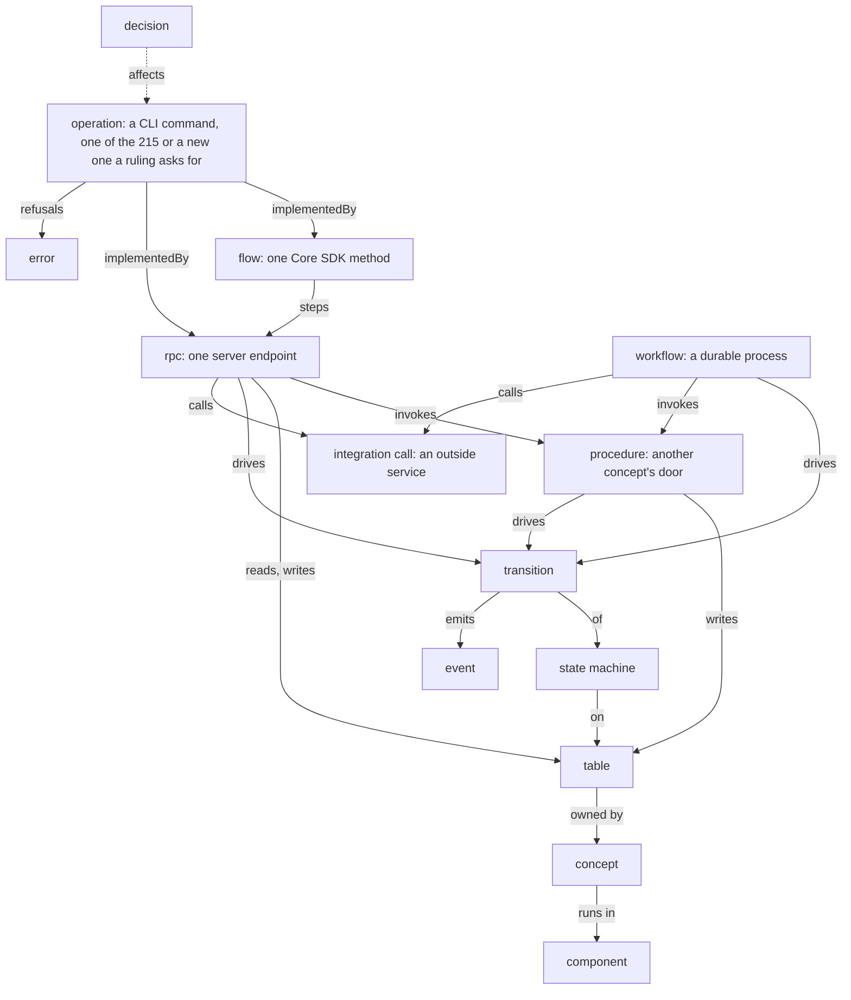
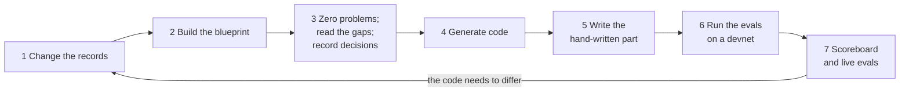

# How the blueprint works

New to the blueprint? Start with [the plain-language guide](blueprint-guide.md), which the portal shows as its Blueprint page with live tables. This page is the detailed reference.

This guide covers what the blueprint is, how its pieces fit together, where it sits in the
wider system and how it is used from a design question to production. Read it first. The
field-by-field reference for the schema is [`docs/spec/50-design-book.md`](spec/50-design-book.md).
The rules for target designers are in [`blueprint/CONVENTIONS.md`](../blueprint/CONVENTIONS.md).

## In one paragraph

The blueprint is Capxul's design, written as data.

- **Records.** Every part of the system is a record: a table, a state machine, a server call, a
  Core SDK flow, a CLI operation, an error code, a durable process or a decision. A record is a
  TypeScript value. An Effect Schema checks it when it is created. It points at the records it
  depends on by importing them.
- **The build.** A small build (`packages/blueprint-engine`, about 1,500 lines) reads every record and
  produces three things:
  - **Problems:** the design contradicts itself or a policy, and the blueprint does not build.
  - **Gaps:** the design is incomplete here.
  - **Evals:** the checks that say when the code matches the design.
- **Everything else is computed.** Every other output is computed from the same records, so none
  of it can drift from them. Today that means diagrams, pages and reports. Later it also means
  generated code, the eval catalogue and the scoreboard.

## Why records and not documents

The old system described itself in five places: a book of 215 operation pages in YAML, a docs
site, the architecture decision records (ADRs), Linear tickets and the code. Only part of that was
kept in step. The docs site's operations reference was generated from the YAML book, and the old
factory computed each operation's state from it. But nothing checked the ADRs, the tickets or the
code against the blueprint, and the YAML could not say how the operations fit together underneath. The
blueprint makes the whole design something a machine can check:

- **A link is an import.** A misspelt or deleted record is a compile error, not a broken sentence.
- **A rule is code that runs on every build.** For example: no concept writes another concept's
  table, every machine sends one event, and every operation has a speed budget.
- **The definition of done is derived.** A complete record is also a complete test plan, so nobody
  writes or maintains a separate list of checks.

## The two books

| Blueprint | Folder | What it is | Who writes it |
|---|---|---|---|
| Frozen | `blueprint/baseline/` | **Reference, not surface.** The old book's 215 operations: the list of capabilities the rebuild keeps, and the acceptance claims whose behaviour its evals keep. Also the old commands, titles and refusals. `flags.ts` holds each command's arguments and flags as the old CLI declares them, plus the global flags: the material for designing the new flags. | Generated: `operations.ts` by `archive/tools/freeze-operations.py` from the old repository's `apps/docs/factory/operations/*.yaml`, and `flags.ts` by `archive/tools/freeze-flags.ts` from its `apps/cli/src`. Never edited by hand. |
| Target | `blueprint/` | The design of the rebuilt Capxul: the specification the build implements, including its own spelling of the surface (commands, flags, `--json` shapes, refusal codes). | The concept designers, then the assembly. When the code needs to differ from it, it changes first. |

**What the freeze keeps.** Aaron's decision `system.frozen-behaviour` is that the freeze keeps
**behaviour, not spelling**:
- The 215 operations stay as the list of capabilities.
- What each acceptance claim requires to happen stays as its evals: that is the hill.
- The exact flags, `--json` shapes, refusal codes and wording are the target's to design as one
  consistent system.
- A refusal is a behaviour ("a signed-out caller is refused"). It is checked by its code only where
  the target's own error vocabulary keeps the code.

**New capabilities.** The 215 are the capabilities the rebuild keeps, not a ceiling. Aaron ruled
some capabilities fundamental that the old system never had: the CRM, Projects and Frappe HR
payroll in every Organization (`aaron.frappe-shape`, `aaron.projects`). Decision
`rules.new-operations` books such a capability as an operation on three terms:
- a decision on it, other than the rule itself, cites the Aaron ruling it serves (it names an
  `aaron.*` ruling);
- it has at least one acceptance claim;
- its id is its command's words joined by dots, and its id and its command collide with nothing:
  no frozen id, no export name another operation has, and no other operation's command, old or
  new.

Which commands a capability gets is its concept's decision pack, a question for Aaron. Whether a
pack's recommendation may blueprint them before he answers is also his (`rules.new-operations` says
yes, for him to confirm). The 215 are still required exactly, and a new operation never stands in
for one of them.

**The old system is a reference for behaviour, not a baseline.** Agents read its code for edge
cases: contract reverts, money paths and permissions. They never port it, and the evals are not run
against it. An earlier **as-is book** described it in the same records. That blueprint is closed and
archived in `docs/as-is/archive/`. It does not typecheck and is kept as evidence only, together
with `docs/as-is/payments.md` (the reviewed payments lane, K1 to K18), `docs/mission/findings.md`
and the lane reports.

**One schema, two stages.** The schema supports stage `"as-is"` for a blueprint of an old system. The
target is built with stage `"target"`, which also enforces the accepted policies that can be
checked as rules:
- P1: acceptance lines are claims;
- P2: an rpc must be reached;
- P5: budgets;
- P7: events only on transitions, one per machine;
- P8: tenant-first keys;
- A4: a flow that implements an operation serves the CLI.

P4's write boundary is a base rule, so it runs in every stage. The kept behaviour, and the terms
on which a new operation is booked, are checked by `packages/blueprint-engine/scripts/check-frozen.ts`. Nothing checks P3, P6
or P9 mechanically yet: reviewers hold them, and the build session's generators will check P6's
spans.

**A target operation record is two layers.** First comes the old text, spread in with
`...frozenText("payment.send")`. Then it adds the design:
- what implements it;
- each acceptance line, as a claim with what an eval observes;
- the world each refusal needs;
- its `--json` shape and its budget.

A claim keeps the frozen words where they read as an outcome. A claim is rewritten where it names a
mechanism or the old spelling, with the frozen claim kept first in its `was` and a decision on the
operation.

A new operation (`rules.new-operations`) has only the second layer. It has no frozen text, so its
title, `about` and `who` are written for the target, and its claims are compared with nothing old.

## The pieces

```
packages/blueprint-engine/                 the record system; product-neutral except the target rules and budget classes
  src/records/*.ts             one define* function per top-level kind, each an Effect Schema; child kinds
                               (transition, call, function, chain event) come from their parent
  src/build.ts                 buildBlueprint: register, link, check the rules, reverse links, gaps
  src/evals.ts                 deriveEvals: the evals each kind of record implies
  src/budgets.ts               the default budget of each class (policy P5)
  src/impact.ts                impactOf: what depends on a record (below)
  src/stand.ts                 underOf and standOf: where an operation stands (below)
  src/status.ts                the status document: its type, its parser, and the merge of a run into it
  src/telemetry.ts             the events an operation sends and the spans it names, and their gap rules
  src/examples.ts              the check of an operation's examples against its record
  src/views.ts, src/main.ts    the command that writes the views and exits 1 on problems
  test/                        the tests, with a small fixture blueprint (invitations)
blueprint/baseline/                  the old operations and their CLI flags, as reference (generated)
blueprint/
  shared/                      the system, the components, the 23 concepts and what each may depend on,
                               the errors, the integrations, the v4 contracts, the architecture decisions,
                               and where each old area lands
  <concept>/                   data.ts        tables, state machines and their events
                               procedures.ts  the concept's door: what other concepts may invoke
                               <area>.ts      the rpcs of one area
                               processes.ts   the durable processes (workflows)
                               flows.ts       the Core SDK flows
                               operations.ts  the operations this concept owns
                               decisions.ts   every judgment behind the design
                               index.ts       the concept's module list
  index.ts                     every record of the target, with stage "target"
packages/blueprint-engine/scripts/         the checks and reports over the blueprint: check-frozen, report-cut, report-surface,
                               report-judgments, impact.ts (below)
packages/plan/                 the plan CLI and the task tree
packages/evals/                the evals runner: it runs the checks bound to evals and writes the results (below)
evals/bindings/<area>.json     which checks prove which evals, one file per area (below)
status/status.json             what has run, per eval (below); written only by a run, never by hand
status/runs/<run>/             one run's results, check lines and evidence (below)
docs/decisions/                the accepted decisions, and the generated judgments report
plan/                          the coordinator's plan (`pnpm plan show`)
```

## Records and links

A record holds the records it depends on. Links point only **down** the layers, so the blueprint has no
cycles. A record never lists who uses it: the build computes every reverse link ("which operations
drive this transition").



The record kinds sit on three axes. Each axis answers one question:

| Axis | Records | The question it answers |
|---|---|---|
| Boundary | operation, rpc, flow | What does a caller ask for, and what answers it? An operation is implemented by exactly one rpc or one Core SDK flow, and the CLI calls one SDK method per command. |
| State | table, machine, procedure, event | What is stored, and how does it change? Each status column is one state machine. Each machine sends one `<machine>_transitioned` event. Another concept's tables change only through its procedures. |
| Time | workflow | What runs when nobody is waiting? Each long-lived object has one durable process, with its trigger, its instance, its signals and its waits. |

Around those axes sit:

- **The system and its components:** what runs where.
- **Integrations and contracts:** the outside world, through Effect services and the chain.
- **The site:** the Frappe DocTypes Capxul defines or extends (`doctype`) and the hats people take, with the Frappe roles
  each gives (`role`), and the parts a site switches (`feature`). They are the code exactly: `pnpm frappe:check-blueprint`
  fails the merge on a difference, and what the code still owes a decision is an `owed-change` gap.
- **Errors:** one vocabulary, with exit codes.
- **Journeys and invariants:** checks across operations.
- **Decisions:** the reason for any record.

## A worked example: `payment send`

These excerpts are trimmed from the real files. They follow one command from the CLI down to the
database.

```ts
// blueprint/payments/operations.ts: the operation, one of the 215
export const operation_payment_send = defineOperation({
  ...frozenText("payment.send"),            // the old book's words, the starting point
  implementedBy: flow_client_payments_pay,  // one Core SDK method; the CLI calls it and nothing else
  acceptance: [
    kept("payment.send", 1, "chain: one UserOperation and one PaymentSent carry the payment id; read: `payment list` shows exactly one Payment for it, settled"),
    // … 8 more: five kept word for word, two with their "On Protocol v4" opening stripped (P9) and one
    // rewritten as an outcome (P1), the frozen claim kept in `was`; each says what an eval observes
  ],
  refusals: [{ error: error_INSUFFICIENT_BALANCE, given: W.empty, when: "Your Safe, or the company Safe, holds less than the amount." } /* … */],
  budget: budget("chain-submit"),           // p50 2,000 ms, p95 4,000 ms
});

// blueprint/payments/flows.ts: what the Core SDK does for it
export const flow_client_payments_pay = defineFlow({
  sdk: "client.payments.pay",
  steps: [{ name: "prepare", rpc: rpc_payments_commands_prepare }, /* sign through approvals … */ { name: "follow", rpc: rpc_payments_ledger_watch }],
});

// blueprint/payments/commands.ts: one server endpoint
export const rpc_payments_commands_prepare = defineRpc({
  kind: "action",
  writes: [table_payment_commands, table_payments],
  drives: [machine_payment.t.open],
  invokes: [parties.procedure_parties_resolve_recipient, procedure_documents_store, approvals.procedure_approvals_open],
  calls: [integration_chain_rpc.c.readContract, integration_chain_rpc.c.getCode],
  budget: budget("chain-read"),
});

// blueprint/payments/data.ts: the table's one state machine
export const machine_payment = defineMachine({
  table: table_payments, field: "status", initial: "prepared",
  states: [/* prepared, scheduled, due, escrowed, submitted, needs_retry, settled, mismatched, cancelled */],
  transitions: { open: { from: [], to: "prepared", emits: [event_payment_transitioned] } /* … */ },
});
```

What the build makes of these four records:

- **Checks.**
  - `prepare` writes only the payments concept's own tables (`write-boundary`).
  - It reaches parties, documents and approvals only through their procedures, and only because
    payments is allowed to depend on them (`invoke-boundary`).
  - Every refusal of `payment.send` is an error that something under the flow can produce: a step,
    a procedure or an integration's failure (`refusal-not-produced`). A refusal nothing can produce
    is a problem, not a hope.
  - The machine sends only `payment_transitioned` (`one-event-per-machine`).
  - Each budget is at its class default, or says why it is not (`budget-override-why`).
- **Evals.**
  - For the operation: `acc:payment.send/<key>`, one per acceptance claim.
  - `ref:payment.send/INSUFFICIENT_BALANCE/<key>` and the other refusal cases.
  - `ret:payment.send`, the shape of its `--json` output.
  - `evt:payment.send/<event>`, one for each event sent anywhere under the flow:
    `payment_transitioned`, `party_transitioned`, `approval_transitioned` and
    `proposal_transitioned`.
  - `spn:payment.send` and `bud:payment.send/p95`.
  - `doc:payment.send`, its reference page, and `des:payment.send`, the one an agent decides: the
    operation's text and what it does agree.
  - For the records below it: `flw:client.payments.pay/budget` and `/spans`;
    `rpc:payments.commands.prepare/budget`, `/spans` and `/errors`; `trn:payment.open`;
    `tbl:payments/schema`, `/writers`, `/tenancy` and `/admits/<key>` (the payee's read of a Payment);
    `prc:<procedure>/atomic` for each procedure it invokes; and, for the Payment's durable
    process, `wfl:payments.lifecycle.payment/resume` and one `/wake/<wait>` per keyed wait.
- **Gaps.** For example, a refusal whose world no devnet can build yet (`refusal-without-world`),
  or a transition nothing drives. In a blueprint an rpc nothing reaches is not a gap but a
  problem (`unreached-rpc`). A target operation also has a gap for each of its examples, spans and
  events that the blueprint does not yet hold (`no-example`, `no-span`, `state-change-without-event`:
  see "What an operation shows beyond its design").
- **Examples.** The operation's `examples`, each a real run: what was typed, what it printed and
  how it exited.

## What a build does, step by step

```bash
pnpm exec tsc -p blueprint                                                                       # 2
node --experimental-strip-types packages/blueprint-engine/src/main.ts blueprint/index.ts var/blueprint   # 1, 3–9
```

1. **Load.** Node imports `blueprint/index.ts`, and every `define*` call checks its record
   against the record's schema as the module loads. A bad id, or an `about` over 2,000 characters,
   throws here and names the field.
2. **Typecheck.** The compiler checks the kind of every link: `writes` takes tables and `drives`
   takes transitions.
3. **Register.** Every record is stored under `kind:id`, and a duplicate is a problem. Child records
   are registered from their parent: a machine's transitions, an integration's calls, and a
   contract's functions and chain events.
4. **Link.** The build walks every field of every record. A link to a record the blueprint does not list
   is `dangling`. A link that holds `undefined`, usually an import cycle, is `undefined-link`.
5. **Rules.** The base rules always run: boundaries, machines, cycles and refusals. With stage
   `"target"`, the policy rules run too: events only on transitions, one event per machine, no rpc
   nobody reaches, budgets, tenant-first keys, acceptance lines as claims, and a flow that
   implements an operation serving the CLI (`flow-surface`). Two more serve the generators:
   - every wait except a timer has a routing `key` (`wait-without-key`), and each key's properties
     must be carried by what wakes the wait (`wait-key`);
   - a table's `admits` clauses (who besides its tenant may read or write a row) must name real
     columns (`admission`), and a chain table must declare read-only clauses (`chain-admits`).
6. **Reverse links.** The build records who points at each record.
   Every example of an operation is checked here too (`example-mismatch`, a problem).
7. **Gaps.** The derived list of incomplete design (`docs/spec/50-design-book.md` has the table),
   and for a blueprint the three telemetry and example rules below.
8. **Evals.** Every eval the records imply. Each has an id, a level, the record it is about, its
   claim, and who decides it: a machine, an agent or a person. The levels are:
   - L1: an operation and the records under it;
   - L2: journeys;
   - L3: the system;
   - L4: live evals on staging. The blueprint does not derive these; B5 adds them.
9. **Views.** It writes these files, and exits 1 if there are problems:
   - `README.md`: the counts, the component and concept diagrams, the problems and the gaps.
   - `concepts/<id>.md`: one page per concept, with its state diagrams.
   - `evals.json` and `findings.json`.

## Using it end to end

Every piece of work follows the same path, from a design question to production. Steps 1 to 3
work today. Steps 4 to 7 are what the goal prompt (`archive/docs/mission/initializer.md`) has the build
session make, as milestones B1 to B5.



1. **Change the records.** For new behaviour, a new column or a new state, edit the owning
   concept's file. If the change is a judgment, add a decision record with the options, the choice
   and why.
2. **Build the blueprint.**
3. **Fix every problem and read the gaps.** A gap is allowed, but each one is visible work. A
   decision that needs Aaron says so, and `packages/blueprint-engine/scripts/report-judgments.ts` collects those under "For
   Aaron".
4. **Generate (B1).** From the records the generators make:

   | Records | Generated |
   |---|---|
   | Tables | SQL migrations, with tenant-first keys and row-level security |
   | Fields | Effect Schemas |
   | Rpcs | The `RpcGroup` and the server router stubs |
   | Flows | The Core SDK client and the flow skeletons |
   | Operations | The CLI wiring |
   | Machines and spans | The telemetry catalogue |
   | Evals | The eval catalogue |

   Nobody edits generated files.
5. **Write what cannot be generated:** the bodies of rpc handlers, flow steps and workflow steps.
   The generated types fix the shape of that code. A handler that writes a table its rpc does not
   list fails `tbl:<table>/writers`.
6. **Run the evals (B2).** The harness:
   1. reads `evals.json`;
   2. builds each eval's world on a devnet. The worlds are the named snapshots in
      `blueprint/devnet/worlds.ts`: plain exports, not records, which a refusal names in its
      `given`;
   3. drives the real CLI;
   4. collects the spans over OTLP;
   5. records one result per eval.
7. **Read the scoreboard.** Per operation it shows the evals passing, p95 against the budget,
   telemetry coverage and lines of code. On staging, the live evals (L4) watch the same budgets and
   journeys in PostHog.

The rule that keeps the system honest: **the blueprint changes first.**

1. Change the record and add a decision.
2. Rebuild to zero problems.
3. Regenerate.
4. Change the code.

Code that disagrees with the blueprint is a defect, not a design.

## Where else the same records are used

The records are plain TypeScript values, so anything that can import a module can read them. One
source has many readers:

| Reader | What it reads | What it gives | State |
|---|---|---|---|
| The blueprint build | every record | problems, gaps, evals | built |
| Markdown views | every record | the summary page and concept pages, with diagrams | built |
| Judgments report | decisions | `pnpm judgments` prints it, with "For Aaron"; the portal shows the same list | built |
| Frozen check | the baseline beside the target operations | an operation not booked, a behaviour dropped without a decision, or a new operation no Aaron ruling asks for | built |
| The docs site | operations, flows, errors, concepts, machines | the reference: a page per CLI command and SDK method, the error catalogue, the state diagrams; the `doc:<operation>` evals check it | B4 |
| Generators | tables, rpcs, flows, operations, machines, events | migrations, schemas, the `RpcGroup`, the SDK client, the CLI wiring, the telemetry catalogue | B1 |
| The product runtime | the generated code (see below) | the error catalogue, the transition tables, integration timeouts and retries, span names | B1 and B3 |
| The eval harness | `evals.json`, the worlds, each refusal's `given` | a pass or a fail per eval | B2 |
| The work loop: the plan, the lead Amp thread and one orb thread per task (`docs/handoff-amp.md`; swarmD is retired) | operations and their links, gaps, evals, decisions | the work queue, the order of work and the definition of done | built: plan and evals; Amp from 11 November 2026 |
| PostHog | events, budgets, journeys | the telemetry catalogue, alerts at the p95 budgets, journey funnels | B3 and B5 |
| CI | the build and the evals | fail a change whose blueprint has problems, or whose code fails an eval | B1 |

### In the docs site

The old docs site (`apps/docs` in the old repository) read the YAML book for its operations table.
It read `public/factory/state.json` from the old factory for each operation's eval state.

The new site imports the records directly. A page per command comes from:

- the operation, for the command, what it does, its acceptance lines, its refusals and its budget;
- its flow, for the SDK method and its steps;
- the errors, for the codes, messages and exit codes;
- the machines, for state diagrams that cannot go stale.

Prose that does not belong in a record is written in the site, next to the generated reference.

### In the factory

The old factory (`apps/factory`, about 12,000 lines) ran one agent per operation. It computed each
operation's stand (specify, decide, build, observe, done) from the YAML records and CI's eval
evidence.

The blueprint keeps that idea and gives it better inputs. Each stand is computed by `standOf`
in `packages/blueprint-engine/src/stand.ts` from the typed records, their derived evals and the status
document, so it sees the whole design under an operation, not just the operation's own page, and
the factory still keeps no state of its own about what is done. The rules are under "Where each
operation stands", below.

The link graph is the work plan. An operation's work depends on the records under it: its flow,
the flow's rpcs, the procedures they invoke and the tables those write. So the coordinator can
order the tasks by concept and run them in parallel, without anyone writing a dependency by hand.
A checker's verdict is a set of eval results: `pnpm evals` writes them to `status/status.json`, with
each run's evidence under `status/runs/`. (Until 11 November 2026 this section named swarmD's
managers and ledger as the factory; they were never built and are retired. Today the plan in
`plan/` and Amp threads, one per task and one pull request each, do that work: `docs/handoff-amp.md`.)

### In the product itself

**Recommended: the running product uses generated code, not the blueprint package.** The tools (the
docs site, the harness, the factory, CI and the scoreboard) import the records directly. This is a
recommendation for the build session, not yet a decision record. The reasons:

- **Review.** A change to production behaviour then always shows up as a generated diff that
  someone reviews.
- **Size.** The runtime does not load some 2,000 records and their prose.
- **Freedom.** The blueprint can carry design-only content (`was`, `about`, decisions) without
  shipping it.

The runtime still behaves as the records say. Its error catalogue, its machine transition tables
(a status change that is not a declared transition is refused), its integration timeouts and
retries, its span names and its budgets all come out of the generators.

### Beyond Capxul

`packages/blueprint-engine` is mostly product-neutral. Its kinds (system, component, concept, table, machine,
rpc, flow, operation, workflow, journey and the rest) fit any service with a CLI or an API.

These parts are specific to Capxul:

- the target rules in `checkTargetRules`, which are policies P1 to P10;
- the budget classes;
- the `chain` tenancy and the contract kinds.

To use the blueprint for another product (swarmD itself, for example), pass the rule set and the budget
classes in as parameters instead of hard-coding them. That change has not been made yet.

## What an operation shows beyond its design

The blueprint is meant to say what is being built, and to leave nothing that can be known up front to
be remembered at build time. Three things about an operation belong to that, and each is derived
or checked, never written twice.

**Examples.** An operation's optional `examples` is a list of
`{ title, input, output, exit }`:

| Field | Holds |
|---|---|
| `title` | what the example shows, in a line |
| `input` | the command line as typed; it names the operation's `command` |
| `output` | the JSON `--json` prints |
| `exit` | the process exit code, 0 to 255 |

The build checks each example against the operation (`example-mismatch`, a problem, because a
wrong example is worse than none):
- with `exit` 0, `output` conforms to the operation's `returns` schema;
- with any other `exit`, `output` is `{ "error": { "code": "...", "message": "..." } }`, its
  `code` is an error the operation declares (in `refusals`, or in `errors`), and `exit` is that
  error's exit code. This is the refusal shape the devnet API uses today (`docs/design/time.md`);
  when the CLI surface designs its own, this check follows it.

An operation with no example is the gap `no-example`. The portal shows the examples as terminal
sessions above the generated skeleton of `returns`, which stays labelled as generated.

**Events and spans, derived.** `eventsSent(blueprint, operation)` answers "which events does this
operation send, and through which transition": for each event, the transition that sends it
(null for an event a record sends itself) and the rpc or procedure that drives it. Events come
from the transitions its implementation drives, through the flow's step rpcs and the procedures
they invoke. `spansNamed(blueprint, operation)` answers "which spans does it name": the implementing
flow's and every rpc's under it. The portal shows both on the operation page's trace.

**Two gap rules for what is silent.** They are gaps, so the build still succeeds, and each has an
id so a view can count it apart from the others (`TELEMETRY_RULES`; the portal's Build page does):

| Rule | The operation |
|---|---|
| `no-span` | has an implementing flow and rpcs that name no span |
| `state-change-without-event` | drives a transition, and sends no event |

These three rules, with `no-example`, run only on a blueprint. The stand does not read them
(`STAND_IGNORES` in `stand.ts`): a missing example must not move an operation back from build.

## What depends on a record

`impactOf(blueprint, "kind:id", { depth? })` in `packages/blueprint-engine/src/impact.ts`, and
`packages/blueprint-engine/scripts/impact.ts <kind:id> [--json] [--depth n]`, answer "if this record changes, what is
affected". The answer is every record that depends on it, directly and transitively, each with
the field of its own that names the record one step nearer and its distance, grouped by kind,
nearest first; the decisions that name any of them, apart; and the evals whose subject is any of
them.

**What counts as "depends on".** A depends on B when A names B in a link, read backwards:

| A | depends on | by |
|---|---|---|
| an operation | the flow or rpc that implements it | `implementedBy` |
| a flow | its rpcs | `steps` |
| an rpc, a procedure, a workflow | the tables, procedures, calls, contract functions and errors it names | `reads`, `writes`, `invokes`, `calls`, `chain`, `errors` |
| an rpc, a procedure, a workflow | the transitions it drives | `drives` |
| a transition | the events it emits, and its machine | `emits`, `of` |
| a machine | its table | `table` |
| a call | the errors it fails with, and its integration | `failures`, `of` |
| a journey | its operations and the events that prove them | `steps` |
| a workflow | what triggers or wakes it | `trigger`, `signals`, `waits` |
| any record | its concept or component | `concept`, `component` |

A parent that only *lists* its children's references (a machine's `transitions`, an integration's
`calls`) is reported as a dependent but does not pass the change on to its other children, so
changing the event `payment_transitioned` reaches the transitions that emit it, and not every
transition of the machine.

**Decisions are separate.** A decision affects what it names, so it is never among the dependents:
the answer lists the decisions that name the record itself, and counts those that name a record
that depends on it. A decision as the subject is read the other way: its dependents are what it
names, and what depends on that.

**In the portal,** every record, operation and concept page has an "If this changes" block: the
count by kind and the nearest few. The page's JSON and Markdown twins carry the list (the nearest
500 for a record that more depend on; a decision's twins list what it names). The tool has all of
it.

## Where each operation stands

`standOf(blueprint, operation, { waits, status })` in `packages/blueprint-engine/src/stand.ts` places an operation
on the climb. It says what is missing, not whether code exists. `underOf(blueprint, operation)` finds
the records under it (`docs/design/portal.md`, "The stand", has the rules): what implements it,
its errors and its refusals' errors, a flow's steps, errors and calls, each rpc's and
procedure's `reads`, `writes`, `drives`, `invokes`, `calls`, `chain` and `errors`, a transition's
machine and that machine's table, a call's integration, a function's contract, and one hop
further the durable processes its records start (`trigger`) or resume (`signals`). Concepts,
components, the system, environments, decisions, admissions and waits are not followed.

The first row that matches is the stand:

| Stand | When |
|---|---|
| specify | the operation, or a record under it, has a problem or a gap (not `no-example`, `no-span` or `state-change-without-event`) |
| decide | a decision that waits for an answer (`waits(decision)`) names one of its own records: the operation, what implements it, a flow's step rpcs |
| build | an L1 eval of the operation, or of a record under it, has no passing verdict in the status document |
| observe | every such L1 eval passes; the operation's live evals (`live:<kind>:<operation id>`, from B5) do not all hold, or none is defined yet |
| done | it has live evals, and they all hold |

A waiting decision on a record further under the operation is shown on the operation's page, not
as its stand. With no status document no eval has a verdict, so an operation is at specify,
decide or build.

**The status document** is one file, `status/status.json` at the repository root. Absent means
nothing has run. Its type is `StatusDocument` in `packages/blueprint-engine/src/status.ts`:

```json
{
  "version": 1,
  "evals": {
    "ret:payment.send": {
      "verdict": "pass",
      "commit": "8d1f230",
      "at": "2026-11-10T10:00:00Z",
      "run": "run-41",
      "evidence": "evidence/run-41/ret-payment.send.txt"
    }
  }
}
```

| Field | Holds |
|---|---|
| `version` | always 1 |
| `evals` | one entry per eval id the blueprint derives; an eval with no entry is `not_run` |
| `verdict` | `pass`, `fail` or `not_run` |
| `commit` | the commit the eval ran at |
| `at` | when, as an ISO 8601 time with a zone |
| `run`, `evidence` | optional: the run's id, and the path of its evidence |

`packages/evals/src/record-status.ts <results.json> [--status <file>]` merges one run into it. A results file is
`{ "commit", "at", "run", "receipt", "results": [{ "id", "verdict", "evidence"? }] }`. New writes require a receipt; historical status remains readable. The tool refuses the
whole run, and writes nothing, when it names an eval id the blueprint does not derive. The file's keys
are written sorted, so two runs of the same results give the same file. The portal reads the file,
shows the evals passing per operation, per concept and in total, and `pnpm portal:check` fails
when an entry names an eval the blueprint does not derive.

## Evals run: bindings, runs and the score

**A task is done when its evals pass in a run, not when an agent says so.** The blueprint derives the evals; `status/status.json` is
the score; only a run writes it. Agents' reports are not evidence: a run's results are.

An eval is a claim in the blueprint. A **check** is code that proves it: a named step of an executable script and its expected
outcome (pass). A **binding** says which checks prove which evals. The runner is `packages/evals` (decision `system.layout`
names `packages/evals` for the harness); the bindings are `evals/bindings/<concept>.json`, one file per concept, each:

```jsonc
{ "area": "devnet", "script": "spikes/skeleton/run.sh", "worlds": ["main"], "secrets": ["spikes/skeleton/.env"],
  "bindings": [ { "eval": "acc:world.snapshot.restore/c-369b1db183b9807f", "checks": ["B9.in-place-state-back-at-saved-moment", "…"], "why": "…" } ],
  "near":     [ { "eval": "acc:world.snapshot.save/c-69e4dbcdf13e3750",    "checks": ["B9.snapshot-saved", "…"], "missing": "…" } ] }
```

- **A binding is strict.** An eval is bound to a check only if the check establishes the whole claim; the eval passes when every
  one of its checks passes. A check that proves only part of a claim is listed as a **near-miss**, with what is missing, and it
  never scores. An eval is bound once. The loader fails on an eval id the blueprint does not derive, a check the script does not
  list, a guard (a check that can only fail), an eval bound twice, and an eval both bound and a near-miss.
- **The script contract.** `run.sh [company] [--only B1,B6]` runs the behaviours asked for, and the ones they need first
  (registered dependencies); `run.sh --list` prints each check's name and whether it is a check or a guard. Skeleton checks live in automatically discovered `evals/checks/<concept>.sh` libraries. Each registers its order, behaviour, function and dependencies, without running while sourced. Each check prints a human
  `PASS`/`FAIL` line and one machine line, `@check<TAB>name<TAB>pass|fail<TAB>ms<TAB>detail`. A name is stable
  (`<behaviour>.<what>`); a name that repeats in a run (the four payments of B7) passes only if every repeat passed.
- **Truthful states.** An eval asked for with no binding is written `not_run`, never `pass`. A bound eval with a failing check is
  `fail` (the portal shows it orange). Before children start, every requested eval is reset to `not_run`. Completed plans retain their assertions even when another plan is skipped or interrupted (`system.eval-reporting`). Missing checks, malformed output, crashes or signals demote that plan's passes to `not_run`, retaining explicit failures and raw evidence. Unrequested evals remain untouched. `status/status.json` is written only through `pnpm evals`; normal recording serializes read/merge/atomic rename so parallel concept runs cannot lose each other's results.
- **Evidence.** Each run keeps `status/runs/<run id>/`: `receipt.json` (intent and completion), `status.json` (only this run's verdicts and immutable claim/observes snapshots), `results.json` (what was merged), `checks.tsv` (every check line),
  `evidence/<eval>.txt` (the eval, its claim, its checks with their details, the run, the commit; at most 60 000 characters) and
  `run.log` (the script's whole output, at most 400 000 characters, not committed). Values from the files a binding lists under
  `secrets` (keys, secrets, passwords, tokens) are replaced with `[redacted]`. Only anvil's published test keys exist in a run.
  A commit that has uncommitted tracked changes or untracked files outside `status/` is recorded as `<sha>+dirty`.

The engine exports `RunReceipt` and `parseRunReceipt`. Receipt version 1 contains `id`, `state` (`running`, `complete`, `incomplete`), `commit`, `at`, optional `finishedAt`, `requested` IDs, `evals: [{id,claim,observes?}]`, `scripts: [{script,exitCode,signal,evals?,completed?}]`, `environment`, and `screens`. New receipts assign each bound request to one script and initialize `completed:false`. A plan completes with well-formed output for all its requested checks and no signal: exit 0, or exit 1 with an explicit failed check. Other nonzero exits and exit 1 without a failed check are crashes, not completed assertions. Incomplete plans cannot supply passes; a finalized incomplete receipt can retain passes from independently completed plans after successful preparation. Unexpected harness/evidence errors suppress passing reports. Intent exists before a child starts, even if it prints nothing or the runner is killed. Every requested ID has a same-run verdict. Complete is published last, only when every requested eval is bound and every plan completed; complete can contain failed assertions. Legacy receipts without per-plan fields keep their zero-exit completion rules. Historical directories are never rewritten or rescored.

Environment is `{world,storage:"json"|"postgres",indexer:"inline"|"ponder",stack,components:Record<string,string>,chainId?,databaseSchemaVersion?}`. Supply `--environment <json>` for a real runtime's metadata; the JSON skeleton is always `stack:"skeleton-json"`, never `postgres-ponder-erpnext-v4`. Children receive `CAPXUL_EVAL_RUN_DIR` and may write its `screens.json`, or their own `<module>/screens.json` one directory down: `[{screen,path,source,assertion}]` with run-relative paths. The runner collects every in-run manifest, so modules never overwrite each other's captures; a path listed twice fails evidence collection (`system.eval-screen-manifests`). The runner validates existing run-relative capture paths and includes them in the final receipt. `assertion:"source-equality"` identifies a screen whose values were checked against the source readback kept in that run. `--screens <manifest>` imports an external manifest and captures. A slice's completion must use fresh same-run verdicts from a complete receipt in its required environment, never a mixture of historical JSON-stack passes.

`--json` returns `{version:1,run,runDir,state,passed,counts:{pass,fail,not_run},exitCode}` on stdout, with script logs on stderr. `passed` requires a nonempty complete run with every requested eval passing. Unbound requests make a new run incomplete; completed failed assertions also exit 1. Completion alone never means success, and partial passing reports never satisfy slice acceptance. `runDir` is repository-relative. Validation errors before a run starts have no run directory. Use `pnpm --silent evals -- ... --json` to omit pnpm's banner.

`--prepare <argv-json-file>` runs one optional preparation command after the running receipt and cleared requested verdicts
are saved, before binding scripts. The JSON is `[executable,...literalArguments]`, validated before creating an attempt and
spawned directly without shell expansion from the repository root. It inherits `CAPXUL_ACCEPTANCE_FIXTURE` and receives
`CAPXUL_EVAL_RUN_DIR`, so it can create the fixture only after the receipt exists. The receipt adds optional
`prepare:{argv,exitCode:null|number,signal:null|string,log:"prepare.log"}`; intent precedes launch and exits precede scripts.
Failure/signal/spawn error skips binding scripts and makes the attempt incomplete. Preparation output never supplies
checks; concepts still prove their public journey actions, persisted reads/native integrity and correlated events.
Keep credentials out of argv and preparation output; the combined `prepare.log` uses declared-secret redaction and the
same cap as `run.log`. Old receipts without preparation remain readable (`system.eval-preparation`).

Unsupported requested script plans do not refuse the attempt before its receipt exists (`system.eval-unsupported-worlds`).
Keep every requested contract and planned script, clear prior verdicts, and run preparation after saving intent as usual.
Skip a whole plan if any of its requested binding files excludes `--world`, or if it is the JSON skeleton against a
non-skeleton environment. Never execute that script or change its binding worlds. Its receipt exit/signal stay null;
`run.log` and per-eval evidence explain the skip. Compatible plans may still retain their completed assertions, but skipped plans leave the run
incomplete and exit 1. Skipped requests remain same-run `not_run`, not omitted or proved by
preparation output. Malformed argv/environment and mismatched environment world remain preflight validation errors.

```bash
pnpm evals -- all                                      # every eval that has a check (company slug: a fresh one; --slug to choose, --world main)
pnpm evals -- acc:doc.submit/c-74a45893884b5bef acc:world.snapshot.restore/c-369b1db183b9807f
pnpm evals -- --journey run_a_world                    # journey, step acceptance/returns/refusals/events, and seen screens
pnpm evals -- --milestone m1                           # the eval ids named by the milestone's exit lines and its tasks
pnpm evals -- check                                    # the bindings against the blueprint and the scripts; no entry that is pass or fail without a binding (also in pnpm test)
pnpm evals -- gaps                                     # checks no eval is proved by; checks that prove part of one; journey evals with no check
```

A run needs the stack the script drives (for the skeleton: the bench on 8000, anvil on 8545 and the Core stub on 8787, started
by the script if they are down) and takes about ten minutes. To run a copy of the script from another checkout against a stack
that is already up, set `SKELETON_FRAPPE` to that stack's `frappe/` folder, so the run does not recreate its containers.

A task may name the evals that say it is done (`pnpm plan task edit <id> --evals id,id`, checked against the blueprint);
`pnpm plan show <task>` then prints how many pass in the status document and which do not yet.

## The plan

The blueprint says what to build; the plan says where the build is and what comes next. It lives beside the blueprint, not in it
(decision `portal.plan-page`): tasks and milestones change daily and are not records.

- **It is written, not computed.** The coordinating model writes `plan/plan.json`: the goal and its exit lines, the milestones in
  order (each with exit lines that may name eval ids and concepts of the blueprint), the tasks (state, the thread working on each,
  what each needs, what blocks it, the blueprint records it concerns, its evidence), the **critical path** as an ordered list of
  task ids with a why in the coordinator's words and the date, and dated notes, the latest of which opens the page. Nothing
  sorts, infers or repairs the path.
- **It changes through one command.** `pnpm plan <command>` (`packages/plan/src/main.ts`, module `packages/plan/src/modules/plan/`): `show [--json]`, `note`,
  `task add | start | block | unblock | done | drop | edit`, `path set`, `milestone current`, `exit met`, `check`, and
  `goal set`, `exit add`, `milestone add` to shape it. Every change takes `--by <name>` (default `coordinator`), is validated,
  written, appended to `plan/log.jsonl` (one line: time, who, action, arguments, commit; never rewritten) and printed.
- **It is checked against the blueprint.** `pnpm plan check` (also inside `pnpm test`) fails, naming the task
  and why, when: an id is used twice; a task's milestone or a `needs` entry does not exist, or `needs` form a cycle; a task is
  doing with no thread, or blocked with no blocker, or blocked on a decision the blueprint does not hold; a record key, eval id or
  concept it names does not resolve; not exactly one milestone is current; a task on the path does not exist, is done or
  dropped, or belongs to a later milestone than the current one and is not blocked (a blocked later task may stand on the path:
  the coordinator asks for it early); or an exit line is met with no evidence.
- **It is not on the portal** (decision `portal.product-only`, 11 November 2026). The portal shows the product and where it
  stands; the plan is read with `pnpm plan show`. Only the plan's tasks blocked on a need of the owner reach the portal, on the
  Questions page, where he answers them.
- **It is explained in files.** `plan/plan.json` is the state; the explanation is Markdown beside it: `plan/outline.md` (where we
  are going, what this goal is, how we get there, how the work runs, what is not in it), `plan/milestones/<id>.md` and
  `plan/tasks/<id>.md` (a task file has What, Why and Done when). `plan check` requires all of them and fails on a file that
  belongs to nothing; `pnpm plan task add` makes the file from `--what`, `--why` and `--done-when` (or a `--detail-file`) and
  refuses without them; `pnpm plan show <task id>` prints one task in full.
- **What waits on the owner is one list, and an answer is saved.** The Questions page holds the blueprint's waiting decisions and
  the plan's tasks blocked on a need of the owner, with one count. `pnpm portal:serve [--port 4391]` serves
  `packages/portal/dist` on 127.0.0.1 with `POST /api/answers` (one validated line appended to `plan/answers.jsonl`, or a
  withdrawal) and `GET /api/answers` (those not yet applied). The coordinator applies an answer (writes the ruling in the blueprint, or
  unblocks the task) and then runs `pnpm plan answers apply <id> --evidence <ref>`, which records it in `plan/log.jsonl`;
  `answers.jsonl` is append only, `pnpm plan show` opens with the answers to apply, and `plan check` fails if an applied
  answer's decision still waits. Opened without that server, the page falls back to a prefilled GitHub issue.
- **The derived task tree stays beneath it.** `packages/plan/src/tasks.ts` still derives the lanes and tasks from the blueprint into
  `docs/mission/tasks.json`, and reads its milestones from `plan/plan.json`, so there is one list. `pnpm tasks:check` fails when the
  file is stale; regenerate it with `pnpm tasks` after a milestone or exit line changes.

## Gaps that stand for a recorded reason

The build derives gaps; authors never write findings by hand. A decision may carry optional
`stands: [{ record: "kind:id", rule: "gap-rule", why: "the specific reason" }]`.
An entry matches a derived gap by both record key and rule. The build moves it out of `gaps`
and into `standing`, retaining the finding's detail and adding `decision` (the decision id)
and `why`. Problems cannot be waived this way. An entry matching no current gap, or with a
blank reason, is a `stale-standing-gap` problem: remove or reconsider the reason when design changes.
`var/blueprint/findings.json` carries `problems`, `gaps` and `standing`; the build summary prints
both open and standing counts. A standing gap is a visible boundary, not evidence of implementation.
For `unproduced-error`, only producer declarations count: `errors` on operations, flows, rpcs
and procedures, or `failures` on integration calls. Decision `affects` and operation `refusals`
are references, not producers; reserving a code in a decision does not erase its gap.

Every derived eval id is globally unique (`system.eval-identity`); a collision is a build problem. Collection members use an explicit `key` when supplied, otherwise `c-` plus the first 16 SHA-256 hex digits of their canonical identity: an acceptance's claim, a refusal's `{given,when}`, an admission's policy fields, or a provider failure's `when`. Object keys are sorted; array order within a policy is meaningful. IDs never use array positions or occurrence counts, including the first refusal/failure case. Inserting, retiring or reordering members cannot redirect an existing binding. Use an explicit key to preserve an ID across rewording; the old verdict still becomes stale when the claim or observes changes. `pnpm evals -- migrate-ids <saved-old-evals.json>` refuses changed contracts, migrates binding/scoreboard IDs, and leaves historical run directories untouched.

## What the schema does not cover yet

[`docs/spec/50-design-book.md`](spec/50-design-book.md#deliberately-not-in-the-schema-yet-the-step-2-slice-decides)
lists what was left out on purpose, such as React hook records and linking indexes to queries.
The `chain` tenancy for Ponder's indexed tables has since been added.

## Commands

```bash
pnpm exec tsc -p packages/blueprint-engine && pnpm test     # the record system and its tests
pnpm exec tsc -p blueprint                                           # the target and frozen books typecheck
node --experimental-strip-types packages/blueprint-engine/src/main.ts blueprint/index.ts var/blueprint   # 0 problems
node --experimental-strip-types packages/blueprint-engine/scripts/check-frozen.ts       # the 215 booked, every behaviour kept, new operations by a ruling: 0 breaches
pnpm contracts:check-blueprint                                        # the contract records against the contract code: 0 undeclared differences
pnpm contracts:export-abi                                        # after a contract's source changes: forge build, then the ABI the check reads
pnpm judgments                                                   # every judgment, with the ones waiting for Aaron (printed, not committed)
node --experimental-strip-types --no-warnings packages/blueprint-engine/scripts/impact.ts event:payment_transitioned   # what depends on a record
node --experimental-strip-types --no-warnings packages/evals/src/record-status.ts results.json          # merge a run into status/status.json (a run does this itself)
pnpm evals -- all                                                # run the checks bound to evals and record the verdicts; pnpm evals -- gaps shows what has none
pnpm plan show                                                   # the plan: note, goal, milestones, path, blocked, tasks
pnpm plan check && pnpm tasks:check                              # the plan against the blueprint; the derived task tree is current
```

The blueprint build does not see the frozen text beside the target's records, so
`packages/blueprint-engine/scripts/check-frozen.ts` checks the kept behaviour, and the new operations, separately:
- **Booking.** Every one of the 215 operations is booked exactly once. A renamed command or title
  carries a decision.
- **Acceptance.** Every acceptance claim is either kept in intent, or rewritten or retired with a
  decision. A rewritten claim keeps the frozen claim first in its `was`.
- **Refusals.** Every frozen refusal's behaviour is still refused: under its code where the target's
  error vocabulary keeps that code, otherwise a decision names it.
- **New operations.** A target operation that is none of the 215 is counted apart and reported
  with the rulings it serves. Each one needs a decision on it, other than the rule itself, that
  cites an Aaron ruling, and at least one acceptance claim. Its id is its command's words joined by
  dots, and shares no export name with another operation. No two operations may share a command
  (`rules.new-operations`).

It does not compare flags, `--json` shapes or wording: those are the target's to design.

### Contract records and the contract code

The contract kind (`packages/blueprint-engine/src/records/external.ts`) records what the chain holds. Its fields:
`code` (`built`, `designed` or `third-party`: where the code is), `artifact` (for a built contract, its Solidity name in
`packages/contracts/src`), `functions`, `events` and `errors` (each member's `signature` and `about`) and `addresses` (only for a
third-party contract at a fixed address on a real network: the devnet's addresses are in the deployment file the deploy tool
writes, `packages/contracts/deployments/devnet.json`, decision `contracts.devnet-addresses`). The code is the truth for what
exists (`contracts.code-is-truth`), so a `built` record holds every function, event and error of its compiled contract.

`packages/contracts/abi-check/main.ts` (`pnpm contracts:check-blueprint`, `--json`) compares them. It reads the committed ABI export
(`packages/contracts/abi/abi.json`, made from `forge build` by `pnpm contracts:export-abi`; the export carries a hash of the
contract source, the manifest and `foundry.toml`, and the check fails when the source has moved on and the export has not, so it
needs no 100 s build) and fails, with a list, when:
- a function, event or error in the code is not in the blueprint, or one in the blueprint is not in the code;
- a signature differs: the name, argument types and order, return types, mutability, an event's indexed arguments (names are the
  blueprint's words and are not compared; a struct or enum is compared by name);
- a record says `built` for a contract the code lacks, says nothing about its `code`, or the code deploys a contract (the deploy
  manifest, plus what the Installer and the EscrowFactory create) that no record describes.

A difference stands only where a decision names it: an entry in `CONTRACT_ALLOWANCES` (`blueprint/shared/contracts.ts`) pairs
a subject with a decision, and counts only if that decision is in the blueprint, its text names the subject, and the difference still
exists. The check prints the allowed differences so they stay visible. Third-party records are listed and not compared. A
contract's source is changed only with the blueprint first (`CLAUDE.md`), then the export is made again.
