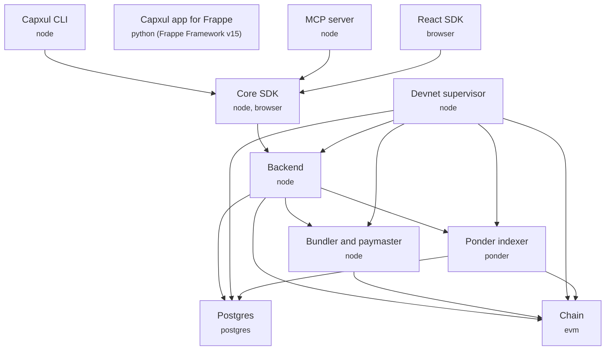
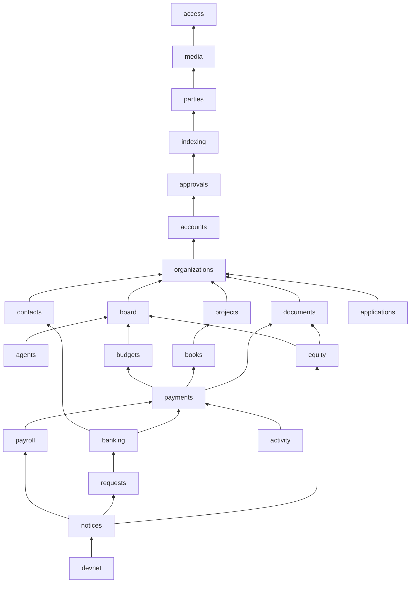

# Target architecture

> **Read with Aaron's decision of 8 November 2026** (`system.frozen-behaviour`): the freeze keeps
> behaviour, not spelling. Where a judgment below argues from "P10 rung 1: the frozen text is
> surface" about a command, flag, `--json` shape, refusal code or exit code, that reasoning no
> longer binds the spelling: the target designs it, and a change carries a decision. The behaviour
> the reasoning protected is still kept. The as-is book is closed and archived in
> `docs/as-is/archive/`.

Status: **decided by Claude, 7 and 8 November 2026 (brought up to date with the concept designs at assembly), for Aaron's review** (W1: Aaron reviews the
data model and boundaries per concept). It rests on the accepted decisions A1 to A4 and P1 to P10
([README](README.md), [policy pack](policy-pack.md)). Every judgment below is a typed decision
record in [`blueprint/shared/decisions.ts`](../../blueprint/shared/decisions.ts), linked to
the records it affects; this page is their readable account. Where this page and the records
differ, the records win.

The records it explains:

| File | What it holds |
|---|---|
| `blueprint/shared/foundation.ts` | the system and its actors, 11 components, 23 concepts, 2 environments, `OPERATION_OWNERS` (the concept that designs each of the 215 frozen operations) and `AREA_CONCEPTS` |
| `blueprint/shared/vocabulary.ts` | the 48 error codes the target answers with (no events: each concept defines its machines' events) |
| `blueprint/shared/external.ts` | 12 integrations as Effect services, and 25 contracts: Protocol v4 and the third-party contracts its install wires |
| `blueprint/shared/decisions.ts` | 152 decision records, one per judgment, 23 of them one per concept's dependencies |
| `blueprint/shared/landings.ts` | `OLD_AREAS`: each of the old concepts' 93 areas, where it lands and the decision that put it there |
| `blueprint/CONVENTIONS.md` | the folders, names and target rules every concept designer follows |

The book builds with stage `"target"`, which enforces the target rules:

```sh
cd /home/user/capxul-next
pnpm exec tsc -p blueprint                     # the target and frozen books typecheck clean
node --experimental-strip-types packages/blueprint-engine/src/main.ts blueprint/index.ts /tmp/target
```

The shared records alone report 0 problems. Their gaps are all of five kinds, and each closes as
the per-concept designs land: `empty-concept` (22: no concept owns a table yet), and contract
functions, chain events, integration calls and error codes that nothing uses yet. While the
concept designs land, `blueprint/index.ts` imports each one, and a concept that imports a
sibling file not yet written stops the whole build until that file exists.

## The shape in one paragraph

One Effect 4 service on Node holds every concept as a module, over one Postgres that Ponder writes
too. The Core SDK owns every flow and all signing; the CLI, the MCP server and the React SDK are
its hosts, and the CLI calls one SDK method per command. Nothing in a client talks to the chain,
the bundler or the indexer directly. The 17 old concepts, 15 of which formed one import loop,
become 23 concepts in one dependency order with no cycle: the authority nouns of Protocol v4
(Budgets, Agreements, Hats and the Signer Gate, AgentOwner, the equity clones) each get one owner,
every person's UserOperation goes through one approvals concept, every Payment settles from one
chain event, and every email is sent by one notices concept that nothing depends on.

## Components



| Component | Runs on | Exposes | Depends on |
|---|---|---|---|
| Backend (`backend`) | node | rpc, http, ws | `postgres`, `ponder`, `chain`, `bundler-paymaster` |
| Bundler and paymaster (`bundler-paymaster`) | node | http | `chain` |
| Chain (`chain`) | evm | http | nothing |
| Capxul CLI (`cli`) | node | cli | `core-sdk` |
| Core SDK (`core-sdk`) | node, browser | none | `backend` |
| Devnet supervisor (`devnet`) | node | cli, http | `chain`, `postgres`, `ponder`, `bundler-paymaster`, `backend` |
| Capxul app for Frappe (`frappe-app`) | python (Frappe Framework v15) | http | nothing: installed on a connected head, the head's half of the `frappe-head` integration (`aaron.frappe-head`) |
| MCP server (`mcp-server`) | node | http | `core-sdk` |
| Ponder indexer (`ponder`) | ponder | http | `chain`, `postgres` |
| Postgres (`postgres`) | postgres | sql | nothing |
| React SDK (`react-sdk`) | browser | none | `core-sdk` |

There is no cycle. The old one (the backend read the indexer, and the indexer fetched the
backend's JWKS to authorize its SQL endpoint) is gone: the backend reads Ponder's tables as views
in the same Postgres, row-level security scopes them, and Ponder calls nothing. The Core SDK's
devnet entry reaches the devnet supervisor through an integration (`devnet-control`), not a
component edge, so nothing on staging depends on the devnet.

Environments: **devnet** runs all ten components on one machine (Anvil forking Base Sepolia, a
real Postgres from a pinned binary, Ponder, alto with the mock paymaster, the backend, the SDK
hosts, the supervisor), with eval worlds as the supervisor's snapshots of chain, database and
Ponder together, booting within 2 minutes. **Staging** is new: a fresh v4 deployment on Base
Sepolia, nothing migrated from old staging (which keeps running until Aaron turns it off), its host
chosen at the spine (Y3).

## The concept map

Each concept is defined after everything it depends on, so a cycle cannot even be written in
`foundation.ts`, and the build's `cycle` rule checks it again. `dependsOn` lists the only concepts
whose tables a concept may read, whose procedures it may invoke and whose rpcs its flows may
compose. A concept that must learn of another's change without depending on it does not: the
dependency always points from the concept that reacts to the concept that changed.

| # | Target concept | Owns | Absorbs (old concepts) | Depends on | Ops |
|---|---|---|---|---|---|
| 1 | **access** | Principals (a person by email, an agent by its Safe), sessions, sign-in codes and agent key challenges, MCP OAuth grants (assistant grants), feature gates; the commands that touch only this machine | access | nothing | 10 |
| 2 | **media** | Stored files (logos, photos, identity documents) and the rules that admit them | media | access | 0 |
| 3 | **parties** | The directory: one Party per person, agent, Organization or outside address, with its handle, Safe and owner; profiles; destinations; recipient resolution. Procedure `parties.register` | parties, profiles | access, media | 0 |
| 4 | **indexing** | Ponder's tables as Safe-scoped views: every chain fact the product reads. No workflow | indexing, permissions | parties | 0 |
| 5 | **approvals** | Every UserOperation from a person's or an agent's own Safe: sponsorship, signature, one send, chain proof. One durable process per approval. Procedure `approvals.open` | accounts, payments | access, indexing | 0 |
| 6 | **accounts** | A person's way in: admission (waitlist, referrals), the `auth login` and `auth verify` flows, the personal Safe's setup, test-network grants. Procedure `accounts.admit` | access, accounts, operator | access, parties, indexing, approvals | 11 |
| 7 | **organizations** | The workspace: record, setup and install, deployment (hat ids, Roles, Gate), members (Seats), invitations, `use org` | organizations | access, media, parties, indexing, approvals, accounts | 14 |
| 8 | **board** | Directors, the threshold, Board proposals, officer hats (Books, Invoicing, People) by `org member grant` and `revoke`. Procedure `board.propose` | organizations, permissions | access, parties, indexing, approvals, organizations | 19 |
| 9 | **agents** | Agents owned through AgentOwner: create, freeze, unfreeze, rotate key, sweep, remove | accounts | access, parties, indexing, approvals, accounts, organizations, board | 8 |
| 10 | **projects** | Projects in ERPNext's shape: projects and their users, tasks, timesheets and their time logs, activity and project types, Projects Settings; its start-up and head sync. New in the rebuild; no frozen operation | none (new) | access, parties, organizations | 0 |
| 11 | **budgets** | The v4 budget tree: top budgets, departments, teams and allowances, office hats, payout ceilings; the one Board proposal of an invitation's grants (`org member invite`) | organizations, payroll, permissions | access, parties, indexing, approvals, organizations, board | 19 |
| 12 | **books** | The books in ERPNext accounting's shape: the Company's accounting, the Account and Cost Center trees, tracked assets and the added-token scan, USD prices, annotations, the gap-free feed of book facts and the vouchers they post, a head's own vouchers, reports, reconcile, QuickBooks export. Procedures `books.record-money-fact`, `books.reverse-money-fact`, `books.record-payroll-accrual` | activity, books, indexing | access, indexing, organizations, projects | 17 |
| 13 | **documents** | The exact content behind every on-chain document hash, memos, render, export and verify. Procedure `documents.store` | documents | access, parties, organizations | 4 |
| 14 | **contacts** | The address book of a person or an Organization, and each Organization's CRM in Frappe CRM's shapes: contacts and organizations with or without a Party, leads and deals, synced with a connected head | parties | access, parties, indexing, organizations | 5 |
| 15 | **payments** | The Payment ledger: commands, routes, dated payments, settlement from `PaymentSent`, reversal, Payments born from chain facts, Movements. Procedure `payments.prepare-command` | indexing, payments | access, parties, indexing, approvals, accounts, organizations, board, budgets, books, documents | 8 |
| 16 | **payroll** | Frappe HR's payroll (Employees, components, structures and assignments, Payroll Entries and Salary Slips, paid through `payments.prepare-command`, the accrual through `books.record-payroll-accrual`) beside v4 Agreements: salaries, streams and retainers from a budget | payroll | access, parties, indexing, approvals, organizations, board, budgets, books, documents, payments | 11 |
| 17 | **banking** | Bridge: KYC and KYB, bank details, deposits, saved bank accounts, payouts, the webhook inbox, the `invite accept` and `contact get` flows. Procedure `banking.match-deposit` | banking, parties | access, media, parties, indexing, approvals, organizations, budgets, books, contacts, payments | 12 |
| 18 | **requests** | Requests and invoices, the payer's inbox, fixed-price services, link checkout, deposit matching; an Invoice for logged hours marks them through `projects.bill-time` | requests | access, parties, indexing, approvals, organizations, projects, budgets, documents, payments, banking | 14 |
| 19 | **applications** | Bootstrap and its origin token, the deployment's health, registered applications, keys and origins, quickstart keys | applications, operator | access, indexing, organizations | 6 |
| 20 | **equity** | Share classes, cap table, vesting, options, rounds and SAFEs, exits, shareholder votes (low priority) | organizations | access, parties, indexing, approvals, accounts, organizations, board, documents | 38 |
| 21 | **activity** | The money read model for whoever you act as: the feed, balances, `address` | accounts, activity, organizations | access, parties, indexing, organizations, budgets, books, documents, payments | 6 |
| 22 | **notices** | Every email after a change, one workflow per notice kind, with delivery records; no frozen operation | operator, payments | access, parties, accounts, organizations, board, budgets, payments, payroll, banking, requests, equity | 0 |
| 23 | **devnet** | Every devnet-only tool: `dev approve`, gates, scripted prices, the mail sink, notices' delivery records, due jobs, snapshots and time | operator | access, approvals, organizations, notices | 13 |

"Ops" is the number of frozen operations the concept designs. Media, parties, indexing and
approvals design none: they serve the concepts above them.

The dependency graph, reduced to the edges that are not implied by others (28 of 122 edges
shown; arrows point at what a concept depends on):



### Where the old concepts went

`OLD_AREAS` maps each of the 93 old areas (the 91 area folders under
`packages/backend/src/<concept>/` and the root files of documents and parties). Every one lands in
a target concept, or leaves the concepts by a decision:

| Old concept | Lands in | Dropped areas |
|---|---|---|
| access | access, accounts | none |
| accounts | agents, approvals, activity, accounts | lanes (`responsibilities.service-lanes`) |
| activity | books, activity | overlays (`responsibilities.overlays`) |
| applications | applications | repairs (`responsibilities.repairs`) |
| banking | banking | none |
| books | books | none |
| documents | documents | none |
| indexing | indexing, payments, books | drifts (`concepts.indexing`) |
| media | media | none |
| operator | devnet, applications, accounts, notices | fixtures (`responsibilities.operator-proof-tools`), identities (`responsibilities.operator-proof-tools`), probes (`concepts.devnet`), receipts (`responsibilities.operator-proof-tools`) |
| organizations | board, equity, organizations, budgets, activity | roles (`responsibilities.roles`) |
| parties | parties, banking, contacts | none |
| payments | payments, approvals, notices | none |
| payroll | payroll, budgets | groups (`payroll.scope`), terms (`payroll.scope`); runs land in payroll as Frappe HR's Payroll Entry and Salary Slip (`payroll.scope`) |
| permissions | budgets, board, indexing | commands (`concepts.permissions-dissolved`) |
| profiles | parties | none |
| requests | requests | none |

`accounts/lanes` is not lost: one send in flight per service key is the `service-signer`
integration's rule.

### Which concept designs each operation

Areas are how people find commands, not concepts. Each old-book area has a primary concept:

| Old area | Concept |
|---|---|
| accounts | accounts |
| activity | activity |
| banking | banking |
| books | books |
| departments | budgets |
| devnet | devnet |
| equity | equity |
| governance | board |
| organizations | organizations |
| payments | payments |
| payroll | payroll |

An operation moves out of its area's concept when its behaviour belongs elsewhere, or when its one
flow composes rpcs of a concept its area's concept may not depend on (a flow sits in a concept that
depends on every concept it composes):

| Concept | Operations that move to it from another area's concept |
|---|---|
| access | `auth.list`, `auth.logout`, `auth.switch`, `config.telemetry.off`, `config.telemetry.on`, `config.telemetry.status`, `schema`, `use.env`, `use.personal`, `whoami` |
| accounts | `dev.fund` |
| activity | `address`, `balance` |
| agents | `agent.create`, `agent.freeze`, `agent.key.rotate`, `agent.list`, `agent.remove`, `agent.show`, `agent.sweep`, `agent.unfreeze` |
| applications | `doctor`, `key.create`, `key.list`, `key.revoke`, `key.rotate`, `dev.key` |
| banking | `verify.start`, `verify.status`, `invite.accept`, `contact.bank.add`, `contact.get` |
| books | `activity.annotate` |
| budgets | `org.allowance.assign`, `org.allowance.change`, `org.allowance.create`, `org.allowance.get`, `org.allowance.list`, `org.allowance.replace`, `org.allowance.revoke`, `org.member.invite` |
| contacts | `contact.add`, `contact.hide`, `contact.label`, `contact.list`, `contact.unhide` |
| documents | `document.export`, `document.get`, `document.render`, `document.verify` |
| equity | `org.vote.create`, `org.vote.execute`, `org.vote.list`, `org.vote.show`, `org.vote.wait`, `vote.cast`, `vote.delegate`, `vote.list` |
| organizations | `use.org`, `invite.decline`, `invite.list`, `org.invite.cancel`, `org.invite.list`, `org.invite.resend`, `org.member.get`, `org.member.list` |
| payments | `org.department.pay` |
| requests | `bank.match`, `inbox.decline`, `inbox.get`, `inbox.list`, `inbox.pay`, `request.cancel`, `request.get`, `request.issue`, `request.list`, `service.create`, `service.deactivate`, `service.get`, `service.list`, `service.revise` |

(81 of 215 move; the rest sit in their area's concept.)

## The target rules, in short

The full text is [CONVENTIONS.md](../../blueprint/CONVENTIONS.md). What a concept designer must
hold to, and why:

- **Events:** one per state machine, `<machine>_transitioned`, defined beside it in the concept's
  `data.ts`, sent by every transition; no rpc, workflow or procedure sends one (P7). The runtime
  writes it to the outbox in the transition's transaction; the outbox and the relay are runtime,
  not records (`rules.outbox`).
- **Budgets:** the class defaults of `packages/blueprint-engine/src/budgets.ts`, with a one-line `why` on any
  override (P5).
- **Tenancy:** every tenant table leads its key and every index with its tenant column; no tenancy
  by join; a `global` table has no tenant, holds nothing private and is written only through its
  own concept (`rules.global-tenancy`); chain tables are Ponder's, read through parties' directory
  of Safes (P8, `concepts.parties-scope`).
- **Acceptance:** each frozen line becomes `{claim, observes, was}`, rewritten only where it names
  a mechanism no black box sees (P1).
- **Time:** an rpc is one transaction; each long-lived object is one durable process that owns its
  machine (A3). The list is `rules.durable-processes`: an approval, a Payment (one process for its
  command and its date), a Board proposal, an Organization's setup, a personal Safe's setup, an
  agreement, a request, an invitation, a bank payout, a verification, an agent change and a round,
  and the objects designers added (an assistant grant, an identity document, a budget change, an
  equity install, grant, sale and vote). The runtime wakes a waiting process by the key its event
  carries (`rules.process-wakeups`). Only P3's crons survive.
- **Writes across concepts:** a procedure only for one money fact (`rules.procedures`): eight are
  named, plus one authority fact, `accounts.admit` (`procedures.accounts-admit`). Everything else
  that follows another concept's change is a workflow in the reacting concept, triggered by the
  other's transition. `sys:tx-width` counts what one run of an rpc invokes itself; a wider one
  needs a decision (`rules.transaction-width`).
- **No unreached rpc** (P2), and **one SDK flow per multi-step operation, the CLI calling one SDK
  method** (A4).
- **Shared records:** every error code is in `vocabulary.ts`; every outside call and contract
  function is in `external.ts`. A "no" to a terminal preview is CANCELLED everywhere
  (`vocabulary.declined-preview-cancelled`).

## Integrations and contracts

| Integration | Effect service | Host | Calls (timeout per attempt, retries) |
|---|---|---|---|
| Bridge: verification, bank details, deposits and payouts (`bridge`) | `Bridge` | backend | submitVerification (10 s, 2), getVerification (10 s, 2), openBankDetails (10 s, 2), readBankDetails (10 s, 2), setDepositToken (10 s, 2), addBankAccount (10 s, 2), quotePayout (10 s, 2), listEvents (10 s, 2) |
| Bundler and paymaster: sponsor, send, follow (`bundler`) | `Bundler` | backend | sponsor (4 s, 1), send (5 s, 0), lookup (2 s, 2) |
| Chain JSON-RPC: Base nodes (`chain-rpc`) | `ChainRpc` | backend | readContract (1.5 s, 2), getCode (1.5 s, 2), getBlock (1.5 s, 2), getTransactionReceipt (1.5 s, 2), getLogs (5 s, 2) |
| Chainlink price feeds (`chainlink`) | `Prices` | backend | usdRate (1.5 s, 2) |
| The devnet supervisor's control socket (`devnet-control`) | `DevnetControl` | core-sdk | snapshotSave (60 s, 0), snapshotRestore (60 s, 0), snapshotList (2 s, 0), clockShow (2 s, 0), clockWarp (30 s, 0), clockStartAt (30 s, 0) |
| Indexer: Ponder's progress and a transaction's facts (`indexer`) | `Indexer` | backend | head (0.5 s, 0), awaitBlock (10 s, 0), factsOf (1 s, 1) |
| Email through Resend (`mail`) | `Mail` | backend | send (10 s, 0) |
| Openfort embedded signer in the Core SDK (`openfort`) | `Signer` | core-sdk | getAddress (10 s, 1), signDigest (60 s, 1) |
| Openfort Shield: the wallet's recovery session (`openfort-shield`) | `Shield` | backend | createEncryptionSession (5 s, 1) |
| PostHog through the connector gateway (`posthog`) | `Analytics` | backend | capture (5 s, 5), exportTelemetry (5 s, 3), flags (5 s, 2) |
| Capxul's service keys: signed chain transactions (`service-signer`) | `ServiceSigner` | backend | send (10 s, 0), waitForReceipt (60 s, 3) |

Timeouts and p95s come from P5's hop table, so each call fits the budget class of what makes it;
the old 30 s per attempt is gone (`integrations.timeouts`). A call that moves money (the bundler's
`send`, the service signer's `send`) is never retried: a lost answer is looked up, never resent
(K4). Plain reads of indexed facts are table reads of indexing's views; only what depends on
Ponder's progress is a call (`integrations.indexer`). PostHog is reached only through the
connector gateway, and nothing waits on it (`integrations.posthog`).

Contracts (P9: v4 only, devnet addresses until staging's fresh deployment): `agent-owner`, `agreements`, `budgets`, `captable`, `companies-house-claimer`, `company-safe-minter`, `entry-point`, `erc20`, `escrow`, `escrow-factory`, `exits`, `governor`, `hats`, `hats-elections`, `hats-signer-gate`, `installer`, `multi-send-call-only`, `options`, `payments`, `roles`, `rounds`, `safe`, `safe-4337-module`, `share-class`, `vesting`. Each
records the functions the frozen designed text calls or reads and the events a concept must follow
(`contracts.functions`).

## What the adversarial review changed (8 November 2026)

A third pass read the map against the frozen surface, the policies and what the first concept
designers could not build inside it. Each change is a decision record:

| Change | Why | Record |
|---|---|---|
| `org member invite` moves from board to budgets | Its one Board proposal can create a new allowance (`Hats.createHat`, `Budgets.createChildBudget`), which only budgets can plan; board sits below budgets, so the budgets designer had narrowed the frozen offer to existing allowances | `operations.member-invite-in-budgets` |
| `dev mail notices` moves from notices to devnet; devnet depends on notices | A devnet-only operation may not live in a concept staging runs (P2, rule 7) | `operations.dev-mail-notices-in-devnet` |
| `contact get` moves from contacts to banking | It returns the contact's bank accounts, which are banking's, and contacts sits below banking | `operations.contact-get-in-banking` |
| Requests and banking depend on approvals and budgets | An agent payer signs `inbox pay` and `bank pay` at once, and `--from` names a budget by its key | `dependencies.payers-sign-and-name-budgets` |
| Budgets depends on parties | Holders and wearers are named by email or an agent's `@handle` | `dependencies.budgets-parties` |
| Notices depends on budgets | The member is emailed an allowance once its assign executes | `dependencies.notices-budgets` |
| The bundler's sponsorship maps `OverBudget` and the payout ceiling to PAYROLL_BUDGET_EXCEEDED, and the other budget reverts to their own codes | The frozen designed refusals say so; it had said INSUFFICIENT_BALANCE and ROLE_PERMISSION_DENIED | `integrations.sponsor-refusals` |
| Capxul's service keys sign in the backend | A4 gives the SDK every signature an actor gives; the claim role, tier key, Budgets executor, escrow relayer and faucet are Capxul's own | `components.service-keys` |
| The ERC-20 record gains the test tokens' `mint` | `dev fund` and the welcome grant mint test money | `contracts.test-token-mint` |
| `doctor`'s exit 124 is the command's | Frozen surface; NETWORK_ERROR keeps exit 5 everywhere else | `vocabulary.doctor-deadline-exit` |

Designers already at work should pick these up: budgets books `org member invite` (and can offer
a new allowance again), banking books `contact get`, devnet books `dev mail notices`, requests and
banking may now call approvals' and budgets' rpcs, and approvals' process answers a budget revert
with the budget codes.

## What the assembly changed in the shared records (8 November 2026)

When the 22 concept designs were assembled, their designers had listed what they needed from the
shared records, or where the shared records no longer said what their designs do
([assembly-items.md](assembly-items.md)). Each change is a decision record:

| Change | Why | Record |
|---|---|---|
| Access no longer names the device flow's client grants; applications owns no consent; the backend has no JWKS route; MCP_EXCHANGE_SECRET leaves both environments | Access dropped the device flow and applications the consent table (P2); tokens are found by their hash in the request's transaction | `concepts.no-device-flow-or-consent` |
| The list of long-lived objects matches the designs: one process per Payment, plus an assistant grant, an identity document, a budget change and equity's install, grant, sale and vote | The designers added or merged objects under their own decisions | `rules.durable-processes` (rewritten in place) |
| `sys:tx-width` counts what one run of an rpc invokes itself (its widest branch); a door's nested invocations count against the door | An invoker cannot change what a door does; counting it would split money facts | `rules.transaction-width` |
| The runtime wakes a waiting process by the key its event carries (opener and subject; chain, sender, nonce) | Approvals, payments, budgets, payroll and equity wait on other concepts' events; the A2 spike must prove the delivery | `rules.process-wakeups` |
| A `global` table is written only through its own concept, not only by "the system" | Parties' directory is global and written at a person's request; its tenancy stays flagged for Aaron | `rules.global-tenancy` |
| A "no" to a terminal preview is CANCELLED (exit 130) in every command | The frozen book is silent; the old CLI said CLI_USAGE (exit 2); contacts chose CANCELLED and asked for one rule | `vocabulary.declined-preview-cancelled` |
| chain-rpc serves every read of the chain as it is now, not only reads before a write | Notices reads Directors and live figures when it sends; shows read live views | `integrations.chain-rpc-live-reads` |
| Bridge gains `readBankDetails`; no payout cancel; `removeBankAccount` goes | `bank settle` keeps its frozen lines (read before the write, nothing written on an unusable answer); the old client never removed an account at Bridge | `integrations.bridge-bank-details-read` |
| Hats gains `viewHat` (not `getNextId`, which v4 does not call) | Budgets plans a new hat's id from the chain head | `contracts.hats-view-hat` |
| Hats Elections and the Installer's `deployElections` and `buildElections` are recorded | The designed `board-settings`, `elect` and `remove` votes call them through the Governor | `contracts.hats-elections` |
| Twelve equity events are recorded (OptionsAccepted, the SAFE and priced-round events, RoundCancelled, SaleApproved, TransferOffered, TransferApproved, Vesting's Granted and Revoked) | Equity's processes follow them | `contracts.equity-events` |
| No checkpoint reads for `org cap-table --at` | The designed call says `--at` is not built yet; ERC20Votes checkpoints votes, not holdings | `contracts.no-checkpoint-reads` |

Two designers also edited `external.ts` themselves, under their own decisions: devnet gave the
`devnet-control` calls the refusals the frozen pages name (`snapshotSave` WRONG_STATE for a taken
name and INVALID_INPUT for a bad one, `snapshotRestore` WRONG_STATE for a world saved with other
backend code, `clockStartAt` INVALID_INPUT for a date not earlier and WRONG_STATE once the clocks
moved) and had the Chainlink fake answer the frozen default rates (`devnet.control-refusals`,
`devnet.scripted-prices`); equity added 14 view and call functions to its contracts
(`equity.contract-functions`). Smaller alignments: the Bridge fake says the sandbox sends a
sandbox deposit's test tokens itself (`banking.sandbox-deposits`), the QuickBooks export's landing
says the CLI writes the files (`books.export-files-by-cli`), and the backend's about names the
bootstrap's origin token (`applications.origin-token`).

Declined: Bridge's `cancelPayout` (no frozen line needs it; a changed account withdraws the
unsigned approval), Hats' `getNextId` (not in v4's IHats, and it closes no race `viewHat` leaves
open), and Escrow's `InvoicePaymentCompleted` (nothing reads the surplus it reports).

## What the builder changed when the book was assembled (8 November 2026)

The assembled book registers all 22 concepts of the time (projects, the 23rd, came with the Frappe redesign) and books each of the 215 frozen operations exactly
once, in its owner's `operations.ts`. The concept fixers' work changed two things a reader of this
page should know about: `contact get` is banking's flow `client.account.address-book.get` (contacts'
picker and entry read, then the new query `banking.accounts.list-for-contact`, decision
`banking.contact-get`), and `bank settle` reads the virtual account through Bridge's
`readBankDetails` before it writes (`banking.settle-reads-first`).

The builder applied the asks the fixers left for others. Each change is a decision record:

| Change | Record |
|---|---|
| The schema says what the book had only said in prose: a flow names the surfaces that call it (`surfaces`), a wait names the chain events that end it (`events`); target rule `flow-surface` | `rules.surfaces-and-wait-events` |
| Budgets plans a new hat's id from `Hats.viewHat`'s `lastHatId` at the chain head, not from indexing | `budgets.hat-planning` (revised) |
| A payout's return fact references the payout's Payment, and the quote states `pay_at` null and `resume` false | `banking.payout-return-reference` |
| Reclassify's straddling row has its own world, `org-with-straddling-payout`, built on `org-with-chart` | `devnet.straddling-payout-world` |
| A declined terminal preview ends CANCELLED in `org create`, `org retry`, `invite decline`, `org invite cancel`, `org invite resend`, `activity annotate` and `invite accept`; the refused `org director` writes ask nothing | `organizations.declined-previews`, `books.annotate-declined-preview`, `banking.invite-accept-declined`, `board.director-refusals-ask-nothing` |
| Waits on another concept's transition or a chain event name their routing key | `rules.process-wakeups` (applied) |
| `agents.transaction-width` is closed by `rules.transaction-width` | `agents.transaction-width` (revised) |

## For Aaron

The records settle everything under the accepted decisions. Three judgments go furthest beyond
them and are the ones to look at first:

1. **`procedures.accounts-admit`** (accepted by Aaron). P4 allows a cross-concept write in one
   transaction only for one money fact. An Organization invitation "admits the invitee to the
   beta", admission is accounts' and accounts sits below organizations, so neither the outbox nor
   a flow step can carry it. The design admits one *authority* procedure, `accounts.admit`. Since
   `aaron.money-waiting-reminders`, payments invokes it too, when money starts waiting in a claim
   escrow (`accounts.money-waiting-admits`).
2. **`concepts.payroll`** (superseded by `payroll.scope`, under `aaron.frappe-shape`). Payroll
   runs first were dropped; they are now Frappe HR's Payroll Entries and Salary Slips, paid through
   `payments.prepare-command`, beside the v4 Agreements.
3. **`operations.invite-accept-in-banking`.** `invite accept` routes a business verification
   invitation (`inv_kyb_`) to banking and every other one to organizations, so its one flow sits in
   banking. The Organization invitation's rpcs and state stay organizations'.

Two readings from the assembly are worth a glance too: `vocabulary.declined-preview-cancelled`
(a "no" at a terminal preview now exits 130 with CANCELLED, where the old CLI exited 2), and
`rules.transaction-width` (a door's nested procedures do not count against its invoker, so only
payments' prepare and propose are wider than the rule, under `payments.birth-width`).

## Every judgment

Each entry is one record in `blueprint/shared/decisions.ts`, by id. The dependency reasons per
concept follow in the next section.

### Components

- **One backend service on Node, with its durable work inside it** (`components.backend`). *Chosen:* One Effect 4 Node service hosts every concept's rpcs, HTTP routes and durable processes (Effect Workflow and Cluster on Postgres). *Why:* A1 fixes Effect 4 on Node and A2 fixes Effect Workflow and Cluster on Postgres. Concepts are modules, not services: a procedure runs in its invoker's transaction, which only one process and one database can give. Cluster already runs the workflow runners inside the same service and spreads them over its instances, so a separate worker adds a deploy and a network hop for nothing. If the A2 spike fails, DBOS runs in the same process, so this choice survives it. *Not chosen:* *per-concept*: One service per concept, talking over the network. *split-worker*: One request service and a separate worker service for workflows.

- **Bundler and paymaster are one component, called only by the backend** (`components.bundler-paymaster`). *Chosen:* One component (the AA gateway on staging, alto with the mock paymaster on a devnet); only the backend calls it. *Why:* Staging serves both behind one URL and one token, and the backend reads no gateway secret but that URL, so two records would describe one thing. Sending stays server-side because the approval's durable process must own the one send and its lookup (K4: one send per signed operation), and the paymaster's token must not ship in a client. A4 gives the SDK signing, not sending. *Not chosen:* *two*: Book the bundler and the paymaster as two components, as the old book did. *sdk-calls*: Let the SDK send its own UserOperations to the bundler after signing.

- **The CLI calls exactly one SDK method per command** (`components.cli`). *Chosen:* Each command calls one Core SDK method; the CLI parses, prompts, prints and exits, nothing else. *Why:* A4. The old CLI held about 20k lines of orchestration that duplicated the SDK, imported the protocol package in 64 files and called the backend Site directly in three places. With one method per command, the operation's `implementedBy` is that method's flow or rpc, and the React app and the MCP server get the same behaviour. *Not chosen:* *orchestrate*: Keep the CLI's own helpers that compose SDK and protocol calls.

- **The Core SDK owns every flow and all signing, and calls only the backend** (`components.core-sdk`). *Chosen:* Flows and signing in the SDK (A4); it reaches only the backend's rpcs, never the indexer, the chain or the bundler. *Why:* A4 accepts the first half. The second follows from P8: a direct indexer read needs its own authorization, which is what built the old component cycle; an rpc over a Safe-scoped view gets tenancy from row-level security for free. One path also gives one span tree per operation (P6). *Not chosen:* *direct-reads*: Keep the old SDK's direct indexer reads for balances and history.

- **The devnet is a component: a supervisor with a real Postgres** (`components.devnet`). *Chosen:* A supervisor process that boots the stack, deploys v4, snapshots worlds and clocks; a real Postgres server from a pinned binary. *Why:* Eval worlds are snapshots of the chain, the database and Ponder together, so something must own them: the supervisor. The backend and Ponder share one Postgres with row-level security, which PGlite cannot serve to two processes; Docker is not available in the swarmD sandboxes the spec targets. A pinned Postgres binary boots in seconds. *Not chosen:* *pglite*: Keep the old devnet's PGlite for the indexer, and give the backend its own store. *docker*: Run the stack in Docker Compose.

- **Stored files live in Postgres** (`components.files`). *Chosen:* In Postgres, behind a BlobStore service, with media's size limits (24 MB at most). *Why:* A1 says one Postgres, and the files are few and small: logos, photos and identity documents of at most 24 MB. A bucket would add a component, a secret and a second thing to snapshot in every devnet world. The BlobStore service makes a move to a bucket a layer change if volume ever needs it. *Not chosen:* *object-store*: An S3-compatible bucket as an eleventh component.

- **The component graph has no cycle** (`components.graph`). *Chosen:* chain, postgres: none; ponder: chain, postgres; bundler-paymaster: chain; backend: postgres, ponder, chain, bundler-paymaster; core-sdk: backend; react-sdk, cli, mcp-server: core-sdk; devnet: everything it boots. *Why:* The old backend read the indexer and the indexer fetched the backend's keys: a cycle the as-is build reports. Reading Ponder in Postgres removes the indexer's edge to the backend. The Core SDK's devnet entry reaches the supervisor through an integration, not a component edge, so a staging client depends on nothing devnet. *Not chosen:* *as-is*: Keep the old edges: the indexer fetching the backend's JWKS and the SDK reading the indexer.

- **The MCP server is a Core SDK host like the CLI** (`components.mcp-server`). *Chosen:* Its tools call Core SDK methods with the person's OAuth grant, like the CLI. *Why:* Its tools are the same operations as CLI commands, so they should be the same flows; the OAuth grant is access' and reaches it through the SDK. *Not chosen:* *backend-direct*: Its tools call the backend's rpcs directly.

- **Ponder writes its schema; Capxul reads it in Postgres, never over HTTP** (`components.ponder`). *Chosen:* The backend reads Ponder's tables as views in the same Postgres; Ponder serves only health and metrics and calls nothing. *Why:* The old indexer authorized every query against a signed `safes` claim it verified with the backend's JWKS, so the indexer depended on the backend and the backend on the indexer: a component cycle. With views in the same Postgres, row-level security does the scoping (P8), the SDK reads through rpcs, and Ponder depends only on the chain and Postgres. The SQL-over-HTTP path also forced compiled query shapes to authorize; views need none. *Not chosen:* *sql-http*: Keep Ponder's `/sql/db` and `/sql/live` HTTP endpoints, authorized by a session claim, read by the backend and the SDK.

- **One Postgres with an app schema and a Ponder schema** (`components.postgres`). *Chosen:* One database: `app` (concept tables with RLS, workflow state, outbox, files) and `ponder` (Ponder-owned, read through views). *Why:* A1 says one Postgres with Ponder on it, and P8 reads chain facts through views joined to the Safe-ownership table, which needs both in one database. Ponder rebuilds its own schema on a reindex, so it must be separate from the app's and nothing in `app` may hold a foreign key into it. A schema per concept adds nothing the book's boundary rules do not already check, and makes every procedure's transaction span schemas for no gain. *Not chosen:* *two-databases*: Separate databases for the app and for Ponder, joined by the application. *schema-per-concept*: One schema per concept plus Ponder's.

- **The React SDK projects the Core SDK and nothing else** (`components.react-sdk`). *Chosen:* Hooks over Core SDK flows and live rpcs; no transport and no logic of its own. *Why:* One client implementation keeps one span tree and one error mapping. Live rpcs replace the 27 Convex subscriptions, so React needs no transport of its own. The approval page is built on it. *Not chosen:* *own-transport*: Keep a React-side subscription transport, as the old Convex hooks had.

- **A4's 'all signing' is the actor's; Capxul's service keys sign in the backend** (`components.service-keys`). *Chosen:* In the backend's service-signer integration: each key does one job on chain, never for a person or an agent. *Why:* A4 is about the actor's authority: every flow and every signature a person or an agent gives is the SDK's, and the backend never holds their keys (integrations.openfort). The service keys are Capxul's own, held in the operator's store, and the designed text names them ('Companies House's claim role, held by a Capxul service key in Infisical'; the tier key sends `Installer.deployMoney`; Budgets' executor runs a dated payment on its day). A client cannot hold them, and the actor's own Safe cannot replace them: the claim exists because the person has no Safe yet, and a dated payment is sent when nobody is there. Each key can do only its one job on chain, and the integration keeps one send in flight per key (responsibilities.service-lanes). *Not chosen:* *sdk*: In the Core SDK, with the service keys shipped to clients. *none*: Drop every service-key transaction and have the actor's own Safe send each one.

### Concepts: merges, splits, renames

- **Access keeps sign-in and sessions and moves to the bottom** (`concepts.access`). *Chosen:* Principals, sessions, sign-in, assistant grants and gates; the waitlist, referrals, consent and the indexer scope leave it. *Why:* Every concept asks access who is calling, so it must depend on nothing. The old imports were for what moves out: the indexer read scope needed the person's and Organization's Safes (now row-level security), the waitlist's earned invites needed live Safes (now accounts, from the chain), and consent needed applications (now applications'). An agent signs in by key; that is proved on chain (`AgentOwner.agentOf` and the Safe's owners through chain-rpc), so access needs no agents table. Feature gates stay: 39 frozen refusals in 30 operations of six areas name FEATURE_NOT_AVAILABLE, so they sit below everything; a gate for an Organization keys on its id as a value. The commands that sign in and then report the account's setup are accounts' flows (operations.sign-in-in-accounts). The device flow's native client grants are not ported (concepts.no-device-flow-or-consent). *Not chosen:* *as-is*: Keep access as it was, importing accounts, applications, organizations, parties and profiles.

- **Accounts keeps the personal Safe and gains admission** (`concepts.accounts`). *Chosen:* Accounts owns admission (waitlist, referrals), the personal Safe's setup and test-network grants. *Why:* A referrer earns an invite when the person they referred gets a live Safe, so referrals need Safe claims: in access that would put access above accounts and break the bottom. Counting claims from the chain (CapxulSafeClaimed) lets accounts own both without a loop. Admission and the Safe's setup are one journey (join, be admitted, set up your Safe), so a separate concept would be a boundary inside one flow. Approvals, agents and balance reads leave for their own concepts. *Not chosen:* *admission-concept*: A separate admission concept for the waitlist and referrals. *access*: Keep the waitlist and referrals in access.

- **Activity is the read model at the top** (`concepts.activity`). *Chosen:* Activity reads payments, indexing, budgets, books and documents to serve the feed, balances and `address`. *Why:* A balance answers for whoever you act as, a person or an Organization, and its 'available' amount needs pending payments; a feed row shows its account and documents. Only a concept above payments, books and organizations can read all of that, and nothing needs to read activity back. In accounts, balances would pull accounts above payments. *Not chosen:* *accounts*: Balances and `address` stay in accounts.

- **New concept: agents, split from accounts** (`concepts.agents`). *Chosen:* Agents is its own concept above the Board, because an Organization can own an agent. *Why:* With `--org` a Director makes the Organization the agent's owner, and every later change is then a Board proposal, so agents must depend on board. Accounts must sit below organizations (a founder must be admitted and set up first). Both cannot hold in one concept. AgentOwner is also its own v4 contract with its own lifecycle. *Not chosen:* *keep*: Keep agents in accounts.

- **Applications stays separate, above organizations, with health** (`concepts.applications`). *Chosen:* Applications above organizations, owning apps, keys, origins, bootstrap, quickstart keys and health; no consent table. *Why:* An Organization's publishable key needs the Invoicing hat ('For an Organization, a member who holds issue invoices'), so applications must sit above organizations; access must sit below everything. Merging them would make a loop. A person's consent to an application would be the application's record, but nothing in the target writes one: its only writer was the device flow (concepts.no-device-flow-or-consent). `doctor --online` checks the deployment and the app key, which is what bootstrap already describes, so health lives here. *Not chosen:* *merge-access*: Merge applications into access.

- **New concept: approvals, every UserOperation from a person's own Safe** (`concepts.approvals`). *Chosen:* One low concept owns every approval and its one send, opened by the concept that prepares it. *Why:* v4 D1 makes every action a UserOperation from a personal Safe: payments, hat grants, Board approvals, agent changes, budget spends, agreements, equity. The old system spread this over payments' `moneyExecutions` (read at 19 sites by its neighbours), accounts' approvals and lanes, and borrowed executions, and that sharing was one of the import loops. One concept gives one approval page, one `dev approve`, one sponsorship and send path that keeps K4 (one send per signed operation) and K6 (only chain proof ends an attempt), and one place for `bud:` on chain-submit. It is 'approvals' because that is the product's word: 'opens your approval in the browser'. *Not chosen:* *per-concept*: Each concept keeps its own executions (payments, permissions, accounts, organizations), as the old code did. *platform*: A shared library outside the book, with each concept owning its rows.

- **Banking gains verification and saved bank accounts** (`concepts.banking`). *Chosen:* Both in banking, with every other Bridge call. *Why:* Verification is Bridge's KYC and KYB and gates only bank transfers ('identity verification for bank transfers'); saved bank accounts are Bridge external accounts used only by bank payouts and encrypted with banking's record key. In banking, every Bridge call and every Bridge secret is in one concept. A business verification invitation (`inv_kyb_`) is banking's too; `invite accept` routes to it by id. *Not chosen:* *parties*: Verification and destinations stay in parties.

- **New concept: board, the Directors, proposals and officer hats** (`concepts.board`). *Chosen:* One board concept above organizations; officer hat grants and revokes are Board proposals there. *Why:* v4 makes every officer permission a hat granted by a Board batch (CAP-1101), and a Board proposal is one company Safe transaction approved by Directors' own approveHash. Grants, Director changes and every other concept's Board batches share that one machine, so it is one concept. It reads members from organizations. An invitation's offered grants become one Board proposal that budgets opens through `board.propose` (operations.member-invite-in-budgets), so organizations never depends on board. *Not chosen:* *organizations*: Keep them in organizations. *permissions*: Keep officer hats in a permissions concept.

- **Books gains annotations and prices** (`concepts.books`). *Chosen:* Both in books: an annotation gives a row its account, which is a book fact; prices value book facts. *Why:* The frozen text says a fact is 'a change to the chart, an account given to a row, or a money event'. If activity owned the annotation, either activity writes a book fact (a cross-concept write that is no money fact) or books reads activity while activity reads books' chart: a loop. In books, `activity annotate` is one transaction. Prices were already `bookPrices`; the Chainlink sync is its writer (P3 keeps it). *Not chosen:* *activity*: Annotations stay in activity, which then writes books' facts or is read by books.

- **Books scans the tokens an Organization adds; indexing has no workflow** (`concepts.books-token-scan`). *Chosen:* Books: one cron scans each added asset's Transfers to and from the company Safe from the block it was added, and writes book facts. *Why:* The frozen text says the books 'record its transfers' and 'Capxul starts scanning its transfers from the current block'; its facts carry the token's symbol and no USD. The scan's only reader is books, and its list of tokens is books' own `assets`. In indexing, the scan would have to follow books' transition, which needs indexing above books, a cycle; a watched-token procedure is not one money fact. In books it reads its own table and the chain (chain-rpc `getLogs`), and `org books assets remove` stops it. Indexing is then Ponder's views only. *Not chosen:* *indexing*: Indexing, triggered by books' asset transition. *indexing-procedure*: Indexing owns a watched-token table that books writes through a procedure.

- **New concept: budgets, from allowances, departments and ceilings** (`concepts.budgets`). *Chosen:* One budgets concept: allowances and departments are both v4 budgets, with office hats and ceilings. *Why:* The designed text says it directly: 'A spending allowance becomes a small budget under a hat the member wears', and a department is a top or child budget. Both are one v4 contract (Budgets), one tree and one authority rule (the wearer of the budget's hat or of any above it). Keeping them apart would duplicate the tree and its authority check. *Not chosen:* *split*: Allowances in permissions and departments in payroll, as the old code had them.

- **New concept: contacts, split from parties** (`concepts.contacts`). *Chosen:* A small contacts concept above organizations. *Why:* An Organization's address book is acted on by its members, which only a concept above organizations can check; parties must stay below organizations because an Organization registers its Party at birth. A hidden runtime check would be a dependency the book cannot see. In payments, banking (bank accounts on a contact) would still have to reach into payments for a non-money record. *Not chosen:* *parties*: Keep contacts in parties and let the runtime check Organization membership. *payments*: Put contacts in payments, as their area suggests.

- **Devnet replaces operator** (`concepts.devnet`). *Chosen:* A devnet concept for devnet-only tools; the faucet to accounts, diagnostics to applications' health, probes dropped, notice records to notices. *Why:* P2 sends operator probes to a devnet concept with devnet-only rpcs, and P8 moves test tables there. The faucet must also work on staging (`dev fund`), so it is accounts' test-network grant. Tenancy probes existed to test tenancy by hand; P8's generated `tbl:<t>/tenancy` evals replace them. The devnet's tables are what the integrations' fakes use, so no production concept depends on devnet. *Not chosen:* *operator*: Keep an operator concept in every environment.

- **Documents stays, below everything that stamps a document hash** (`concepts.documents`). *Chosen:* Below payments, requests and payroll; participants are given when the document is stored. *Why:* A document is born with its subject (K2: a command, its Payments and their documents are born together), so the subject's concept stores it through a procedure and must depend on documents. Documents then cannot read its subjects; giving it the participants at store time means it never has to. *Not chosen:* *as-is*: Keep documents reading payments, requests and books to find a document's participants.

- **New concept: equity, with shareholder votes** (`concepts.equity`). *Chosen:* One equity concept, low priority, including the Governor's votes. *Why:* They are the v4 equity clones (Captable, ShareClass, Vesting, Options, Rounds, Exits, Governor), all low priority and off the critical path (spec 40), so one concept keeps them out of the critical concepts' budgets. Shareholder votes weigh shares and run on the Governor, an equity clone; Board decisions are board's proposals. *Not chosen:* *board-votes*: Equity without votes; votes in board.

- **Indexing keeps its name and owns every chain view** (`concepts.indexing`). *Chosen:* Indexing owns every chain-tenancy view and no workflow; drift reconcile goes; the added-token scan goes to books. *Why:* Ponder is one app with one schema, and the views are read across concepts: Hats wearers by board, budgets, books, requests, applications and organizations; Transfers by payments and activity. Per-concept ownership would force the dependency order to follow the contracts' call graph and still need Hats at the bottom. Old indexing's drift reconcile existed because Convex copied chain rows; nothing copies them now (P3 lists drift only while it is needed). The added-token scan leaves too (concepts.books-token-scan). The name stays: `chain` is already the component, and the old name already meant chain facts. *Not chosen:* *per-concept*: Each concept owns the views of its contract (payments the PaymentSent view, budgets the Budgets views...). *rename-chain*: As one-owner, renamed `chain`.

- **No line budgets on concepts yet** (`concepts.line-budgets`). *Chosen:* Leave `lines` unset; each concept's design sets its budget from its own records. *Why:* A line budget is only as good as the design under it, and the per-concept designs have not been written. The old lines are mostly plumbing (about two thirds of an area is ceremony, and 166 files are emit, intent, load or record), so they would anchor the numbers on the system being replaced, the same objection P5 made to per-operation budgets. *Not chosen:* *now*: Set budgets now from the old lines less the plumbing.

- **Commands that touch only this machine are booked under access** (`concepts.local-commands`). *Chosen:* Access: they read or write the client's own session and environment state, as Core SDK flows with local steps. *Why:* A4 makes each of them one SDK method too. They are about who and where the client is (the current person, the environment, consent to telemetry, what the CLI can do), which is access' question on the client side. A concept with no tables and no rpcs would be an empty concept. *Not chosen:* *cli-concept*: A `cli` concept for client-only commands.

- **23 target concepts in one dependency order** (`concepts.map`). *Chosen:* 23 concepts in this order: access, media, parties, indexing, approvals, accounts, organizations, board, agents, projects, budgets, books, documents, contacts, payments, payroll, banking, requests, applications, equity, activity, notices, devnet. *Why:* 15 of the 17 old concepts formed one import loop, and the loop ran through real responsibilities in the wrong place: permissions inside organizations' authority, executions inside payments, Directors inside organizations, waitlist credit inside access. v4 itself splits them: Budgets, Agreements, Hats and the Signer Gate, AgentOwner and the equity clones are separate contracts with separate authority. Each target concept owns one of those nouns, and its dependencies point only at concepts it must read or invoke. Merging into fewer concepts would break the line budgets (`sys:loc`) and hide ownership (P4 option C's objection). The new ones are small and each has a decision below. Projects, the 23rd, is new in the rebuild (aaron.projects): it sits after agents and below budgets, books, requests and payroll, which read it (projects.dependencies). *Not chosen:* *keep-17*: Keep the 17 old concepts and cut the loop by moving imports. *fewer*: Merge into about 8 large concepts (identity, organizations, money, books, equity, devnet...).

- **Media stays, and owners point at files** (`concepts.media`). *Chosen:* Keep media as the file store at the bottom; logos, photos and verification documents point at media's files. *Why:* Three concepts use files (parties' photos, organizations' logos, banking's identity documents), so a file store under all of them is simpler than three copies. The old media imported organizations, permissions and profiles to bind an image to its owner; inverting the link removes all three edges. *Not chosen:* *merge*: Merge media into parties (photos) and organizations (logos).

- **Access keeps assistant grants only; applications keeps no consent** (`concepts.no-device-flow-or-consent`). *Chosen:* Align them: access owns sessions, sign-in, assistant grants and gates; applications owns no consent; the backend serves no JWKS and admits a browser origin by the bootstrap's origin token; MCP_EXCHANGE_SECRET leaves both environments. *Why:* The shared records are what every designer reads first, and a map that names records no concept builds misleads them. Both drops follow P2: no client starts a device request (the CLI keeps its v1 grant records only to delete them), and the consent table's one writer was the device flow's accept. Access finds an opaque session or assistant token by its hash in the request's own transaction (access.sessions, access.assistants), so nothing needs a JWKS, and the MCP server passes the person's token through the Core SDK with no exchange. The daily client-grant sweep P3 keeps is access' daily sweep of sessions, codes and ended assistant grants. The origin token is applications.origin-token's. *Not chosen:* *keep*: Keep the shared wording and let the concept decisions override it.

- **New concept: notices, every email after a change** (`concepts.notices`). *Chosen:* One notices concept at the top: one workflow per notice kind, triggered by the source concept's transition. *Why:* P3 makes each notification an after-commit workflow fed by the outbox, one per notice kind. Putting them in one concept gives one place for templates, recipients and delivery records (which `dev mail notices` reads), and keeps every money concept free of mail. It sits at the top because it reads the facts of the concepts it tells about. The sign-in code stays in access: sending it is the operation itself, not a notice after one. *Not chosen:* *each-concept*: Each concept sends its own email from an outbox workflow.

- **Organizations keeps the workspace; Directors and equity leave** (`concepts.organizations`). *Chosen:* Identity, setup and install, the deployment record, members and invitations; Directors and proposals to board; equity and votes to equity. *Why:* Members and invitations are needed by almost every concept (who may act for this Organization), so they must sit low; Board proposals are opened by budgets, payments, payroll, agents and equity, so the Board must sit above organizations and below them. Keeping both in one concept is what tied organizations and permissions into a two-way loop (76 and 37 imports). Equity is low priority and off the critical path, so it should not share a line budget with the workspace. *Not chosen:* *as-is*: Keep everything, including directors, equity, rounds, proposals and votes.

- **Parties is the directory and absorbs profiles** (`concepts.parties`). *Chosen:* Parties owns Parties, handles, Safes, owners, profiles and resolution; contacts, verification and engagements leave. *Why:* A profile is a person's own Party seen by others: its display name is what a counterparty sees, so it belongs with the Party (old profiles was one `identities` table linked to the person's Party). Contacts need an Organization's membership, which sits above parties, so they move up (concepts.contacts). Verification is Bridge's KYC for bank rails only, so it moves to banking. Engagements were what payroll runs paid; v4 Agreements replace them. What remains is the one thing everyone below organizations needs: a name, the Safe it routes money to, and who owns that Safe. *Not chosen:* *as-is*: Keep parties with contacts, verification and engagements, and keep profiles separate.

- **Parties' directory is the Safe-ownership table P8 scopes by** (`concepts.parties-scope`). *Chosen:* Parties' directory (Safe, owner kind, owner id) is the scope; indexing's views join it. *Why:* Every Safe a tenant owns already has a Party (a person's, an agent's, an Organization's) with its owner, so a second table would be a copy that can disagree. Chain events alone cannot say which Organization id a company Safe is. With the scope in parties, indexing depends on parties and nothing below indexing needs it. *Not chosen:* *indexing*: A separate safe-owners table in indexing, written by accounts, agents and organizations. *chain-derived*: Derive ownership from chain events alone.

- **Payments keeps the ledger and is born from chain facts too** (`concepts.payments`). *Chosen:* Commands, routes, settlement, reversal, dated payments, Movements, and Payments born from indexed PaymentSent facts. *Why:* On v4 every movement of money ends in one `PaymentSent` (architecture.md: one way money leaves), whoever starts it: an agreement collection, an escrow payout, `Budgets.execute`, a round payment. Settling from that one event gives one settlement path (fixing M2 and M3), one place that writes book facts (K10) and one ledger activity can read. A payment Capxul prepared is matched by its command; any other is born from the fact. Payroll, requests and equity then never need to write a Payment, which is what kept them in loops with payments. *Not chosen:* *prepared-only*: Only payments Capxul prepared; other money movements are left to each concept.

- **Superseded by payroll.scope: Frappe HR's payroll beside the agreements** (`concepts.payroll`). *Chosen:* As payroll.scope decides under aaron.frappe-shape: Frappe HR's payroll (Employees, Salary Components, Salary Structures and their Assignments, Payroll Entries and Salary Slips) beside the v4 Agreements; saved groups and terms stay dropped; departments stay budgets'. *Why:* Superseded by payroll.scope. This record first chose agreements only: no frozen operation made, listed or showed a payroll run, so by P2 runs had no caller. aaron.frappe-shape and aaron.erp-on-capxul made payroll Frappe HR's from an Organization's first day, which gives runs their caller: the SDK flows of payroll.hr-surface. A run is not old payroll's run: it pays through `payments.prepare-command` and follows `payment_transitioned` (payroll.pays-through-payments), and posts its accrual through books' door, so the old settle-run procedure stays gone and neither payments nor books depends on payroll (dependencies.payments-payroll, dependencies.books-payroll). *Not chosen:* *agreements*: The earlier choice: payroll owns v4 Agreements only; runs, items and saved groups are dropped; departments go to budgets. *keep-runs*: Keep payroll runs and rosters as batches of payments.

- **Old permissions is dissolved** (`concepts.permissions-dissolved`). *Chosen:* Allowances to budgets, managePeople to board's People hat, assignments and receipts to indexing's chain views, Roles commands gone. *Why:* On v4, Capxul 'reads the permission only from Hats', and a spending allowance is a budget. The Zodiac Roles commands were the pre-v4 way to change permissions; v4 uses Roles only for the payout role the install wires (P9 drops the rest). The receipt-verified record existed because Convex copied chain state; indexing's views are that record now. *Not chosen:* *keep*: Keep a permissions concept over hats.

- **Requests gains the bank deposit match** (`concepts.requests`). *Chosen:* Requests: it marks its request paid and marks the deposit matched through a banking procedure. *Why:* A request is paid by a Payment, an escrow or a bank deposit: the means are below it, and the request reacts to them. With the match in requests, requests depends on payments and banking and neither depends on requests. The deposit and the request it paid are one money fact (what the money was for), so the deposit side is a procedure. *Not chosen:* *banking*: Banking: it marks the deposit and drives the request through a requests procedure.

### Dependency directions and edges

- **Payments depends on accounts; accounts never reads payments** (`dependencies.accounts-payments`). *Chosen:* Payments reads accounts; claim escrows waiting for a person are found from indexing's escrow views. *Why:* Payments needs whether the sender and the recipient have live Safes (pay directly, or into a claim escrow). Accounts needed payments only for balances (now activity), sending approved operations (now approvals) and the claim escrows to collect at setup, which are chain facts (EscrowCreated with the person's Safe as payee). So accounts reads indexing. *Not chosen:* *accounts-up*: Accounts reads payments, for the escrows and balances.

- **Activity reads books; books never reads activity** (`dependencies.activity-books`). *Chosen:* Activity reads books' annotations, chart and prices; books owns annotations. *Why:* Annotations moved to books (concepts.books), so activity is a pure reader above books and nothing reads activity. *Not chosen:* *books-up*: Books reads activity's annotations.

- **A removed agent's Seats end from the chain event** (`dependencies.agent-seats`). *Chosen:* Organizations' workflow, triggered by AgentOwner's `AgentRemoved`, ends every Seat the agent's Safe holds. *Why:* The removal is final only when `AgentOwner.remove` lands, so the Seats must follow the chain, not the request: a procedure at prepare time would end Seats for a removal that never lands. A chain-event trigger needs only organizations' existing dependency on indexing. *Not chosen:* *procedure*: Agents invokes an organizations procedure in the removal's transaction.

- **Approvals sits low, under every chain-writing concept** (`dependencies.approvals-low`). *Chosen:* Approvals depends on access and indexing only; every concept that writes the chain from a person's Safe depends on it. *Why:* An approval needs only its owner (access: a person's Safe is a pure function of their email; an agent's is on its principal) and chain proof (indexing). It carries a summary for the approval page, given by the concept that opens it, so it never reads its openers. Accounts, organizations, board, agents, budgets, payments, payroll and equity open approvals. *Not chosen:* *high*: Approvals above the concepts whose operations it carries, reading their intents.

- **Every concept that needs the Board depends on board** (`dependencies.board-below-proposers`). *Chosen:* They depend on board and open a proposal in their own transaction; they follow `proposal_transitioned`. *Why:* The concept that knows the intent (a department, a Board payment, an org-owned agent's freeze) builds the calls; the Board only collects approvals and executes. If board built them it would depend on every money concept. A proposal and the intent it carries are one fact (rules.procedures), so opening it is a procedure. *Not chosen:* *board-up*: Board depends on them and builds their batches.

- **Books sits below payments and banking, which write its money facts** (`dependencies.books-below-money`). *Chosen:* Payments and banking depend on books and write a money fact's book fact through its procedure, in the same transaction. *Why:* ADR-0042 decision 1 (accepted) and P4 put a book fact in the caller's transaction so a fact is never lost or doubled, and K10 says a settled Payment always has its book facts. Books needs nothing from payments: its facts carry what they record. The old code had the door (`recordSettledPaymentInTx`) and never used it; the target imports only the door. *Not chosen:* *consumer*: Books depends on payments and consumes `payment_transitioned` through the outbox.

- **Budgets depends on parties** (`dependencies.budgets-parties`). *Chosen:* Add parties: resolve an email or an agent's `@handle` to its Party and Safe, and name a wearer's Safe. *Why:* A Seat carries a Party and a principal, not a mailbox or a handle. A person's email reaches their principal through access, but an agent is named by its `@handle`, which is parties' namespace, and a hat wearer is shown by the name its Safe's Party has. Every other concept that names people (board, payments, payroll, equity) already depends on parties. Parties sits far below budgets, so the edge makes no cycle. *Not chosen:* *through-seats*: Resolve only through organizations' Seats and access' principals by email.

- **Notices depends on budgets, for the allowance email** (`dependencies.notices-budgets`). *Chosen:* Add budgets to notices: one notice workflow follows budgets' change transition and reads the allowance. *Why:* Only budgets knows that a proposal carried an allowance assign, to whom and on which budget; a Board proposal does not say. Notices sends every email and depends on what it tells about (dependencies.notices-top), and budgets sits below it. The budgets designer asked for this edge (budgets.notices-need-budgets). *Not chosen:* *board-proposal*: Notices follows board's proposal_transitioned and reads nothing of budgets.

- **Notices depends on what it tells about; nothing depends on notices** (`dependencies.notices-top`). *Chosen:* Notices depends on accounts, organizations, board, budgets, payments, payroll, banking, requests and equity; their transitions trigger it. *Why:* An email may lag its change and must never roll it back, so it is an outbox consumer (P3, P4), and the consumer depends on the producer. Only devnet (the mail sink) sits above it. *Not chosen:* *senders-up*: Each concept depends on notices and invokes it.

- **Budgets and board depend on organizations, never the reverse** (`dependencies.organizations-permissions`). *Chosen:* Budgets and board depend on organizations; organizations reads hats from indexing, never from them. *Why:* Organizations needs to know whether an inviter wears the People hat, which is a chain fact (indexing) plus the hat id in its own deployment record. Budgets and board need the company Safe, the members and the hat ids, which are organizations'. The one place the old code went down, an invitation offering grants, becomes the invite flow's second step: budgets proposes the grants for the invitation through the Board (operations.member-invite-in-budgets). *Not chosen:* *down*: Organizations depends on budgets and board.

- **Organizations and agents register their Party at birth** (`dependencies.parties-registration`). *Chosen:* The birth transaction invokes `parties.register` (handle, Safe, owner); a taken handle fails the birth. *Why:* The frozen text says a taken handle creates no Organization, and an invalid logo leaves no Organization or setup row: the birth is all or nothing. A handle and the Safe it routes money to are one money fact (a wrong binding sends money to the wrong Safe), so this is a procedure under rules.procedures. A flow step first would leave reserved handles with no owner; separate handle tables cannot share one unique index. The company Safe's address is known before it is minted (`companySafeAddressFor`). *Not chosen:* *flow-steps*: The SDK flow reserves the handle with a parties rpc first, then creates the Organization or agent. *own-handles*: Organizations and agents keep their own handles; resolution reads both.

- **Requests and banking depend on approvals and budgets** (`dependencies.payers-sign-and-name-budgets`). *Chosen:* Add approvals and budgets to both: the flow reads and signs the approval, and the rpc resolves `--from` by the budget's key and checks who may spend. *Why:* The frozen surface needs both. 'An AI with its own key signs at once': an agent payer signs in the flow (A4), which calls approvals' rpcs, as every other paying concept's flow does. The designed examples name budgets by key (`bank pay ... --from office-costs`, `inbox pay ... --from operations`) and print the budget's name and what it has left, which only budgets holds. The requests designer recorded both as open problems and fell back to the approval page and chain ids (requests.inbox-pay-approval, requests.inbox-pay-funding); a proxy in payments would duplicate approvals and budgets inside the ledger. Both concepts sit below payments, so neither edge makes a cycle. *Not chosen:* *page-and-chain-id*: No edges: a person always signs on the approval page, and `--from` takes the budget's chain id read from indexing. *payments-proxies*: Payments re-exposes the approval and resolves budget keys for its invokers.

- **Banking depends on payments for bank payouts** (`dependencies.payments-banking`). *Chosen:* Banking births the payout's Payment through `payments.prepare-command` and follows it; the payout machine holds in-transit, delivered and returned. *Why:* The money leaves the Safe in one `Payments.send` to Bridge's deposit address; that Payment settles on chain like any other. What happens at the bank afterwards (in transit, delivered, returned) is Bridge's, so it is the payout's machine (K13 kept, on banking's side). Payments then never needs banking, and a return arrives as a new deposit. *Not chosen:* *payments-up*: Payments drives the payout as part of the Payment's own states.

- **Payroll depends on payments to pay a run; payments never depends on payroll** (`dependencies.payments-payroll`). *Chosen:* Payroll depends on payments: a run's payment is born through `payments.prepare-command` (purpose payroll) and its settlement follows `payment_transitioned`. Payments never depends on payroll; collections are born as Payments from chain facts. *Why:* Rewritten to payroll.scope, which supersedes concepts.payroll: runs came back as Frappe HR's Payroll Entries and Salary Slips. A run's payment is a Payment and its route is payments' (one request key per command, the funding check, the claim escrow for a new hire, one settlement path with its reorg reversal), so payroll births it through payments' door, as requests and banking do (payroll.pays-through-payments). A slip's paid state and its settled transaction may lag a second, so they follow the Payment's transition (P4's outbox), never a procedure payments invokes: P4 kept settle-run only because a settled Payment with its run still open was a money bug, and a slip following the event closes that without payments knowing payroll. An agreement collection is still `Agreements.collect`, whose PaymentSent payments settles like any other. The edge points down the order (payroll after payments), so it makes no cycle, and payments never writes or reads payroll's tables. *Not chosen:* *independent*: The earlier choice: neither depends on the other; payroll depends on budgets, and collections are born from chain facts. *procedure*: Keep `payroll.settle-run` as a procedure payments invokes (P4's example).
- **Payroll posts a run's accrual through books' door; books never reads payroll** (`dependencies.books-payroll`). *Chosen:* Payroll depends on books and invokes `books.record-payroll-accrual` in `payroll.runs.submit` and `payroll.runs.cancel`, in their own transactions; books reads nothing of payroll's. *Why:* Books sits below payments (dependencies.books-below-money) and payroll above payments (dependencies.payments-payroll), so books depending on payroll would make a cycle through payments. The accrual and the submitted run are one money fact: a run that owes its people must have the liability in the books, or a slip's Payment is booked against a payable nothing credited, so the door runs in the run's transaction (P4), as payments and banking write their book facts. Books needs no new edge for it: the lines name books' own accounts and an Employee's Party id, which books keeps as given. *Not chosen:* *books-up*: Books depends on payroll and follows `payroll_entry_transitioned` to post the accrual.

- **Requests depends on payments; the paid notice goes through the outbox** (`dependencies.payments-requests`). *Chosen:* Requests invokes `payments.prepare-command` to pay from the inbox and follows `payment_transitioned` for paid. *Why:* A request is the receivable; a Payment is one way to pay it. The payment of a request and the Payment are one money fact, so the request's rpc births the command through a payments procedure. The request's paid state and its notice may lag a second (P4's own example of the outbox), so they follow the Payment's transition. *Not chosen:* *payments-up*: Payments reads the request and drives its state at settlement.

### Procedures beyond money facts

- **One authority procedure: an invitation admits its invitee to the beta** (`procedures.accounts-admit`). *Chosen:* Organizations' invitation rpc invokes `accounts.admit` in its own transaction. *Why:* P4 sends a lagging change to the outbox only when the consumer can depend on the producer; here it cannot, and a flow step cannot do it either, because accounts could not check that the caller really invited that email. An invitation and the admission it carries must never disagree at a commit: an invitee who got the invitation but is still waiting cannot take the Seat. So it is one fact, of authority rather than money, and the one procedure that is not a money fact; its `about` begins `Authority fact:`. Admission stays in accounts with referrals, because a spent invite and the friend it admits are one write there. The beta gate is checked only above accounts (setting up the Safe, the faucet, `org create`, `referral invite`); the old hold at profile onboarding (old profiles, now parties, below accounts) moves to the Safe's setup, which already refuses a waiting person. Aaron accepted it. A second invoker came with the ruling that waiting money admits its recipient as an invitation does: payments' `escrow` step invokes it for a claim escrow's mailbox (`via` escrow; accounts.money-waiting-admits), for the same reason, since accounts sits below payments too. *Not chosen:* *outbox*: Accounts follows `invitation_transitioned` (it would have to depend on organizations: a cycle). *admission-in-access*: Move admission back to access, below both, and invoke `access.admit` from accounts and organizations. *derived*: Compute admission at the gate from invitations (the gate would have to read organizations).

### Which concept owns an operation

- **`contact get` is banking's flow, because it returns the contact's bank accounts** (`operations.contact-get-in-banking`). *Chosen:* Banking: its flow calls contacts' read of the entry, then its own masked accounts for that Party. *Why:* The frozen `returns` names `bankAccounts` (P10 rung 1), and the old CLI made a second call for them. A flow composes only concepts its concept depends on, and banking is the one concept above contacts that owns the accounts, as `contact bank add` already is. The contacts designer found this and kept the record in contacts until the map moved it (contacts.get-bank-accounts); the entry's rpc stays contacts' for banking's flow to call. *Not chosen:* *contacts*: Contacts, returning the entry without its bank accounts. *contacts-up*: Contacts above banking (banking would lose the contact a saved account belongs to: a cycle).

- **`dev mail notices` is devnet's, reading notices' delivery records** (`operations.dev-mail-notices-in-devnet`). *Chosen:* Devnet owns it and depends on notices to read the delivery records; notices owns the records and no operation. *Why:* P2 gives devnet-only rpcs to the devnet concept, the devnet environment says devnet-only rpcs are the devnet concept's, and CONVENTIONS rule 7 says they live there. `dev mail notices` refuses WRONG_ENVIRONMENT off a local devnet, so in notices it would put a devnet-only rpc in a concept staging runs, the case P2's `devnet-in-production` rule exists to refuse. Reading another concept's table needs only the dependency, and devnet sits at the top, so the edge makes no cycle (dependencies.notices-top already put devnet above notices). *Not chosen:* *notices*: Notices owns it, as first decided, because the delivery records are notices'.

- **`invite accept` is banking's flow, because it routes business verification** (`operations.invite-accept-in-banking`). *Chosen:* Banking: the flow sends an `inv_kyb_` id to its own verification rpc and every other id to organizations' accept rpc. *Why:* The CLI calls one SDK method per command (A4), so the routing is one flow, in a concept that depends on both. Banking is the lowest such concept. Keeping a person's verification answers out of organizations matters more than where a two-branch flow sits; the Organization invitation's rpcs and state stay organizations'. *Not chosen:* *organizations*: Organizations, which cannot reach banking's verification (banking depends on organizations). *kyb-in-organizations*: Make business verification invitations organizations', passing the person's KYC answers through it.

- **`org member invite` is budgets' flow, because its grants include allowances** (`operations.member-invite-in-budgets`). *Chosen:* Budgets: the flow creates the invitation through organizations' rpc, then budgets' rpc plans every grant (officer hat mints from the deployment's hat ids; an allowance's hat, and for a new one `Hats.createHat` and `Budgets.createChildBudget` with its budgets row), opens one proposal (`board.propose`) and binds it to the invitation (`organizations.bind-invitation-grants`). Budgets also proposes taking the hats back when an offer ends with them on chain. *Why:* Revised in the 8 November adversarial review. The frozen text offers 'existing spending allowances, a new spending allowance or Manage allowances with the invitation', and the designed call is one Board batch with 'the allowance's `Hats.createHat`, `Budgets.createChildBudget` and `Hats.mintHat`'. Planning an allowance (its parent, its hat, CHILDREN_EXCEED_PARENT, its budgets row) is budgets' alone, and board sits below budgets, so board's flow could not compose it; the budgets designer had to narrow the frozen offer to existing allowances (budgets.invitation-allowance-offers), which P10 rung 1 does not allow. Budgets is the lowest concept that depends on organizations, board and its own allowances, and it already opens Board proposals for allowances (`org allowance assign`). Officer hat mints are two Hats calls built from hat ids organizations already holds. Board keeps `org member grant` and `org member revoke`; an invitation's grants, and taking them back, have one owner. The request key makes a repeat return the same invitation and the same proposal. *Not chosen:* *board*: Board, as first decided: board's flow proposes the grants through its own rpc. *existing-only*: Board, with invitations narrowed to officer hats and existing allowances; a new allowance waits for `org allowance create --assign-to`. *organizations*: Organizations, calling board's rpc (organizations would depend on board, and board on organizations: a cycle).

- **Each frozen operation has one owning concept; an area spreads over several** (`operations.owners`). *Chosen:* Each area maps to a concept; an operation whose behaviour belongs to another concept goes there (OPERATION_OWNERS). *Why:* Areas are how people find commands, not concepts (the operation record says so). 134 operations sit in their area's primary concept (AREA_CONCEPTS) and 81 move with their behaviour: agents, session and local commands out of accounts; `doctor` and keys to applications; verification and `contact bank add` to banking; invitations and members to organizations, `invite accept` to banking, allowances and `org member invite` to budgets and votes to equity out of governance; requests, services, the inbox, contacts, documents, `address` and `balance` out of payments, with `contact get` to banking; `activity annotate` to books; `bank match` to requests; `org department pay` to payments; `dev fund` to accounts, `dev key` to applications. The map is typed against every frozen id, so none can be missed, and every concept but media, parties, indexing, approvals and notices owns at least one operation. The rule behind each exception: an operation's flow sits in a concept that depends on every concept whose rpcs it composes (operations.sign-in-in-accounts, operations.member-invite-in-budgets, operations.invite-accept-in-banking, operations.contact-get-in-banking); every devnet-only operation is devnet's (operations.dev-mail-notices-in-devnet). *Not chosen:* *by-area*: Every operation stays with its area's concept.

- **`auth login` and `auth verify` are accounts' flows over access' rpcs** (`operations.sign-in-in-accounts`). *Chosen:* Accounts: the flow sends and checks the code through access' rpcs, then reads the Safe's setup state. *Why:* 'Like auth login, it returns the setup link if your account is not ready yet' is frozen surface (P10 rung 1). A flow may compose only rpcs of concepts its own concept depends on, and access depends on nothing, so the flow sits in accounts, which is the person's way in. Sessions, codes, the send cooldown and an agent's key challenge stay access' rpcs. *Not chosen:* *access*: Access, with the setup state left out.

### Old responsibilities moved or dropped

- **Receiving destinations stay in parties; the Solana cleanup is dropped** (`responsibilities.destinations`). *Chosen:* Destinations stay with the Party; the Solana report and removal are dropped. *Why:* The two internal operations clean up old rows on a network the target does not serve; nothing is migrated (P9) and no frozen operation calls them (P2). *Not chosen:* *keep*: Port all destination operations.

- **'Manage books' is the Books officer hat** (`responsibilities.keepers`). *Chosen:* The wearers of the Books hat: board grants and revokes it, books reads its wearers from indexing. *Why:* On v4 every officer permission is a hat granted by a Board batch (CAP-1101), and Capxul reads it only from Hats; a table would copy the chain. *Not chosen:* *table*: Keep a keepers table in books.

- **Every old concept area lands in a target concept, or is dropped by a decision** (`responsibilities.landings`). *Chosen:* OLD_AREAS in shared/landings.ts: each of the old concepts' area folders, the target concepts it lands in, and the decision that put it there. *Why:* A concept's `about` says what it absorbs, but nothing checks that the old list is covered. The map lists all 91 area folders under packages/backend/src/<concept>/, plus the root files of documents and parties, and every entry names a decision record, so a dropped responsibility is a judgment a reviewer can find. The map is not a record: the build follows its decisions' `affects`. *Not chosen:* *prose*: Each target concept's `about` names what it absorbs.

- **Old operator's proof identities, fixtures and receipt hold are dropped** (`responsibilities.operator-proof-tools`). *Chosen:* Drop them: eval worlds are built by running operations as the devnet's fixed identities and saved as snapshots; codes are read from the mail sink; a held receipt is the bundler fake's fault switch. *Why:* They wrote other concepts' rows from outside (the as-is book's write-boundary findings), which no target rule allows. A world made by real operations is the black-box baseline spec 30 asks for, and the supervisor restores it in seconds. No frozen operation reaches them. *Not chosen:* *devnet-rpcs*: Port each as a devnet-only rpc.

- **Old activity's overlays are dropped** (`responsibilities.overlays`). *Chosen:* Drop: the feed reads Ponder's views and payments' rows in one Postgres, so there is nothing to overlay. *Why:* The overlay joined two stores (Convex rows on top of the indexer's answer). With one Postgres the join is a query. *Not chosen:* *keep*: Keep an overlay table in activity.

- **Old applications' repairs are dropped** (`responsibilities.repairs`). *Chosen:* Drop: no frozen operation reaches them (P2); a data repair is a migration, not an rpc. *Why:* They mended rows the old shapes let go wrong (disposable proofs). Nothing is migrated from old staging (P9), and the target's generated migrations and tenancy evals cover what they guarded. *Not chosen:* *keep*: Port them as devnet-only rpcs.

- **Old organizations' invitable roles list is dropped** (`responsibilities.roles`). *Chosen:* Drop: on v4 an invitation offers the three officer hats and the Organization's allowances, which budgets' invite flow reads and `--preview` shows. *Why:* The roles were pre-v4 Zodiac Roles shapes (P9). No frozen operation calls the read. *Not chosen:* *keep*: Keep a roles read in organizations.

- **Old accounts' service-key lanes become the service signer** (`responsibilities.service-lanes`). *Chosen:* Into the service-signer integration: one send in flight per key, signed bytes recorded before broadcast. *Why:* Every service key (claim, tier, Budgets executor, escrow relayer, faucet) needs the same rule, and only one of them is accounts'. *Not chosen:* *accounts*: Keep the lane table in accounts.

- **Old accounts' summaries: deposit instructions to activity, the rest by surface** (`responsibilities.summaries`). *Chosen:* Deposit instructions become activity's `address`; `home`, `me` and 'needs you' come back only as flows for a named surface (P2). *Why:* `address` is the only frozen operation they back (`client.account.profile.depositInstructions`), and it reads for whoever you act as, which is activity's. `home` composed treasuries, payroll runs and activity items in one action; no frozen operation calls it, so P2 deletes it until the web app names it, and then it is a react-surface flow over activity's, approvals' and requests' reads. *Not chosen:* *accounts*: Keep a summaries area in accounts.

### Rules every concept designer follows

- **Which objects are long-lived and get one durable process each** (`rules.durable-processes`). *Chosen:* An approval, a Payment (one process for its command and its date: payments.one-process-per-payment), a Board proposal, an Organization's setup, a personal Safe's setup, an agreement, a request, an invitation, a bank payout, a verification, an agent change and a round (equity). Added by their designers: an assistant grant (access.assistant-grant-process), an identity document (media.document-process), a budget change (budgets.one-process-per-change), and an equity install, grant, sale and vote (equity.processes). *Why:* Each waits on something outside a request (a signature, the chain, a date, a person, Bridge) and must survive a crash: P3's test holds for each, and A3 says the process owns its machine. Short-lived rows (a contact, a book account, an annotation) change only inside rpcs and have no process. The concept designer may add objects, never drop one of these without a decision. The list was brought up to date with the designs on 8 November 2026: payments folded the payment command's and the dated payment's processes into one per Payment, with its own decision, and four designers added objects that wait on a person, the chain or a date. *Not chosen:* *workflows-only*: Only what P3's three-part test calls a workflow, with no instance per object.

- **A global table has no tenant and is written only through its own concept** (`rules.global-tenancy`). *Chosen:* `global`: no tenant column; every row may be read by every tenant and holds nothing private; written only by the owning concept's own procedures, rpcs and workflows, never directly by a tenant. Prices, flags and the directory of Parties. *Why:* Row-level security keeps a tenant's rows from other tenants; a global row belongs to none, so what matters is who writes it and that nothing private is in it. Every target write goes through its concept's records anyway (P4), so 'only the system' and 'only the owning concept' differ only in whether a caller's request may cause the write. The directory's tenancy stays flagged for Aaron's data-model review (W1) in parties.directory-tenancy; this record only stops the conventions contradicting it. *Not chosen:* *system-only*: Only the system writes a global table; the directory needs another tenancy.

- **The outbox and the telemetry relay are runtime, not booked records** (`rules.outbox`). *Chosen:* The runtime writes each transition's event to an outbox row in its transaction; one generic relay delivers them; a reaction is a workflow triggered by the transition. *Why:* P3 and P7 make telemetry the runtime's job ('telemetry is never a workflow') and every reaction a workflow whose trigger is the transition. Booking the outbox in a concept would make every concept depend on it, and the generic relay has no domain behaviour to specify. *Not chosen:* *booked*: Book an outbox table and a relay workflow in some concept.

- **A procedure only for one money fact, read narrowly** (`rules.procedures`). *Chosen:* A fact about money moved, reserved, routed or owned: a Payment and its book fact or document; a chain write and the approval or proposal that carries it; a name and the Safe it routes money to; a deposit and the request it paid; a Payment command another concept births. Everything else goes through the outbox. *Why:* The test is P4's: if the two writes disagreed at a commit, could money move, or be owned, that Capxul's records do not account for? An approval opened without its intent would let a person sign a money movement with no Payment; a proposal without its intent would execute a budget nobody recorded; a handle bound to the wrong Safe misroutes payments. A notice, a projection or telemetry can lag and be rebuilt, so it never qualifies. Each procedure's `about` names its fact, and the build's `notice-in-transaction` rule, when it lands, refuses one that is only a notice. One authority fact is admitted beside them, `accounts.admit` (procedures.accounts-admit), because neither a procedure for money nor the outbox can carry it. *Not chosen:* *payments-only*: Only payments and books writing together. *any-atomic*: Any write the caller wants atomic.

- **The runtime wakes a waiting process by the key its event carries** (`rules.process-wakeups`). *Chosen:* The runtime. A transition's outbox event wakes each instance whose wait names it and whose key its props carry (the opener and subject on approval_transitioned and proposal_transitioned); an indexed chain event wakes one by the key Ponder's row carries (chain, sender, nonce; a payment id). The book names the wait and, in its about, the key. *Why:* A3 makes each long-lived object one process that owns its machine, and a wait is its own span, never system time. A reactor per event would add a workflow for every wait, and a poll spends system time and lags by its interval. Effect Workflow resumes an instance through a durable deferred it can address, so the runtime keeps the map from an event's key to that address, fed by the outbox relay and by Ponder's progress (integration indexer). The A2 spike must prove both, including a transition a procedure writes in another concept's transaction (approvals.withdraw). The schema has no field for a wait's key yet, so its about names it. *Not chosen:* *reactor*: One reacting workflow per event finds the waiting instance by a table read and signals it. *poll*: Each waiting instance polls the tables it waits on.

- **Flows name their surfaces; waits name the chain events that end them** (`rules.surfaces-and-wait-events`). *Chosen:* FlowSpec gains `surfaces` (the system's surfaces: cli, sdk, react, mcp, http); a flow whose surfaces leave out cli is not an unused-flow, and a target flow that implements an operation must keep cli (rule flow-surface). A workflow wait gains `events` (chain events), a link the gap counts. Both are optional, so the as-is and frozen books are unchanged. *Why:* A gap should mean something is missing; these were the schema's blind spots, and 72 real gaps were hidden among 130. A workflow per event would split an object's one writer (A3, rules.durable-processes). `surfaces` reuses the system's vocabulary, and flow-surface keeps it from hiding a CLI flow. A wait's `events` are the logs the process reads at finality, so the remaining unconsumed events are ones only indexing's views read or nothing uses. The routing key stays in the wait's `about` (rules.process-wakeups): it is the runtime's and has no record kind yet. Tests in packages/blueprint-engine/test/build.test.ts cover both. *Not chosen:* *leave*: Leave the gaps and explain each in its concept's decisions. *trigger-per-event*: A workflow triggered by each chain event, beside each process.

- **sys:tx-width counts the procedures an rpc invokes itself** (`rules.transaction-width`). *Chosen:* Count what one run of the rpc or workflow invokes itself; where its branches invoke different doors (approvals.open for a person, board.propose for an Organization), its widest branch. A procedure's own invocations count against that procedure, held to the same limit. A wider transaction needs the invoking concept's decision record. *Why:* The rule bounds what one concept couples into its transaction, and an invoker cannot change what a door does inside: board.propose always opens its first approval. Counting that against every proposer (budgets, payroll, payments, agents, equity) would push each to split one money fact over two transactions, which P4 exists to prevent. The door is bounded on its own (board.propose: one procedure of one concept). An rpc's `invokes` lists every branch's doors, so agents' create and sweep list three concepts but run two (agents.transaction-width). P4 allows a wider one with a decision record: payments.birth-width is that record for payments' prepare and propose (parties, documents, and approvals or board). Equity's Board-matter prepares are within the rule. *Not chosen:* *nested*: Count every procedure the transaction runs, nested ones included.
- **A new operation is booked with a decision citing an Aaron ruling, and a claim** (`rules.new-operations`). *Chosen:* A new operation is booked only when: (1) a decision on it other than this rule (its `affects` lists the operation) cites the Aaron ruling it serves: the decision is one of Aaron's rulings, or its own words or its source name an `aaron.*` id that is a ruling in the book; (2) it has at least one acceptance claim, a claim with what an eval observes (P1); and (3) it collides with nothing: its id is its command's words joined by dots, is no frozen id, and shares its export name `operation_<id>` with no other operation, frozen or new (ids that differ only in . - or _ share one); and its command is no other target operation's command and no frozen operation's old command. It is written in the owning concept's operations.ts with its own text (it has no frozenText, so nothing of it is compared with the old book) and keeps every target rule: its flow serves the CLI (A4), its budget (P5), and refusals its implementation produces, each from a world. packages/blueprint-engine/scripts/check-frozen.ts counts new operations apart from the 215, which it still requires booked exactly once each, and reports the rulings they serve. *Why:* Aaron's rulings already make these capabilities operations: aaron.projects says they are new capabilities designed book first with a decision pack, and aaron.frappe-shape puts CRM, Projects and Frappe HR payroll in every Organization from the start. system.frozen-behaviour keeps the 215 and what their claims require, and nothing in it closes the list. So the rule opens it exactly where a ruling does. Citing the ruling ties each new command to the authority that made its capability; a claim makes it an eval, not a hope, as the 215's claims are theirs; and the collision checks keep the 215 exact: a new id equal to a frozen one would be read as that operation, one that differs only in its separators would share its export name, and a reused command would be two operations to the CLI. The 215 are still counted and required exactly, so a new operation never stands in for a frozen one. Accepted-pack was weighed: a decision pack's recommendation stands until Aaron answers, as every recorded choice does (the judgments report lists the packs for him), and a new operation changes no behaviour of the 215, so the stricter form would only hold the book back. Closed would leave the CRM, projects and Frappe HR payroll with no CLI, though the Forward Deployed Engineer works through the CLI as every agent does (aaron.fde-agent). Any-decision would let in a capability no ruling asked for. This rule never counts as the decision on a new operation: it cites rulings for every capability, so an operation in its affects would be booked with no pack of its own. It decides how one is booked, not which: the commands the CRM, projects, payroll and the head get are their packs' questions. For Aaron: may a new command be booked on its pack's recommendation before he answers the pack? Recommended: yes, as chosen; accepted-pack is the change if he wants his acceptance first. *Not chosen:* *accepted-pack*: As cited-ruling, and the decision must also be one Aaron accepted (ACCEPTED in shared/rulings.ts) or his own, so no new command is booked on a recommendation alone. *closed*: Keep the 215 as the whole CLI: new capabilities stay SDK methods until Aaron reopens the list himself. *any-decision*: Book a new operation with any decision on it, as a frozen command is renamed, with no ruling cited.
- **Row admissions and wait keys are fields, not prose** (`rules.admissions-and-wait-keys`). *Chosen:* TableSpec gains `admits`: one entry per policy clause, with how the session is matched (`tenant`; `safe`, through parties' directory; `own-safe`; `email`; `anyone`), the column or a one-hop join (`via` a table and its column), the rows (`where`), and whether it reads and writes. A wait gains `key`: one entry per way it is woken, its carriers (a product event, a chain event, a table's row, a signal rpc or the instance's own call) and the properties they carry (`reaches` for Ponder's progress passing a block). Both optional. Rules `admission` and `wait-key` check them wherever present; in a target book `chain-admits` and `wait-without-key` require them; the gap `admission-in-prose` shows a target table whose prose admits someone with no `admits`. Each clause and each key yields an eval: `tbl:<table>/admits/<n>`, `wfl:<workflow>/wake/<wait>`. *Why:* A policy the generator cannot see refuses a legitimate reader, or, written by hand, admits too much; a route written by hand is the reactor rules.process-wakeups rejected. As fields both are checked on every build and each becomes an eval, so B2 proves every clause and B0 the routing. A wait without a key is found by structure alone and leaves the generator nothing to emit, so in a target book it is a problem; a timer is the instance's own and takes none. Admission prose is found only by reading words (ADMISSION_PROSE in packages/blueprint-engine/src/build.ts), which can be wrong either way, so it is a gap: visible, never why the book fails to build. A chain table's scope always is its policy, so its admissions are a rule. The matchers are the book's own: `safe` is P8's chain-read scope (indexing.scope-by-parties), which requests.owner-tenancy, payroll.payee-reads and equity.holder-reads name; `own-safe` is documents.tenancy's principal's own Safe or a Seat's company Safe, and an agent's own row (agents.who-acts). `writes` is what each concept's decision grants and no more: requests' pay and decline and equity's holder writes are their rpcs' work, not a policy's. A key reaches several instances only where the design means it: every approval on one nonce, every Payment of one command, every instance whose block Ponder's progress passed. A cross-tenant index stays one named query, not a clause (organizations' offers, accounts' referee). Review tightened both rules: a clause must read or write, `anyone` never writes, and a `where` value must be one its column can hold, or the clause admits no row; a signal routes by its instance's own columns only when it reads or writes the instance's table, the row it resolves them from. Each clause's eval allows for the tenant and the other clauses. *Not chosen:* *prose*: Keep the prose: B1 reads it, or writes each policy and route by hand. *all-gaps*: The fields, with every missing one a gap. *all-problems*: The fields, with admission prose and no `admits` a problem too.
- **A counterparty reads company rows through admissions, never elevated** (`rules.counterparty-reads`). *Chosen:* Each such table gets a read-only admission joined from the counterparty's own row (the investment, the grant, the share holding, the agreement) to the company rows it may see, so the database enforces it. The build session adds these clauses at B1, book first, before generating the policies; the admission-in-prose gap and the tenancy evals show any it misses. *Why:* P8 puts tenancy in the database so that no handler's mistake can leak another tenant's rows; an elevated read moves that guarantee back into each handler, exactly where the old system leaked. A clause joined from the counterparty's own row admits only what that relationship already entitles them to, and each clause is an eval (tbl:<t>/admits/<n>). Found by the adversarial review of the admissions, which listed fundraise-rounds, votes, equity-installs and organizations; the review did not finish the list, so B1 starts from the rpcs whose `who` is a counterparty. *Not chosen:* *elevated*: The rpc authorizes the counterparty by the chain or by its own row, then reads in the company's tenant with the service role, returning only its declared output.
- **The old flags are reference for the target's flags, not surface to keep** (`rules.frozen-flags-kept`). *Chosen:* Nothing: they are reference. flags.ts records both, the CLI's own and the designed ones the CLI lacks (`designedNotInCli`, with `inCli: false` on the 23 commands), without inventing a type or help text. B1 designs each operation's flags in the book as one consistent system and may keep, rename, merge or drop any old flag; a dropped flag needs no decision, but an acceptance claim that depends on a flag's behaviour keeps that behaviour. *Why:* First recorded as union under P10 rung 1, which made flags surface. Aaron's system.frozen-behaviour (8 November 2026) frees the spelling: the 215 operations and what their acceptance claims require are kept, and the flags are the target's to design. The extraction still earns its keep: it is the one complete list of what the old commands took, so B1's design sees every input an old caller could pass, and the designed-only flags show what v4 meant to add. *Not chosen:* *union*: Both kinds are frozen surface: every flag the old CLI declares and every flag the designed block lists, and dropping one needs a decision on its operation. *cli-only*: Only what the old CLI declares is kept; designed flags nothing built are not.
- **The frozen flags are read from the old CLI's own grammar** (`rules.frozen-flags-source`). *Chosen:* archive/tools/freeze-flags.ts parses apps/cli/src with the TypeScript compiler API and evaluates only the Effect CLI grammar (Command.make, Flag.*, Argument.*, GlobalFlag.Setting), following constants and flag helpers across imports into the old packages. It never runs a handler, and it stops on any name, help text, choice or default it cannot work out. *Why:* `capxul schema` is the CLI's own manifest, but running it needs the old workspace installed (Effect 4.0.0, @capxul/sdk and their dependencies) and runs the old code; the checkout has no node_modules. The docs pages lose what the frozen surface needs: they capitalise each help text and end it with a period, escape Markdown, and drop types, defaults and repeats. Read from source, the grammar agrees with the docs pages on all 192 commands the old CLI has (names, order, required, and help text once the docs formatting is undone), and the six global flags it declares agree with its recorded `capxul schema` output. Two runs write the same file byte for byte. *Not chosen:* *run-schema*: Run the old CLI's `capxul schema <command> --json` for every command. *docs-pages*: Parse the old docs site's CLI reference (apps/docs/content/docs/reference/cli), which `capxul schema` generated.
- **Effect's built-in global flags are recorded as the old CLI printed them** (`rules.frozen-flags-built-ins`). *Chosen:* Recorded, as the newest recorded `capxul schema … --json` result printed them (apps/docs/factory/proofs): name, alias, printed type, required and help text. *Why:* A person types them and the old docs list them among the global flags, so the reference must hold them; under system.frozen-behaviour they are reference for the target CLI's own global flags, not surface. This repository has Effect 4.1.2, whose --completions also offers powershell and pwsh; the old CLI pinned 4.0.0 and printed <bash|zsh|fish|sh>, so the library source is not the old words. The 38 recorded results all agree. The old CLI drops --wizard outside an interactive terminal (runtime/entry.ts); that is behaviour, not grammar. *Not chosen:* *library*: Recorded, from Effect's GlobalFlag source in this repository's node_modules. *omit*: Not recorded: only the flags the CLI declares itself.
- **The old CLI's boolean spellings are recorded once in flags.ts** (`rules.frozen-flags-boolean-forms`). *Chosen:* Recorded once as `booleanForms` in blueprint/baseline/flags.ts beside the global flags. The generator stops if the old test that uses them is gone. Each boolean flag keeps `takesValue: false`: it needs no value. *Why:* flags.ts is the reference the target designs its flags from, not surface to keep (system.frozen-behaviour). As reference it must describe the old grammar truly, and without this a boolean flag reads as taking no value, though the old CLI's own tests pass it one. The forms are the same for every boolean flag, so once is exact. The target decides its own spellings; Effect 4.1.2 gives the same four by default. One edge for its designer: a word after a boolean flag that is one of those words is taken as its value, so the old `org director threshold --confirm 1` reads 1 as --confirm's value, not as <n>. *Not chosen:* *per-flag*: Recorded as a `negation` field and an optional value on each of the boolean flags. *omit*: Not recorded: library behaviour, as `--wizard` outside a terminal is (rules.frozen-flags-built-ins).
- **The old CLI's 21 unlisted commands are not frozen** (`rules.frozen-flags-unlisted`). *Chosen:* No. They are recovery and unfinished commands the old book never made operations. flags.ts covers the 215 frozen commands only, and the target adds such a command only through an operation record. *Why:* The frozen surface is the 215 operations (P10), and P2 deletes what nothing reaches. No frozen page or acceptance line needs one of them: `schema` #4 uses `schema org.payroll.run` as its example, but it still holds when neither spelling names a command, since both are refused alike with CLI_USAGE; its eval should use a frozen command. No frozen operation describes bare `capxul`, so what it prints is the target CLI's own design. *Not chosen:* *frozen*: Freeze them too, with their flags.
- **A designed flag belongs to the command its synopsis part or table row names** (`rules.frozen-flags-designed-attribution`). *Chosen:* On the frozen command its part or row names: a part names its command in full after `capxul` (or an operator script), or by its last words under the page's family, and `a|b` names both; a row naming "For `x`" is for x, and also limits the page's synopsis for that flag to x. When no part names the page, the first part is the page's own v4 spelling. A row keyed by an argument's value lists the flags in its meaning cell for the page. flags.ts names the other page in `designedNotInCliOnPage`. *Why:* flags.ts is the reference the target designs its flags from (system.frozen-behaviour), so it has to say which command each designed flag was for. The page form put flags on the wrong commands and lost others. It gave `org vote list` the `--until` that the old CLI declares on `org vote wait`, gave `org agreement change` the `--last-day` designed for `end` (whose CLI flag is `--on`), gave `org round create` the invite's `--investor --amount`, and left `org round preview`, `org round invite` and `org safe invite`, which the old CLI never had, with no flags at all, though their only grammar is in these synopses. It also missed the 15 matter flags of `org vote create` beyond `--class --authorised`. Named, the designed text lists 58 flags for 25 commands that the old CLI does not declare. One part names no frozen command (`invites void --referee` on `waitlist invites grant`, an operator script); the generator reports it and keeps it nowhere. *Not chosen:* *page*: On the page's own command only, the whole synopsis when no part names it (what the first freeze did): `org round create` then lists `--investor --amount`, and `org round invite`, `org round preview` and `org safe invite` list nothing.

### Error vocabulary: kept, added, dropped

- **Use ADR-0039's auth and permission classes; one class per code** (`vocabulary.classes`). *Chosen:* NOT_AUTHENTICATED is auth; ROLE_PERMISSION_DENIED and BELOW_THRESHOLD are permission; by-mode codes get one class and carry the mode in details. *Why:* The book's error record has one class, and ADR-0039's classes include auth and permission, which say who acts better than `input` and `state` did. A failure mode (timeout, refused, revert) is a detail of one occurrence, not of the code, so it travels in `details.mode` and in the span's attributes (P6). *Not chosen:* *as-is*: Keep the old classes, with by-mode resolved at run time.

- **Declining a terminal preview ends CANCELLED in every command** (`vocabulary.declined-preview-cancelled`). *Chosen:* A 'no' to a terminal preview ends CANCELLED (exit 130) and writes nothing, in every command; a script without `--confirm` stays CLI_USAGE, as the frozen mistakes say. *Why:* The frozen book is silent (P10 rung 5: the code is evidence), and one CLI must answer one way. A 'no' is the person's choice, not a usage mistake, and CANCELLED already says the command stopped before it finished and nothing was sent, as a declined approval ends (vocabulary.drop-signer-rejected). Scripts pass `--confirm` and never see the question, so no script's exit changes. A command whose approval page is its confirmation refuses `--confirm` and has no terminal question to decline. *Not chosen:* *per-concept*: Each concept chooses. *usage*: CLI_USAGE, as the old `confirmWrite` did.

- **`doctor`'s exit 124 is the command's, not NETWORK_ERROR's** (`vocabulary.doctor-deadline-exit`). *Chosen:* NETWORK_ERROR keeps exit 5; `doctor` alone exits 124 on its own deadline, as its frozen notes and acceptance say. *Why:* The 124 is the timeout convention of one command (`timeout(1)`), written into `doctor`'s notes and an acceptance line, so it is frozen surface (P10 rung 1); every other NETWORK_ERROR exits 5 by the old exit table. Moving the code's exit would change every other command's. The applications designer books the override on the operation. *Not chosen:* *code-exit*: Change NETWORK_ERROR to 124 everywhere.

- **Drop ACCOUNT_CLAIMED_BY_OTHER_SIGNER; it is WRONG_STATE** (`vocabulary.drop-account-claimed-by-other-signer`). *Chosen:* Merge into WRONG_STATE, as the designed `account retry` refusal does. *Why:* The designed text answers 'The Safe is already claimed by another signer' with WRONG_STATE (CompaniesHouseClaimer's SwapRefused). *Not chosen:* *keep*: Keep it.

- **Drop ACCOUNT_NOT_FOUND; an unknown id is INVALID_INPUT** (`vocabulary.drop-account-not-found`). *Chosen:* Merge into INVALID_INPUT, which the frozen refusals already use for an id that names nothing. *Why:* No frozen text names it; the frozen refusals answer an unknown or unreadable id with INVALID_INPUT throughout. The old E5 problem (not found and not yours look alike) is a privacy property worth keeping: a caller learns nothing about another tenant's ids. *Not chosen:* *keep*: Keep a not-found code.

- **Drop ACTOR_STOPPED; a frozen agent's refusal is WRONG_STATE** (`vocabulary.drop-actor-stopped`). *Chosen:* Merge into WRONG_STATE: a frozen agent or a stopped Organization is a state that does not allow the request. *Why:* No frozen text names it, and on v4 a frozen agent is refused by AgentOwner on chain, which surfaces as a state refusal. *Not chosen:* *keep*: Keep it.

- **Drop EMAIL_DELIVERY_FAILED; a mail failure is PROVIDER_ERROR** (`vocabulary.drop-email-delivery-failed`). *Chosen:* Drop it: notices send after the commit and retry durably; the sign-in code's failure is the mail provider's, PROVIDER_ERROR. *Why:* No frozen text names it. In the target no request waits on an email except the sign-in code, whose failure is a provider failure like any other; every other email is a notices workflow, whose failures are its delivery records. *Not chosen:* *keep*: Keep it for any request that sends mail.

- **Drop ENV_MISSING; configuration is checked at boot** (`vocabulary.drop-env-missing`). *Chosen:* Drop it: every layer reads its configuration when the service starts, and a missing setting stops the boot. *Why:* With Effect layers, configuration is read when the layer is built, so a missing setting is a failed boot (`env:<env>/boot`) and never reaches a caller. The old code met it at run time, where it was misread as an outage (old R3). *Not chosen:* *keep*: Keep it.

- **Drop PLAYER_NOT_FOUND** (`vocabulary.drop-player-not-found`). *Chosen:* Drop it: Openfort's player is not a Capxul concept; a missing person is NOT_AUTHENTICATED or PROFILE_NOT_FOUND. *Why:* No frozen text names it, and it leaks a vendor's word into the product's vocabulary. *Not chosen:* *keep*: Keep it.

- **Drop SIGNER_REJECTED; a declined approval is CANCELLED** (`vocabulary.drop-signer-rejected`). *Chosen:* Merge into CANCELLED, as the frozen fixes say ('a rejection with CANCELLED'). *Why:* Three frozen fixes say a rejected approval ends with CANCELLED; nothing names SIGNER_REJECTED. *Not chosen:* *keep*: Keep it beside CANCELLED.

- **Drop STALE_EPOCH** (`vocabulary.drop-stale-epoch`). *Chosen:* Drop it: the frozen text answers a stale revision with INVALID_INPUT and a changed state with WRONG_STATE. *Why:* `service revise` refuses a changed revision with INVALID_INPUT; no frozen text names STALE_EPOCH. *Not chosen:* *keep*: Keep it.

- **Exit codes: the designed text where it names one, else the old CLI** (`vocabulary.exit-codes`). *Chosen:* The designed text's exit where it names the code; the old `exitClass` otherwise; a tie goes to the class rule (input refusals exit 2). *Why:* P10 rung 1 makes exit codes surface, with the designed v4 text first; it names exits for 22 codes and moves five from 6 to 2 (INSUFFICIENT_BALANCE, VERIFICATION_REQUIRED, PAYROLL_BUDGET_EXCEEDED, INVALID_RECIPIENT, TOKEN_NOT_SUPPORTED). Two outliers are settled: INVALID_INPUT is 2 (27 designed refusals) not 1 (one, waitlist.invites.grant), and TOKEN_NOT_SUPPORTED is 2 (one 2, one 6; it is an input refusal). Recomputing every exit would change codes no text asked to change. *Not chosen:* *old*: Keep every old exit code. *by-class*: Recompute every exit from the class.

- **Keep five unnamed codes the runtime needs** (`vocabulary.keep-unnamed`). *Chosen:* Keep all five, each for one case nothing else covers. *Why:* UNKNOWN is the one defect code every unexpected failure maps to. TRANSACTION_FAILED is a revert on chain, which no refusal names but every chain write can meet. PROVIDER_RESPONSE_INVALID marks an answer that will not change on retry, which PROVIDER_ERROR (retryable) would misstate. NOT_IMPLEMENTED is what a frozen command answers until it is built (the low-priority equity area will be last), and it leaves when the last one is built. CLI_DEFECT is exit 1 in the CLI's frozen exit table. *Not chosen:* *drop*: Drop them and fold every case into the named codes.

- **Keep every code the frozen book names** (`vocabulary.kept`). *Chosen:* Every code named in a frozen refusal (top-level or designed), a mistake's fix or an acceptance line. *Why:* P10 rung 1: refusal codes are surface, and the book wins. A code named in a mistake's fix (PROFILE_NOT_FOUND, OTP_EXPIRED, WORK_DIED, ENVIRONMENT_NOT_CHOSEN, CANCELLED) is what a person is told to expect, so it is surface too. That keeps 32 old codes named in refusals and these 5; with the 5 new equity codes and the 5 kept unnamed ones the target has 47 codes, from the old 50. *Not chosen:* *refusals-only*: Only codes named in refusals.

- **Add the five codes the frozen equity refusals name** (`vocabulary.new-equity-codes`). *Chosen:* Add all five with the designed text's exit 2, class state. *Why:* They are refusal codes in the frozen surface (P10 rung 1), from designed v4 text that was never built (equity was NOT BUILT on the old devnet). Merging them would change what the frozen commands answer. INSUFFICIENT_FUNDS stays apart from INSUFFICIENT_BALANCE because `shares exercise` names it. *Not chosen:* *merge*: Map them onto WRONG_STATE and INSUFFICIENT_BALANCE.

- **PROVIDER_ERROR keeps both meanings the frozen book gives it** (`vocabulary.provider-error`). *Chosen:* One code, class provider-unavailable, retryable; `details.mode: refused` marks a refusal. *Why:* `verify start`, `verify status` and `bank settle` name PROVIDER_ERROR for both, and refusal codes are surface (P10). The common case is unavailability, so that is its class. A malformed answer keeps its own code (PROVIDER_RESPONSE_INVALID). *Not chosen:* *split*: Add PROVIDER_REFUSED for refusals.

- **All error codes are shared; no concept defines its own** (`vocabulary.shared-only`). *Chosen:* Every code lives in shared/vocabulary.ts; a new one needs a shared decision. *Why:* The CLI's exit table, the SDK's error union and the refusal evals all enumerate one list, and an old concept's codes (PAYROLL_BUDGET_EXCEEDED) are now raised by another (budgets). One file makes a duplicate code impossible. *Not chosen:* *per-concept*: Each concept owns its codes.

### Integrations

- **Bridge gains a read of one virtual account; no payout cancel, no remove** (`integrations.bridge-bank-details-read`). *Chosen:* Add `readBankDetails` (one virtual account: status, deposit token, details), as the old client's readVirtualAccount; add no cancel; drop `removeBankAccount`. *Why:* A frozen claim is never weakened: `bank settle` #4 is an outcome a black box sees (the Bridge fake records no update when the first answer is unusable), and without a read the target can only promise less. The old settle read the account, checked it, wrote, then read it back (settle.ts:39-46); the read has the shape of getVerification and takes the same numbers and failures. A cancel is not needed: no frozen line asks for one, an unfunded transfer lapses at Bridge, and `bank pay`'s 'nothing is sent' for a changed account is kept by withdrawing the unsigned approval (banking now depends on approvals), not by a call to Bridge. `removeBankAccount` goes: the old client never deleted an external account at Bridge, and removing a saved account calls Bridge no more than it did (banking.not-ported). *Not chosen:* *read-and-cancel*: Add the read and a `cancelPayout` for an unfunded transfer. *none*: Add neither, and keep banking's rewrites.

- **chain-rpc serves every read of the chain as it is now** (`integrations.chain-rpc-live-reads`). *Chosen:* Yes: any view whose answer is the chain's state now, which Ponder holds late or not at all, read when a concept needs it as of now: before a write, for a show a person waits on, or when a notice is sent. *Why:* A fact that happened is Ponder's, read through indexing's views; state as of now (a budget's left, what an agreement has released, a balance, a Safe's owners) is a view call, which is what chain-rpc answers within its node-read timeout and p95. Notices has no indexing edge and should not gain one for a recipient list (dependencies.notices-top). What stays: chain-rpc never replaces an indexed fact (a settlement, a claim) and scans history only for books' added-token window. *Not chosen:* *pre-write-only*: Keep chain-rpc to reads before a write; every other read through indexing's views.

- **The indexer is a service for what depends on Ponder's progress** (`integrations.indexer`). *Chosen:* Plain indexed reads are table reads; head, awaitBlock and factsOf are calls, because Ponder may lag, reindex or be rebuilt. *Why:* A read that needs a fact Ponder has not indexed yet must wait for it or fail with a code, not answer with nothing (the old system answered 'pending' forever when the indexer was down, old R2). Making those reads calls gives them a timeout, a failure mapping and a `call.indexer.*` span (P6), so a lagging Ponder is visible in every trace that waits on it. *Not chosen:* *tables-only*: No integration: everything is a table read.

- **Openfort is the person's signer in the Core SDK; agents sign locally** (`integrations.openfort`). *Chosen:* The Core SDK's Signer service: Openfort in a browser, the agent's own key or a dev signer locally; only Openfort is an integration. *Why:* A4 gives all signing to the Core SDK, and the v4 design keeps the person's key out of Capxul's hands. An agent's key is on the agent's machine (`CAPXUL_PRIVATE_KEY` or a file). Only Openfort is an outside system with failures to map. *Not chosen:* *backend-signer*: The backend signs for people with a custodial key.

- **PostHog only through the connector gateway, and nothing waits on it** (`integrations.posthog`). *Chosen:* Through the connector gateway, which holds the key: the outbox relay's events, the runtime's telemetry and the flag sync. *Why:* The task fixes 'PostHog through the gateway' and Y4 has another thread building it; the key then never sits in the backend's secrets. Every PostHog call is on a background path (relay, export, flag sync), so `balance` #3's 'answers without waiting on PostHog' holds by construction. *Not chosen:* *direct*: Directly with a project token in the backend.

- **Eleven integrations, two of them new** (`integrations.set`). *Chosen:* chain-rpc, bundler, indexer, bridge, mail, openfort, openfort-shield, chainlink, posthog, service-signer and devnet-control; chain-evidence folds into indexer; roles becomes a contract. *Why:* The bundler is no longer reached through chain-rpc: it has its own failures and its own budget class. Old chain-evidence checked receipts beside the indexed facts; with one settlement path, a transaction's facts are read from Ponder's tables together (indexer). The service keys (Companies House, the Budgets executor, the escrow relayer, the faucet) were scattered across concepts and an integration folder; one service gives one send-once rule. Openfort has a backend half (Shield's recovery session) and a client half (the signer), on different components. The devnet's control socket is an outside system to the Core SDK. *Not chosen:* *as-is*: Keep the old integration folders (chain-rpc, chain-evidence, ponder, mail, openfort, bridge, roles, chainlink, companies-house).

- **A sponsorship simulation's budget reverts answer with the budget codes** (`integrations.sponsor-refusals`). *Chosen:* As the designed refusals name them: `OverBudget` and Roles' AllowanceExceeded (the payout ceiling) are PAYROLL_BUDGET_EXCEEDED, `BudgetIsClosed` WRONG_STATE, `ChildrenExceedParent` CHILDREN_EXCEED_PARENT, `AmountBelowUse` AMOUNT_BELOW_USE; Budgets' `NotAuthorised` and every other Roles or Gate revert stay ROLE_PERMISSION_DENIED, and a token's shortfall INSUFFICIENT_BALANCE. *Why:* The designed refusals of `payment send`, `payment retry`, `org department pay`, `bank pay`, `inbox pay` and the agreement offers name the contract error beside the code: `OverBudget(id, left, requested)`; Roles `AllowanceExceeded` is PAYROLL_BUDGET_EXCEEDED, and `BudgetIsClosed(id)` is WRONG_STATE (P10 rung 1). Concepts read `leftOf` before birth (K3), so the simulation is the backstop for a race; a backstop that answers a budget shortfall as the Safe's balance, or the payout ceiling as a missing hat, tells the payer the wrong fix. K18 already says Roles refusals are authority refusals; the ceiling is the one Roles status the frozen text calls a budget refusal. PAYROLL_BUDGET_EXCEEDED's message now covers a spend as well as an offer or a raise. *Not chosen:* *as-was*: Keep balance, authority and revert as the only three codes a simulation can answer.

- **Timeouts and p95s come from the budget classes, not the old 30 s** (`integrations.timeouts`). *Chosen:* From P5's hop table, so a call fits its rpc's class default; money-moving calls are never retried blindly. *Why:* A chain-read operation has p95 2,000 ms (P5), so a 30 s attempt cannot be inside it; one eth_call is 400 ms p95, so 1.5 s per attempt and three nodes keep the worst case near the class. Vendor calls are 2 s p95 at 10 s timeout. A send (bundler, service signer) has no retry: its answer can be lost after it took effect, so the rule is look up, never resend (K4, CAP-1097). Mail retries in the notices workflow, not in the call. *Not chosen:* *as-is*: Keep the old 30 s per attempt and up to four nodes.

### Contracts (v4 only)

- **Addresses: the devnet deployment now, staging when it is deployed** (`contracts.addresses`). *Chosen:* The devnet deployment from the v4 address book; staging's after the fresh deployment; none for per-company proxies and per-escrow contracts. *Why:* v4 is deployed only on the devnet today, and P9 gives the new staging a fresh deployment with nothing migrated, so old staging's addresses (V2 and V3) must not appear. A Safe, a company's Roles and Gate, and each escrow are proxies with one address each, so their records carry none; the clone contracts carry their implementation's. *Not chosen:* *old-staging*: Reuse old staging's addresses.

- **The equity events that equity's processes follow are recorded** (`contracts.equity-events`). *Chosen:* Add Options' OptionsAccepted; Rounds' SafeRoundCreated, SafeInvited, SafeSigned, Invited, Allocated and RoundCancelled; Exits' SaleApproved, TransferOffered and TransferApproved; Vesting's Granted and Revoked. *Why:* contracts.functions records every event a concept must follow, and equity/processes.ts and equity/data.ts name these; Ponder indexes them for indexing's views either way. Recorded, equity can trigger on or name them by record, and the unconsumed-chain-event gap shows exactly which it still follows only in words. Escrow's InvoicePaymentCompleted is not added: nothing reads the surplus it reports (indexing's report). *Not chosen:* *prose*: Leave them named only in the processes' prose.

- **Record the functions the designed calls name, and the events concepts follow** (`contracts.functions`). *Chosen:* Every function a frozen designed `call` names, the views a write must read first, and every event a concept must follow. *Why:* The build reports a function nothing calls and an event nothing consumes as gaps, so recording only what the product uses makes those gaps meaningful: each one left after the concept designs is either a missing design or a contract function the product does not need. Admin and wiring functions (configure, setAgreements, setUp) belong to the install, which the Installer's batches build. A call one contract makes to another inside a call the product makes (Budgets.commit inside Agreements.offer, Budgets.payReserved inside Agreements.collect, Captable.forcedTransfer inside Exits.buy, Captable.setConversionPrice inside Rounds.close) is the callee's business and is left out. The designed text's `Budgets.setOffice` is v4's `setHat` (IBudgets.sol:203), recorded under that name. *Not chosen:* *full-abi*: The full ABI of each contract.

- **Hats Elections and the Installer's election calls are recorded** (`contracts.hats-elections`). *Chosen:* Record the Elections clone (elect, recall, setNextTerm, startNextTerm, currentTermEnd, nextTermEnd) and the Installer's deployElections, buildElections and ElectionsDeployed. *Why:* P10: a designed block is the specification, and the shared records should not be what keeps a designed matter unbuilt; equity.vote-matters names this record as one of its two blockers. The calls are v4's: IHatsElectionEligibility and InstallerElections are in packages/contracts/v4, and the Governor's allowed targets include the predicted Elections clone. The other blocker, board's seat groups and terms, is board's design; until it lands the three matters keep NOT_IMPLEMENTED, and equity builds them once it does. *Not chosen:* *wait*: Leave it out until board designs seat groups; the three matters answer NOT_IMPLEMENTED.

- **Hats' `viewHat` is recorded; `getNextId` is not** (`contracts.hats-view-hat`). *Chosen:* Record `viewHat`, which v4's IHats declares: a hat's supply, modules, `lastHatId` and whether it is active. *Why:* The contract records hold what v4 calls (contracts.v4-set): v4's IHats lists viewHat and not getNextId, and the Installer itself reads viewHat. The next child's id is the admin's id with `lastHatId + 1` at the child's level, so viewHat at the chain head gives what getNextId would. Neither closes the race the budgets designer names (a hat made under the same admin between proposal and execution); v4 has no guard, and budgets applies a change only on its indexed effect with the planned hat (budgets.one-process-per-change), so a shifted id never reads as applied. *Not chosen:* *get-next-id*: Record `getNextId(admin)` from the deployed Hats contract. *none*: Record neither; plan from indexing alone.

- **No checkpoint reads for `org cap-table --at` yet** (`contracts.no-checkpoint-reads`). *Chosen:* Record none: the designed call says `--at` is not built yet, so it answers NOT_IMPLEMENTED. *Why:* The frozen designed `call` says '`--at` (checkpoints) is not built yet', so NOT_IMPLEMENTED is the frozen surface, not a weakening. ERC20Votes keeps checkpoints of votes, not balances: a holder who delegated shows no votes, so a past vote count is not a past holding, and only the company Safe's balance has its own checkpoint (safeBalanceAt). A past cap table reads better from indexing's history of the classes' Transfers; when `--at` is designed, equity and indexing choose. *Not chosen:* *votes*: Record ShareClass getPastVotes, getPastTotalSupply and safeBalanceAt.

- **The test tokens' open `mint` is recorded on the ERC-20 record** (`contracts.test-token-mint`). *Chosen:* Add `mint(address,uint256)` to the ERC-20 record, for the test networks' synthetic tokens only. *Why:* On devnet and Base Sepolia the admitted assets are Capxul's synthetic test tokens, which anyone may mint; the faucet key calls `mint` through the service signer. It is not a Protocol v4 contract, but neither is any ERC-20, and P9 is about the protocol, so the one ERC-20 record carries it with its test-only scope; production tokens have no such function and production refuses `dev fund`. The accounts designer left its rpc's `chain` empty waiting for this (accounts.faucet). *Not chosen:* *separate-contract*: A separate test-token contract record.

- **The v4 contracts plus the third-party contracts v4 wires** (`contracts.v4-set`). *Chosen:* The 15 v4 address-book contracts (Escrow and its factory counted separately) and the third-party contracts the v4 install wires and the product calls: Safe, Safe4337Module, MultiSendCallOnly, EntryPoint v0.7, Roles 2.1, Hats, the Hats Signer Gate v2, Hats Elections and ERC-20. *Why:* P9 drops V2, V3, CapxulEscrow, PayrollDepartments and the rest. The third-party contracts are not pre-v4: v4's architecture lists Hats, the Signer Gate and Roles as its authority group, and every approval goes through the EntryPoint and the Safe module. Without them the book could not name the calls the designed text makes (approveHash, mintHat, claimSignerFor). The libraries are left out: no frozen operation calls them. Hats Elections was left out at first and is in since the assembly (contracts.hats-elections): the designed shareholder votes call it through the Governor. *Not chosen:* *capxul-only*: Only Capxul's own v4 contracts.

### Environments

- **The devnet runs everything on one machine, with worlds as snapshots** (`environments.devnet`). *Chosen:* All ten components on loopback; worlds are supervisor snapshots; boot from a golden snapshot within 2 minutes. *Why:* Every machine eval runs on a devnet as a black box (spec 30), and settlement is now triggered by Ponder's events, so a devnet without Ponder could not settle a payment. The 2-minute boot is the spec 40 spike's exit criterion. *Not chosen:* *partial*: A devnet without Ponder or the MCP server, as the old one booted without the indexer.

- **A new staging: fresh v4, nothing migrated, host chosen at the spine** (`environments.staging`). *Chosen:* A new standing environment with a fresh v4 deployment on Base Sepolia, no migration from old staging, its host chosen at the spine. *Why:* P9 drops pre-v4 entirely, and old staging runs V2 and V3. Y3 leaves the host to the spine, so the record names what runs and what it needs, not where. Turning old staging off is Aaron's irreversible step (P9) and is not taken here. *Not chosen:* *reuse*: Upgrade old staging in place.

### System

- **Actors as v4 has them** (`system.actors`). *Chosen:* The old actors, with ai-seat folded into agent, system-job renamed system, and office-holder covering every hat wearer. *Why:* The designed text replaces `--ai` with `--agent` ('The Seat is held by an agent'), so an AI Seat is an agent with a Seat. A workflow acts for no caller, whatever started it, so 'system' covers crons, timers, chain events and transitions. *Not chosen:* *as-is*: Keep the old list unchanged.
- **Product code mirrors the book: one package per component, one folder per concept** (`system.layout`). *Chosen:* pnpm workspaces in this repository (tooling.package-manager). One package per component: packages/runtime (the Effect services: auth, SQL, chain, integrations, the workflow engine, tracing), packages/backend, packages/sdk (the Core SDK), packages/cli, packages/sdk-react, packages/mcp, packages/indexer (Ponder), packages/devnet, plus packages/generate (the generators) and packages/evals (the harness). In the backend and the SDK, src/<concept>/ mirrors blueprint/<concept>/, and another concept's code is imported only from its src/<concept>/door.ts (sys:imports). Generated files live in each package's src/generated/, each headed 'Generated from blueprint by packages/generate. Do not edit.', and line counts leave that folder out. The B0 spike is spikes/durable-execution/, deleted once its decision is recorded. Lanes are branches lane/<concept> merged by pull request into integration/build; integration/build merges into main at each milestone's exit. *Why:* A record and its code then share a name and a place, so an agent finds one from the other without a map, and the evals that need a layout have one: sys:imports reads src/<concept>/ imports, sys:loc counts each concept's folder, system.size counts everything outside src/generated/, and sys:generated regenerates src/generated/ and diffs it. By layer spreads a concept over four places, which is what made the old system hard to change; the old layout carries its pre-v4 packages (protocol, aa-gateway, scenarios) that P9 removes. One integration branch keeps main green while lanes land. *Not chosen:* *by-layer*: Packages by technical layer (db, api, services), concepts spread across them. *old-layout*: Keep the old repository's package names and folder habits.
- **Concepts are built in dependency layers; priority orders the work within each** (`system.build-order`). *Chosen:* By the concept map's layers, each concept's door (its tables, machines and procedures) before any concept that depends on it: access; media; parties; indexing; approvals; accounts; organizations; then board's proposals and door, documents, contacts, applications and projects; budgets, agents and books; payments; payroll, banking and activity; requests; notices; devnet's own dev commands alongside the harness. Within a concept, critical operations first. Board's director and vote operations and all of equity are built last, and a lane may build against their events before they exist. *Why:* Built in layers, every procedure a lane invokes already exists and is proven, so no lane builds against a stub that can drift from the real door. Board shows why priority alone fails: its proposal machine and board.propose carry every Board payment, budget and grant, so they are on the critical path even though its director and voting commands are not. Equity stays last because only notices depends on it, and only for its events. Revised at the Frappe assembly: projects joins the eighth layer; books, which now reads projects, moves up to budgets and agents; payroll, which now pays through payments and posts its accrual through books, moves above payments, beside banking and activity. *Not chosen:* *product-priority*: By product priority alone, stubbing every dependency that is not built yet.
- **The rebuild's hand-written code is at most a quarter of the old system's** (`system.size`). *Chosen:* At most 100,000 hand-written, non-test, non-generated lines across the backend, Core SDK, CLI, React SDK, MCP server, indexer and devnet: a quarter of the old system's 400,000 or so. The build session sets each concept's lines (the concept record's budget, checked by sys:loc) after the pilots (B3), from the lines per operation they measure, and records it here. *Why:* Measured on integration/factory (8 November 2026), the old product code is about 400,000 non-test lines: backend 184,000, Core SDK 59,000, protocol 55,000, CLI 48,000, devnet 22,000, React SDK 9,600, observability 9,400, indexer 4,600, MCP 4,400, AA gateway 2,900. Much of it goes: pre-v4 paths (P9), schemas, routers, clients, CLI wiring and telemetry that are now generated from the records, and duplicate event and status plumbing (P7). What is left to write by hand is the body of each rpc, flow step and workflow step, about 215 operations at 150 to 300 lines, plus a runtime spine of some 15,000 and a devnet of some 10,000: 60,000 to 100,000. A per-concept number set now would be a guess from the old areas, which are what is being cut; the pilots measure the real ratio first. With no budget, size is not hill-climbable. *Not chosen:* *per-concept-now*: Set every concept's line budget now, from the old areas each absorbs. *no-budget*: Report lines on the scoreboard and set no budget.

## Why each dependency

One record per concept (`dependencies.of-<concept>`). The reasons are typed against the concept's
`dependsOn`: an edge with no reason, or a reason for an edge that does not exist, does not compile.

**access** (`dependencies.of-access`): depends on nothing. Every concept asks it who is calling.

**media** (`dependencies.of-media`)

| Depends on | Because |
|---|---|
| access | who uploaded a file, and that only they or its owner may read it. |

**parties** (`dependencies.of-parties`)

| Depends on | Because |
|---|---|
| access | a person's Party and profile are their principal's, and only they edit them. |
| media | a profile photo points at a stored file. |

**indexing** (`dependencies.of-indexing`)

| Depends on | Because |
|---|---|
| parties | every chain view is scoped by joining parties' directory of Safes and their owners (P8). |

**approvals** (`dependencies.of-approvals`)

| Depends on | Because |
|---|---|
| access | an approval belongs to a principal, whose Safe is its sender. |
| indexing | an approval ends only on chain proof: the UserOperationEvent on its nonce. |

**accounts** (`dependencies.of-accounts`)

| Depends on | Because |
|---|---|
| access | admission, setup and sign-in are a principal's; the sign-in flows call access' code and session rpcs. |
| parties | the person's Party gets its Safe at setup; `dev fund --org` resolves an Organization's handle to its Safe. |
| indexing | Safe claims (CapxulSafeClaimed) earn referral invites, and the claim escrows waiting for a person are chain facts. |
| approvals | collecting the claim escrows at setup is an approval from the person's Safe. |

**organizations** (`dependencies.of-organizations`)

| Depends on | Because |
|---|---|
| access | the caller of every rpc. |
| media | an Organization's logo points at a stored file. |
| parties | the Organization's Party is registered at birth; an invitee is resolved by email, handle or Party. |
| indexing | hat wearers, the minter's and Installer's events, and AgentRemoved, which ends an agent's Seats. |
| approvals | the founder's install batch is an approval from the founder's Safe. |
| accounts | the founder must be admitted with a claimed Safe, and an invitation admits its invitee (procedures.accounts-admit). |

**board** (`dependencies.of-board`)

| Depends on | Because |
|---|---|
| access | the caller of every rpc. |
| parties | a Director or a grantee is named by handle or email and resolved to their Safe. |
| indexing | Director hat wearers, the company Safe's owners, threshold and approvals, and ExecutionSuccess. |
| approvals | each Director's approveHash, and the founder's batches, are approvals from their own Safes. |
| organizations | the company Safe, its members and hat ids, and the invitation whose grants it proposes. |

**agents** (`dependencies.of-agents`)

| Depends on | Because |
|---|---|
| access | the owner is a principal, and the agent signs in through access with its key. |
| parties | an agent registers its Party (handle and Safe) at birth. |
| indexing | AgentOwner's events say what became of each change. |
| approvals | a person-owned agent's change is an approval from the owner's Safe. |
| accounts | a person must have a claimed Safe to own an agent. |
| organizations | with `--org` the owner is the Organization's Safe, acted for by a Director. |
| board | every change to an Organization-owned agent is a Board proposal. |

**projects** (`dependencies.of-projects`)

| Depends on | Because |
|---|---|
| access | the caller of every rpc, and the principal a head user's edit is matched to. |
| parties | a project's customer and a member named on a task or timesheet are Parties. |
| organizations | projects are an Organization's, kept by its members; its setup starts the projects' start-up and its head connection their sync. |

**budgets** (`dependencies.of-budgets`)

| Depends on | Because |
|---|---|
| access | the caller of every rpc. |
| parties | a holder or wearer is named by email or an agent's `@handle` and resolved to their Party and Safe; lists name them (dependencies.budgets-parties). |
| indexing | Budgets' tree, amounts and spends, and each budget hat's wearers, are chain views. |
| approvals | an office holder's change is an approval from their own Safe. |
| organizations | the company Safe, members, hat ids from the install, and the invitations whose grants it proposes. |
| board | top budgets, payout ceilings, allowance hats and an invitation's grants are Board batches. |

**books** (`dependencies.of-books`)

| Depends on | Because |
|---|---|
| access | the caller of every rpc. |
| indexing | the Transfers, PaymentSent facts and Safe balances it reconciles against, and the Books hat's wearers. |
| organizations | books are an Organization's, and the Books hat id is in its deployment. |
| projects | an annotation's or a voucher line's project is checked against projects' table (projects.dependencies put projects below books). |

**documents** (`dependencies.of-documents`)

| Depends on | Because |
|---|---|
| access | the reader of a document. |
| parties | a document's participants are Parties, given when it is stored. |
| organizations | an Organization participant's members may read its documents. |

**contacts** (`dependencies.of-contacts`)

| Depends on | Because |
|---|---|
| access | the owner of a personal address book. |
| parties | a contact names a Party, or a handle, email or address that resolves to one. |
| indexing | only the People hat's wearers, read from Hats, edit an Organization's book and CRM (contacts.members-write). |
| organizations | an Organization's book is acted on by its members. |

**payments** (`dependencies.of-payments`)

| Depends on | Because |
|---|---|
| access | the payer. |
| parties | the recipient is resolved to a Party and its Safe. |
| indexing | PaymentSent, Transfers, escrow and Budgets events settle, reverse and birth Payments. |
| approvals | a personal or budget payment is an approval from the payer's Safe. |
| accounts | whether the sender and recipient have claimed Safes decides a direct send or a claim escrow, and money waiting in one admits its recipient through accounts.admit (accounts.money-waiting-admits). |
| organizations | an `--org` payment's Organization and its company Safe. |
| board | `--as-directors` payments and a company-owned claim escrow's refund are Board proposals. |
| budgets | which budget pays, what it has left and who may spend from it. |
| books | a settled Payment writes its book fact in its own transaction (books.record-money-fact). |
| documents | a Payment's document is stored at its birth (documents.store). |

**payroll** (`dependencies.of-payroll`)

| Depends on | Because |
|---|---|
| access | the caller of every rpc. |
| parties | the payee is resolved to a Party and its Safe. |
| indexing | Agreements' events drive each agreement's process. |
| approvals | offers, changes, acceptance and collection are approvals from the actor's Safe. |
| organizations | an agreement is an Organization's, read by its members. |
| board | an agreement on a top budget is offered or changed by Board proposal. |
| budgets | an agreement pays from a budget, whose office holder or anyone above may act on it. |
| books | a submitted run Capxul computed posts its accrual through books.record-payroll-accrual, and a cancel takes it back (dependencies.books-payroll). |
| documents | an agreement's terms document is stored at its offer. |
| payments | a run is paid through payments.prepare-command, and its slips follow payment_transitioned to settled (dependencies.payments-payroll). |

**banking** (`dependencies.of-banking`)

| Depends on | Because |
|---|---|
| access | the caller of every rpc. |
| media | verification documents are stored files. |
| parties | bank details are per Party and currency, and a deposit lands in a Party's Safe. |
| indexing | the token Transfer a bank deposit becomes, and Director hat wearers for a business's people. |
| approvals | the payer signs a bank payout's approval: an agent with its own key at once (dependencies.payers-sign-and-name-budgets). |
| organizations | who may manage an Organization's banking, and the routing of `invite accept`. |
| budgets | `bank pay --from` names the budget an Organization pays from by its key, and who may spend from it. |
| books | a bank deposit writes its book fact in its own transaction. |
| contacts | a saved bank account may belong to a contact, and `contact get` reads the entry before its accounts. |
| payments | a bank payout's money leaves as a Payment born through payments.prepare-command. |

**requests** (`dependencies.of-requests`)

| Depends on | Because |
|---|---|
| access | the caller of every rpc. |
| parties | the issuer and the payer are Parties. |
| indexing | an invoice escrow's events pay a checkout request. |
| approvals | the payer signs an inbox payment's approval: an agent with its own key at once (dependencies.payers-sign-and-name-budgets). |
| organizations | an Organization's requests need the Invoicing hat; its inbox is read by members. |
| projects | an Invoice for logged hours marks them billed through projects.bill-time in its own transaction (requests.bill-time). |
| budgets | `inbox pay --from` names the budget an Organization pays from by its key, and who may spend from it. |
| documents | a request's invoice document is stored at issue. |
| payments | paying from the inbox births a command; a request's paid state follows payment_transitioned. |
| banking | a matched deposit is marked through banking.match-deposit. |

**applications** (`dependencies.of-applications`)

| Depends on | Because |
|---|---|
| access | the caller of every rpc: a person owns their own applications and keys. |
| indexing | the Invoicing hat's wearers may manage an Organization's keys. |
| organizations | an Organization's applications, and its Invoicing hat id. |

**equity** (`dependencies.of-equity`)

| Depends on | Because |
|---|---|
| access | the caller of every rpc. |
| parties | investors, grantees and shareholders are resolved to Parties and Safes. |
| indexing | the equity clones' events and positions. |
| approvals | an investor's, grantee's or shareholder's call is an approval from their own Safe. |
| accounts | an invited investor needs a claimed Safe to commit or pay. |
| organizations | the company, its members and its equity deployment. |
| board | every Board matter (issue, round, options, exit) is a Board proposal. |
| documents | round, SAFE and grant documents are stored with their offers. |

**activity** (`dependencies.of-activity`)

| Depends on | Because |
|---|---|
| access | the reader. |
| parties | the counterparties a row names. |
| indexing | Transfers and Safe balances. |
| organizations | whether the reader may read an Organization's activity. |
| budgets | what an Organization's budgets have left, for `available`. |
| books | a row's account and memo, and USD prices. |
| documents | the documents a row carries. |
| payments | Payments, pending payments and Movements. |

**notices** (`dependencies.of-notices`)

| Depends on | Because |
|---|---|
| access | the sender address and a recipient's principal. |
| parties | a recipient's mailbox. |
| accounts | referral invites and admissions. |
| organizations | invitations sent, resent and expiring. |
| board | a proposal waiting for a Director. |
| budgets | an allowance assigned to a member, at its amount once the assign executes (dependencies.notices-budgets). |
| payments | a dated payment due or failed, and money received. |
| payroll | an agreement offered, changed or ending. |
| banking | a business verification invitation and a payout returned. |
| requests | a request issued, paid or declined. |
| equity | a round or SAFE invitation. |

**devnet** (`dependencies.of-devnet`)

| Depends on | Because |
|---|---|
| access | `dev approve` signs in as another person, and `dev gates set` writes gates. |
| approvals | `dev approve` signs an approval with the dev signer. |
| organizations | `dev gates set` for an Organization needs its membership. |
| notices | `dev mail notices` reads notices' delivery records (operations.dev-mail-notices-in-devnet). |

