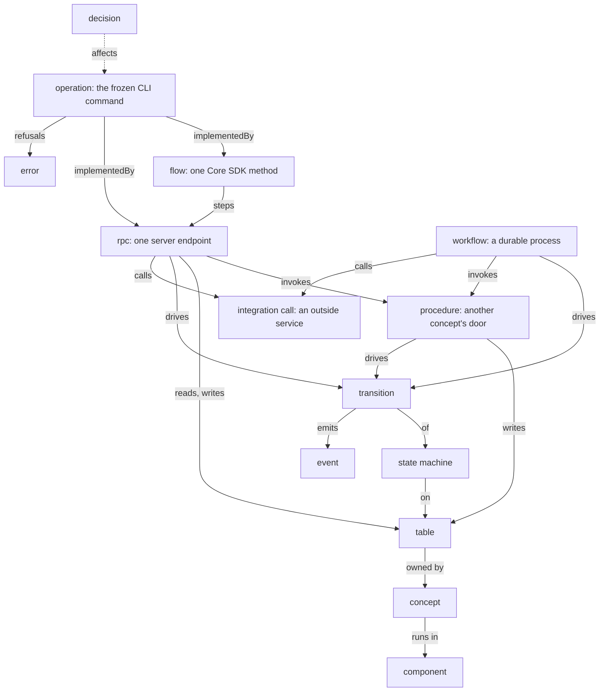
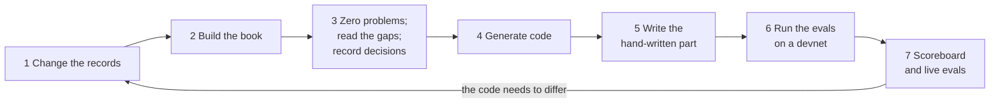

# How the design book works

This guide covers what the design book is, how its pieces fit together, where it sits in the
wider system and how it is used from a design question to production. Read it first. The
field-by-field reference for the schema is [`docs/spec/50-design-book.md`](spec/50-design-book.md).
The rules for target designers are in [`books/target/CONVENTIONS.md`](../books/target/CONVENTIONS.md).

## In one paragraph

The design book is Capxul's design, written as data.

- **Records.** Every part of the system is a record: a table, a state machine, a server call, a
  Core SDK flow, a CLI operation, an error code, a durable process or a decision. A record is a
  TypeScript value. An Effect Schema checks it when it is created. It points at the records it
  depends on by importing them.
- **The build.** A small build (`packages/book`, about 1,200 lines) reads every record and
  produces three things:
  - **Problems:** the design contradicts itself or a policy, and the book does not build.
  - **Gaps:** the design is incomplete here.
  - **Evals:** the checks that say when the code matches the design.
- **Everything else is computed.** Every other output is computed from the same records, so none
  of it can drift from them. Today that means diagrams, pages and reports. Later it also means
  generated code, the eval catalogue and the scoreboard.

## Why records and not documents

The old system described itself in five places: a book of 215 operation pages in YAML, a docs
site, the architecture decision records (ADRs), Linear tickets and the code. Only part of that was
kept in step. The docs site's operations reference was generated from the YAML book, and the old
factory computed each operation's state from it. But nothing checked the ADRs, the tickets or the
code against the book, and the YAML could not say how the operations fit together underneath. The
design book makes the whole design something a machine can check:

- **A link is an import.** A misspelt or deleted record is a compile error, not a broken sentence.
- **A rule is code that runs on every build.** For example: no concept writes another concept's
  table, every machine sends one event, and every operation has a speed budget.
- **The definition of done is derived.** A complete record is also a complete test plan, so nobody
  writes or maintains a separate list of checks.

## The three books

| Book | Folder | What it is | Who writes it |
|---|---|---|---|
| Frozen | `books/frozen/` | The text of the old book's 215 operations: the CLI command, the title, the acceptance lines and the refusals. This is the public surface that must not change. | Generated by `tools/freeze-operations.py` from the old repository's `apps/docs/factory/operations/*.yaml`. Never edited by hand. |
| As-is | `books/as-is/` | The old system described in the same records, with findings on what is wrong with it. Evidence only. | Agents reading the old code. Paused on purpose; payments is fully reviewed. |
| Target | `books/target/` | The design of the rebuilt Capxul: the specification the build implements. | The concept designers, then the assembly. When the code needs to differ from it, it changes first. |

**One schema serves all three books.** What differs is the **stage**:

- A book built with stage `"target"` also enforces the accepted policies that can be checked as
  rules:
  - P1: acceptance lines are claims;
  - P2: an rpc must be reached;
  - P5: budgets;
  - P7: events only on transitions, one per machine;
  - P8: tenant-first keys;
  - A4: a flow that implements an operation serves the CLI.

  P4's write boundary is a base rule, so it runs in every stage. P10, the frozen surface, is
  checked by `tools/check-frozen.ts`. Nothing checks P3, P6 or P9 mechanically yet: reviewers hold
  them, and the build session's generators will check P6's spans.
- An as-is book is allowed to record the old system's faults.

**A target operation record is two layers.** First comes the frozen text, spread in unchanged with
`...frozenText("payment.send")`. Then it adds only the design: what implements it, what each
acceptance line observes, the world each refusal needs and the budget. So the frozen surface is
kept word for word, and the design is written next to it.

## The pieces

```
packages/book/                 the record system; product-neutral except the target rules and budget classes
  src/records/*.ts             one define* function per top-level kind, each an Effect Schema; child kinds
                               (transition, call, function, chain event) come from their parent
  src/build.ts                 buildBook: register, link, check the rules, reverse links, gaps
  src/evals.ts                 deriveEvals: the evals each kind of record implies
  src/budgets.ts               the default budget of each class (policy P5)
  src/views.ts, src/main.ts    the command that writes the views and exits 1 on problems
  test/                        16 tests, with a small fixture book (invitations)
books/frozen/                  the frozen operations (generated)
books/as-is/                   the old system (evidence)
books/target/
  shared/                      the system, the components, the 22 concepts and what each may depend on,
                               the errors, the integrations, the v4 contracts, the architecture decisions,
                               and where each old area lands
  <concept>/                   data.ts        tables, state machines and their events
                               procedures.ts  the concept's door: what other concepts may invoke
                               <area>.ts      the rpcs of one area
                               processes.ts   the durable processes (workflows)
                               flows.ts       the Core SDK flows
                               operations.ts  the frozen operations this concept owns
                               decisions.ts   every judgment behind the design
                               index.ts       the concept's module list
  index.ts                     every record of the target, with stage "target"
tools/                         the workflow scripts that wrote the book; report generators
docs/decisions/                the accepted decisions, and the generated judgments report
docs/mission/initializer.md    the goal prompt that starts the build
```

## Records and links

A record holds the records it depends on. Links point only **down** the layers, so the book has no
cycles. A record never lists who uses it: the build computes every reverse link ("which operations
drive this transition").



The record kinds sit on three axes. Each axis answers one question:

| Axis | Records | The question it answers |
|---|---|---|
| Boundary | operation, rpc, flow | What does a caller ask for, and what answers it? An operation is implemented by exactly one rpc or one Core SDK flow, and the CLI calls one SDK method per command. |
| State | table, machine, procedure, event | What is stored, and how does it change? Each status column is one state machine. Each machine sends one `<machine>_transitioned` event. Another concept's tables change only through its procedures. |
| Time | workflow | What runs when nobody is waiting? Each long-lived object has one durable process, with its trigger, its instance, its signals and its waits. |

Around those axes sit:

- **The system and its components:** what runs where.
- **Integrations and contracts:** the outside world, through Effect services and the chain.
- **Errors:** one vocabulary, with exit codes.
- **Journeys and invariants:** checks across operations.
- **Decisions:** the reason for any record.

## A worked example: `payment send`

These excerpts are trimmed from the real files. They follow one command from the CLI down to the
database.

```ts
// books/target/payments/operations.ts: the frozen unit
export const operation_payment_send = defineOperation({
  ...frozenText("payment.send"),            // the old book's words, unchanged
  implementedBy: flow_client_payments_pay,  // one Core SDK method; the CLI calls it and nothing else
  acceptance: [
    kept("payment.send", 1, "chain: one UserOperation and one PaymentSent carry the payment id; read: `payment list` shows exactly one Payment for it, settled"),
    // … 8 more: five kept word for word, two with their "On Protocol v4" opening stripped (P9) and one
    // rewritten as an outcome (P1), the frozen claim kept in `was`; each says what an eval observes
  ],
  refusals: [{ error: error_INSUFFICIENT_BALANCE, given: W.empty, when: "Your Safe, or the company Safe, holds less than the amount." } /* … */],
  budget: budget("chain-submit"),           // p50 2,000 ms, p95 4,000 ms
});

// books/target/payments/flows.ts: what the Core SDK does for it
export const flow_client_payments_pay = defineFlow({
  sdk: "client.payments.pay",
  steps: [{ name: "prepare", rpc: rpc_payments_commands_prepare }, /* sign through approvals … */ { name: "follow", rpc: rpc_payments_ledger_watch }],
});

// books/target/payments/commands.ts: one server endpoint
export const rpc_payments_commands_prepare = defineRpc({
  kind: "action",
  writes: [table_payment_commands, table_payments],
  drives: [machine_payment.t.open],
  invokes: [parties.procedure_parties_resolve_recipient, procedure_documents_store, approvals.procedure_approvals_open],
  calls: [integration_chain_rpc.c.readContract, integration_chain_rpc.c.getCode],
  budget: budget("chain-read"),
});

// books/target/payments/data.ts: the table's one state machine
export const machine_payment = defineMachine({
  table: table_payments, field: "status", initial: "prepared",
  states: [/* prepared, scheduled, due, escrowed, submitted, needs_retry, settled, mismatched, cancelled */],
  transitions: { open: { from: [], to: "prepared", emits: [event_payment_transitioned] } /* … */ },
});
```

What the build makes of these four records:

- **Checks.**
  - `prepare` writes only the payments concept's own tables (`write-boundary`).
  - It reaches parties, documents and approvals only through their procedures, and only because
    payments is allowed to depend on them (`invoke-boundary`).
  - Every refusal of `payment.send` is an error that something under the flow can produce: a step,
    a procedure or an integration's failure (`refusal-not-produced`). A refusal nothing can produce
    is a problem, not a hope.
  - The machine sends only `payment_transitioned` (`one-event-per-machine`).
  - Each budget is at its class default, or says why it is not (`budget-override-why`).
- **Evals.**
  - For the operation: `acc:payment.send/1` to `/9`, one per acceptance line.
  - `ref:payment.send/INSUFFICIENT_BALANCE` and the other refusals.
  - `ret:payment.send`, the shape of its `--json` output.
  - `evt:payment.send/<event>`, one for each event sent anywhere under the flow:
    `payment_transitioned`, `party_transitioned`, `approval_transitioned` and
    `proposal_transitioned`.
  - `spn:payment.send` and `bud:payment.send/p95`.
  - `doc:payment.send`, its reference page, and `des:payment.send`, the one an agent decides: the
    operation's text and what it does agree.
  - For the records below it: `flw:client.payments.pay/budget` and `/spans`;
    `rpc:payments.commands.prepare/budget`, `/spans` and `/errors`; `trn:payment.open`;
    `tbl:payments/schema`, `/writers` and `/tenancy`; and `prc:<procedure>/atomic` for each
    procedure it invokes.
- **Gaps.** For example, a refusal whose world no devnet can build yet (`refusal-without-world`),
  or a transition nothing drives. In a target book an rpc nothing reaches is not a gap but a
  problem (`unreached-rpc`).

## What a build does, step by step

```bash
npx tsc -p books                                                                       # 2
node --experimental-strip-types packages/book/src/main.ts books/target/index.ts /tmp/target   # 1, 3–9
```

1. **Load.** Node imports `books/target/index.ts`, and every `define*` call checks its record
   against the record's schema as the module loads. A bad id, or an `about` over 2,000 characters,
   throws here and names the field.
2. **Typecheck.** The compiler checks the kind of every link: `writes` takes tables and `drives`
   takes transitions.
3. **Register.** Every record is stored under `kind:id`, and a duplicate is a problem. Child records
   are registered from their parent: a machine's transitions, an integration's calls, and a
   contract's functions and chain events.
4. **Link.** The build walks every field of every record. A link to a record the book does not list
   is `dangling`. A link that holds `undefined`, usually an import cycle, is `undefined-link`.
5. **Rules.** The base rules always run: boundaries, machines, cycles and refusals. With stage
   `"target"`, the policy rules run too: events only on transitions, one event per machine, no rpc
   nobody reaches, budgets, tenant-first keys, acceptance lines as claims, and a flow that
   implements an operation serving the CLI (`flow-surface`).
6. **Reverse links.** The build records who points at each record.
7. **Gaps.** The derived list of incomplete design (`docs/spec/50-design-book.md` has the table).
8. **Evals.** Every eval the records imply. Each has an id, a level, the record it is about, its
   claim, and who decides it: a machine, an agent or a person. The levels are:
   - L1: an operation and the records under it;
   - L2: journeys;
   - L3: the system;
   - L4: live evals on staging. The book does not derive these; B5 adds them.
9. **Views.** It writes these files, and exits 1 if there are problems:
   - `README.md`: the counts, the component and concept diagrams, the problems and the gaps.
   - `concepts/<id>.md`: one page per concept, with its state diagrams.
   - `evals.json` and `findings.json`.

## Using it end to end

Every piece of work follows the same path, from a design question to production. Steps 1 to 3
work today. Steps 4 to 7 are what the goal prompt (`docs/mission/initializer.md`) has the build
session make, as milestones B1 to B5.



1. **Change the records.** For new behaviour, a new column or a new state, edit the owning
   concept's file. If the change is a judgment, add a decision record with the options, the choice
   and why.
2. **Build the book.**
3. **Fix every problem and read the gaps.** A gap is allowed, but each one is visible work. A
   decision that needs Aaron says so, and `tools/report-judgments.ts` collects those under "For
   Aaron".
4. **Generate (B1).** From the records the generators make:

   | Records | Generated |
   |---|---|
   | Tables | SQL migrations, with tenant-first keys and row-level security |
   | Fields | Effect Schemas |
   | Rpcs | The `RpcGroup` and the server router stubs |
   | Flows | The Core SDK client and the flow skeletons |
   | Operations | The CLI wiring |
   | Machines and spans | The telemetry catalogue |
   | Evals | The eval catalogue |

   Nobody edits generated files.
5. **Write what cannot be generated:** the bodies of rpc handlers, flow steps and workflow steps.
   The generated types fix the shape of that code. A handler that writes a table its rpc does not
   list fails `tbl:<table>/writers`.
6. **Run the evals (B2).** The harness:
   1. reads `evals.json`;
   2. builds each eval's world on a devnet. The worlds are the named snapshots in
      `books/target/devnet/worlds.ts`: plain exports, not records, which a refusal names in its
      `given`;
   3. drives the real CLI;
   4. collects the spans over OTLP;
   5. records one result per eval.
7. **Read the scoreboard.** Per operation it shows the evals passing, p95 against the budget,
   telemetry coverage and lines of code. On staging, the live evals (L4) watch the same budgets and
   journeys in PostHog.

The rule that keeps the system honest: **the book changes first.**

1. Change the record and add a decision.
2. Rebuild to zero problems.
3. Regenerate.
4. Change the code.

Code that disagrees with the book is a defect, not a design.

## Where else the same records are used

The records are plain TypeScript values, so anything that can import a module can read them. One
source has many readers:

| Reader | What it reads | What it gives | State |
|---|---|---|---|
| The book build | every record | problems, gaps, evals | built |
| Markdown views | every record | the summary page and concept pages, with diagrams | built |
| Judgments report | decisions | `docs/decisions/judgments.md`, with "For Aaron" | built |
| Frozen check | the frozen book beside the target operations | breaches of the frozen surface | built |
| The docs site | operations, flows, errors, concepts, machines | the reference: a page per CLI command and SDK method, the error catalogue, the state diagrams; the `doc:<operation>` evals check it | B4 |
| Generators | tables, rpcs, flows, operations, machines, events | migrations, schemas, the `RpcGroup`, the SDK client, the CLI wiring, the telemetry catalogue | B1 |
| The product runtime | the generated code (see below) | the error catalogue, the transition tables, integration timeouts and retries, span names | B1 and B3 |
| The eval harness | `evals.json`, the worlds, each refusal's `given` | a pass or a fail per eval | B2 |
| The factory: swarmD managers and pairs | operations and their links, gaps, evals, decisions | the work queue, the order of work and the definition of done | B4 |
| PostHog | events, budgets, journeys | the telemetry catalogue, alerts at the p95 budgets, journey funnels | B3 and B5 |
| CI | the build and the evals | fail a change whose book has problems, or whose code fails an eval | B1 |

### In the docs site

The old docs site (`apps/docs` in the old repository) read the YAML book for its operations table.
It read `public/factory/state.json` from the old factory for each operation's eval state.

The new site imports the records directly. A page per command comes from:

- the operation, for the command, what it does, its acceptance lines, its refusals and its budget;
- its flow, for the SDK method and its steps;
- the errors, for the codes, messages and exit codes;
- the machines, for state diagrams that cannot go stale.

Prose that does not belong in a record is written in the site, next to the generated reference.

### In the factory

The old factory (`apps/factory`, about 12,000 lines) ran one agent per operation. It computed each
operation's stand (specify, decide, build, observe, done) from the YAML records and CI's eval
evidence.

The target book keeps that idea and gives it better inputs. Each stand is computed from the typed
records, their derived evals and the eval results. So it sees the whole design under an
operation, not just the operation's own page, and the factory still keeps no state of its own
about what is done:

| Stand | Computed as |
|---|---|
| specify | the operation, or a record under it, has a problem or a gap |
| decide | a decision it depends on is waiting for Aaron |
| build | its design is complete and its evals are derived, but not all of them pass |
| observe | its evals pass on the devnet, but its live events are not yet seen on staging |
| done | its live evals hold |

The link graph is the work plan. An operation's work depends on the records under it: its flow,
the flow's rpcs, the procedures they invoke and the tables those write. So a swarmD manager can
order the lanes by concept and run them in parallel, without anyone writing a dependency by hand.
A checker's verdict is a set of eval results, and the swarmD ledger
(`docs/spec/10-swarmd-ledger.md`) keeps them as evidence.

### In the product itself

**Recommended: the running product uses generated code, not the book package.** The tools (the
docs site, the harness, the factory, CI and the scoreboard) import the records directly. This is a
recommendation for the build session, not yet a decision record. The reasons:

- **Review.** A change to production behaviour then always shows up as a generated diff that
  someone reviews.
- **Size.** The runtime does not load some 2,000 records and their prose.
- **Freedom.** The book can carry design-only content (`was`, `about`, decisions) without
  shipping it.

The runtime still behaves as the records say. Its error catalogue, its machine transition tables
(a status change that is not a declared transition is refused), its integration timeouts and
retries, its span names and its budgets all come out of the generators.

### Beyond Capxul

`packages/book` is mostly product-neutral. Its kinds (system, component, concept, table, machine,
rpc, flow, operation, workflow, journey and the rest) fit any service with a CLI or an API.

These parts are specific to Capxul:

- the target rules in `checkTargetRules`, which are policies P1 to P10;
- the budget classes;
- the `chain` tenancy and the contract kinds.

To use the book for another product (swarmD itself, for example), pass the rule set and the budget
classes in as parameters instead of hard-coding them. That change has not been made yet.

## What the schema does not cover yet

[`docs/spec/50-design-book.md`](spec/50-design-book.md#deliberately-not-in-the-schema-yet-the-step-2-slice-decides)
lists what was left out on purpose, such as React hook records and linking indexes to queries.
The `chain` tenancy for Ponder's indexed tables has since been added.

## Commands

```bash
npx tsc -p packages/book && npm test -w @capxul/book     # the record system and its 16 tests
npx tsc -p books                                           # the target and frozen books (the paused as-is book: npx tsc -p books/as-is)
node --experimental-strip-types packages/book/src/main.ts books/target/index.ts /tmp/target
node --experimental-strip-types tools/check-frozen.ts       # the target keeps the frozen surface: 0 breaches
node --experimental-strip-types tools/report-judgments.ts > docs/decisions/judgments.md
```

The book build does not see the frozen text's refusals and claims beside the target's, so
`tools/check-frozen.ts` does that separately. It checks that every frozen operation has its
record with its command and title. It checks that every acceptance line is kept word for word, or
changed with the frozen claim kept first in its `was`. And it checks that every refusal, from the
page or its designed v4 block, is still a refusal, unless a decision on the operation names it.
