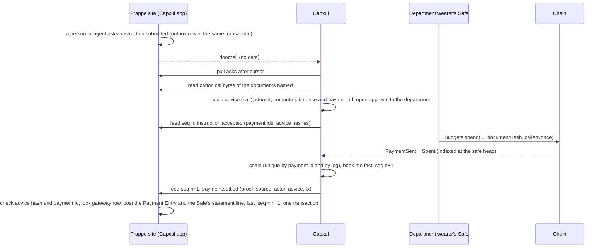

# Gateway-first: Capxul is the payment gateway inside every Organization's books

Design study for the payments bridge (`aaron.frappe-native`, `aaron.one-product`, `aaron.other-accounts`,
9 November 2026). Written from scratch, independently of the book's current money design. It answers Aaron's three
questions:

- Do the contracts change?
- How does a Capxul payment event become a Frappe payment event?
- If we built this from scratch, how would we do it?

The direction this study takes is **gateway-first**. Capxul is a payment gateway inside Frappe, in the pattern of
Frappe's own payments app:

1. A Frappe document asks to pay or to be paid.
2. Capxul executes the payment on chain.
3. The settled payment comes back as the Payment Entry, with its allocations.

Every claim about code cites a file and line. Paths:

- `v4/` is `/home/user/factory/packages/contracts/v4/src/`.
- `pv4/` is `/home/user/factory/docs/planning/protocol-v4/`.
- `erpnext:`, `hrms:` and `frappe:` are `/tmp/erpnext`, `/tmp/hrms` and `/tmp/frappe`, at the commits in
  `bridge/frappe.md`. hrms and frappe are sparse checkouts, read with `git show HEAD:<path>`.
- `payments-app:` is `/tmp/payments` (frappe/payments `b2ceb4a0`).
- Every other path is the book, `/home/user/capxul-next/`.

The research this builds on, all in the same folder, is `bridge/frappe.md`, `bridge/v4.md` and `bridge/prior-art.md`.

Nothing in the book or in any repository was edited. Internal names below (doctypes, custom fields) are the
implementer's. A user and an agent never see them, and never see the words Frappe, ERPNext or head (section 2.8).

---

## The answer in brief

1. **The contracts do not have to change.** Gateway-first needs three things the contracts already give:
   - a payment id known before anyone signs, consumed once (`v4/money/Payments.sol:15-17`, `:59-64`);
   - a document hash that is never zero and is bound into that id (`:56`, `:80-95`);
   - a `PaymentSent` indexed by that id (`v4/interfaces/IPayments.sol:23-31`).

   Every gap the research found is closed off chain. That is done by what the document hash commits to, and by the
   settlement message Capxul composes. The smallest change worth making is two event fields on the escrow, which
   `aaron.escrow-general` is already rewriting and redeploying (section 6):
   - the job nonce on `EscrowCreated`;
   - the surplus on `EscrowPaid`.

   Section 6.4 lists what is lost if nothing changes.
2. **The document hash commits to a payment advice.** It is a salted, typed, Merkle-rooted remittance advice in the
   shape banks use (ISO 20022 structured remittance, EDI 820). It names:
   - each document paid, by Capxul's stable id, its version and the hash of its canonical content;
   - the amount allocated to each document;
   - optionally each line and each tax row paid;
   - adjustments with a reason (withholding, discount, credit note, rounding);
   - the exchange rate used;
   - the fiat leg of a bank payout;
   - the payment it refunds;
   - the batch and line it belongs to.

   Both systems recompute it from their own records. That is how each proves that "this payment pays these lines of
   these documents" (section 3).
3. **The events are naive, and that is fine.** `PaymentSent` is proof that money moved. It is not an accounting event.
   The accounting event is a settlement message the gateway composes from:
   - the `PaymentSent`;
   - the sibling event (budget, schedule, escrow, agreement);
   - the transaction's user operation (who acted);
   - the advice (what for);
   - Bridge's record (fiat, fees);
   - the block (when, and at what finality).

   Frappe never reads the chain. It receives that message, checks the advice's hash and the payment id locally, and
   posts (section 4).
4. **Exactly once is fenced four times.** The fences are:
   1. a request key on each ask;
   2. the payment id on chain;
   3. a unique settlement in Capxul;
   4. a gap-free, per-Organization feed applied in Frappe in the same database transaction as a unique gateway
      record and the voucher.

   A completer re-checks chain, Capxul and Frappe against each other.
5. **From scratch, gateway-first is seven pieces.** Each is in Frappe's own idiom, with no fork:
   1. The ask lives in Frappe: a Payment Request for money in, and a Capxul payment instruction for money out.
   2. The advice is fixed and hashed into the payment id before signing.
   3. Capxul executes under the chain's authority checks.
   4. One gateway record per payment id lives in Frappe, unique, as the anchor for every voucher.
   5. One voucher per movement, posted from the settlement message at a named finality, dated by the block.
   6. Each Safe is a bank account whose statement is the chain. So is each clearing account: money waiting in an
      escrow, and money in transit at Bridge. Frappe's own Bank Reconciliation then shows any money the books do not
      explain.
   7. Other bank accounts are ordinary Frappe bank accounts, reconciled from their own statements. Capxul never posts
      to them.

---

## 1. Who holds what

| System | Holds | Never holds |
|---|---|---|
| **Frappe** (one site per Organization, hosted by Capxul) | The business documents: invoices, orders, claims, advances, salary slips, payroll entries. The parties and their bank accounts. The chart. Every voucher. The **asks** (what should be paid or collected, from which account, when). The **gateway record** of each Capxul payment and its postings. The Safe's statement. | Keys. The power to move a Safe's money. A posting to a Safe account that Capxul did not make. |
| **Capxul** | Identity, Seats, agents, departments and budgets, approvals and Board proposals, the payment ledger (the `payments` table and its machine, `books/target/payments/data.ts:137-289`), the advice documents, the settlement from the chain, Bridge's records, the world clock, and the per-Organization feed of money events. | Business documents of its own: those are Frappe's. A copy of the ledger: Frappe's GL is the ledger. |
| **The chain** | Each payment's terms and its document hash, bound into its id; budgets, schedules, escrows and agreements; balances. | Meaning, fiat, fees, tax, dates other than block time. |
| **Bridge** | Fiat deposits and payouts, their fees, the bank's sender and description, delivery and returns. | Anything Capxul's books need without Capxul's join (its deposit names the chain transaction, `destination_tx_hash`; `bridge/prior-art.md` section 4.2). |



---

## 2. The pieces inside Frappe: the Capxul app

### 2.1 The gateway registration (money in)

The Capxul app registers a gateway exactly as the payments app's gateways do:

- A `Payment Gateway` row named "Capxul", made by the payments app's `create_payment_gateway`
  (`payments-app:payments/utils/utils.py:48-59`), pointing at a single settings doctype, `Capxul Settings`.
- `Capxul Settings` is the controller. It implements `validate_transaction_currency` and `get_payment_url`, which
  ERPNext calls (`erpnext:erpnext/accounts/doctype/payment_request/payment_request.py:567-597`).
- One `Payment Gateway Account` per Safe account (one per Safe and token). Its `payment_account` is that Safe's
  account, and its channel is Email. The app refuses the Phone channel on a Safe account, because a Phone request is
  marked Paid with no Payment Entry at all (`payment_request.py:603-605`).

ERPNext runs a gateway only for an **Inward** request (`payment_request.py:338-361`). So the gateway carries money
in:

- A Sales Invoice or Sales Order gets a Payment Request whose `payment_url` is Capxul's pay link.
- `request issue` makes one.

Capxul's controller **never** calls `on_payment_authorized`. The stock callback books a Payment Entry as
Administrator, which is wrong for chain money in three ways:

- it is dated today;
- it is for the request's whole outstanding amount;
- its reference number is the request's own name.

(`payment_request.py:599-689`, reference at `:654`; `bridge/frappe.md` section 4.2.) Capxul writes the Payment Entry
itself from the chain fact, naming the request on the reference row. ERPNext's own code then moves the request to
Paid (`update_payment_requests_as_per_pe_references`, `payment_request.py:1405`).

### 2.2 The outward ask: a Capxul payment instruction

ERPNext has no gateway path for money out. The Outward Payment Request only sets status Initiated
(`payment_request.py:338-345`). Two things stand in the way:

- **Payment Request** may reference only Sales Order, Purchase Order, Sales Invoice, Purchase Invoice, POS Invoice and
  Fees (`payment_request.py:25-32`, enforced at `:855`). Expense Claim, Employee Advance, Salary Slip, Payroll Entry,
  Leave Encashment and Gratuity cannot have one.
- **Payment Order** is ERPNext's batch of instructions to one bank account, but:
  - its rows are Suppliers only (`payment_order_reference.json`: `supplier`);
  - its type Payment Entry requires the entries already submitted before the bank is told (`payment_order.py:102-108`).

So the app adds one submittable doctype, **Capxul Payment Instruction**. It is ERPNext's Payment Order generalised to
every payee and every document. An Outward Payment Request, or a Payment Order on a Safe's bank account, converts
into one.

| Part | Fields |
|---|---|
| Header | `company`; `from_account` (a Safe account); `source`, which is one of: a department (the `Department` with `capxul_budget`), the Board, or an allowance; `pay_on` (date, optional, for a scheduled payment); `requested_by` (User); `status`; `capxul_command`; `approval_link` |
| `items` (one per chain payment) | `line`; `party_type`; `party`; the payee's destination, which is one of: their Safe, a mailbox with no account, or their bank account for a Bridge payout; `amount` and `currency`; `rail` (direct, escrow or bank payout); `payment_id`; `document_hash`; `status` |
| `allocations` (child rows keyed by `line`, because Frappe has no table inside a table) | `reference_doctype`; `reference_name`; `payment_term`; `payment_request`; `allocated_amount` in the document's currency; `lines` (optional: which rows and tax rows, with amounts) |
| `adjustments` (keyed by `line`) | `reason`; `account`; `amount`; `reference` |

**Status** moves only forward, as Payment Core's does (`bridge/prior-art.md` section 1.5):

```
Draft → Submitted → Awaiting signature → (Scheduled) → Sending → Partly paid | Paid
Any open state → Cancelling → Cancelled
```

**Cancel.** The doctype's own Cancel is enabled only once Capxul reports that nothing can still move (section 5,
P14).

### 2.3 The gateway record: Capxul Payment (one per payment id)

This is the anchor that makes posting exactly once inside Frappe's own database. It is the gateway's ledger row, as
the payments app's Payment Session Log and Payment Core's Payment Transaction are (`bridge/prior-art.md` sections 1.5
and 5.2).

- **Not submittable, never deleted.** Only Capxul's service user writes it.
- **One row per v4 payment id.** `payment_id` is a **unique** Custom Field. Frappe supports `unique` on a Custom
  Field (`frappe:frappe/custom/doctype/custom_field/custom_field.json:265`). Neither `reference_no` nor
  `transaction_id` is unique (`payment_entry.json:431`, `bank_transaction.json:130`).
- **Fields:**
  - the instruction and its line;
  - the terms: chain, Payments address, job nonce, caller nonce and budget, executor, sender, recipient, token, raw
    amount, decimals, kind, document hash;
  - the advice (JSON, as the reader may see it);
  - `status`: Prepared, Awaiting signature, Scheduled, Sent, Escrowed, Settled, In transit, Delivered, Returned,
    Cancelled or Reversed;
  - `generation`;
  - the proof: transaction, log, block number, block hash, block time, and the finality tag it was posted at.
- **`postings`, a child table.** Each row has a kind (funding, settlement, delivery, refund, return or reversal), a
  generation, a voucher type, a voucher number and a transfer key. The pair (kind, generation) is unique per payment.
- **No amendment.** The row is never amended, so the unique index on `payment_id` survives a reorg's
  cancel-and-amend. The book left `capxul_id` non-unique for exactly this reason (`docs/design/frappe/accounting.md:71-74`).
  This row is where uniqueness lives instead.

### 2.4 The accounts the app keeps

Each is a ledger account with a Bank Account document, so ERPNext's bank tools work on it. Each is frozen, and only
the app's service user holds the Company's `role_allowed_for_frozen_entries` (`erpnext:erpnext/accounts/doctype/gl_entry/gl_entry.py:430-440`).

| Account (role) | Type and currency | Its statement is | Why |
|---|---|---|---|
| **The Safe**, one per Safe and token | Bank, the token's currency (USDC, EURC) | every ERC-20 Transfer touching the Safe at finality | The bank is the chain (`docs/design/frappe/accounting.md:125-128`) |
| **Money waiting to be claimed** | Bank, the token | Transfers into and out of escrows the Organization funded | Escrowed money is still the company's: its sender can take it back (G6, `docs/design/escrow.md:161`). The books should show it as the company's asset, not as paid and not as vanished. This replaces `books.escrow-held` (`books/target/books/decisions.ts:1427-1455`). |
| **Bank payouts in transit** | Bank, the token | Transfers to Bridge's deposit addresses, Bridge's deliveries, and returns | A Bridge payout has left the Safe on the chain's word but has not reached the supplier until Bridge says so. This is the Stripe and Xero practice for processor payouts (`bridge/prior-art.md` section 4.2). |
| **Transfers in transit** | Bank, the Company's currency | none of its own: it is cleared on both sides | Money moving between an outside bank account and a Safe through Bridge (P12) |
| **Capxul fees** | Expense, under Bank charges | — | Capxul's developer fee inside a Bridge deposit or payout. This is how Capxul is paid. |

### 2.5 The Safe's statement: Bank Transactions from the chain

At finality, every Transfer that touches a Safe, an escrow the Organization funded, or a Bridge deposit address used
by its payouts becomes one **Bank Transaction** on the matching account. This applies the prior art of treating the
chain as a bank feed (`bridge/prior-art.md` section 2.3). Each has:

- `capxul_transfer_key`, a unique Custom Field holding `<chain>:<tx>:<log>`;
- `date`, the block's date;
- deposit or withdrawal, in the token;
- `bank_party_name`, the counterparty;
- `reference_number`, which is exactly one string per movement:
  - the payment id, when a `PaymentSent` explains the Transfer;
  - otherwise the transfer key.

Capxul's voucher for that movement carries the same string in `reference_no` (or `cheque_no`). The app reconciles
the two in the same transaction, which sets `clearance_date` to the block date. ERPNext's own auto-reconcile also
needs exactly this: an exact reference match is its hard filter (`bank_reconciliation_tool.py:1617-1618`).

The result:

- A Transfer nobody explains stays an **Unreconciled** Bank Transaction. That is the book's Movement
  (`books/target/payments/data.ts:293-303`), now shown in the screen accountants already use.
- The book's choice to leave Bank Transaction out ("a Capxul voucher is cleared on its posting date",
  `accounting.md:76-77`) is reversed.

The tx hash alone is not used as the reference. One transaction can carry a whole payroll, so the hash does not name
one voucher.

### 2.6 Guards: every back door, and the one door left open

Rule: **no posting to a Safe, escrow or in-transit account except by the app's service user, through the feed.** Each
place Frappe can mark money moved (`bridge/frappe.md` section 11) is guarded by a `doc_events` hook. No doctype class
is overridden. HRMS already overrides Payment Entry's class (`hrms:hrms/hooks.py:168`), and two overrides of one
class cannot both win.

| Back door | Guard |
|---|---|
| Payment Entry or Journal Entry with a line on a guarded account | `before_submit`, `before_cancel` and `before_update_after_submit` refuse unless the feed is applying. This catches the stock gateway callback, `make_payment_entry` (`payment_request.py:1365-1368`), Payment Order's draft Bank Entries (`payment_order.py:278-316`), HRMS's Make Bank Entry draft (`hrms:.../payroll_entry.py:1093`) and the Bank Reconciliation Tool's "create voucher" (`bank_reconciliation_tool.py:337`, `:569-669`, `:772`). |
| Purchase Invoice `is_paid`, Sales Invoice `is_pos`, Expense Claim `is_paid` with a guarded account | `validate` refuses (`purchase_invoice/services/gl_composer.py:861-900`; `sales_invoice/services/gl_composer.py:473-500`; `hrms:.../expense_claim.py:380-421`) |
| Payment Request with the Phone channel on a Capxul gateway account | `validate` refuses (`payment_request.py:603-605`) |
| Cancelling a document that a live instruction or Capxul Payment references (an invoice, a claim, a slip, a Payroll Entry) | `before_cancel` refuses with the instruction named. Cancelling a Payroll Entry cancels every bank entry that references it (`hrms:.../payroll_entry.py:168-180`). |
| A manual Payment Entry from an outside bank that would over-allocate a document while a Capxul payment is in flight | `validate` treats in-flight Capxul allocations as already taken |

**The one door left open: allocation changes in place.** Payment Reconciliation and Unreconcile Payment change only
the reference rows of a submitted Payment Entry and rebuild its ledger rows. They do not cancel it
(`erpnext/accounts/utils.py:518-589`, `:746-823`; `bridge/frappe.md` section 3).

- The guard allows them on Capxul vouchers.
- The guard refuses any change to the bank side, the amounts, the dates or the reference.

So a payee who re-allocates a receipt does it Frappe's way. The advice still proves what the payer committed to, and
the difference is recorded, not overwritten (section 3.7). This replaces the book's cancel and amend for every
recategorization (`accounting.md:227-240`).

### 2.7 Delivery between Capxul and the site

**Asks: Frappe to Capxul.**

1. On submit or cancel of an instruction, or on submit of a Capxul-gateway Payment Request, the app writes a row to
   its own outbox table **in the same database transaction**.
2. It rings Capxul's doorbell, with no data.
3. Capxul pulls the changes after its cursor. This is the book's pull pattern (`accounting.md:295-300`).

Frappe's own Webhook doctype is not used. It holds deliveries in process memory until after the commit, so a crash in
between loses them (`frappe:frappe/integrations/doctype/webhook/__init__.py:73-119`; `bridge/prior-art.md`
section 1.4).

**Results: Capxul to Frappe.** Capxul writes each money event, under the Organization's next gap-free `seq`, in the
same Postgres transaction as the settlement. That is the book's feed (`books.feed`, `accounting.md:139-146`).

- One sync process per site pushes the events in order to the app's `apply(seq, event)`.
- The app applies one event per Frappe database transaction, under a row lock on its own company row.
- It refuses any `seq` other than `last_applied + 1`.
- A repeat (`seq <= last_applied`) answers with what it did the first time.

### 2.8 One product

The re-skin and the SDK mapping keep Frappe invisible:

- Every doctype the app adds is labelled in Capxul's words: payment instruction, payment, statement line.
- Every error the app raises is one of Capxul's refusal codes, with Capxul's wording. The app raises them and the SDK
  passes them through. A Frappe `ValidationError` that escapes is mapped to `INVALID_INPUT` or `WRONG_STATE` by the
  SDK, with a message that names no product.
- The book's command family `org head doc …` (`docs/design/new-commands.md:505-545`) must be renamed without "head".
  That rename is outside this study.

---

## 3. The payment advice: what the document hash commits to

### 3.1 Why an advice

Today the hash is one of five things (`books/target/documents/data.ts:29-31`):

- a Memo;
- a request's Invoice, Capxul's own and without tax;
- an offer's terms;
- a payslip;
- a receipt file.

None of them lists several documents with amounts (`bridge/v4.md` section 6). Paying a supplier's invoice that lives
in Frappe therefore commits only to a Memo. A Bridge payout commits to `keccak256(payout id)`, which names no
document (`books/target/banking/decisions.ts:917-945`).

The advice replaces all of these **for payments**. Every `PaymentSent` that Capxul prepares carries an advice hash.
Terms stay for Agreements' offers, whose contract checks the terms hash on accept (`v4/money/Agreements.sol:199`).

### 3.2 The typed structure (EIP-712)

Domain: `{ name: "Capxul payment advice", version: "1", chainId, verifyingContract: <Payments> }`. The payment id
already binds the chain and Payments (`Payments.sol:80-95`). The domain binds the advice to them as well, so an
advice can never be replayed on another deployment.

```
CapxulPaymentAdvice(
  uint16  schema,          // 1
  bytes32 salt,            // 32 random bytes, new for every payment (never derived)
  bytes32 instruction,     // keccak256("capxul:instruction:" + instruction capxul id): the batch
  uint32  line,            // this payment's line in the instruction: the per-line identity in a batch
  uint8   purpose,         // 1 supplier invoice, 2 customer invoice, 3 salary, 4 expense, 5 advance,
                           // 6 refund, 7 escrow funding, 8 own transfer, 9 fee, 0 other
  Party   payer,
  Party   payee,           // the economic payee, even when the chain recipient is an escrow or Bridge
  uint8   rail,            // 0 direct, 1 escrow, 2 bank payout
  address token,
  uint256 amount,          // must equal the payment item's amount
  bytes32 allocationsRoot, // Merkle root over Allocation leaves; zero when none
  uint32  allocationCount,
  Adjustment[] adjustments,
  Fx      fx,              // zero struct when every document is in the token's own peg currency
  bytes32 related,         // refund: the payment id refunded; escrow funding: the escrow's payment id; else zero
  bytes32 memo,            // keccak256 of the payer's note (UTF-8), or zero
  bytes32 fiat             // hashStruct(FiatLeg) for a bank payout, or zero
)
Party(bytes32 party, address safe)                     // party = keccak256("capxul:party:" + party id)
Adjustment(uint8 reason, bytes32 reference, Money amount)
  // reason: 1 withholding tax, 2 early-payment discount, 3 credit note applied, 4 short payment (disputed),
  //         5 rail fee borne by payee, 6 rounding; reference = a document's docId or zero
Fx(bytes32 fromCurrency, bytes32 toCurrency, uint256 rate, uint8 scale, bytes32 source)
  // source = keccak256 of "chainlink:<feed>:<round>" or "bridge-quote:<quote id>"
Money(bytes32 currency, int256 units, uint8 scale)     // currency = keccak256("USD"); units signed; scale = precision

Allocation(                // a Merkle leaf, hashed with the same domain
  uint32  index,
  bytes32 docType,         // keccak256("Purchase Invoice"), ("Sales Invoice"), ("Expense Claim"), ("Salary Slip"),
                           // ("Employee Advance"), ("Journal Entry"), ("Purchase Order"), ("advance") …
  bytes32 issuer,          // the party that issued the document
  string  number,          // as its issuer numbers it: a Sales Invoice's name, a Purchase Invoice's bill_no
  bytes32 docId,           // keccak256("capxul:doc:" + capxul_id): stable across amendments
  uint32  version,         // which amendment of that document
  uint32  docDate,         // yyyymmdd
  bytes32 contentHash,     // keccak256 of that version's canonical bytes (3.3)
  bytes32 paymentTerm,     // keccak256(term name) or zero
  Money   allocated,       // in the document's currency; negative for a credit or debit note
  bytes32 linesRoot,       // Merkle root over LinePaid leaves, or zero = the document as a whole
  uint32  lineCount,
  bool    payerPrivate     // a leaf the payee is shown only as a hash
)
LinePaid(uint32 idx, bytes32 lineHash, Money paid, TaxPaid[] taxes)
TaxPaid(bytes32 taxType, Money amount)
FiatLeg(bytes32 payout, Money amount, bytes32 beneficiary, bytes32 quote, Money fee, bytes32 rail)
  // beneficiary = keccak256(salt ‖ account number or IBAN ‖ holder name)
```

**Trees.** Leaves are `hashStruct` values. The tree follows OpenZeppelin `MerkleProof` conventions: commutative
keccak of sorted pairs. The leaf's own `index` fixes the order.

`documentHash = hashTypedData(domain, CapxulPaymentAdvice)`, which is never zero, as Payments requires
(`Payments.sol:56`).

### 3.3 The canonical content of a document version

Frappe's row names are random hashes (`sales_invoice_item.json:4`). An amendment clears every child row's name
(`frappe:frappe/model/document.py:4409-4434`) and renames the parent `<name>-1` (`frappe:frappe/model/naming.py:578-595`).
So the advice names a document by three things:

- Capxul's `capxul_id`, which survives amendment;
- its `version`;
- `contentHash` over a canonical form.

It never uses Frappe names.

- **Who makes the canonical bytes.** Only the Capxul app, in one function per doctype: `capxul.canon(doctype, name)`.
  It returns RFC 8785 (JCS) JSON and its keccak256. Capxul stores the exact bytes with the advice, so verifying needs
  only a keccak over stored bytes in either language.
- **What it holds,** for an invoice (Sales or Purchase):
  - the schema name (`capxul.canon.purchase-invoice/1`);
  - the issuer and the party (Capxul party ids);
  - the number, plus `bill_no` and `bill_date` for a Purchase Invoice;
  - the dates, currency and conversion rate;
  - `is_return` and `return_against` (by Capxul id);
  - every item row in `idx` order: item code, description, quantity, UOM, rate, discount, amount, net amount, and its
    tax rows from Item Wise Tax Detail (`item_wise_tax_detail.json:15-42`);
  - every taxes row: charge type, tax type, rate, amount;
  - the totals;
  - the payment schedule terms.

  Numbers are decimal strings at the field's precision. A line's `lineHash` is keccak256 of its row's canonical JSON.
- **Other doctypes.**
  - An Expense Claim: its expense rows (date, type, description, amount, sanctioned amount), its taxes, and the
    advances it uses.
  - A Salary Slip: the book's payslip content (`books/target/documents/procedures.ts:86-117`) plus the Payroll
    Entry's Capxul id.
  - An Employee Advance: employee, purpose, amount, currency and date.
- **Versioning.** The schema name is inside the bytes, so a later ERPNext field change bumps the schema. It never
  changes an old hash's meaning.

### 3.4 Why a Merkle tree

- **Cross-company.** A payment between two Capxul Organizations is seen by both. The payee is shown the leaves that
  name its own documents, plus proofs for the rest. Leaves the payer marks private, such as its own Purchase Invoice
  that mirrors the payee's Sales Invoice, its cost centre, or its notes, appear to the payee only as hashes.
- **Disclosure of one line.** An auditor or a tax office can be shown one line of one invoice, with its proof, and
  nothing else.

### 3.5 What Capxul checks before anyone signs

At prepare, refused with `INVALID_INPUT` and nothing written:

- **Amounts.** `amount` equals the allocations less the adjustments, converted at `fx` into the token's units,
  exactly. A rounding adjustment (reason 6, smaller than one minor unit of the document's currency) closes any gap.
- **Bank payouts.** For a payout: `amount` = the fiat amount at the quote's rate plus the quote's fee, and `fiat` is
  set.
- **Lines.** Each allocation with lines: its lines' `paid` adds up to `allocated`.
- **Outstanding.** No allocation exceeds the document's outstanding less what other live Capxul payments have already
  allocated to it. This is the in-flight reservation (2.6).
- **Salt.** A new 32-byte salt per payment, so the same terms twice give two hashes. Salt is mandatory: an invoice's
  hash is otherwise guessable (`bridge/prior-art.md` section 3.4, item 8).
- **Kind** is set from `purpose`, matching v4's table (`pv4/architecture.md:151-165`):
  - 1 for an invoice (purpose 1 or 2);
  - 2 for a salary;
  - 3 for an expense or an advance;
  - 0 otherwise.

  This replaces the book's "one-off" kind for salaries (`books/target/payroll/staged.ts:75`). Budgets accepts kinds
  0 to 3 (`v4/money/Budgets.sol:448-450`). Books never classify by kind (`accounting.md:450`).

### 3.6 The proof: how either side shows "this payment pays these lines of these documents"

A participant fetches the **receipt bundle** for a payment id (SDK `payments.receipt`, CLI `payment receipt <id>
--json`). It holds:

- the advice;
- the leaves and canonical bytes the reader may see, and the Merkle proofs for the rest;
- the item's job nonce, caller nonce and budget, executor and kind;
- the proof: chain, transaction, log and block hash.

The check then runs:

1. `hashTypedData(advice) == PaymentSent.documentHash`.
2. **The id recomputes.** `keccak256(abi.encode(TYPEHASH, chainId, Payments, jobNonce, executor, recipient, token,
   amount, kind, documentHash)) == paymentId` (`Payments.sol:80-95`).
   - For a budget spend, `jobNonce = keccak256(abi.encode(Budgets, budgetId, callerNonce))` (`Budgets.sol:229`).
   - For an escrow, the job nonce is in its terms (`Escrow.sol:73`).

   The log alone cannot do this, because `PaymentSent` carries neither the job nonce nor the executor
   (`bridge/v4.md` section 2). That is why the bundle carries them.
3. **Each visible allocation's content.** `keccak256(bytes) == contentHash`, and `capxul.canon` over the document's
   live version in Frappe gives the same bytes. If the document was amended since, the bundle shows which version was
   paid.
4. **Each disclosed line** proves into `linesRoot`, and each leaf into `allocationsRoot`.
5. **The voucher.** The Payment Entry's references equal, as (document, term, allocated amount), the leaves that name
   this side's own documents, or a recorded difference exists (3.7).

The app runs steps 1, 2 and 5 before it posts. A mismatch is never posted silently: the event is recorded as
"blocked" with an alert. Capxul runs all five in the evals (section 9).

### 3.7 The payee's allocation may differ

The advice fixes what the **payer** committed to. The payee's books are the payee's. An EDI 820 payer deducts, and
ERPNext lets a payee unreconcile and re-allocate (`bridge/prior-art.md` section 3.5). When a Payment Entry's
references stop matching the advice, after Payment Reconciliation or after a fallback in 4.3, the app does not
refuse. It records an **allocation difference** on the gateway record: the advice's allocation against the voucher's.
`payment get` shows it, and the evals count it. Nothing overwrites the advice.

---

## 4. The settlement message: Capxul's events, shaped for accounting

### 4.1 The events Capxul sends a site

Every event carries the Organization's `seq`, the `payment_id` or `transfer_key`, and a `generation`.

| Event | When | What it carries beyond the keys |
|---|---|---|
| `instruction.accepted` | the command is prepared | per line: payment id, document hash, advice, job nonce, caller nonce, budget, executor, kind; the approval or Board proposal and who may sign |
| `payment.scheduled` | `PaymentScheduled` at finality (`Budgets.sol:264`) | scheduled id, `payAt`, the proof |
| `payment.sent` | the transaction is included but not yet final | the transaction (shown, never posted) |
| `payment.escrowed` | the funding `PaymentSent` at finality | the funding payment id, the escrow address, the escrow's own payment id, the proof |
| `payment.settled` | the `PaymentSent` at finality, for the payer's side | the terms; the proof; the source (budget and department, scheduled id, escrow, agreement and its collection index, Board); the actor (the user operation's sender Safe, its member or agent, and the hat worn at that block); the advice; fx at the block; fee |
| `payment.received` | the same `PaymentSent`, for the payee's side when the payee is an Organization | the same, with the advice's payee view |
| `payout.delivered`, `payout.returned` | Bridge's events (and, for a return, the Transfer back at finality) | the payout id, the delivered fiat amount and time, the refund transfer key |
| `deposit.arriving`, `deposit.credited` | Bridge's deposit events; then the Transfer into the Safe at finality | Bridge's deposit id, gross, `developer_fee_amount`, `exchange_fee_amount`, net, sender name, the bank's description, the transfer key, the proof, and the match (a Payment Request or invoice, the company itself, or none) |
| `payment.cancelled` | withdrawn, lapsed, `ScheduleCancelled`, or `EscrowRefunded` at finality | the reason, and for a refund its transfer key and `by` |
| `payment.reversed` | the block that held a posted payment or transfer is no longer canonical | the generation reversed, and the day it was seen |
| `movement.recorded` | any other Transfer touching a guarded account at finality | the transfer key, direction, counterparty, amount and proof |

### 4.2 The four fences, and the completer

| Boundary | Fence | Code |
|---|---|---|
| Frappe ask → Capxul | Request key `ask:<org>:<doctype>:<name>`. An amendment has a new name and so a new key. A repeat answers the same command. | Capxul's command key (K1: `request_key` and its index, `books/target/payments/data.ts:112`, `:126`) |
| Capxul → chain | The payment id is consumed once. A lapsed approval is retried with the same ids. | `Payments.sol:64`; `docs/design/frappe/payroll.md:396-401` |
| Chain → Capxul | One settlement per (chain, payment id), and one per log | the unique indexes `by-chain-payment-id` and `by-settled-log` (`books/target/payments/data.ts:259-279`) |
| Capxul → Frappe | `seq == last_applied + 1`, applied in the same transaction as the gateway record (unique `payment_id`), its posting row (unique per kind and generation), the voucher and the statement line (unique `capxul_transfer_key`) | section 2.3, 2.5 and 2.7 |

**The completer** runs hourly on the world's clock. It compares three things:

- every `PaymentSent` and Transfer touching the Organization's guarded addresses up to the finalized head;
- Capxul's settled payments and facts;
- the site's gateway records and statement lines.

It re-sends what a site lacks, from its last applied `seq`. It flags what a site has that the chain does not. This is
Brandur's completer and Payment Core's re-check, with the chain as the provider whose answer wins
(`bridge/prior-art.md` section 5.1).

### 4.3 Which voucher each event posts, and the fallback ladder

| Event | Voucher (one per payment id, kind and generation) |
|---|---|
| `payment.settled`, direct, the payee a Supplier or Employee with documents | **Payment Entry** Pay from the Safe. References are the advice's leaves for this side's documents. Adjustments become deductions (reason 1 is a negative deduction on the tax liability; reasons 2 to 6 go to their accounts). |
| `payment.settled`, salary slip | **Journal Entry** Bank Entry. Dr Payroll Payable, party Employee, `reference_type` Payroll Entry; Cr the Safe. No Payment Entry may reference a Payroll Entry (`hrms:hrms/overrides/employee_payment_entry.py:22-30`). |
| `payment.settled`, no documents (an expense with a memo) | **Journal Entry** Bank Entry: Dr the chosen account and cost centre; Cr the Safe |
| `payment.received` | **Payment Entry** Receive into the Safe, references the payee-side leaves and the Payment Request |
| `payment.escrowed` | **Journal Entry**: Dr Money waiting to be claimed; Cr the Safe. Keyed by the funding payment id. |
| `payment.settled`, escrow rail | As the direct case, but paid **from** Money waiting to be claimed |
| `payment.cancelled` (refunded) | **Journal Entry**: Dr the Safe; Cr Money waiting to be claimed. Keyed by the refund's transfer key. |
| `payment.settled`, bank payout | **Journal Entry**: Dr Bank payouts in transit; Cr the Safe |
| `payout.delivered` | **Payment Entry** Pay from Bank payouts in transit to the Supplier. References as advised; Bridge's fee is a deduction on Bank charges and Capxul's on Capxul fees. Dated when Bridge delivered. |
| `payout.returned` | Before delivery: Dr the Safe, Cr in transit. After delivery: a Payment Entry Receive from the Supplier into the Safe against the invoice, which re-opens it. Any fee Bridge keeps goes to Bank charges. |
| `deposit.credited`, matched | **Payment Entry** Receive into the Safe. The party side is the gross; the deductions are Bridge's exchange fee and Capxul's fee; the reference is the request's invoice. |
| `deposit.credited`, from the company itself | **Journal Entry**: Dr the Safe (net), Dr fees; Cr Transfers in transit (gross) |
| `deposit.credited` unmatched, or `movement.recorded` | Only the **statement line**, Unreconciled, until `bank match` or `activity annotate` gives it meaning. Then a voucher keyed by the transfer key. |
| `payment.reversed` | Cancel that generation's vouchers and statement lines, the reversal dated the day it was seen (immutable ledger, `erpnext/accounts/general_ledger.py:758-762`) |

Every voucher's fields:

- `reference_no` (or `cheque_no`) is the movement's one reference string.
- `reference_date`, `posting_date` and `clearance_date` follow section 7.
- `capxul_payment` links the gateway record.
- `capxul_block_time` holds the block time.
- The cost centre is the department's.

A single voucher never has more than a handful of rows. A Journal Entry with more than 100 rows submits in the
background (`erpnext/accounts/doctype/journal_entry/journal_entry.py:218`, `:231`), which would break "one event, one
transaction".

**The fallback ladder.** A chain-proven movement is always recorded; its voucher is at most once and eventually once.
ERPNext can refuse a Payment Entry whose document has changed:

- partly paid since (`payment_entry.py:560-601`);
- on hold;
- cancelled;
- party disabled;
- a closed period.

So the app tries, in order:

1. **As advised.**
2. **Without the refused references.** The rest stays unallocated with the party, as an advance (`payment_entry.py:1298-1316`).
   An allocation difference is recorded.
3. **As a Bank Entry to the not-decided account** (6999 or 4999), when the party itself is refused.
4. **On the first open day,** when the date is closed. The block time is kept (`accounting.md:203-204`).
5. **Not posted.** The gateway record is written with `posting_error`, the `seq` advances, and an alert fires. The
   Safe's balance check (section 9) shows the gap until a retry action posts it.

### 4.4 Which finality "the chain says so" means

Base has three stages (`bridge/prior-art.md` section 6):

- about 200 ms: the sequencer;
- about 2 minutes: `safe`, once batched to L1. No batched L2 block has ever been reorged.
- about 20 minutes: `finalized`.

The book waits a time window ("the deployment's finality depth", `books/target/indexing/decisions.ts:257-274`), and
Ponder's default window is 180 s.

**This design posts at the `safe` tag**, read through the RPC's block tag, never a time window. It keeps a reversal
path (`payment.reversed`). The completer re-checks every posted block hash against `finalized`. Section 12 asks Aaron
whether to wait for `finalized` instead.

---

## 5. Every money path, end to end

Each path names five things:

- what Frappe holds **before**;
- what Capxul **does**;
- what the **chain** records;
- the **event** that comes back;
- what Frappe holds **after**.

It then names the key that makes it **exactly once**. Amounts are illustrative. "The Safe" is the company Safe's
USDC account. Every voucher has a Bank Transaction on each guarded account it touches, reconciled to it in the same
transaction (2.5). That is not repeated in each path.

### P1. A department pays one supplier invoice in full

- **Before.**
  - Supplier S, with `capxul_party`.
  - Purchase Invoice PINV-0007, submitted: 1,000 USD, outstanding 1,000, cost centre Marketing.
  - Optionally an Outward Payment Request on it.
  - The `Department` Marketing, with `capxul_budget` set.
- **Ask.** "Pay with Capxul" on the invoice, or `capxul bill pay PINV-0007 --from marketing`. Either one submits an
  instruction:
  - from the Safe;
  - source Marketing;
  - one line: payee S at S's Safe, 1,000 USDC, allocation PINV-0007 1,000 (with the Payment Request).
- **Capxul does.**
  1. Pulls the ask.
  2. Reads `capxul.canon` for PINV-0007.
  3. Builds and stores the advice: purpose 1, kind 1, salt.
  4. Picks a caller nonce. The id is computed from `keccak256(Budgets, budgetId, callerNonce)` (`Budgets.sol:229`).
  5. Reads `leftOf`, `authorised` and the Safe's balance.
  6. Opens one approval addressed to Marketing's current wearers.
  7. Sends `instruction.accepted`.
- **Chain.** A wearer's Safe sends `Budgets.spend(budget, S.safe, 1000e6, 1, documentHash, callerNonce)`, which runs
  through Roles and the Safe to `Payments.send` (`Budgets.sol:206-232`, `:497-526`). The logs:
  - `Transfer`(Safe → S);
  - `PaymentSent(id, Safe, S, USDC, 1000e6, 1, documentHash)`;
  - `Spent(..., id)`;
  - `UserOperationEvent` from the wearer's Safe.
- **Event.** `payment.settled`, with source Marketing and actor the wearer (the hat at that block).
- **After.**
  - Payment Entry Pay, Supplier S, `paid_from` the Safe, references [PINV-0007 1,000; the Payment Request], reference
    and posting dated the block's day, cost centre Marketing.
  - PINV-0007 Paid. The Payment Request Paid, through ERPNext's own code.
  - The instruction Paid. The gateway record Settled, with one settlement posting.
- **Exactly once.** The ask's key; the payment id; the settlement's uniqueness; the `seq`; the unique gateway record.

### P2. Several invoices in one payment, and several suppliers in one approval

- **Several invoices to one supplier.** One line with allocations [PINV-0007 600, PINV-0009 400]. One `PaymentSent`.
  One Payment Entry with two references. A debit note enters as a negative allocation (ERPNext lets a Payment Entry
  reference a return invoice), or as adjustment reason 3.
- **Several suppliers.** One line per supplier in one instruction, so one approval. The wearer's Safe sends one user
  operation with N `Budgets.spend` calls; a Board payment is one `Payments.sendBatch` (`Payments.sol:42-46`).
  - On chain: N `PaymentSent`, all in one transaction and atomic (all or none).
  - Back: N `payment.settled` with consecutive `seq`.
  - In Frappe: N Payment Entries, one per payment id.
  - The per-line identity is the payment id, plus `instruction` and `line` in each advice. No batch id is needed on
    chain.
- **Exactly once.** As P1, per line.

### P3. A partial payment, and instalments

- **Before.** PINV-0007 is 1,000. If its template allocates by payment term, every reference must name a term
  (`payment_entry.py:536-545`).
- **Ask.** One line of 400, allocation PINV-0007 400 with its payment term.
- **Capxul.** It checks 400 is at most the outstanding less the in-flight amount. The advice allocates 400; lines are
  optional. When they are given, they say which lines the 400 pays (ISO 20022's per-line remitted amount).
- **Chain and event.** As P1.
- **After.** A Payment Entry of 400. PINV-0007 Partly Paid, outstanding 600; the payment schedule moves
  (`payment_entry.py:945`).
- **The next instalment** is a new instruction with a new id and a new salt. Two things link the instalments:
  - on chain, nothing;
  - in the advices, the same `docId`.

  `payment list --document PINV-0007` reads Capxul's allocation index.
- **Exactly once.** As P1. The in-flight reservation (2.6) stops two asks over-allocating one invoice.

### P4. A customer pays the Organization's invoice (Capxul's request is Frappe's Sales Invoice)

- **Before.** `request issue`, or Frappe's own invoice screen, makes:
  - Sales Invoice SINV-0042: Customer C, 2,500 USD, due date;
  - a Payment Request Inward with gateway Capxul. Its `payment_url` is Capxul's `/pay/<request>`.

  At issue, the app stores `capxul.canon(SINV-0042)`. That is the issued document both sides will name.
- **P4a: the payer is on Capxul** (a person, or an Organization).
  - **Capxul.** The request is in the payer's inbox. When they pay, Capxul builds the advice:
    - purpose 2, kind 1;
    - a shared leaf for SINV-0042, with issuer the Organization and `number` SINV-0042;
    - if the payer is an Organization, a `payerPrivate` leaf for its own Purchase Invoice, whose `bill_no` is
      SINV-0042.
  - **Chain.** The payer's Safe sends `approve` and `Payments.send`, or a budget spend for an Organization. One
    `PaymentSent`, recipient the Organization's Safe.
  - **Events.**
    - `payment.received` to the payee's site;
    - `payment.settled` to the payer's site, if the payer has one.
  - **After, the payee.** Payment Entry Receive, Customer C (found by `capxul_party`), references [SINV-0042 2,500;
    the Payment Request]. SINV-0042 Paid; the Payment Request Paid.
  - **After, the payer.** Payment Entry Pay against its Purchase Invoice. Both vouchers carry the same payment id and
    document hash. One `PaymentSent` gives two books, in two sites, each with its own `seq`.
- **P4b: an outside payer with crypto.**
  - **Capxul.** The request's invoice escrow, condition amount-reached (`docs/design/escrow.md:197`):
    - owner: the Organization's Safe;
    - sender: the payer's email Safe;
    - document hash: the advice built when the payer gave their email.
  - **Funding.** Transfers from any wallet into the escrow. This is not the Organization's money, so its books post
    nothing.
  - **Chain.** Capxul's relayer calls `payout()`. The logs are `PaymentSent` (sender the escrow, `Escrow.sol:149`) and
    `EscrowPaid`. Any surplus goes back to the sender.
  - **Event.** `payment.received`.
  - **After.** As P4a for the payee.
- **P4c: the payer wires money.** See P10.
- **Exactly once.** The payment id. The Payment Request's outstanding moves only through Payment Entry references,
  never through the stock callback (2.1).

### P5. Payroll: Frappe HR works the slips out, Capxul pays them, many people in one batch

- **Before.**
  - Payroll Entry for Engineering, November.
  - Salary Slips submitted.
  - HRMS's accrual Journal Entry, submitted by HRMS itself (`hrms:hrms/payroll/doctype/payroll_entry/payroll_entry.py:619-701`):
    Dr the salary expenses; Cr Payroll Payable for each employee.
  - Under `aaron.frappe-native`, Frappe computes and accrues, so the book's accrual door (`books.payroll-accrual`)
    goes.
- **Ask.** "Pay with Capxul" on the Payroll Entry, or `org payroll run pay`. One instruction:
  - source: Engineering's budget;
  - one line per slip: the net, to the Employee's Safe, or to their mailbox for a new hire with no account;
  - each line's allocation: its Salary Slip (canonical content: earnings, deductions, net) and its Payroll Entry;
  - purpose 3, kind 2.

  Withheld slips are left out.
- **Capxul.**
  - N advices and N ids.
  - It checks `leftOf` ≥ the total (`PAYROLL_BUDGET_EXCEEDED`) and the Safe's balance.
  - One approval to Engineering's wearers (C9, `docs/design/frappe/payroll.md:387-392`).
  - Above a size cap, the instruction is split into several user operations, each its own approval. Each line keeps
    its own id.
- **Chain.**
  - N × (`Transfer`, `PaymentSent` kind 2, `Spent`).
  - For each new hire: a `Transfer` to the escrow address, a funding `PaymentSent`, `Spent`, `EscrowDeployed` and
    `EscrowCreated`.
- **Events.** N × `payment.settled`, and `payment.escrowed` for each new hire.
- **After.**
  - One Bank Entry per slip: Dr Payroll Payable (Employee, reference Payroll Entry); Cr the Safe. `cheque_no` is the
    payment id; `cheque_date` is the block's day. A Bank Entry needs both (`journal_entry.py:548-557`).
  - Each Salary Slip gets `capxul_payment` and a paid status. Salary Slip itself has no paid state
    (`bridge/frappe.md` section 9).
  - HRMS's `has_bank_entries` is true (`payroll_entry.py:1069-1090`).
  - New hires: Dr Money waiting to be claimed; Cr the Safe. At claim (P8): Dr Payroll Payable; Cr Money waiting.
  - The Payroll Entry cannot be cancelled while any slip has a live Capxul payment (2.6).
- **Deductions** owed to a tax office or a pension fund are later, separate payments. Each is a line whose allocation
  is the accrual Journal Entry's liability row, purpose 0.
- **Exactly once.** Per slip, by payment id. A lapsed approval resumes the same command and the same ids
  (`docs/design/frappe/payroll.md:396-401`).

### P6. An expense claim

- **Before.** Expense Claim EXP-0031, submitted and approved. HRMS posted Dr the expenses, Cr payable to Employee E,
  180 (`hrms:.../expense_claim.py:302-421`).
- **Ask.** "Pay with Capxul". One line to E's Safe:
  - allocation EXP-0031 180, with its expense rows as lines and its tax rows;
  - purpose 4, kind 3;
  - source: the department of the claim's cost centre.
- **Chain and event.** As P1.
- **After.** Payment Entry Pay, party Employee E, reference EXP-0031. HRMS's hooks recompute `total_amount_reimbursed`
  and set the claim Paid (`expense_claim.py:675-708`, `:127-161`). An `is_paid` claim on a Safe account is refused
  (2.6).
- **Exactly once.** As P1.

### P7. An employee advance, and its return

- **Before.** Employee Advance EA-0005, submitted, 500.
- **Ask.** Pay, one line: allocation EA-0005 500, purpose 5, kind 3.
- **After paying.** Payment Entry Pay, Employee, reference EA-0005. HRMS sets `paid_amount` from the Advance Payment
  Ledger (`employee_advance.py:185-252`).
- **Later claims** settle against the advance inside Frappe. No money moves.
- **An unclaimed 50 returned.**
  - The Organization issues a request to E, or E runs `payment send` to the Organization.
  - The advice: purpose 6, `related` the advance's payment id, allocation EA-0005 −50 (a return).
  - Chain: E's Safe → the company Safe.
  - Event: `payment.received`.
  - After: a Journal Entry Dr the Safe; Cr the advance account, party E, reference EA-0005, as HRMS's
    `make_return_entry` builds it (`employee_advance.py:323-385`). `return_amount` becomes 50.
- **Exactly once.** Each by its own payment id.

### P8. A payment to someone with no account (the general escrow), its claim, and its refund

- **Before.** PINV-0012 from Supplier T, who is known only by a mailbox. T's Party is provisional, at the Safe the
  mailbox derives.
- **Ask.** As P1, with the payee a mailbox.
- **Capxul builds two advices.**
  - **The final payment's.** Purpose 1, payee T, allocation PINV-0012. Its hash goes into the escrow's terms. The
    terms (`docs/design/escrow.md:59-67`, `:172-179`) are:
    - owner: T's derived Safe;
    - sender: the company Safe;
    - authority: Budgets and the budget id;
    - owner-collects;
    - bootstrap owner: Companies House.
  - **The funding's.** Purpose 7, `related` the escrow's payment id, which `predictPaymentId` gives before anything
    exists (`v4/money/EscrowFactory.sol:46-60`).
- **Chain, at funding.**
  - `Budgets.spend` to the escrow's address, giving `Transfer`(Safe → escrow), `PaymentSent`(funding id) and `Spent`;
  - in the same approval, `EscrowFactory.deploy`, giving `EscrowDeployed` and `EscrowCreated`.
- **Event.** `payment.escrowed`.
- **After.** Dr Money waiting to be claimed; Cr the Safe, keyed by the funding id. PINV-0012 **stays unpaid**: T has
  not been paid. The instruction shows "Waiting for the payee". The gateway record is Escrowed.
- **The claim.**
  - T signs up and runs `payment claim`, which calls `collect()`.
  - The logs are `Transfer`(escrow → T), `PaymentSent`(the escrow's id, sender the escrow, document hash the final
    advice) and `EscrowPaid`.
  - Event: `payment.settled`, rail escrow.
  - After: Payment Entry Pay to T **from Money waiting to be claimed**, reference PINV-0012 1,000. PINV-0012 Paid.
- **The refund.**
  - A current wearer of the budget, or the Board, runs `payment cancel`, which calls `refund()`.
  - Logs: `Transfer`(escrow → the company Safe) and `EscrowRefunded(sender, by, id, amount, Refunded)`. No
    `PaymentSent` (`docs/design/escrow.md:104`).
  - Event: `payment.cancelled` (refunded, with `by`).
  - After: Dr the Safe; Cr Money waiting, keyed by the transfer. PINV-0012 is still outstanding. The budget's room is
    not restored (G10, `docs/design/escrow.md:165`). Capxul's budget report says so.
- **The race.** A claim racing a refund: the chain lands exactly one (G7). The other event never comes.
- **Exactly once.** The funding id, the escrow's id, and the refund's transfer key.

### P9. A department's budget spend under `aaron.departments`

- **Before.** The department Marketing's budget, with hat H.
  - Ana is a clerk. She has the Frappe permission to make the instruction, but not hat H.
  - Ben wears H.
- **Ask.** Ana asks: P1, or an expense with no document, which takes a memo and an account.
- **Capxul.** The approval goes to the **department**: every current wearer of H, or of a hat above it, is told. The
  first valid signature lands it.
  - Ana cannot sign. The sponsorship simulation refuses her Safe with `ROLE_PERMISSION_DENIED`
    (`docs/design/authority.md:189`).
  - If Ben is taken out of H before he signs, his signature is refused. Carla, the new wearer, signs.
- **Chain.** `Budgets.spend` passes `authorised(id, msg.sender)` at that block (`Budgets.sol:373-384`). Room and the
  Roles ceiling are checked.
- **Event.** `payment.settled`, with the actor's Safe and the hat it wore at the block.
- **After.** As P1. For an expense with no document: Bank Entry Dr the chosen account, cost centre Marketing; Cr the
  Safe. The voucher's remarks name the department and the person who signed, as the hat's wearer.
- **Exactly once.** As P1.

### P10. A fiat deposit through Bridge into a Safe

- **Before.**
  - The Organization's Bridge virtual account (USD ACH and wire), whose destination is the Safe. Frappe has a Bank
    Account "Capxul USD account" holding its details, for invoices to print.
  - SINV-0050, 2,000 USD, with an Inward Payment Request. Its printed reference is the request's short Capxul
    reference.
- **Bridge.** Customer C wires 2,000 USD with that reference in the description. Bridge's events carry:
  - the deposit id, 2,000 gross;
  - `developer_fee_amount` 5, which is Capxul's revenue;
  - `exchange_fee_amount` 1;
  - net 1,994;
  - the sender's name and the description.

  Then Bridge sends the USDC and names `destination_tx_hash` (`bridge/prior-art.md` section 4.2).
- **Capxul.**
  - The deposit is arriving: `deposit.arriving`, shown only, never posted.
  - At finality it credits the deposit, on the exact Transfer of the net into the Safe (`books/target/banking/processes.ts:229-262`).
  - It matches the description to the Payment Request.
- **Chain.** `Transfer`(Bridge → Safe, 1,994 USDC). There is no `PaymentSent`. Bridge does not call Payments.
- **Event.** `deposit.credited`, with the match.
- **After.** Payment Entry Receive, Customer C, into the Safe:
  - party side 2,000 USD;
  - received 1,994 USDC;
  - deductions: Bank charges 1 and Capxul fees 5;
  - references [SINV-0050 2,000; the Payment Request];
  - reference number: the transfer key.

  SINV-0050 is Paid.
- **Unmatched.** Only the statement line, Unreconciled, with the bank's sender and description. Then `bank match`, or
  the Organization's agent, gives it meaning, and Capxul posts.
- **Exactly once.** Bridge's event id (applied only when newer, `books/target/banking/processes.ts:211-213`) and the
  unique transfer key.
- **Proof.** This proof is Bridge's word plus the chain Transfer. There is no advice: the payer was a bank.

### P11. A fiat payout through Bridge

- **Before.**
  - PINV-0020 from Supplier S, 920 EUR.
  - S's Bank Account (party Supplier, IBAN), registered at Bridge.
- **Ask.** One line, rail bank payout: payee S, S's bank account, 920 EUR, from Marketing.
- **Capxul.**
  1. Gets Bridge's quote (`books/target/banking/payouts.ts`): 1,003.40 USDC including a fee of 3.40, with the rate and
     the expiry.
  2. Builds the advice:
     - payee S, not Bridge;
     - allocation PINV-0020 920 EUR;
     - `fx` from the quote;
     - `fiat` = {payout id, 920 EUR, the beneficiary hash, the quote, fee 3.40}.

     This replaces `keccak256(payout id)` (`banking/decisions.ts:917-945`): "paid Bridge" now names its real
     purpose.
  3. The line: `Budgets.spend` to Bridge's deposit address, kind 1.
- **Chain.** `Transfer`(Safe → Bridge), `PaymentSent`(recipient Bridge's address), `Spent`.
- **Events.** `payment.settled`, rail bank payout. Later `payout.delivered`, or `payout.returned`.
- **After the chain.** Dr Bank payouts in transit 1,003.40; Cr the Safe. PINV-0020 is **still unpaid**: the supplier
  has nothing yet.
- **After delivery.** Payment Entry Pay from Bank payouts in transit to S:
  - paid 1,003.40 USDC, received 920 EUR;
  - deduction: Bank charges 3.40;
  - reference PINV-0020 920;
  - ERPNext books any exchange difference;
  - dated when Bridge delivered.
- **Returned.** Bridge sends the USDC back as a Transfer into the Safe (`banking/processes.ts:121-170`).
  - Before delivery: Dr the Safe; Cr in transit.
  - After delivery (a bank's return within 60 days): a Payment Entry Receive from S against PINV-0020, which re-opens
    it.
- **Exactly once.** The payout id (Bridge's `Idempotency-Key`, `books/target/shared/external.ts:234`), the payment id,
  and Bridge's event id, newer-wins.

### P12. An outside bank account the company also keeps (`aaron.other-accounts`)

- **Before.** The Bank Account "Chase operating", whose ledger account is type Bank, in USD. It is not guarded and
  not frozen. Its statement comes from its own feed (Plaid, which ERPNext ships, `plaid_settings.py:300-342`) or a
  statement import.
- **Paying from it, or being paid into it.** The usual Frappe Payment Entry, by a person or through the CLI and SDK:
  `capxul payment record --account chase --bill PINV-0030`. That writes the Payment Entry as the member's own user.
  The document family's money ban (`docs/design/new-commands.md:513-515`) needs this one money command, or it would
  breach `aaron.sdk-reaches-everything`. Capxul moves nothing and proves nothing: the bank's statement line clears it,
  through ERPNext's Bank Reconciliation Tool.
- **Moving from Chase into a Safe.**
  - The company wires from Chase to its Bridge virtual account. That is P10 with the sender's IBAN equal to a company
    Bank Account's (party matching, `bank_transaction.py:309-330`).
  - Capxul posts Dr the Safe (net) and fees; Cr Transfers in transit (gross).
  - Chase's statement line (a withdrawal of 2,000) is matched to Dr Transfers in transit; Cr Chase, by a Bank
    Transaction Rule or a person.
  - A single Internal Transfer cannot do this: the Bank Reconciliation Tool's transfer is single-currency
    (`bank_reconciliation_tool.py:631`).
- **Moving from a Safe to Chase.** `bank pay --to self`: P11's chain leg. At delivery: Dr Transfers in transit; Cr
  Bank payouts in transit, with the fee. Chase's statement line clears Transfers in transit.

  Capxul never posts to Chase itself. Each account is posted from its own source:
  - the Safe from the chain;
  - in-transit from Bridge;
  - Chase from Chase's statement.
- **Exactly once.** On Capxul's side, by the transfer key and the payout id. On Chase's side, by the bank feed's
  `transaction_id`. That field is not unique, but Plaid checks before it inserts (`plaid_settings.py:315-317`).

### P13. A scheduled payment

- **Before.** PINV-0007, due 30 November.
- **Ask.** The instruction, with `pay_on` 2026-11-30.
- **Capxul.**
  - `payAt` is the first second of 30 November in the Company's time zone.
  - The advice is fixed now.
  - A wearer signs `Budgets.schedule(..., payAt, documentHash, callerNonce)`. The room is reserved
    (`Budgets.sol:235-265`).
  - A personal or Board payment uses the book's held operation or Board proposal instead (`docs/design/escrow.md:191-193`).
- **Chain.** `PaymentScheduled`, which carries the job nonce, so the id is known.
- **Event.** `payment.scheduled`.
- **After.** The instruction is Scheduled. Nothing is posted.
- **Before the day,** PINV-0007 cannot be cancelled or amended while the schedule names it (2.6). Cancel the
  instruction first (P14).
- **On the day.** Capxul's executor calls `Budgets.execute` (anyone may, `Budgets.sol:283-300`). The logs are
  `PaymentSent` and `ScheduledPaid`. Then `payment.settled`, and the Payment Entry dated the block's day: 30 November.
  If the executor was late, the voucher is dated when the money actually moved.
- **Exactly once.** The scheduled id and the payment id. `execute` refuses a second time (`NotPending`).

### P14. A cancel before settlement

Frappe's Cancel on an instruction is an **ask to cancel**. The instruction goes to Cancelling. Capxul answers by
route, and only its answer moves the Frappe document to cancelled:

| State | What Capxul does | The answer |
|---|---|---|
| Awaiting signature, nobody signed | `approvals.withdraw` | `payment.cancelled` (withdrawn) |
| Signed, not yet included | Nothing can stop it. The chain decides. | `payment.settled` (the cancel is refused: paid) or, at the deadline, `payment.cancelled` (lapsed) |
| Scheduled | A current wearer, or the Board, signs `Budgets.cancel` (`Budgets.sol:268-278`) | `ScheduleCancelled` gives `payment.cancelled`. The event has no amount; Capxul has it. |
| Escrowed | `refund()`, as P8 | `payment.cancelled` (refunded) with its posting |
| Bank payout quoted, not funded | The quote expires and the approval is withdrawn (`banking/processes.ts:112-130`) | `payment.cancelled` |
| Board proposal not executed | Withdraw it. One already approved needs a rejecting Safe transaction with the same nonce. | `payment.cancelled`, or `payment.settled` if it ran |

- **After a cancel.** Nothing is posted. The invoice's outstanding was never touched. The Payment Request returns to
  Initiated or Requested. The gateway record is Cancelled. The instruction is cancelled, and an amendment (a new name,
  a new key, new ids) can try again.
- **Exactly once.** The cancel event is keyed by payment id and generation. A cancel that loses the race to a
  settlement posts the payment.

### P15. A reorg after settlement

- **Before.** P1's Payment Entry, posted at the `safe` head of block B.
- **Capxul.** The indexer finds B is no longer canonical, so the `PaymentSent` with that id is gone.
- **Event.** `payment.reversed` (generation 1, seen on day D).
- **After.**
  - The Payment Entry and its statement line are cancelled. With the immutable ledger, the reversal is dated D
    (`general_ledger.py:758-762`).
  - PINV-0007's outstanding is back to 1,000.
  - The gateway record goes back to Sent, with generation 2.
- **What follows.**
  - The same signed operation is usually included again: the same payment id, in a new block. That gives
    `payment.settled` with generation 2, and an amended Payment Entry (`amended_from` the cancelled one).
  - If it is never included again, the approval lapses and is retried with the same id.
- **Exactly once.** Per (payment id, kind, generation). The payment id still pays at most once on the canonical chain.

### P16. Fees

| Fee | Where it is on record | How it posts |
|---|---|---|
| Bridge's exchange or rail fee, deposit | Bridge's deposit record | A deduction on Bank charges (P10) |
| Capxul's developer fee, deposit or payout | Bridge's record (`developer_fee_amount`); the Bridge account's percentage (`books/target/banking/data.ts:363`) | A deduction on Capxul fees. It is how Capxul is paid. |
| Bridge's payout fee | The quote, and the advice's `fiat.fee` | A deduction at delivery (P11) |
| Capxul's own charges (seats, the hosted FDE) | Capxul's Sales Invoice to the Organization; in the Organization's books a Purchase Invoice from Supplier "Capxul" | An ordinary P1 payment, whose advice names Capxul's invoice (`org seats buy`, `org fde pay`) |
| Gas | Capxul's paymaster pays it | Nothing in the Organization's books, unless Capxul bills it |
| Withholding tax the payer keeps | The advice's adjustment, reason 1 | A negative deduction on the tax liability: allocated 1,000, paid 900, withheld 100 |

Payments has no fee field, and it refuses fee-on-transfer tokens (`Payments.sol:71-75`). Every fee above is off
chain, so no contract change is needed for fees.

### P17. A currency other than the token

| Case | What the advice fixes | What Frappe posts |
|---|---|---|
| An EUR invoice in a USD Company, paid in USDC | allocation 920 EUR; `fx` EUR→USDC at prepare (Chainlink round or Bridge quote) | Payment Entry: `paid_from` USDC at the block's USD rate; party account in EUR or USD; ERPNext books the exchange gain or loss on the references (`payment_entry.py:1240-1279`) |
| A USD invoice paid in EURC | allocation in USD; `fx` USD→EURC | the same, the other way |
| A payroll in GBP paid in USDC | each slip in GBP; `fx` GBP→USDC at the pay | the Bank Entry is multi-currency; the difference from the accrual's rate goes to exchange gain or loss |
| USDC in a USD Company | no `fx` | rate 1, where the Company pegs USDC to USD (`erpnext/setup/utils.py:17-61`); else the block's Chainlink rate (`accounting.md:178-181`) |

The advice commits to the payer's rate. The block's rate values the Safe side. ERPNext's own exchange machinery books
the difference between them. That difference is real, so nothing is hidden.

### P18. An agreement's collection (a contractor's or employee's running pay)

This one is **not asked by Frappe**: the payee pulls (`Agreements.sol:209-224`).

- **Chain.** `PaymentSent`, kind 4, whose document hash is the **terms** hash on every collection (`:222`), then
  `ReservedPaid` and `Collected`.
- **Event.** `payment.settled`, with source the agreement, and the collection index from Capxul's record.
- **After, the payer.**
  - For a contractor: a Payment Entry Pay against the agreement's open Purchase Invoices, oldest first, or unallocated
    when there are none. Frappe makes one Purchase Invoice per accrual period from the terms.
  - For an Employee: the payroll posting.
- **Proof.** Weaker than an advice. The chain proves the agreement and the amount, and only Capxul's record says which
  period it pays (section 6, change C).

### P19. Money nobody explained

A Transfer into or out of a Safe with no `PaymentSent`, deposit or payout. Examples:

- tokens sent from an exchange;
- a direct `token.transfer` in a Board batch. The Gate does not refuse it. This is inferred from its refusal list in
  `pv4/spec/board.md:51-53`.

**Event:** `movement.recorded`. **After:** an Unreconciled statement line. `activity annotate` or `bank match` gives
it meaning, then Capxul posts a voucher keyed by the transfer and reconciles the line.

### P20. Refunds between parties

- **A supplier refunds the Organization.** A payment from the supplier's Safe:
  - the advice: purpose 6, `related` the original payment id, allocation the debit note;
  - after: Payment Entry Receive **from Supplier** against the debit note.
- **The Organization refunds a customer.** Purpose 6, allocation the credit note. Payment Entry Pay to the Customer.

The link from a refund to its payment is in the advice, not on chain. It costs no contract change. This is Request
Network's and AuthCaptureEscrow's lesson (`bridge/prior-art.md` section 3.2).

---

## 6. Do the v4 contracts change?

### 6.1 The plain answer

**No change is required.** Gateway-first uses what v4 already does:

| What the design needs | What v4 gives |
|---|---|
| An id known before signing, so the ask, the advice and the draft records can all be keyed before money moves | `paymentId(item)` (`Payments.sol:32-34`); `PaymentScheduled`'s job nonce (`Budgets.sol:264`); `predictPaymentId` (`EscrowFactory.sol:46-60`) |
| Paid at most once, so retries are safe | `paid[id]`, refused on reuse (`Payments.sol:64`, `:67`) |
| A commitment to meaning that cannot change after signing | `documentHash`, nonzero, inside the id (`:56`, `:80-95`) |
| A per-line identity in a batch | one `PaymentSent` per item, each with its own id (`:42-46`, `:77`) |
| The budget, schedule, escrow or agreement behind a payment | the sibling events with the same id (`Budgets.sol:231`, `:299`, `:338-340`; `Agreements.sol:223`; `Escrow.sol:172`) |
| Who acted for a department | `UserOperationEvent` in the same transaction, and Hats at that block (`bridge/v4.md` section 3) |

### 6.2 Each candidate change, field by field

| # | Change | Needed? | Smallest form | What is lost without it |
|---|---|---|---|---|
| A | **The job nonce on `EscrowCreated`** | Recommended, and nearly free: the event is already changing under `aaron.escrow-general` (`docs/design/escrow.md:97-104`) | add `bytes32 jobNonce` | The collection's id cannot be recomputed from logs alone. The receipt bundle carries the nonce instead (3.6). |
| B | **The surplus on `EscrowPaid`** | Recommended, the same reasons | add `uint256 surplus` | Money waiting to be claimed must read the surplus from the plain Transfer back to the sender (`Escrow.sol:158-170`). That works, but with one more join. |
| C | **A per-collection document on Agreements:** `collect(id, amount, documentHash)`, where zero keeps the terms hash, and `Collected` gains `documentHash` and `index` | Not now | the signature above; the job nonce derivation unchanged (`Agreements.sol:222`) | A collection cannot commit on chain to which period or invoice it pays. Capxul allocates collections oldest first, and only Capxul's records prove the allocation (P18). |
| D | **A reference field on `PaymentSent`** (indexed document hash, instruction id) | No | — | Nothing. The advice is salted and unique per payment, so indexing its hash finds one payment. Instruction and line are inside the advice. |
| E | **A batch id or line number in `sendBatch`** | No | — | Nothing. Each item already has its own id and log, and the advice names its instruction and line. |
| F | **Refunds through Payments,** linked to the payment they return | No | — | An escrow refund stays a plain Transfer plus `EscrowRefunded(sender, by, paymentId, amount, state)`, which names the payment and the amount. That is enough to post it (P8). Ordinary refunds are new payments whose advice names `related` (P20). |
| G | **Refuse a payment to oneself** (`recipient == msg.sender`) | No (Capxul refuses to prepare one) | one `revert` in `Payments._send` | A hand-built self-payment emits an amount that never moved (`Payments.sol:71-75`). The settle step must treat `sender == recipient` as no movement and post nothing. Changing Payments would redeploy the contract every other one points at. |
| H | **The actor on `Spent`** | No | — | Who acted is read from the user operation and Hats. A chain-only verifier needs that join. |
| I | **The budget on `PaymentSent`** | No | — | It is on the sibling event. Board payments have none, and the advice names the source. |
| J | **A fee field** | No | — | Every fee is Bridge's or Capxul's, off chain (P16). |
| K | **Stop direct token transfers from a Board batch** | Out of scope | a Safe guard beyond Hats Signer Gate | They show as unexplained statement lines (P19) and are never posted unexplained. |

### 6.3 What we would do

1. Add A and B to the general escrow change already being built (`payments.escrow-contract-build`,
   `docs/design/escrow.md:226-243`). They are event fields only, with no change in behaviour, on a contract that is
   being redeployed anyway.
2. Leave Payments, Budgets and Agreements as they are.
3. Revisit C only if running pay through Agreements remains a product path under Frappe HR's payroll.

### 6.4 If nothing changes at all

Nothing breaks. The losses, all of them about verifying **without Capxul's data**:

- **Recomputing an id** from the log needs the job nonce and executor from the receipt bundle (A).
- **Escrow surplus** needs one extra Transfer join (B).
- **Collections** carry no per-collection meaning on chain (C).
- **Who acted** needs the user-operation join (H).
- **A malformed self-payment** reports an amount that never moved (G).
- **Deposits** are proved by Bridge's word plus the chain Transfer, not by an advice. No contract change could fix
  that: Bridge does not call Payments.

---

## 7. The world clock: dates come from blocks

`aaron.world-clock`: everything in a world follows its one clock, the Frappe site included. The site's
`now_datetime` is replaced by the Capxul app's hooks (`docs/design/time.md:1005-1045`).

- **Posting date** = the date of the settling block's timestamp in the Company's time zone. The same date goes into
  `reference_date`, `cheque_date` and `clearance_date`. Frappe's `now` never dates a Capxul voucher. It only stamps
  `creation` and `modified`, which on a devnet are the world's now anyway.
- **Which block:**
  - an escrow payment is dated by the claim's block, and its funding by the funding's block;
  - a deposit by the Transfer's block, not by Bridge's "funds received";
  - a Bridge delivery by Bridge's delivery time, which on a devnet is the Bridge stand-in on the world clock.
- **A scheduled payment's `payAt`** is the first second of `pay_on` in the Company's time zone. The chain judges it
  (`block.timestamp < payAt` reverts), so the timer re-arms until the head reaches it (`docs/design/time.md:279-293`).
- **A closed day** (a Period Closing Voucher, frozen-till) posts on the first open day, with `capxul_block_time` kept
  (`accounting.md:203-204`).
- **A reversal** is dated the day the reorg was seen, on the world's clock.
- **Two calendars, shown and not merged.** Budget periods are UTC calendar periods (`pv4/architecture.md:167-169`).
  The books' periods are the Company's. A payment at 02:00 UTC on 1 January is, in New York, in the books' December
  and the budget's January. Capxul's budget report and Frappe's reports each keep their own calendar.
- **On a devnet,** a warp is a barrier that stops at every due instant (`docs/design/time.md:396-444`). A dated
  payment due on day 10 of a 28-day warp settles, and posts, on day 10.

---

## 8. Authority: who may cause each payment

Two separate questions:

- **Who may ask** is Frappe's permission on the documents named, given to a member's user by the roles their hats
  give at that call (`organizations.doc-authority`).
- **Who may cause the money to move** is only the chain's check, as `aaron.departments` and
  `docs/design/authority.md:203-233` set out.

Capxul adds its Seat check and refuses before building anything. No Frappe role ever authorises money.

| Path | Who may ask | Who may cause it (the chain's check) | Capxul's own check |
|---|---|---|---|
| A department's or team's payment (P1-P3, P5-P9, P11, P13) | A member with Frappe permission on the documents: an accounts clerk, or HR for payroll | Any current wearer of the budget's hat or one above, at the call (`Budgets.authorised`, `Budgets.sol:373-384`); room and the Roles ceiling | Seat; the approval is addressed to the department, not to the asker; `ROLE_CONFLICT` keeps the People hat out of department offices (`docs/design/authority.md:239-246`) |
| A Board payment | A member with permission | The Gate's threshold of Directors (`docs/design/authority.md:47-50`) | A Board proposal |
| A personal payment | The person | Their own Safe | Seat or sign-in |
| Payroll | People hat (HR) asks | The run's department hat wearer signs. Separation of duties: HR asks, the department pays. | `PAYROLL_BUDGET_EXCEEDED` before building |
| An escrow refund (P8, P14) | The instruction's owner, or anyone with permission | The sender, or a caller `Budgets.authorised` admits on the budget **now** (G9, `docs/design/escrow.md:164`) | `canRefund` read first |
| An escrow claim | The payee | Only the owner, once it can act (G4, G5) | — |
| A scheduled payment | As its route | `schedule` and `cancel` by a wearer now; `execute` by anyone | — |
| A Bridge payout | As a department's | As a department's, plus Bridge's verification of the Organization (KYB) | `VERIFICATION_REQUIRED` |
| A deposit | Nobody causes it | — | Matching needs the Invoicing or Books hat |
| An outside bank account | A member with Frappe permission | Not Capxul's: the bank's | Capxul only records |
| An agent | As its own Seat | Its own Safe's hats. The hosted FDE acts as its asker, and the asker signs (`docs/design/authority.md:150-162`). | The act-for token |

---

## 9. How an eval proves each path

Every eval runs on a devnet world with a real Frappe site following the world clock (`devnet.head-follows-world`),
driven only through the CLI and SDK. It observes three places:

- **the chain:** the logs and the balances;
- **Capxul:** the payment and its events;
- **Frappe:** the vouchers, statements and outstanding amounts, read through the SDK.

It then runs the proof in 3.6.

### 9.1 Checks run after every eval

| # | Invariant | How it is checked |
|---|---|---|
| I1 | **A Safe's books equal the chain.** For each guarded account, the opening balance plus every live voucher line whose `capxul_block_number` ≤ B equals `balanceOf` at B (for escrows and in-transit, the sum over their addresses) | an RPC read at B, and a GL query by block number |
| I2 | **Every Transfer is on the statement once.** Every Transfer touching a guarded address at finality has exactly one statement line, reconciled to its vouchers or Unreconciled | the indexer's transfers and the statement lines by `capxul_transfer_key` |
| I3 | **Every settled payment is posted once.** Each settled payment id has exactly one live posting per kind. Every voucher on a guarded account has a payment id or transfer key. | the gateway record's postings, and a scan of the GL |
| I4 | **The advice proves.** For every voucher: the hash recomputes, the id recomputes, every visible content hash recomputes from `capxul.canon`, and the references equal the advice's own-side leaves or an allocation difference is recorded | the receipt bundle, checked in TypeScript and in Python against golden vectors |
| I5 | **Nothing posts before finality.** Each posting's block ≤ the `safe` head when it was applied | the head recorded on the posting |
| I6 | **Replays change nothing.** Re-sending the whole feed from `seq` 1, or one `seq` twice, changes nothing. A gap is refused. | the eval harness replays the outbox |
| I7 | **The clearing accounts add up.** Money waiting = Σ open escrows the Organization funded. In transit = Σ undelivered payouts. | indexing's escrows, and banking's payouts |
| I8 | **One product.** No CLI or SDK output or error in the eval's transcript contains "Frappe", "ERPNext" or "head" | a string scan of the transcript |
| I9 | **Capxul never posts to an outside bank account** | the GL by account and author |

### 9.2 The paths

| Path | Act (CLI or SDK) | It proves |
|---|---|---|
| P1 | `bill pay PINV --from <dept>`; a wearer signs | one `PaymentSent` with kind 1 and the advice hash; the Payment Entry with references = the advice; the invoice Paid; the Payment Request Paid |
| P2 | an instruction with 3 invoices to 1 supplier and 3 suppliers | 3 ids in one transaction; 3 Payment Entries; one with two references and a negative debit note |
| P3 | pay 400 of 1,000, then a second ask of 700 | the second is refused for over-allocation in flight; the first leaves the invoice Partly Paid; the term's outstanding moves |
| P4a, P4b | a person pays the inbox request; an outside wallet funds the escrow and `payout()` runs | two sites post from one `PaymentSent` (P4a); a Payment Entry Receive with the Payment Request Paid |
| P5 | `org payroll run pay` for 3 employees, one a new hire | 2 Bank Entries; 1 escrow funding to Money waiting; after `payment claim`, the third Bank Entry from Money waiting; Payroll Entry cancel refused |
| P6, P7 | pay the claim; pay the advance; the employee returns 50 | HRMS's own statuses (reimbursed, paid, returned) move |
| P8 | pay a mailbox; then the claim; in another world, the refund by a new wearer after a hat swap | funding posts to Money waiting and the invoice stays open; the claim pays it; the refund returns it and leaves the budget's room spent; the old holder's refund is refused |
| P9 | a clerk asks; the old holder is swapped out; the new wearer signs | `ROLE_PERMISSION_DENIED` for the clerk and the old holder; the voucher names the new wearer |
| P10 | the Bridge stand-in posts a deposit with a matching reference, and one with none | a Payment Entry Receive with two deductions; an Unreconciled line until `bank match` |
| P11 | `bank pay` to a supplier's EUR account; the stand-in delivers; in another world, returns | in transit until delivery; the invoice Paid at delivery; re-opened on return |
| P12 | the stand-in posts a deposit from the company's own IBAN; record a Chase payment with `payment record` | Transfers in transit cleared by both sides; nothing Capxul posted on Chase |
| P13 | schedule for day 10; warp 28 days | `payAt` in the Company's zone; posted on day 10; an invoice cancel refused while scheduled |
| P14 | cancel at each state in the table | no voucher; the race against a signed operation lets the chain decide |
| P15 | the devnet forces a reorg past the posting depth (snapshot and revert, then a different block at that height) | the voucher cancelled and dated the day seen; amended on re-inclusion; I1 holds throughout |
| P16, P17 | a withholding adjustment; an EUR invoice | the deduction rows; the exchange gain or loss booked by ERPNext |
| P18 | a contractor collects | the posting against the oldest open invoice |
| P19 | a direct transfer into the Safe | an Unreconciled line; `activity annotate` posts it |
| P20 | a supplier refund naming `related` | a Payment Entry Receive from the Supplier against the debit note |

---

## 10. What this changes in the book (input for the design lane)

The book is not edited here. These are the changes this design implies.

- **documents.** Payments carry one on-chain kind, the advice (3.2). Memo, invoice, payslip and receipt become its
  leaves or its memo, and terms stays for offers. `capxul.canon` lives in the Capxul app, with golden vectors shared
  with Capxul.
- **payments.**
  - The command is born from a Frappe ask.
  - Approvals for a department go to its current wearers, not to the caller.
  - Kind follows purpose.
  - The receipt bundle is new.
  - `payment record` is new, for outside accounts.
- **books.** Under `aaron.frappe-native` the GL is Frappe's.
  - Capxul keeps the facts and the gap-free feed; the feed becomes the gateway's event stream (4.1).
  - Money waiting to be claimed replaces `books.escrow-held`.
  - The chain-fed statement replaces "cleared on its posting date" (`accounting.md:76-77`).
  - Allocation changes go through reconciliation in place, not cancel and amend (`accounting.md:227-240`).
  - The payroll accrual door goes, because HRMS accrues.
  - The voucher Custom Fields gain the payment id and document hash (`accounting.md:365-368`).
  - The reference list gains Leave Encashment, Gratuity, Dunning and Payment Entry
    (`hrms:hrms/overrides/employee_payment_entry.py:22-30` against `accounting.md:186-190`).
- **banking.**
  - A payout's hash is its advice, not `keccak256(payout id)` (`banking/decisions.ts:917-945`).
  - Payouts post through Bank payouts in transit.
  - Deposits post with their deductions.
  - A deposit from the company's own bank posts through Transfers in transit.
- **requests.** A request is a Sales Invoice plus an Inward Payment Request with the Capxul gateway.
- **payroll.** HRMS computes and accrues. Capxul pays, with kind 2, and writes the paid status back to each slip.
- **indexing.** Posting waits for the `safe` tag, not a time window (`indexing/decisions.ts:257-274`). It reads
  `EscrowRefunded` and the surplus Transfers for Money waiting. The claim "every movement ends in a PaymentSent"
  (`books/target/shared/external.ts:1224-1225`) is false: deposits, escrow refunds and direct transfers do not.
- **organizations.** "head" disappears from every name, under `aaron.one-product`.

---

## 11. Risks

1. **ERPNext refuses a chain-proven posting.** Possible causes: a document changed, put on hold or cancelled; a
   closed period; a disabled party.
   - The fallback ladder (4.3) records every movement, and I1 shows any gap.
   - The remaining risk is a stuck `posting_error` that needs a person.
2. **The canonical form drifts.** An ERPNext upgrade can change a doctype's fields, and with them the canonical bytes.
   - The schema name is inside the bytes, and each site's ERPNext is pinned.
   - An upgrade bumps the schema; it never re-hashes old documents.
3. **Two implementations disagree.** EIP-712 and Merkle hashing run in Python (the app) and in TypeScript (Capxul).
   Golden vectors in both test suites, and I4 in every eval.
4. **Bridge is off-chain truth.** Deposits, deliveries and returns rest on Bridge's word.
   - Its retry and ordering guarantees are undocumented (`bridge/prior-art.md` section 8).
   - Mitigations: newer-wins, the completer re-reads Bridge, and the chain Transfer is required for every credit.
5. **A reorg after posting.** Rare at `safe`, and it churns a voucher (cancel and amend), with the reversal dated on
   the day seen. Waiting for `finalized` removes the churn and adds about 20 minutes before Frappe shows paid
   (question 1).
6. **Large runs.** One user operation's gas limits the batch. Split instructions approve in several parts, so a run
   can be partly paid, one line at a time.
7. **Throughput under one lock.** A per-company row lock in Frappe serialises postings. That is fine at an SMB's
   volume, and must be measured for a large payroll.
8. **Over-payment through an outside bank.** A person records a Chase payment of an invoice that a Capxul payment is
   also paying. The in-flight hook (2.6) refuses the over-allocation. A Chase payment recorded after the Capxul one
   settles is an ordinary over-payment, shown as an advance.
9. **Direct token transfers from a Board batch** bypass Payments. This is inferred, not checked against Hats Signer
   Gate's source. They are never posted unexplained. Capxul cannot prevent them without a guard beyond this study.
10. **ERPNext's version-2 gateway.** It could change Payment Request's `before_submit` if `PaymentController` lands
    (`payment_request.py:59-77`, `:366-395`). Capxul registers as a version-1 gateway, pins ERPNext, and covers the
    path in the evals.
11. **Precision.** Frappe's Currency is decimal(21,9) (`accounting.md:51`). An 18-decimal token rounds in Frappe. The
    advice and Capxul keep raw units exactly, and I1 compares within the account's precision.
12. **Stablecoin classification.** Whether a Safe's balance is cash or a cash equivalent is the company's policy
    (`bridge/prior-art.md` section 7). The Bank type is for operations only.
13. **Privacy.** The advice is salted and Merkle-shared. Capxul, as host, still sees every Organization's documents.

---

## 12. Questions for Aaron

1. **When is money "moved" in the books?** On Base's `safe` head (about 2 minutes, with a rare reversal path), or on
   `finalized` (about 20 minutes, no reversals)? Recommended: `safe`.
2. **When is a supplier paid by bank payout "paid"?** When the USDC leaves the Safe (the chain), or when Bridge
   delivers to their bank? Recommended: on delivery, with the money in transit until then. An invoice then shows paid
   a day or so later, and a bank's return re-opens it.
3. **Is money waiting in an escrow still the company's on its balance sheet until claimed?** Recommended: yes, in
   "Money waiting to be claimed". The book today posts nothing until the claim.
4. **The contracts.** Add the job nonce to `EscrowCreated` and the surplus to `EscrowPaid` in the escrow change
   already under way. Leave Payments, Budgets and Agreements unchanged. Agree?
5. **Department payments.** May anyone with permission ask, with the department's current wearers signing? This is
   how a clerk or HR asks and the department head pays.
6. **Capxul to Capxul invoices.** When one Capxul Organization invoices another, should the bill appear automatically
   as a draft Purchase Invoice in the payer's books?
7. **Outside bank accounts.** At launch, does Capxul offer bank feeds (Plaid) for them, or only statement import?
