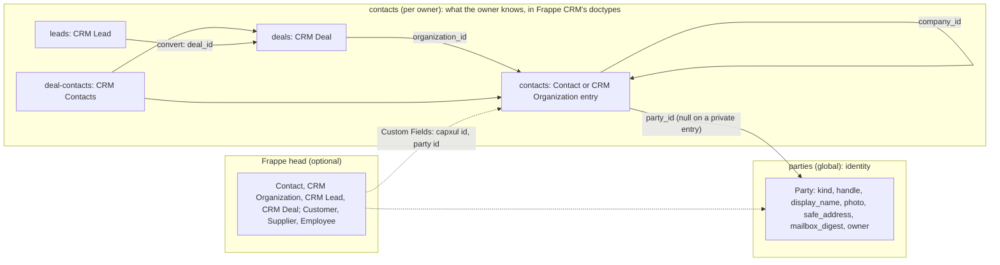

# CRM: people and companies in Frappe CRM's shape

Lane: **crm**. Owns `books/target/parties` and `books/target/contacts`. Written 8 November 2026,
main-line design, book first. The records are the design; this page explains them and lists what
other lanes must change.

The rulings this lane carries out:

- `aaron.erp-on-capxul`: Frappe is Capxul's UI, the head. An Organization's data lives in Frappe's
  shapes from the start, whether or not a head is connected.
- `aaron.frappe-shape`: CRM and Projects are fundamental. Every Organization starts with them.
- `aaron.crm-frappe-shape`: the global directory of people and companies is a global CRM in Frappe
  CRM's shape.
- `aaron.frappe-head`: the head is optional. Once it is connected the CRM syncs, and Capxul stays the
  system of record for money and identity.
- `aaron.contacts-permissions`: editing the contact book needs a permission, the People hat. The
  superseded `contacts.members-write` already follows it.
- `system.frozen-behaviour`: the five frozen contacts operations keep their behaviour, and so do the
  money path's uses of `parties.resolve-recipient`.

The starting point was [`docs/vision/erp.md`](../../vision/erp.md): section 2's two layers, the
party mapping table, and core checks C12 to C15 and C27, now read as main-line design.

## In one paragraph

Capxul's CRM has two layers.

- **The directory (`parties`, global)** holds identity. It has one Party per person, agent, Capxul
  Organization or wallet that Capxul can name and pay: a name, a picture, the Safe where money
  lands, and the key that makes it one record across every tenant. A person's key is a digest of
  their mailbox.
- **Each owner's book (`contacts`)** holds everything that owner knows. It is laid out in Frappe
  CRM's doctypes, table for table and field for field:
  - Contact and CRM Organization in `contacts`;
  - CRM Lead in `leads`;
  - CRM Deal in `deals`;
  - CRM Contacts, the deal's child table of people, in `deal-contacts`.

So an Organization with no head has a complete CRM. A head connected later syncs by mapping names
and ids, never by changing shapes. Frappe CRM matches a person by their mailbox alone, and so does
the directory, so a head's Contacts and every book's entries land on the same Party.

## What was read

| Source | Commit | Used for |
|---|---|---|
| `frappe/frappe` `frappe/contacts/doctype` | `1a7ea577` | Contact (`email_ids`, `phone_nos`, `designation`, `company_name`, `links`, `user`), Contact Email, Contact Phone, naming (`autoname` from the full name) |
| `frappe/crm` `crm/fcrm/doctype`, `crm/install.py`, `crm/api` | `2cecd300` | CRM Organization, CRM Lead, CRM Deal, CRM Contacts, the default statuses, lost reasons and sources, `convert_to_deal`, `contact_exists`, `validate_lost_reason`, `set_primary_contact`, `get_linked_deals` |
| `frappe/crm` `frontend/src/pages/Organization.vue:490` | `2cecd300` | "`Contact.company_name` is the only tie" between a person and their company |
| `frappe/erpnext` Customer, Supplier, Employee, CRM Settings | `6b946b0f` | where a Party lands in ERPNext; Employee's `personal_email` and `company_email` (C27) |

The `fde-frappe:frappe-stack` skill confirms the routing: Frappe CRM owns leads and deals, which
become an ERPNext Customer when a deal is won (`create_customer_on_status_change`).

## The two layers

## Mapping, field for field

**A Party and Frappe** (decision `parties.frappe-identity`). The Party's columns keep their names.
The mapping depends on the Party's kind.

| Party (`parties`) | Frappe |
|---|---|
| kind `person` | Contact, and through ERPNext's links an Employee, Customer or Supplier (type Individual); a Frappe User if the person holds a Seat |
| kind `agent` | Contact and a Frappe User for the agent |
| kind `organization` (a Capxul Organization) | CRM Organization, and a Customer or Supplier (type Company) |
| kind `address` (an outside wallet) | Contact, or the Supplier or Customer paid at it |
| `display_name` | the name a Contact (`full_name`, pushed as `first_name`) or CRM Organization (`organization_name`) shows when the owner's book gives it no label; a head never changes it |
| `photo_file_id` | Contact `image`, CRM Organization `organization_logo` |
| `mailbox_digest` | what Frappe CRM matches a person by (`contact_exists`: "Match only on email which uniquely identifies a person"); the head holds the mailbox itself in its Contact Email rows |
| `party_id` | one Custom Field on Contact, CRM Organization, Customer, Supplier and Employee |

**A book entry** (`contacts`, decisions `contacts.frappe-shape` and `contacts.private-entries`).

| `contacts` column | Contact | CRM Organization |
|---|---|---|
| `contact_id` (the PartyId for an entry born from a Party, else `contact_<ulid>`) | `capxul_id` (Custom Field) | `capxul_id` (Custom Field) |
| `doctype` | `contact` | `organization` |
| `party_id` | `capxul_party` (Custom Field; also a Frappe `links` row to the Customer or Supplier) | `capxul_party` (Custom Field) |
| `label` (else the shown name: typed mailbox, Party's name, handle, id) | `first_name`, with no last name; the head names the Contact | `organization_name`, numbered ` - 2`, ` - 3` when the head already has that name (`contacts.head-mapping`) |
| `email_ids` [`email_id`, `is_primary`] | Contact Email rows | |
| `phone_nos` [`phone`, `is_primary_phone`, `is_primary_mobile_no`] | Contact Phone rows | |
| `designation` | `designation` | |
| `company_id` | `company_name` (the organization entry's Frappe name) | |
| `website`, `industry`, `territory`, `no_of_employees`, `annual_revenue`, `currency`, `company_description` | | same names (`industry` and `territory` are names of CRM Industry and CRM Territory records) |
| `visibility` (listed, hidden) | Custom Field `capxul_hidden` | Custom Field `capxul_hidden` |
| `head_name`, `version` | the record's `name` there; the version its edits are compared against | the same |

**A lead** (`leads`): CRM Lead with the same field names:

- the person: `first_name`, `last_name`, `email`, `mobile_no`, `phone`, `job_title`;
- the company as typed: `organization`, `website`, `industry`, `territory`, `no_of_employees`,
  `annual_revenue` (CRM Lead has no currency field, so it is in the Organization's currency);
- `source`, `status`, `lost_reason` and `lost_notes`.

The columns that differ: `lead_owner_party_id` is `lead_owner` (a member's Party, which is a Frappe
User in the head), and `stage` is the status's `type`, except that stage `converted` is CRM Lead's
`converted` check, with status Qualified as Frappe's `mark_converted` sets it. `deal_id` is the deal
the conversion made (Frappe links the other way, with `CRM Deal.lead`).

**A deal** (`deals`, `deal-contacts`): CRM Deal and CRM Contacts:

- `organization_id` is `organization`, a link to the CRM Organization entry;
- `deal_owner_party_id` is `deal_owner`;
- `probability`, `deal_value`, `expected_deal_value`, `currency`, `expected_closure_date`,
  `next_step`, `source`, `status`, `lost_reason` and `lost_notes` keep their names;
- `closed_at` is `closed_date`;
- `lead_id` is `lead`;
- each `deal-contacts` row is a CRM Contacts row (`contact`, `is_primary`).

**Statuses** (decision `contacts.crm-statuses`). Frappe's behaviour depends on a status's type,
never its name. So the `lead` and `deal` machines run on the type, and the status names are Frappe
CRM's install defaults.

| Stage | Lead statuses | Deal statuses (probability) |
|---|---|---|
| open | New | Qualification (10) |
| ongoing | Contacted, Nurture | Demo/Making (25), Proposal/Quotation (50), Negotiation (70), Ready to Close (90) |
| won | Qualified, Converted | Won (100) |
| lost | Unqualified, Junk | Lost (0) |
| converted (leads only, terminal) | CRM Lead's `converted` check, status Qualified | |

Frappe's default Converted status is of type Won, not a type of its own: Frappe's conversion sets
the status to Qualified and the `converted` check. So a person may pick Converted like Qualified
without converting, as in Frappe, and only the check makes a lead `converted`. On Hold has no default
status in either list, so it is not booked. The lost reasons are Frappe's
nine defaults, and `Other` needs notes. Sources, industries and territories are free names, which
the head creates as link records when it syncs.

**Not taken**, left to the head as its own fields:

- SLAs, response times and communication status;
- products and totals (ERPNext Items);
- domain enrichment and social links;
- lead score and temperature;
- notes, tasks and call logs (FCRM Note, CRM Task, CRM Call Log).

The last are activities on a lead or deal. They are the obvious next addition when a business works
its CRM without a head, as a `crm-activities` table in Frappe's shape.

## Behaviour

**The five frozen operations keep every claim.** `contact add`, `list`, `label`, `hide` and `unhide`
book exactly as before:

- every entry they make is born from a Party, so its id is still the PartyId that `contact add`
  prints;
- every locator still lands on that one entry, now through the unique `contacts-by-party` index;
- a mailbox typed into `contact add` is kept as the entry's primary entry in `email_ids`, not as its
  label. The label rule still shows it before the Party's name, so `contact add` #3 holds.

`contact get` and `contact bank add` are banking's and step through `contacts.book.list` and
`contacts.book.get` as before. `get` now also returns the entry's details.

**What changed on the wire.**

- An entry's `ref` is null on a private entry, which cannot be paid until it has a Party.
- Entries now carry their `doctype`.
- Inputs that named an entry by `partyId` now name it by `contactId`. The value is the same for
  every entry born from a Party.

**Payments' recipient resolution is unchanged.** `parties.resolve-recipient` keeps its input, its
output and its rule of never refusing. Contacts invokes it in three places:

- `contact add`;
- `contacts.book.record`, when a person's primary mailbox is given or a private entry is linked;
- `contacts.leads.convert`, for the lead's mailbox.

A private entry can never reach `payment send`, because its `ref` is null.

**The CRM's own capabilities** are new, and none is among the 215:

- `contacts.book.record`: records a person or company and its details, or links a private entry to
  its Party.
- `contacts.leads.save`, `move`, `convert`, `list` and `get`.
- `contacts.deals.save`, `move`, `list` and `get`.

Each is one rpc behind one Core SDK method:

- `client.account.addressBook.record`;
- `client.org(orgId).crm.leads.*`;
- `client.org(orgId).crm.deals.*`.

These methods serve the SDK only. The Organization's Forward Deployed Engineer uses them, wearing
the People hat to write. A connected head does not use them; it syncs through contacts' own process
(see below). Their CLI commands wait on a decision for Aaron (`contacts.crm-capabilities`).

**Frappe's rules, kept:**

- A lead needs a first name, a company name or a mailbox (`set_lead_name`).
- A lost status needs a reason, and `Other` also needs notes (`validate_lost_reason`).
- A lost lead cannot be converted.
- A deal's probability defaults from its status (`update_default_probability`).
- A won deal records when it was won (`closed_date`, here `closed_at` on the one clock).
- A deal has at most one primary person, and a deal's only person is its primary.
- A lead's owner is never the lead's own mailbox.

**Conversion** (decision `contacts.lead-conversion`) is Frappe's `convert_to_deal`, run as one
transaction that locks the lead first. It sets three things:

- **The person** is the entry given, or else the book's entry for the lead's mailbox, resolved in
  the directory (which names a provisional Party if the mailbox is new), or else a private Contact
  when the lead has no mailbox.
- **The company** is the entry given, or else the book's CRM Organization whose shown name is the
  company name the lead typed (Frappe's `create_organization`), or else a new private one made from
  it. On a head a CRM Organization's name is its identity, so a conversion there lands on the same
  company; matching here keeps the two sides one. A deal moves no money and the match never changes
  an entry's Party.
- **The deal** is born open.

The lead then becomes `converted`, status Qualified. Converting it again returns the same deal (the
lead's `deal_id`, read under its lock), which is Frappe's "Return Existing". `deals-by-lead` is not
unique, because a head may still make a second deal from one lead (Frappe's default is "Create").
Before conversion a lead's mailbox names nobody in the directory.

**Permissions** (decisions `contacts.members-write` and `contacts.crm-permission`):

- Every member of an Organization reads its whole CRM.
- Only a member whose Safe wears the People hat records, changes, moves or converts anything in it,
  in Capxul or on a connected head (an edit on the head counts only when the head user's mailbox
  matches such a member).
- A lead's or deal's owner must be a member.
- In a person's own book, the person reads and writes; a person's book has no leads or deals.

**No door; one process.** Nothing in the CRM is a money fact, so it has no procedure. Entries, leads
and deals change only inside an rpc and wait on nothing; a deal's expected closure date is a
forecast, not a timer. The one process is the head sync below, which lives as long as a head is
connected (decision `contacts.no-door-no-process`).

## The core checks on the directory

| # | Check | Verdict now | Record |
|---|---|---|---|
| C12 | Seats are enough for an ERP | Fits | Payees are Parties in the directory and entries in a book, never Seats. A lead's or deal's owner is a member. |
| C13 | The directory can hold people and companies not on Capxul | **Decided; for Aaron.** It holds people, by mailbox, whether or not they have joined. It holds companies once they are on Capxul (or paid at a wallet). A company not on Capxul is a private CRM Organization entry in each book until it is linked. | `parties.outside-companies`, `contacts.private-entries` |
| C14 | The directory leaks nothing a CRM keeps private | Fits | `parties.frappe-identity`; `parties.directory-tenancy`; `parties.mailbox-digest` |
| C15 | The address book extends to a CRM | Fits, settled | `contacts.frappe-shape`: the book *is* the CRM, in Frappe CRM's doctypes |
| C27 | A person's mailbox for life | **Decided; for Aaron.** Yes, one mailbox for good. Anyone who pays people pays at a mailbox the person keeps: Frappe HR's `personal_email`, never `company_email`. Moving an account to another mailbox is a later capability across access, parties and accounts, with a guard against reassigned work addresses. | `parties.mailbox-for-life` |
| C6 (in part) | A settled fact names its counterparty's Party | Books' (see below) | |

**C13 in short.** A Party is something money can be routed to, and whose owner can be proved:

- a mailbox proves itself at sign-in;
- a handle proves itself at its Organization's birth;
- an address proves itself on chain.

A company not on Capxul has none of these. A global row for it would hold one tenant's words. If
such a row could be claimed by the first person with a mailbox at the company's domain, it would
redirect money meant for the real company, in every tenant's CRM. If Aaron wants companies named
before they join, the path is to key them by a proven web domain. That needs a domain proof (a new
integration) and an unclaimed-company state on the Party machine, and both must be designed first.

**C27 in short.** The book assumes one mailbox everywhere: sign-in, the Safe's derivation, Companies
House's hand-over (accepted as the beta's trust root), the claim escrow, and resolution. Moving to a
new mailbox is possible off chain, but every one of those pieces must move together. A work mailbox
that is later given to someone else would sign the newcomer in as the person who left.

## Syncing with a head

Decisions `contacts.head-sync` and `contacts.change-log`. The CRM syncs the way every app concept
does: projects (`projects.head.sync`) set the pattern, and the shared `frappe-head` integration and
organizations' `org-heads` carry it. Each concept syncs its own records.

- **The change log.** Every write to an Organization's CRM appends one row to `contact-changes`, in
  its own transaction, whether it changes a book entry, a lead or a deal with its people. Each row
  takes the next `seq` from `crm-settings`, under that row's lock, so seqs commit in order and a
  reader that pages by `seq` skips nothing. The changed record keeps that seq as its `version`. A
  person's own book has no head and logs nothing. A time-ordered pull could miss a late commit,
  which is the vision's C5 problem; the seq log avoids it.
- **One process per connection.** `contacts.head.sync` starts at `org-head.confirm` and keeps its
  cursors in `contact-head-syncs` (`pushed_seq`, `pulled_change`). It does three things:
  - **Push.** It pages the log and writes each record as it stands (`upsertDocs`): a Contact or CRM
    Organization with `capxul_id` and `capxul_party`, a CRM Lead, or a CRM Deal with its CRM Contacts.
    The first push starts from seq 1, so a head connected late still receives the whole CRM.
  - **Pull.** It reads the head's own changes (`listChanges`) and applies each one through the CRM's
    own checks and transitions, by the version rule of `organizations.head-ownership`, as the member
    the head user's mailbox matches. That member must wear the People hat
    (`aaron.contacts-permissions`), unlike projects, which falls back to the connection's authority.
    A stale edit loses, and Capxul's version is pushed back (a conflict). An edit the checks refuse
    is pushed back too (refused): an editor without the hat, a status Capxul does not know, a lost
    status with no reason, an edit to a converted lead. Capxul never deletes a CRM record, so a
    head's deletion is pushed back. A refused document born in the head has no Capxul version to
    push, so it stays there with no `capxul_id`, counted `refused`.
  - **Wake.** It wakes on a change here, on the head's ring, and on a daily catch-up timer.
- **Identity stays Capxul's.** A head never sets or changes `capxul_party`. A Contact born in the
  head with a primary mailbox is named in the directory through `parties.resolve-recipient`, exactly
  as a recorded person is; if that Party already has an entry in the book, the Contact is refused,
  never merged. A Contact born there with no mailbox, and every CRM Organization born there, is a
  private entry. A Party's name is never taken from a head: a pulled name is the book's label. This
  is what stops a head from redirecting money.
- **Shapes match, and the head's own rules are kept** (`contacts.head-mapping`). The field names are
  Frappe's, and `doctype`, `stage`, the status names and `capxul_hidden` (hide and unhide) map one
  to one. The rules a table cannot show:
  - A CRM Organization is named by its `organization_name`, unique on the site, and Contact's
    `company_name` holds that name. The frozen book lets two entries share a label, so the push
    numbers a taken name (` - 2`, ` - 3`), as Frappe numbers a Contact's, and keeps it as
    `head_name`. A label change renames the document there.
  - A Contact's `first_name` is the entry's shown name. A pulled `full_name` or `organization_name`
    becomes the label only when it differs from the name Capxul shows.
  - A member is a User on the head, with the Contact Frappe made for that User. A deal that names a
    member names that Contact, found by its `capxul_party`. A member's own row in the book is not
    pushed while the member holds a Seat, and a change to a User's Contact is not pulled.
  - A lead with no first name is written as Frappe's Data Import writes one, the path
    `set_lead_name` serves (CRM Lead's form makes `first_name` mandatory).
  - A lead the head converts arrives as a new deal naming it and then the lead's `converted` check
    (set with `db_set`). The pull applies `convert` with that first deal, and keeps any later deal
    from the same lead as a deal.
  - A site that already holds a CRM: the first push adopts a Contact with no `capxul_id` whose
    primary mailbox is an entry's, and a CRM Organization whose name is an organization entry's
    shown name (Frappe's own keys), instead of making a second.

## Records changed

**parties**

- `data.ts`: `parties`'s about and header now say what a Party is in Frappe's shapes. The table
  itself is unchanged.
- `procedures.ts`: `parties.resolve-recipient`'s about names its CRM uses. Its behaviour is
  unchanged.
- `decisions.ts`: three new decisions: `parties.frappe-identity`, `parties.outside-companies` (C13,
  for Aaron) and `parties.mailbox-for-life` (C27, for Aaron).

**contacts**

- `data.ts`: `contacts` is reshaped. Its key is (owner, `contact_id`). It gains `doctype`, a nullable
  `party_id` with a unique index, Frappe's Contact and CRM Organization fields, and `head_name` and
  `version`. The event now carries `contact_id`. New tables: `leads`, `deals` and `deal-contacts`,
  plus the sync tables `crm-settings`, `contact-changes` and `contact-head-syncs`. New machines, each
  with its event: `lead` and `deal`.
- `book.ts`: `Entry` gains `doctype` and its `ref` is nullable. New shapes: `Details`,
  `EntryWithDetails` and `PartyRef`. Inputs name an entry by `contactId`. `contacts.book.get`
  returns details. New rpc: `contacts.book.record`.
- `leads.ts` (new): five rpcs.
- `deals.ts` (new): four rpcs.
- `flows.ts`: the guided flows take `contactId`. Ten new SDK-only flows.
- `operations.ts`: claims unchanged; `contact add` returns a non-null `PartyRef`.
- `processes.ts`: one workflow, `contacts.head.sync`.
- Every CRM write, the frozen book writes included, appends to `contact-changes` in an
  Organization's book.
- `decisions.ts`, rewritten: `contacts.one-book-table` (the new key), `contacts.ref-and-label` (the
  typed mailbox moves to `email_ids`) and `contacts.no-door-no-process` (one process now: the head
  sync). Widened: `contacts.budgets`.
- `decisions.ts`, new: `contacts.frappe-shape`, `contacts.private-entries`, `contacts.crm-statuses`,
  `contacts.lead-conversion`, `contacts.crm-permission`, `contacts.crm-capabilities` (for Aaron),
  `contacts.head-sync`, `contacts.change-log` and, from review, `contacts.head-mapping`.
- `index.ts`, `procedures.ts`: module list and comments.

## For Aaron

1. **`parties.outside-companies` (C13).** Companies join the directory when they are on Capxul;
   until then they are private in each CRM. Or should they be named before they join, by a proven
   domain?
2. **`parties.mailbox-for-life` (C27).** Is one mailbox per person for good? Or will a person be
   able to move their account to a new mailbox?
3. **`contacts.crm-capabilities`.** Should the CRM get CLI commands now (`contact record`,
   `crm lead …`, `crm deal …`)? That means allowing operations beyond the 215, together with the
   projects concept. Or should it stay SDK-only until then?

## For other lanes

- **Shared foundation:**
  - Widen `concept_contacts`'s about to the CRM: "and each Organization's CRM in Frappe CRM's
    shapes: contacts and organizations, with or without a Party, leads and deals".
  - Add `concept_indexing` to its `dependsOn`, so the People hat's wearers (`hat-wearers`) can be
    read. This was asked already, by `contacts.members-write`.
  - `concept_parties`'s about still lists "onboarding, withdrawal address" among the profile's
    fields. `parties.profile-shape` dropped them.
- **Banking:**
  - `client.account.address-book.get` and the pickers of `contact bank add` and `bank pay` pass the
    entry's `contactId` to `contacts.book.get` (it was `partyId`; the value is the same for every
    Party-backed entry).
  - `Entry.ref` can be null: a private entry has no bank accounts by Party, and `bank pay` refuses it.
  - A payee known only by name (`scope: payee`) could later name a private company entry.
- **Head and organizations:**
  - `organizations.head-ownership` is now a decision record, but it does not say whose authority a
    pulled edit runs under. Contacts settles it for the CRM (`contacts.crm-permission`): the member
    the head user's mailbox matches, who must wear the People hat, with no fallback to the
    connection's authority. Projects falls back to the connection; the head lane should say in
    `organizations.head-ownership` that an app concept may be stricter.
  - The Capxul app for Frappe adds the Custom Fields `capxul_id` (Contact, CRM Organization, CRM
    Lead, CRM Deal), `capxul_party` (Contact, CRM Organization, Customer, Supplier, Employee) and
    `capxul_hidden` (Contact, CRM Organization), and reports changes to those four doctypes in
    `listChanges`.
  - `listChanges` must catch every change Frappe CRM makes, not only saves. `convert_to_deal` sets
    the lead's `converted` check and status with `db_set`, which runs `on_change` but not
    `on_update`. It also writes with `frappe.db.set_value`, which runs no hook at all
    (`update_lead_contact`; the `deal_owner` restore in `create_deal`, with `update_modified=False`).
  - The first `listChanges` of a connection must list the documents the site already holds, not only
    changes made after the Capxul app was installed. Otherwise a site connected late keeps a CRM that
    Capxul never sees (`contacts.head-mapping` adopts by mailbox and name on the first push).
  - `upsertDocs` must make the link records a document names before writing it: CRM Industry, CRM
    Lead Source, CRM Territory and Currency (a token such as USDC is no Currency in a fresh site, and
    Frappe CRM fetches an exchange rate for any currency that is not the site's).
  - `upsertDocs` writes a CRM Lead with no `first_name` as Frappe's Data Import does
    (`ignore_mandatory`), so `set_lead_name` names it.
  - Renaming a CRM Organization must also rewrite the `company_name` of the Contacts that hold its
    old name. `company_name` is a Data field, which `rename_doc` does not follow.
  - Every Seat is a User on the head, and the Contact Frappe makes for that User (`create_contact`)
    carries the member's `capxul_party`. Contacts names a member on a deal by that Contact.
  - The head's Sales User and Sales Manager roles should follow the People hat, so that the head's
    own forms stop the users whose edits Capxul would push back.
  - A won deal's Customer in ERPNext is the head's (`create_customer_on_status_change`), and keeps
    the deal's Party.
- **FDE and organizations:**
  - The Organization's own agent needs the People hat to work the CRM. Decide whether setup grants
    it, or the founder does.
  - Importing a business's existing contacts at start-up goes through `contact add` and
    `contacts.book.record`.
  - The CRM needs no seeding: the status lists are fixed defaults.
- **Payroll:** resolve an employee's Party from Frappe HR's Employee `personal_email`, never
  `company_email` (`parties.mailbox-for-life`).
- **Books:** core check C6. A fact's `counterparty` is a string. Pin it to a Party id, so a head can
  post the fact against the Contact, Supplier or Customer that carries that Party.
- **Rulings owner:** `contacts.members-write` is already rewritten to `aaron.contacts-permissions`
  and can leave `SUPERSEDED`.
- **Frozen check and conventions:** new capabilities cannot be operations today (check-frozen:
  "a target operation that is none of the 215"). The CRM and projects need one rule for booking new
  CLI commands with a decision pack.
- **Vision note owner:** `docs/vision/erp.md` still frames C13, C15 and C27 as open questions. They
  are now these decisions.

## Revised in review

An adversarial review read the lane against Frappe's sources and changed these records:

- **Converted is not a status type.** Frappe CRM's default Converted lead status is of type Won, and
  its `convert_to_deal` sets the status to Qualified and the `converted` check. The first pass gave
  Converted its own type, which a head would have read back as won. Now stage `converted` is the
  check, a converted lead's status is Qualified, and Converted can be picked like Qualified.
- **A lead has no currency.** CRM Lead's `annual_revenue` has no currency field. The `currency`
  column on `leads` is gone.
- **A company is matched by name on conversion, and a lead may have several deals.** On a head a CRM
  Organization's name is unique, and Frappe's conversion matches by it and by default makes another
  deal when asked again. A conversion here now matches the same way, `deals-by-lead` is no longer
  unique, and converting twice answers the lead's own `deal_id`.
- **Head edits need the People hat.** The first pass applied an edit by a head user who matched no
  member under the connection's authority. That broke `aaron.contacts-permissions`, and it let any
  head user choose the Party of a private entry by giving it a mailbox.
- **The head's own rules are booked** (`contacts.head-mapping`): unique organization names, members'
  User Contacts, leads with no first name, conversions made on the head, deletions, refused
  documents born on the head, and a site that already holds a CRM. The first pass said only that a
  sync renames fields.
- **A lone mailbox is primary,** as Frappe's `set_primary_email` makes it. A private entry's id is a
  valid CLI id, so the CLI no longer refuses it as a malformed PartyId.
- **A Party's name is identity.** The first pass mapped `display_name` straight to Contact
  `full_name`. Now it is the name a Contact shows only when the book has no label, and a head never
  changes it.

## Not decided here

- Notes, tasks and call logs on leads and deals (FCRM Note, CRM Task, CRM Call Log).
- Per-Organization status, source, industry and territory lists, and On Hold.
- A domain proof for companies (only if C13 changes).
- Moving a person's account to a new mailbox (only if C27 changes).
- A sales permission apart from the People hat.
- Linking a request or payment to the deal it closes.
