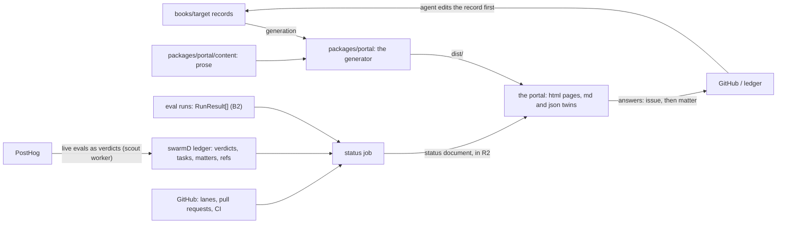

# The portal

The portal is the documentation site. It connects everything: the design book's records, the evals derived from them and
their verdicts, the swarmD ledger, GitHub, PostHog and hand-written prose. It is built first, at D0, beside the B0
spike.

- **The book** means only the design book (`books/target`).
- **The portal** means the documentation site.

This document is the portal's design. The build session builds the portal from it, so nothing about the portal is left
to invent. Every judgment in it is a decision record in
[`books/target/shared/portal.ts`](../../books/target/shared/portal.ts), with ids `portal.<topic>` (listed at the end).

**What renders it.** The book's own generator does (`portal.stack`, by Aaron's ruling `aaron.portal-generator`):
the starter kit's `packages/portal`, copied into this repository and grown. Fumadocs is set aside for now, to revisit
later. Whatever the generator writes is the portal.

**See it.** [`portal-prototype.html`](portal-prototype.html) is a working prototype generated from the real records by
[`tools/portal-prototype.ts`](../../tools/portal-prototype.ts). It is one self-contained page with the overview, Review,
every concept and operation page, the scoreboard and the CLI surface. Its verdicts are mock until B2. The stands it shows
for specify and decide come from the real records. Its **Verdicts: None yet** switch shows the stands as the records give
them today.

```bash
node --experimental-strip-types tools/portal-prototype.ts docs/design/portal-prototype.html   # about 1.8 MB
```

## 1. Who it is for

Each audience comes with one job, and the portal gives each job one place to start.

| Audience | Comes to | The portal gives them | Starts at |
|---|---|---|---|
| **Aaron**, reviewing and deciding | Decide what waits for him, see where the build stands, and read the design at any depth before code exists | **Review** lists the judgments waiting for him, ordered by how many operations each one holds, and each has Accept, Choose another option and Change. It also lists the decision packs managers raise, the milestone acceptances and the CLI surface's changes. The overview shows the milestones and the stand of all 215 operations. Every page goes down from a concept to an operation to the records under it. | `/review/` |
| **Lane managers and agents** (the master agent, makers, checkers) | Find their task's records, its evals and their status | Every record has its own page, with the records it links to and the records that link to it, its evals and their verdicts at the head, its gaps and its decisions. An operation's page also lists the records under it, which is its work. Every page has a JSON twin and a Markdown twin, so agents never scrape HTML. | `/data/operation/<id>.json`, or the URL of any record key |
| **App developers** using the CLI and the SDK | Use a command or an SDK method correctly | The operation page starts with Use: the synopsis and flags, who can run it, examples, the `--json` shape, each refusal with its code, exit code and message, and the budget. There are guides, the error catalogue and the SDK methods by namespace. | `/docs/` |
| **Operators** on staging | Know what runs where, what is deployed, and whether it holds | The environments and the components each runs, the configuration and secret names, the deployed commit, each operation's live evals (p95 against budget, error rate) and each journey's funnel. There is the error catalogue, with who acts on each code, and the runbooks. | `/operate/` |

The portal is private while it shows pending judgments, internals and money paths (`portal.hosting`). The public developer
docs come later, as a filtered build of the same site: the Docs section and each operation's Use and Acceptance, built
from `main`. Publishing them is Aaron's step.

## 2. What it connects, and how each source reaches it

The portal has two layers.

- **Pages.** These are generated from the records at build time. They change only when the records change.
- **Status.** This is one document per tracked ref, read by the pages when they open (`portal.status-source`). It changes
  with every eval run, pull request and deploy.

The portal holds no credential and writes nothing (`portal.read-only`). Every action leaves through a system that already
knows who is acting.



| Source | What the portal shows from it | How it reaches the portal | When | Credential |
|---|---|---|---|---|
| **The book's records** (`books/target`) | Every page: concepts, operations, flows, rpcs, procedures, workflows, tables, machines, events, errors, integrations, contracts, components, environments, journeys, invariants, decisions, and the system (the Overview) | The generator (`packages/portal`) imports `books/target/index.ts`, runs `buildBook`, and writes each record's page with its page model, the JSON twin. It also imports every file under `books/target` and maps each record to the file whose exports hold it (modules are loaded once, so the values are the same objects); a child record takes its parent's file. | Every portal build: each push to `integration/build`, and a preview for each pull request | none |
| **The frozen book** (`books/frozen`) | Each acceptance line marked kept or rewritten (against `operations.ts`); the old arguments and flags, and the global flags, as reference until B1 (`flags.ts`) | The same build imports `books/frozen/index.ts`, as `tools/check-frozen.ts` does | Same | none |
| **Derived from the records** | Problems, gaps, every derived eval (id, level, subject, claim, decider; 4,789 on 8 November 2026), the reverse links, the records under each operation, each operation's stand with no verdicts, the CLI surface | The same build, with `buildBook`'s problems, gaps, evals and `linkedBy`, `underOf` and `standOf` (§4) | Same | none |
| **Git** | The commit each page is built from (`seenAt`), and links to a record's file and its history on GitHub at that commit | The build passes the commit in. History is a link, not data, so the site stays deterministic and CI needs no full clone. | Same | none |
| **Decisions and the review list** | Every decision page. Review lists the decisions waiting for review and the operations each one holds. | The decision records and their `review` field (`portal.review-state`), from D0 | Same | none |
| **Verdicts: the scoreboard** | Each eval's current verdict at the head (pass, fail, unverifiable or error, or unknown), its measures (p50, p95, n) and its evidence. The stand of each operation. | **Until the ledger runs:** the harness's `RunResult[]` from each run at the head (B2), which the status job turns into `status/<ref>.json`. **After:** the ledger's `verdicts` and `score` resources, read by the status job. | After every eval run at a ref head | the status job's only |
| **The swarmD ledger** | The task on each operation and its state, the assignee and role, the pull request, the open matters and the milestone tasks | **Until the ledger runs:** the task tree from `docs/mission/tasks.json`, which the swarm design derives with `tools/plan-tasks.ts` (absent, the work sections say "no tasks yet"); `docs/mission/progress.md` is linked, not parsed. **After:** the ledger resources listed below, read by the status job. Live detail stays on the manager's board, which the portal links to (`portal.artifact-boundary`). | Every 10 minutes, and on a `repository_dispatch` if the swarm design's manager sends one on a ref move | a read-only ledger token, in the status job |
| **GitHub** | Each lane's branch (`lane/<concept>`), its open pull requests with their CI and review state, CI on `integration/build`, the open `review` issues and the pull requests that answer them, and links to source at the commit | The status job calls the GitHub API with the CI token | On every push, pull request and issue event | CI's token, in the status job |
| **PostHog** | Each operation's live evals (`live:bud:<op>`, `live:err:<op>`), and each journey's funnel as step counts | Only as verdicts. The scout worker reads PostHog and posts the L4 verdicts to the ledger (spec 30), with the funnel's step counts in `measures`. Each page links to the PostHog insight by the name the telemetry catalogue gives it. | From B5 | none; the key stays in the connector gateway |
| **Hand-written prose** | Guides, explanations, runbooks, and each command's examples and notes | Markdown with directives in `packages/portal/content/`, placed in named slots on generated pages (`portal.prose`) | Every portal build | none |

### The status document

The status job writes one status document for each tracked ref: `integration/build`, `main` and each open pull request
(`pr/<n>`, which that pull request's preview reads). It computes every operation's stand with `standOf`, from the book
at the document's commit and the verdicts, and writes it in. Pages show those stands; they never compute one, because
`standOf` needs the book and the browser has only page models. An eval with no entry is `unknown`. With no status
document yet, a page shows the stand the generation computed with no verdicts.

```ts
/** status/<ref>.json: written by the status job, read by each page when it opens. */
interface PortalStatus {
  ref: string;                       // "integration/build", "main", "pr/123"
  commit: string;                    // the head the verdicts are about
  writtenAt: string;
  source: "harness" | "ledger";
  stands: Record<OperationId, {      // standOf at `commit`
    stand: "specify" | "decide" | "build" | "observe" | "done";
    why: string;                     // the first rule that matched, e.g. "gap refusal-without-world on operation:dev.fund"
  }>;
  verdicts: Record<EvalId, {
    result: "pass" | "fail" | "unverifiable" | "error";
    commit: string;                  // = commit; an older one is shown greyed as "last seen"
    at: string;
    waived?: boolean;                // unverifiable with a person's waiver: counts as a pass
    measures?: Record<string, number>;  // { p50_ms, p95_ms, n } for a budget eval; a funnel's step counts
    detail?: string;                 // ≤ 600 characters: what was expected and what was seen
    evidence?: string[];             // links to the run, the trace, the review
  }>;
  work?: Record<OperationId, {       // from the ledger, or docs/mission/tasks.json before it; a task is on an
                                     // operation when one of its own evals has that operation as its subject
    task: string; title: string; state: string; owner: string;
    assignees: { actor: string; role: string }[]; pr?: number;
  }[]>;
  matters?: { id: string; kind: string; title: string; decision?: string; state: "open" | "resolved";
              options?: { label: string; text: string }[]; recommendation?: string; board: string }[];
  answers?: { decision: string; answer: "accept" | "choose" | "change"; issue?: number; matter?: string; pr?: number }[];
  lanes?: Record<ConceptId, { branch: string; head: string;
              prs: { number: number; title: string; ci: "pass" | "fail" | "pending"; review: string }[] }>;
  deployed?: Record<EnvironmentId, { commit: string; at: string }>;
}
```

The pages and the status can be at different commits. When they are, the banner shows both. A verdict at an older commit
is shown greyed as "last seen", as in the ledger's roll-up (spec 10).

### What the portal reads from the ledger

The status job needs read access only, to these resources of `docs/spec/10-swarmd-ledger.md` and their fields. Their
shapes belong to the swarm design ([`swarm.md`](swarm.md)); the portal names what it reads so that those fields stay
stable.

- **`tasks`:** id, title, state (derived), owner, labels, evals and needs. A task is on an operation when one of its own
  evals has that operation as its subject in `evals.json`; no label is needed.
- **`verdicts?ref=`:** the current verdict of each eval at the ref's head.
- **`log`:** the `assigned` and `ended` entries (who works a task, in which role), `deployed` (each environment's
  commit) and waivers. Spec 10 has no `assignments` resource, and `verdict.waive` appends an entry of no listed kind;
  the swarm design adds an `assignments` resource and a `waived` entry kind, or the status job keeps reading the log.
- **`matters`:** kind, title, options, recommendation, state, resolution and the task.
- **The project** (`projects/<project>`): its refs and their heads. Spec 10 has no separate `refs` resource.
- **`score?group=label:area`:** the counts the scoreboard shows. The status job checks that the verdict counts it
  computes over each area's task evals equal them.

## 3. Information architecture

### Sitemap

```
/                                   Overview
/review/                            Review: waiting judgments, answers in flight, open matters, acceptances, surface changes
/decisions/                         every decision, searchable, the waiting ones first
/design/                            the concept map in build-order layers, the components, the environments
/concept/<id>/                      a concept
/<kind>/<id>/                       every record (one URL grammar for all kinds, below)
/build/                             the scoreboard
/build/evals/                       the eval catalogue: filter by level, kind, decider, result and concept
/build/gaps/                        gaps and problems, by rule and concept
/build/milestones/                  D0 and B0 to B5: exits, state and acceptance
/build/lanes/  /build/lanes/<c>/    one lane per concept: branch, pull requests, CI, tasks
/operate/                           environments, deployed commits, live evals, journey funnels
/operate/runbooks/<slug>/           hand-written runbooks
/docs/                              the developer home
/docs/guides/<slug>/                hand-written guides and explanations
/docs/cli/                          the CLI surface (commands, global flags, flag index, --json shapes, error vocabulary)
/docs/sdk/                          the Core SDK methods by namespace
/docs/errors/                       the error catalogue
/llms.txt   /<page>.md   /data/<page>.json   /status/<ref>.json   /eval/?id=<eval id>
```

### Navigation

- **Sections.** The top bar holds the six sections: Overview, Review, Design, Build, Operate and Docs
  (`portal.sitemap`). Review shows a count of what waits.
- **The concept rail.** Design and record pages have a left rail of the 23 concepts in build-order layers, each with its
  operation count and its stand bar. On a narrow screen the rail folds into the Design index.
- **Breadcrumbs.** Every record page has one: section, concept, kind.
- **Search.** One static index covers commands, SDK methods, record ids and titles, error codes, decision ids and titles,
  and eval ids.
- **The stand everywhere.** Every list of operations shows each operation's stand chip, and every list of decisions shows
  its review state.

### One URL per record

A record key is its URL, so any reader or tool that holds a key, an eval id or a command builds the link without a
lookup.

| What | URL | Example |
|---|---|---|
| A record | `/<kind>/<id>/` | `/operation/payment.send/`, `/table/payments/`, `/decision/system.size/`, `/error/INSUFFICIENT_BALANCE/`, `/invariant/<id>/`. The system's page is the Overview: `/system/capxul/` redirects to `/`. |
| A child record | an anchor on its parent: its kind, then its name | `/machine/payment/#transition-open`, `/integration/bridge/#call-createTransfer`, `/contract/payments/#function-send`, `/contract/payments/#chainEvent-Sent`. The kind keeps a contract's function and event apart (the Safe has `approveHash` and `ApproveHash`). |
| An eval | an anchor on its subject's page (a child's parent): the eval's kind, then what its id holds beyond the subject's id, split at `.` and `/`, joined by `-` | `acc:payment.send/3` → `/operation/payment.send/#acc-3`; `tbl:payments/admits/1` → `/table/payments/#tbl-admits-1`; `trn:payment.open` → `/machine/payment/#trn-open`; `int:bridge.createTransfer/PROVIDER_ERROR` → `/integration/bridge/#int-createTransfer-PROVIDER_ERROR`; `sys:imports/payments` → `/concept/payments/#sys-imports` |
| Any eval id | `/eval/?id=<eval id>`: a static page that looks the id up in the site's eval index (`data/evals.json`: id → page and anchor) and redirects; an unknown id says "no such eval at this commit" | `/eval/?id=ref:payment.send/INSUFFICIENT_BALANCE` |
| A command, an SDK method | redirect to the canonical page, through the static assets' `_redirects` file (about 360 rules, under its 2,000) | `/cli/payment/send/` → `/operation/payment.send/`; `/sdk/client.payments.pay/` → `/flow/client.payments.pay/` |
| The twins | `.md` beside the page, JSON under `/data/`: files the generator writes in the same generation | `/operation/payment.send.md`, `/data/operation/payment.send.json` |

Operation ids never change, so a command renamed by a decision keeps its page. The old command path redirects to it.

**Every eval id is unique** (`portal.eval-ids`). The anchors, `/eval/?id=`, the status document and the ledger's catalog
all key by id, and today they cannot: of 4,789 derived evals, 4,759 ids are distinct. Nineteen operations list one
refusal code from two or three worlds (`ref:org.member.grant/WRONG_STATE` twice) and nine integration calls map two
failures to one error (`int:bridge.submitVerification/PROVIDER_ERROR`). At D0, book first, `deriveEvals` emits one `ref:`
eval per operation and code, whose claim names every world, and one `int:` eval per call and error; `buildBook` gains
the problem `duplicate-eval`. Spec 30's grammar and every existing id stay as they are.

## 4. Page types

Every page type is generated from records. The table below says from which record kinds and fields, what the page holds,
what it links to, and what status it overlays. Every record page also has the same shared parts:

- its forward links, grouped by field;
- the records that link to it, from `linkedBy`, grouped by field;
- its evals with their verdicts;
- its gaps;
- the decisions whose `affects` name it, the waiting ones first;
- its source file in `books/target`, linked on GitHub at the commit, with a link to that file's history there.

Some parts need configuration, not data: the GitHub repository, the PostHog host and project id (for insight links,
by the name the telemetry catalogue gives them), and the swarmD host and namespace (for the managers' boards). They are
the portal build's settings, none of them secret.

| Page | Generated from | Sections | Links to | Status overlay |
|---|---|---|---|---|
| **Overview** `/` | the system (`title`, `about`, `actors`, `surfaces`); the components (`dependsOn`); the concepts (`dependsOn`, transitively reduced); the counts of every kind; problems and gaps; the decisions' `review`; the milestone tasks | What Capxul is; the milestones (D0, B0 to B5); the 215 operations by stand (each stand links to the scoreboard filtered by it); waiting for review (the top five by operations held); what reaches the portal; the component and concept maps; a link to the book's history on GitHub at the commit | Review, the scoreboard, each concept, each milestone | stand counts, the review count, each milestone's state |
| **Review** `/review/` | decisions (`question`, `options`, `chosen`, `why`, `affects`, `review`); the operations each one holds (§4, the stand); matters; milestone acceptances (from B4, the milestone tasks' `ok:<task>` person evals; before the ledger, each milestone's exit and whether `integration/build` has merged into `main` for it); the surface model, against `docs/decisions/accepted-surface.json` | Waiting for review, ordered by operations held, then touched, each with its actions; answered, waiting for the record (its issue or matter, pull request and preview); open matters (decision packs from managers, answered on the manager's board); milestone acceptances; surface changes since the last acceptance (`portal.cli-surface`), with Accept | each decision, each held operation, each matter on its board, the pull request previews | the review state, the answers in flight |
| **Decision** `/decision/<id>/` | `id`, `title`, `question`, `options[label, text]`, `chosen`, `why`, `source`, `affects`, `review`; its home (the id's first segment when that is a concept, else shared) | Question; options, with the chosen one marked; why; source; affects, grouped by kind; holds at decide (if waiting); touches through the records under them; its file's history on GitHub (a link) | the affected records, the held operations, related decisions (those affecting the same records) | the review state; each held operation's stand |
| **Concept** `/concept/<id>/` | the concept (`title`, `about`, `component`, `dependsOn`, `lines`); the records its folder exports; its decisions (id prefix); gaps on its records; its layer from `dependsOn` | Header (runs in, depends on, depended on by, layer, lane); operations with their stands; Core SDK flows; rpcs; procedures (its door); durable processes; tables; state machines with their diagrams; events; decisions; gaps; lane | every record of it, the concepts it depends on and those depending on it, `lane/<concept>` on GitHub | stand counts bar; `sys:imports/<concept>` and `sys:loc/<concept>`; lane pull requests and CI |
| **Operation** `/operation/<id>/` | see below | Use; Acceptance; How it works; Status; Decisions; Frozen text | see below | the stand, with its ladder |
| **Flow** (an SDK method) | `sdk`, `component`, `input`, `output`, `steps[name, rpc or local, about]`, `errors`, `calls`, `spans`, `surfaces`, `budget` | The method's signature from its input and output schemas; steps (wait steps marked); errors; budget; the operations it implements | its rpcs, the operations | `flw:<id>/budget` and `/spans` |
| **Rpc** | `kind`, `who`, `input`, `output`, `errors`, `reads`, `writes`, `drives`, `invokes`, `calls`, `chain`, `spans`, `budget`, `concept` | Who may call it; input and output; what it touches; errors; budget | tables, transitions, procedures, calls, contract functions; who reaches it (flows' steps, operations, workflows' signals and triggers) | `rpc:<id>/budget`, `/spans`, `/errors` |
| **Procedure** (a door) | `input`, `output`, `errors`, `reads`, `writes`, `drives`, `invokes` | As an rpc, and its invokers | its invokers, the tables it writes | `prc:<id>/atomic` |
| **Workflow** | `trigger`, `instance`, `signals`, `waits[name, for, timeoutMs, events, key]`, `steps`, the tables it touches, `calls`, `chain`, `idempotency`, `timeoutMs`, `retries`, `compensation`, `budget` | Trigger and instance; waits and what wakes each (its key); steps; idempotency, retries and compensation; budget | the transition, rpc or chain event that starts it; the rpcs that signal it | `wfl:<id>/idempotent`, `/resume`, `/wake/<wait>`, `bud:<id>/p95` |
| **Table** | `tenancy`, `tenantField`, `fields`, `key`, `indexes`, `admits`, `retention`, `scope` | Fields; key and indexes; tenancy and admissions (who besides the tenant may read or write, by clause); the machine on it; writers and readers | the machine, writers and readers, the tables an admission joins | `tbl:<id>/schema`, `/writers`, `/tenancy`, `/admits/<n>` |
| **Machine** | `table`, `field`, `initial`, `states`, `transitions[from, to, emits, guard]` | The state diagram; transitions, each with what drives it and the processes it starts | the table, the event, drivers, the processes started | `trn:<machine>.<transition>` per transition |
| **Event** | `props` | Properties beyond the envelope; senders (transitions) and waiters (workflow waits); its PostHog name, which is its id | senders, waiters, the journeys it proves | `evt:` evals naming it; its live count from B5 |
| **Error** | `class`, `actor`, `message`, `retryable`, `exit` | Message, class, who acts next, exit code, retryable; the operations that refuse with it, with the world each needs; what produces it (rpcs, procedures, flows, integration call failures) | those operations and producers | the `ref:` evals naming it |
| **Integration, contract** | integration: `system`, `service`, `component`, `calls` (timeouts, retries, p95, failures mapped to errors), `fake`, `secrets` (names); contract: `addresses`, `functions`, `events` | Calls or functions and events, each with its callers or consumers | callers, consumers, errors | `int:<id>/conformance`, `int:<id>.<call>/<error>` |
| **Component, environment** | `runtime`, `exposes`, `dependsOn`; `runs[component, on]`, `config`, `secrets` (names only), `deploy`, `bootMs` | What runs where; configuration and secret names; deploy | the components, the environments | `env:<id>/boot`, `/smoke`; the deployed commit |
| **Journey** | `steps[operation, as, proves]`, `variants` | Steps in order, each with its operation's stand and its proving event; the live funnel | the operations, the events | `jrn:<id>`, `fun:<id>`; `live:fun:<id>` with step counts from B5 |
| **Invariant** | `statement`, `over`, `check`, `by` | The statement; the tables and machines it is over; how it is checked, and for `reconcile` the workflow that checks it in production | the tables, machines and workflow | `inv:<id>` |
| **Scoreboard** `/build/` | operations (`command`, `priority`, `budget`), their concept and layer; the status document | A strip of counts by stand (each a filter); for each concept in build-order layers, each operation's stand, its own evals passing, the evals under it passing, p95 against budget, telemetry coverage (`evt` and `spn` passing), its task and assignee; lines per concept from B3 | operations, concepts, lanes, the manager's board | it is the overlay |
| **Eval catalogue** `/build/evals/` | `evals.json` (id, level, subject, claim, decider) | A table with filters | each eval's anchor | each eval's verdict |
| **Gaps** `/build/gaps/` | the build's gaps and problems (`record`, `rule`, `detail`) | By rule, then by concept | the records | none |
| **Milestones** `/build/milestones/` | the milestone tasks (`docs/mission/tasks.json`, then the ledger) | Each milestone: its goal, exit, state and acceptance (`ok:<milestone>`) | its tasks | task state; the acceptance verdict |
| **Lane** `/build/lanes/<concept>/` | the concept; the status document's lanes and work | Branch and head; open pull requests with CI and review; the concept's tasks with their states and assignees; a link to the manager's board | GitHub, the board | it is the overlay |
| **CLI surface** `/docs/cli/` | operations (`command`, `title`, `returns`, `refusals`, then `flags` from B1); errors; the global flags | Command tree by noun; global flags; flag index (B1); every `--json` shape, with an index of field names; error vocabulary and the exit-code-by-class table; verbs; marks where the system is not consistent (`portal.cli-surface`) | each operation, each error | each command's stand |
| **Environments** `/operate/` | environments; journeys; the status document | Each environment's components, deployed commit, configuration and secret names; live evals by operation; journey funnels; runbooks | environment, operation and journey pages; PostHog insights | live verdicts from B5 |
| **Guides and runbooks** | Markdown in `packages/portal/content/` | Hand-written, citing records through directives | the records cited | none |

### The operation page

There is one page per operation, at `/operation/<id>/` (`portal.operation-page`). It runs in a fixed order: the reference
first, then the design, then the status.

1. **Header.** `capxul <command>` and the title. Then the stand chip, the id, the area, the priority, the SDK method and
   the journeys it is a step of.
2. **Use.**
   - The synopsis, then a flags table. The flags come from the operation's designed flags, from B1. Until then the old
     CLI's arguments and flags from `books/frozen/flags.ts` are folded underneath and marked reference.
   - Who can run it (`who`), what it does (`about`), and the examples from its prose slot.
   - The `--json` shape (`returns`), as a field table and a JSON Schema.
   - Refusals (`refusals[error, given, when]`): each code links to its error page, with the exit code and message from
     the error record. A world of `?` shows "no world yet".
   - The CLI's own errors (`errors`), the budget (`budget`: class, p50, p95, why) and the SDK method or rpc
     (`implementedBy`, and a flow's `sdk`).
   - Common mistakes (`mistakes[what, fix]`).
3. **Acceptance.** Each claim (`acceptance[claim, observes, was]`), with what an eval observes. Each is marked kept or
   rewritten against the frozen claim; a retired line shows as retired. Each line is the anchor of its `acc:` eval.
4. **How it works.**
   - The implementation diagram: the operation, what implements it, the flow's steps, each rpc's procedures, the tables
     it writes, the transitions it drives and the processes those start.
   - Then every record under the operation (`underOf`, below), grouped by kind.
5. **Status.**
   - The stand ladder: five steps, each with why it is met or not.
   - Its own evals, each with its claim, decider, verdict and measures.
   - The evals of the records under it, counted by kind: total, pass, fail and unknown.
   - Its task, assignee, pull request and CI.
   - Its live evals.
6. **Decisions.** The decisions on its own records, the waiting ones first. Then those waiting judgments that touch it
   through the records under it.
7. **Frozen text.** The old book's `who`, `changes` and `notes`, as the starting point that `system.frozen-behaviour`
   keeps for behaviour.

The prototype's `#/operation/payment.send` shows this page.

### The stand

The stand says what is missing for an operation, not whether code exists. One pure function computes it,
`standOf(book, operation, verdicts)`, which D0 adds to `packages/book` beside `deriveEvals` (`portal.stand`). It needs
the book, so it runs only where the book is: the generator (the stand with no verdicts, in each JSON twin) and the
status job (the stand at the status document's commit). Everyone else reads its results as data: the pages, the
scoreboard, agents, and swarmD's managers, which live in a separate, product-neutral repository and read
`/status/<ref>.json`. Nobody reimplements it.

**The records under an operation** (`underOf`) are reached by following these links from the operation:

- what implements it (`implementedBy`), its own `errors` and its refusals' errors;
- a flow's `steps`, `errors` and `calls`;
- each rpc's and procedure's `reads`, `writes`, `drives`, `invokes`, `calls`, `chain` and `errors`;
- a transition's machine, and that machine's table;
- a call's integration, and a function's contract;
- one hop further, the durable processes its own rpcs and transitions start (`trigger`) or resume (`signals`), with their
  own records followed by the same rules.

Concepts, components, the system, environments, decisions, admissions and waits are not followed.

**Its own records** are the operation itself, what implements it and, for a flow, its step rpcs.

The first row that matches is the stand:

| Stand | Label | When |
|---|---|---|
| specify | Not specified | the operation, or a record under it, has a problem or a gap |
| decide | Awaiting a judgment | a decision whose `review.state` is `waiting` affects one of its own records |
| build | Specified, not proven | an L1 eval of the operation, or of a record under it, has no passing verdict at the head. A person's waiver of an `unverifiable` verdict counts as a pass, as in the ledger's roll-up. |
| observe | Proven, live unseen | every L1 eval passes; its live evals (`live:bud:<op>`, `live:err:<op>`, from B5) do not all hold |
| done | Done | its live evals hold |

A waiting judgment on a record further under the operation is shown on the operation's page as touching it, not as its
stand. Recorded choices stand, and the build follows them, so a judgment must not hide build progress.

These are the stands on the book of 8 November 2026, with no verdicts. They are what the portal shows at D0.

| Rule for decide | specify | decide | build |
|---|---|---|---|
| the judgments affecting the operation's **own records** (chosen) | 41 | 40 | 134 |
| the judgments affecting **any record under it** | 41 | 142 | 32 |

With any record under it, two judgments would hold most operations: `parties.directory-tenancy`, which touches 138
operations (134 have the parties table under them), and `agents.org-owned` (102). The counts were measured twice: by
the prototype, and by a separate implementation written from this section's text alone.

**The overlay.** Every list of operations shows its stand chip. The concept, journey, lane and milestone pages show a
stacked bar of their operations' stands. Each other record page shows its own evals' verdicts, and how many operations
under which it sits are at each stand.

## 5. Aaron's review flow

**The portal never edits a record** (`portal.review-flow`). An answer on the portal becomes a typed request, an agent
changes the record first, and the change lands like any book change.

```mermaid
sequenceDiagram
  participant A as Aaron, on the portal
  participant R as GitHub issue (D0) or ledger matter (later)
  participant G as Applier agent, and a checker
  participant B as books/target
  participant P as Portal
  A->>R: Accept, Choose another option or Change (a typed answer)
  R->>G: the answer, with seenAt (the commit he read)
  G->>B: edit the decision, and every record the change ripples to
  G->>G: build to 0 problems, check-frozen 0 breaches
  G->>P: pull request into integration/build, with a portal preview
  Note over P: Review lists it under "answered, waiting for the record"
  G->>B: the checker confirms the records say what the answer says, then merge
  B->>P: rebuild: the decision shows the answer; the operations it held move on
  B->>B: only then: regenerate and change code
```

1. **Read.** A waiting decision's page, and its card on Review, shows the question, the options with the chosen one
   marked, why, what it affects, the operations it holds at decide, and those it touches.
2. **Answer.** A waiting decision has three buttons; every other decision has **Change**, because any recorded choice
   may be overruled.
   - **Accept** keeps the choice.
   - **Choose another option** picks one of the recorded options.
   - **Change** takes his own words.

   Each answer is one typed request:

   ```ts
   interface ReviewAnswer {
     decision: string;                       // the decision record's id, or "surface" for the CLI surface
     answer: "accept" | "choose" | "change";
     option?: string;                        // choose: an existing option's label
     text?: string;                          // change: what he wants instead; otherwise an optional note (≤ 1,000 characters)
     by: string;                             // who answered: set by the carrier (the issue's author, the resolution's actor)
     at: string;                             // when: set by the carrier (the issue's creation, the resolution's time)
     seenAt: string;                         // the commit the page was built from
   }
   ```

   The portal fills `decision`, `answer`, `option` and `seenAt`, and he writes `text`. It never fills `by` or `at`: the
   system that carries the answer already knows who and when (`portal.read-only`).

3. **Where it goes.**
   - **Until the ledger runs:** the button opens a GitHub issue form prefilled through its URL:
     `https://github.com/AaronAbuUsama/capxul-next/issues/new?template=review-answer.yml&title=review:+<decision>&decision=<id>&answer=<answer>&option=<label>&seenAt=<commit>`.
     The form is `.github/ISSUE_TEMPLATE/review-answer.yml`, which the swarm design's templates own. It has input fields
     with the ids `decision`, `answer`, `option` and `seenAt` (input fields, because a URL can prefill them), a textarea
     `text`, and the label `review`. The build session takes `review` issues before any other work. It applies an issue
     only when its author is the decision's reviewer (`review.by`, mapped to a GitHub login in the build session's
     settings); any other author's issue gets a comment and waits.
   - **After the ledger runs:** each waiting decision has a decision matter, raised by the swarm design's build manager
     with the record's options and its chosen option as the recommendation. The buttons open that matter on the
     manager's board. This needs two fields spec 10's `Matter` lacks: the record it is about (`subject:
     "decision:<id>"`, so the portal and the applier can find it) and a typed resolution (the `ReviewAnswer`, where
     `matter.resolve` today takes only `text` and `record`). The swarm design adds both; until it has, the issue stays
     the way to answer, ledger or not.
   - Either way, the answer shows on Review under "answered, waiting for the record" until it merges.
4. **The record changes first.** An agent applies the answer.
   - **accept** sets `review: { state: "accepted", by: "aaron", at, ref }`.
   - **choose** sets `chosen` to the option and puts his reason first in `why`, keeping the earlier reason after it. It
     then sets `review.state` to `changed`.
   - **change** adds his option and chooses it, the same way.
   - **An answer on `surface`** (accept only) writes `docs/decisions/accepted-surface.json` from the generated
     `data/surface.json` at `seenAt`, with the generator's `--accept-surface`. It is the one portal file that is
     committed: it changes only when he accepts the surface, so lanes never conflict over it.
   - Every record the change ripples to changes in the same pull request.
   - If his words leave a judgment open, the agent does not guess. It raises a decision pack back: the question, two to
     four graded options and a recommendation.
   - If the record changed after `seenAt`, the agent asks before applying.
5. **Prove and merge.**
   - The book builds to zero problems and `check-frozen` reports zero breaches.
   - The pull request into `integration/build` carries the portal preview of the changed pages and stands.
   - A checker confirms that the records say what the answer says.
   - On merge, the decision shows the answer and its `ref`, and the operations it held move on.
   - Only then does code change: regenerate, then the lanes.

**The `review` field** (`portal.review-state`) moves the review list into the records at D0, book first. The decision
schema in `packages/book/src/records/outcomes.ts` gains:

```ts
review: Schema.optionalKey(Schema.Struct({
  state: Schema.Literals(["waiting", "accepted", "changed"]),
  by: Schema.String,                        // the member who decides: "aaron"
  at: Schema.optionalKey(Schema.String),
  ref: Schema.optionalKey(Schema.String),   // "github:#123" or "ledger:M-12"
})),
```

Every decision on the judgments report's "For Aaron" list at D0 gets `state: "waiting"`: the 17 of the committed
`docs/decisions/judgments.md`, `portal.hosting`, and those the other design lanes flag (20 on the live tree of
8 November 2026). `tools/report-judgments.ts` then reads the field, and its hand list `FLAGGED`, its `CARRIES_OUT` list
and its name match go. The stand's decide step and the Review page read the same field.

## 6. Stack and hosting

### Stack: the book's own generator (`portal.stack`)

Aaron ruled on 8 November 2026 (`aaron.portal-generator`): "let's forget Fumadocs for now and just run the generate;
whatever we get generated from that generator, we'll stick with that for now." The portal is the generator's output.

The generator is the starter kit's `packages/portal`: plain TypeScript and Effect, with no framework and no dependency
beyond the kit's own packages. One generation writes the whole site: every page as HTML, its Markdown twin and its JSON
twin (the page model), `llms.txt`, one stylesheet, one small script and inline SVG diagrams. Every link is relative, so
the site works from `file://` and from any static host. The kit's generator already has a page per record with both
twins, the implementation and state-machine diagrams, the scoreboard, the eval catalogue with its filter, the CLI
surface, the stand and the portal check, each part tested (3,292 lines).

| Part | What the generator does |
|---|---|
| Generated pages | its views, one per record kind and index, made of blocks rendered as HTML and as Markdown |
| Hand-written prose | Markdown slot files with a small directive syntax (`::synopsis{op=payment.send}`), filled from the records (`portal.prose`) |
| Search | the kit's table filters and the eval finder now; a site-wide index over `data/search.json` in the same script when it is wanted |
| Agent twins (`llms.txt`, `.md`, `.json`) | written beside each page in the same generation |
| Redirects (commands, SDK methods) | a `_redirects` file it writes, which Workers static assets read |
| Status overlay | the one client script: it reads `/status/<ref>.json` when a page opens (§2) |
| Precedent | the starter kit and the prototype |

What Capxul adds to the kit's generator: Review (§5), the status overlay, the prose slots, `_redirects`, search, and
the operation page's design and status sections as §4 gives them. Fumadocs on a Next.js static export, the earlier
choice, is set aside. The JSON twins are the page models, so a framework could render them later without changing the
generator's views.

### Hosting: a private Cloudflare Worker behind Access (`portal.hosting`, for Aaron)

- **One Worker, `capxul-portal`, on Aaron's Cloudflare account.** It is the account where swarmD already runs. It serves:
  - the generated site (`packages/portal/dist/`) as Workers static assets;
  - one route, `/status/<ref>.json`, read from an R2 bucket (`capxul-portal-status`), which the status job writes.
- **Cloudflare Access in front.**
  - An email allowlist: Aaron, and whoever he adds.
  - A service token for swarmD's managers and agents, which read the JSON twins.
- **Deploys.**
  - CI deploys on every push to `integration/build`.
  - For every pull request that changes `books/` or `packages/portal/`, CI uploads a preview version and links it from
    the pull request. Access covers the preview URLs too (the Worker's Access setting for `workers.dev` and preview
    URLs).
  - The CI secret is one Cloudflare API token, allowed to deploy Workers and to write the R2 bucket, which Aaron
    supplies through the credential form, never in chat. The deploy and the status job both use it.
- **Size.** About 1,700 record pages (the 523 child records are anchors), each with its HTML and two twins: some
  5,100 files, under the 20,000 files a Worker's static assets allow on the free plan.
- **Later, public.** A public developer build (Docs, and each operation's Use and Acceptance, from `main`) is a separate
  Worker. Publishing it is Aaron's step.

The portal is a tool, not a component of the system (`portal.no-component`). It has no component or environment record,
so it derives no `env:` evals and leaves no unhosted-component gap. When the developer docs become a public product
surface, a component and its environment are added then, with a decision.

## 7. The generation pipeline

```
books/target, books/frozen, content/ ──▶ packages/portal (generate) ──▶ packages/portal/dist/   the site (gitignored)
dist/ ──▶ portal check (the gate) ──▶ deploy: the Worker on integration/build, a preview version per pull request
status job ──▶ R2 status/<ref>.json ──▶ read by each page when it opens
```

`pnpm portal` generates and `pnpm portal:check` checks, as in the starter kit: one package with its own `generate`
and `check` commands, an Effect CLI with Effect's FileSystem.

### 1. Generate

The generator, in one generation:

- imports `books/target/index.ts` and each concept's module list, to know which concept each record comes from, and
  every file under `books/target`, to know which file (§2);
- imports `books/frozen/index.ts`, for the kept marks and the reference flags;
- runs `buildBook`;
- computes `underOf`, and each operation's stand with no verdicts;
- reads the prose slots in `packages/portal/content/` and fills their directives from the records;
- writes every page and the files in the table below into `packages/portal/dist/`.

| File | Holds |
|---|---|
| `<kind>/<id>/index.html` | each record's page, with `<meta name="record-hash">` |
| `data/<kind>/<id>.json` | each record's page model, which is its JSON twin: its fields rendered for display (schemas as field tables and JSON Schema); its forward and reverse links; its evals (id, level, claim, decider, anchor); its gaps and decisions; its source file; and `recordHash`, a hash of the record fields the page renders. For an operation, also its own records, the records under it, the eval ids under it by kind, and its stand with no verdicts. |
| `<kind>/<id>.md` | the Markdown twin |
| `data/index.json` | the counts, the commit, problems and gaps, the navigation tree |
| `data/evals.json` | the eval catalogue, as the book build writes it, with each eval's page and anchor (the index `/eval/?id=` reads) |
| `data/surface.json` | the CLI surface: commands, flags (B1), `--json` shapes with their field names, errors, exit codes by class |
| `data/review.json` | the waiting decisions, with the operations each holds and touches |
| `data/search.json` | the documents for search |
| `llms.txt`, `_redirects`, the stylesheet and the script | as §3 and §6 give them |

**The site is regenerated on every build and never committed** (`portal.generated-content`).

- **Not committed.** Committed portal output would conflict between every pair of lane pull requests, because every book
  change touches the navigation, the search documents and the counts. The old repository lived this (CAP-1081), and
  ended up refusing generated files in lane pull requests and regenerating them by bot.
- **Deterministic.** It uses sorted keys and no timestamps, and the commit is passed in, so two runs are byte-identical.
  The portal check holds this.
- **Not generated code.** It lives in `packages/portal/dist/`, not under `src/generated/`. That folder's files are
  committed, carry the hashed do-not-edit header, and are compared by the tooling design's `generate:check` and by
  `sys:generated`. HTML, JSON and Markdown carry no header, and a fresh clone has no site to compare, so the portal stays
  outside `generate:check`.

### 2. The views

The generator's views, started from the kit's (`src/views/*.ts`, one Page per record or index, rendered by `html.ts`
and `markdown.ts`). Its pieces:

- one view per record kind, and the generic record page for a kind with no view of its own;
- the operation page (§4);
- the Review, scoreboard and CLI surface pages;
- the status overlay, the client script that fetches `/status/<ref>.json` and shows its verdicts and stands (the
  generation's no-verdict stand when there is no document);
- the prose in named slots (`portal.prose`): `content/operation/<id>.md` with `Example` and `Notes` sections, and
  guides and runbooks as pages. Prose cites facts through directives the generator fills from the record, such as
  `::synopsis{op=payment.send}` and `::error{code=INSUFFICIENT_BALANCE}`, so no fact is retyped.

### 3. The portal check

The portal check is the portal's gate in CI, from D0. It passes when all of these hold:

- every record has a page model and a built page, or, for a child record, its anchor on its parent's page; every
  record page in `dist/` belongs to a record;
- every eval id is unique (`portal.eval-ids`), and every eval has its anchor;
- every internal link, anchor and `/eval/?id=` resolves;
- two generations are byte-identical;
- the waiting list on Review equals `tools/report-judgments.ts`'s "For Aaron" list (one function, once the `review` field
  lands);
- every operation has a stand computed with no status (it is specify, decide or build);
- `doc:<operation>` parts 2 to 5 (below) pass for every operation;
- no prose slot names a record that does not exist;
- the build finishes within 5 minutes;
- the hand-written lines are within `portal.size`: 5,000 non-test lines in `packages/portal`, leaving out `dist/` and
  `content/`.

### 4. The status job

The status job writes `status/<ref>.json` to R2.

- **Where.** A GitHub Actions workflow in capxul-next, `.github/workflows/portal-status.yml`. It checks out the ref's
  head, imports the book there to run `standOf`, and writes to R2 with the Cloudflare token. It holds the only
  credentials: that token, CI's GitHub token and, from B4, the read-only ledger token.
- **When.** On push, pull request and issue events; when an eval run at a ref head finishes (`workflow_run`); every
  10 minutes on a schedule (GitHub runs schedules late at times, so this is a floor, not a promise); and, from B4, on a
  `repository_dispatch` if the swarm design's manager sends one when a ref moves.
- **Before B2.** It writes no verdicts: the stands (with no verdicts), the lanes and `review` issues from GitHub, and
  the task tree from `docs/mission/tasks.json`.
- **From B2.** It adds the harness's `RunResult[]` of each run at the head, which the eval run uploads as an artifact.
- **Once the ledger runs.** It reads the ledger's resources instead (§2), and checks that its counts equal the
  ledger's `score`.

### What `doc:<operation>` checks

The book derives `doc:<operation>`: "its CLI help, reference page and record agree". At one commit, it passes when all
five parts hold (`portal.doc-eval`):

1. **The CLI agrees with the record.** The CLI built at that commit is asked for its machine manifest of the command:
   the target's `schema` command with `--json`. Parsed help text is not used, because help is formatted for people. The
   manifest shows:
   - the operation's `command`;
   - its `title` as the summary;
   - exactly its designed flags: name, short form, value type, required, default, choices and repeatable;
   - the global flags.
2. **The page served is the record.** The page served for that commit (the pull request's preview, or the deploy of
   `integration/build`) carries `recordHash` in its JSON twin and in a `<meta name="record-hash">` of its HTML, and both
   equal the hash a fresh generation computes from the record at that commit. A stale build, a cached page or a deploy
   of an older commit fails here.
3. **The generated sections are unedited.** Only the prose slots are hand-written, and a slot file is structured, not
   free: it holds only its named sections (`Example`, `Notes`), and it names no error code, exit code, flag or `--json`
   field as literal text outside an example's code block. It cites them through directives
   (`::error{code=…}`), so it cannot restate a generated fact.
4. **The prose agrees.** Every example command in the slots parses against the designed flags: each flag exists, the
   required ones are present, and each value has its type. Until B1 adds the flags, an example is checked for its
   command only. Every example `--json` output validates against `returns`, and every record a slot cites exists.
5. **Every link on the page resolves.**

A failure names its first disagreement, for example `flag --org: the manifest says required, the record says optional`.
Until the CLI exists, part 1 is not runnable and the harness lists the eval as such (B2's rule). Parts 2 to 5 run in the
portal check from D0, against the generated `dist/`. The manifest of part 1 is the `schema` operation's own promise:
its acceptance line 2 says `schema payment send --json` gives that command's arguments, flags, output and error codes.

## 8. The D0 milestone

D0 runs alongside B0 (`portal.milestone`). The build session should add this row to the goal prompt's "Order of work":

| # | Milestone | Exit |
|---|---|---|
| D0 | **The portal**, built alongside B0, following `docs/design/portal.md`. **Book first:** add the decision record's `review` field and set it on every decision waiting for review; move `tools/report-judgments.ts` onto the field; make every eval id unique (`portal.eval-ids`: one `ref:` eval per operation and code, one `int:` eval per call and error, and the `duplicate-eval` problem); add `underOf` and `standOf` to `packages/book`, with tests. **Then:** `packages/portal`, the starter kit's generator copied and grown (`portal.stack`), generates the site into `packages/portal/dist/` (regenerated on every build, never committed). The site has the overview; Review, with Accept, Choose and Change through a prefilled `review` issue; a page for every record; operation pages with their reference, design and stand; the CLI surface, with the old flags as reference until B1; the scoreboard, the eval catalogue, gaps and decisions; and Markdown and JSON twins with `llms.txt`. It is deployed as a private Cloudflare Worker behind Access, with a preview per pull request. Status comes from `status/<ref>.json`, which has no verdicts until B2. | The portal check passes at the head of `integration/build`: every record has its page, every link resolves, two generations are byte-identical, and Review's list equals the judgments report's. Every operation shows the stand `standOf` gives it (41 specify, 40 decide and 134 build on the book of 8 November 2026; the numbers move as the book does). The portal is live behind Access with a preview on each pull request, and its link has gone to Aaron. |

**The D0 work, in order:**

1. **Book first.**
   - Add the `review` field to the decision schema, with its decision.
   - Set `review: { state: "waiting", by: "aaron" }` on every decision on today's list.
   - Rewrite `tools/report-judgments.ts` to read the field.
   - Make every eval id unique (`portal.eval-ids`) and add the `duplicate-eval` problem, with a fixture test.
   - Rebuild to zero problems.
2. **`underOf` and `standOf` in `packages/book`.** Test them on the fixture book, including each stand and the
   one-hop rule for processes.
3. **`packages/portal`.** Copy the starter kit's `packages/portal`, which is made to be copied: edit its
   `src/project.ts` to name Capxul's book, the CLI's command tree, the binary `capxul`, the results file and the output
   folder.
4. **What Capxul adds to it.** Review, the status overlay, the prose slots with their directives, `_redirects`, search,
   and the operation page's sections as §4 gives them. The prototype's views are a reference for what the kit lacks
   (Review); do not copy its code.
5. **The portal check** in CI.
6. **Hosting.**
   - The Worker and the R2 bucket.
   - Access, using Aaron's allowlist and his deploy token through the credential form.
   - The CI deploy for each push and each pull request.
7. **The status job,** with the stands (no verdicts yet), the lanes, the `review` issues and the tasks.

**What later milestones add.**

| Milestone | What it adds to the portal |
|---|---|
| B1 | The operations' designed flags: the synopsis, the flags tables and the surface's flag index |
| B2 | Real verdicts from `RunResult[]`. The stands reach observe. |
| B3 | The CLI exists, so `doc:` part 1 runs; each concept's line budget |
| B4 | Tasks, assignments and matters from the ledger, and links to the managers' boards. The goal prompt's B4 line "Generate the reference pages of the docs site" becomes "make each operation's `doc:` eval pass". |
| B5 | Live evals and funnels from PostHog as verdicts; the deployed commit of each environment. The stands reach done. |

## The decisions

All are in [`books/target/shared/portal.ts`](../../books/target/shared/portal.ts).

| Id | Choice |
|---|---|
| `portal.milestone` | Built first, at D0, alongside B0 |
| `portal.sitemap` | Six sections by job; one URL per record key; evals as anchors |
| `portal.eval-ids` | Every eval id unique: one `ref:` eval per operation and code, one `int:` eval per call and error |
| `portal.operation-page` | One page per operation: reference, then design, then status |
| `portal.stand` | One `standOf` in `packages/book`; decide only from the operation's own records |
| `portal.status-source` | One status document per ref at a commit, read when a page opens; PostHog only as verdicts |
| `portal.read-only` | No secret, no write path |
| `portal.artifact-boundary` | Link to the managers' live boards, do not repeat them; the ledger fields the portal reads |
| `portal.review-flow` | A typed answer (an issue, then a matter); an agent changes the record first |
| `portal.review-state` | A `review` field on decision records replaces the hand list and the name match |
| `portal.cli-surface` | The whole CLI surface on one generated page, reviewed as one system |
| `portal.doc-eval` | `doc:<operation>` compares the CLI manifest, the page model and the record; prose examples are checked |
| `portal.prose` | Prose in named slots, citing records through directives |
| `portal.agent-reads` | Markdown and JSON twins; agents never scrape HTML |
| `portal.generated-content` | The site is regenerated on every build, deterministic, never committed |
| `portal.stack` | The book's own generator, the starter kit's `packages/portal` grown; Fumadocs set aside (Aaron's `aaron.portal-generator`) |
| `portal.hosting` | A private Cloudflare Worker behind Access, with previews; **for Aaron**: the deploy token and the allowlist |
| `portal.no-component` | A tool, with no component or environment record |
| `portal.size` | At most 5,000 hand-written lines |

## What other designs provide

- **The swarm design** ([`swarm.md`](swarm.md)) owns:
  - the task, manager and matter schemas the portal reads;
  - `docs/mission/tasks.json`, the milestone and lane task tree the portal shows before the ledger runs;
  - `.github/ISSUE_TEMPLATE/review-answer.yml`, the issue form for a review answer. The portal needs it to have input
    fields with the ids `decision`, `answer`, `option` and `seenAt`, a textarea `text`, and the label `review`;
  - three ledger additions the portal needs, missing from spec 10: an `assignments` resource (or the status job keeps
    reading `assigned` entries from the log); an entry kind for `verdict.waive`, so a waiver can be read; and, on
    `Matter`, the record it is about (`subject`) and a typed resolution, so a decision matter can carry a
    `ReviewAnswer`. Until the last two exist, answers stay GitHub issues.
- **The tooling design** ([`tooling.md`](tooling.md)) owns the toolchain and the conventions the generator follows (an
  Effect CLI, the pinned Node and pnpm, the lint). The portal is its own package with its own `generate` and `check`,
  as in the starter kit, not a target of `packages/generate`, and it stays outside `generate:check`, whose targets are
  committed files under `src/generated/`.
