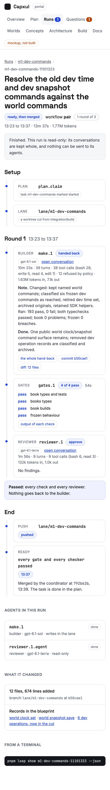
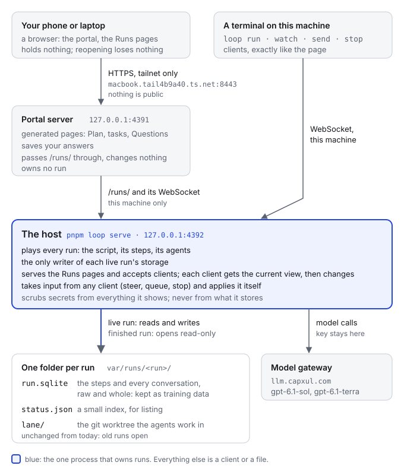

# Run observability: the design pack

**Status: a design, for Aaron to accept. Nothing in it is built.** The only code behind it is a spike
(`packages/loop/var/spike/attach.ts`, not committed) that proved a second process can attach to a running agent, see it
live and steer it, on our pinned pi-durable 1.5.0 with the fake model.

What Aaron asked for: see what is running at any time; how many backwards and forwards there have been; the handoffs
between agents; see and inspect what is happening inside a run; ideally steer it. And, on 10 November: where exactly
the runs are in the portal, how they relate to a task, and how it all works, because these are durable agents.

## The screens here were rejected, 10 November

Aaron rejected the screens of this pack (sections 1 and 3, and the pictures in `shots/`): they are document pages, with
no agents as things you can open and a transcript that does not read as a conversation. They are replaced by a
working prototype, `packages/loop-ui` (`pnpm --filter @capxul/loop-ui dev`), built from shadcn's own components on the
same real runs: a sidebar of runs, a run as steps, an agent as a conversation with everything about it beside it, and
an Agents page. The object model (section 2) and the architecture (section 4) stand. Nothing is accepted yet.

## Amendments, 10 November

The coordinator read the pack and accepted it on Aaron's behalf, with these changes. Where they differ from the text or
the pictures below, they win. Aaron's own comments on the pictures, if any, win over both.

1. **Who may be steered.** A person can steer and queue a builder only. A reviewer or any other checker can be watched
   and stopped, not steered, so a check stays independent; its page says so where the box would be.
2. **The browser client is proved first**, before any screen. If pi's Chord layer does not run in a browser against
   our pinned version, the host carries the same three objects over a plain WebSocket as JSON.
3. **One command brings up everything.** The host is added to `.claude/launch.json` beside the portal, and the portal
   says plainly when the host is down: on the top bar's count, on the Runs page and in the Runs block.
4. **Other work in progress.** Under the three groups on Runs, a short generated list of plan tasks that are being done
   by something that is not a run: the task, its thread and since when, from `plan/plan.json`. Runs stays the one page
   that answers "what is going on".
5. **Many rounds.** A run with more than one round shows one line above its rounds: how many rounds, and for each
   handoff how many findings went back and how many came back fixed.
6. **Refusals are shown** on the run page, as drawn. The command policy was reviewed against them (commit `6b65712`).
7. **The decisions** below are recorded in the blueprint by the coordinator.

The screens are drawn with the portal's own stylesheet and filled with real data read from runs in `var/runs` on
10 November 2026. To open them as pages instead of pictures:

```bash
pnpm portal && python3 docs/design/run-observability/mock/build.py packages/portal/dist
pnpm portal:serve --port 4391     # then open /mock-runs/
```

## 1. Where runs live in the portal

| Place | What is there | Kind of page |
|---|---|---|
| **Runs**, a new item in the top bar, with the number running | Every run in three groups: running now, waiting on a person, finished | live |
| A run, `/runs/<run>/` | Its rounds, every step with what it left behind, its agents | live |
| An agent, `/runs/<run>/<agent>/` | The conversation, and the box to steer, queue or stop | live |
| A plan task's page, `/plan/task/<task>/` | A **Runs** block: every attempt at this task, newest first | generated page, block filled live |
| The Plan's task list | On a task's row: what is working on it now, or how many runs it has had | generated page, filled live |
| An operation's page | The same Runs block, for the operation's own task (`operation:<id>`) | generated page, block filled live |
| **Questions** | A blocked task's card links to the run that blocked | generated |

The path a person takes: **Plan → a task → its runs → one run → one agent**. Or, when the question is "what is going
on right now": **Runs → one run → one agent**.

Run pages are not nested under Plan, because a run may have no plan task: a research question or something ad hoc is
listed on Runs under what it was asked, and has no task link. A run on a derived task (`operation:account.show`) links
to that operation's page.

## 2. The object model, with the real names

```text
plan task            m1-dev-commands                      plan/plan.json, plan/tasks/m1-dev-commands.md
 └─ run              m1-dev-commands-11101323             var/runs/<run>/ ; one attempt by one workflow (pair)
     ├─ step         plan.claim                           the task is marked started, with this run as its thread
     ├─ step         lane                                 a git worktree on lane/m1-dev-commands
     ├─ round 1
     │   ├─ step     make.1          ── agent session     m1-dev-commands-11101323 / make.1            (builder)
     │   │                               └─ turn          one answer of the model and the tool calls in it
     │   │                                   └─ tool call bash, read, write, edit: its input, its output, or a refusal
     │   ├─ step     gates.1                              the repository's checks, run by the runner
     │   └─ step     reviewer.1      ── agent session     m1-dev-commands-11101323 / reviewer.1.agent  (reviewer)
     ├─ round 2 …                                         only if findings went back
     ├─ step         push | plan.block                    the branch is pushed, or the task is blocked with reasons
     └─ end          ready | blocked | answered           then merged by the coordinator, outside the run
```

- **An agent session is a durable conversation**, addressed as run plus agent. It is what a person attaches to.
- **A round** is not stored as such: it is the number at the end of the step names (`make.2`, `gates.2`).
- **The handoff** between rounds is the list of open findings: failed checks and blocking findings, less what a
  checker marked fixed. It is computed by `settle` and passed to the next builder with the last builder's handover.
- **A re-run** is a new run of the same task (a new folder, a new id). A task has many runs; the newest is the plan's
  thread. **Resume** continues the same run after a crash or a stop: same id, same storage, finished steps are not
  redone. **Continue**, in Aaron's Workflow DX note, is more input to an agent after its run ended; it is out of scope
  for the first build.
- **Names in the authoring layer.** Aaron's note renames these: `make.N` becomes `builder.N`, `gates.N` becomes
  `checks.N`, `reviewer.N.agent` becomes `reviewer.N`, `push` becomes `publish`, and the commit becomes its own step.
  The screens show today's names because they show today's runs. Old runs keep their names.

**What each step leaves behind, and where it is today**

| Step | A person wants to open | Stored in |
|---|---|---|
| `lane` | The branch, its base, the diff against the base | the run's ledger (branch, base); git |
| `make.N` | The hand-back: note, handover (done, left, decisions, where); the commit; time, turns, tool calls by kind, refusals, tokens; the conversation | the ledger (the result); the agent's conversation |
| `gates.N` | Each check, pass or fail, and its output | the ledger (last 1,200 characters each); `gates.N.out` in the run folder (all of it) |
| `reviewer.N` | The verdict; each finding with severity, file and line; what it marked fixed; the conversation | the ledger; the agent's conversation |
| between rounds | Which findings went back to the builder | derived from the ledger |
| `push`, `plan.block`, end | The branch pushed; why it blocked; the merge commit | the ledger; `status.json`; `plan/log.jsonl` |

**How a run links to the blueprint's records.** Two ways, both shown on the run page under "What it changed":
the task names its records where it has any (a derived task is an operation), and the lane's diff names the record
files it touched, each linked to that record's page. For `m1-dev-commands-11101323` that is `world clock set`,
`world snapshot save` and the six `dev` operations it moved to the cut.

## 3. The screens

Phone first, because that is where they are read. Desktop versions are in `shots/desktop-*.jpg`.

| Screen | Picture | What is real in it |
|---|---|---|
| Runs | [phone](shots/phone-1-runs.jpg) · [desktop](shots/desktop-1-runs.jpg) | The live run is `m1-telemetry-11101341` as it stood at 14:11; the rest are the day's real runs. |
| A task and its runs | [phone](shots/phone-2-task.jpg) | `m1-dev-commands` and its three real runs. |
| A run, ready in one round | [phone](shots/phone-3-run-ready.jpg) · [desktop](shots/desktop-3-run-ready.jpg) | `m1-dev-commands-11101323`: every number and sentence. |
| A run, blocked after three | [phone](shots/phone-4-run-blocked.jpg) · [desktop](shots/desktop-4-run-blocked.jpg) | `m1-dev-commands-11101246-2`: every number, error and finding. |
| Inside one agent, live | [phone](shots/phone-5-agent-live.jpg) · [desktop](shots/desktop-5-agent-live.jpg) | `make.1` of the ready run, replayed from its stored conversation as at 13:26. The steer note is an illustration. |
| The five states | [phone](shots/phone-6-states.jpg) · [desktop](shots/desktop-6-states.jpg) | Live, finished, blocked and failed are real runs; offline is an illustration. |
| A blocked run in Questions | [phone](shots/phone-7-questions.jpg) | The card is an illustration: that task was in fact unblocked by a second run. |



**The states**

| State | Means | What a person can do |
|---|---|---|
| Live | The host owns the run and the page is attached | Steer, queue, stop the agent, stop the run |
| Offline | The run says running but its owner process is gone | Read everything stored; nothing can be sent until it is resumed |
| Finished (ready, merged, answered) | It ended by itself; opened read-only | Read; open every step's output; follow links |
| Blocked | It stopped with a reason and needs a person | Read why; answer in Questions when the coordinator brings it |
| Failed or stopped | A step threw, or someone stopped it | Read the error first; resume or start again from a terminal |

**How a blocked run joins Questions.** Today a run that blocks marks its plan task blocked for the coordinator, with
the reasons. That stays. The coordinator answers it, or passes it to Aaron, and then it is a card in Questions as any
blocked task is. The one addition: the card links to the run that blocked, so the findings and conversations are one
tap away. The page never sends a question to Aaron by itself.

What the blocked run teaches: the page has to say the important thing first. In that run the builder's model failed
in every round, so nothing was built and the reviewer read an empty change three times. The terminal showed
"blocked, 3 rounds". The run page says "the builder never ran" at the top.

## 4. The architecture



**One process owns the runs; everything else attaches to it.** This is pi-durable's own design: "One process owns a
storage at a time, and other clients attach to that process", and "any client can steer a running conversation or
queue a follow-up". The host is `pnpm loop serve`. It plays the runs (as `pnpm loop work` already plays several in one
process today) and is the only writer of each live run's storage. The terminal commands and the page are clients.
`pnpm loop run` alone still works: the process that plays a run serves it for as long as it lives.

**The attach contract.** Three kinds of object, carried by pi's Chord layer over a WebSocket:

| Object | Address | A client sees | A client can do |
|---|---|---|---|
| the runs | — | the list: each run's task, state, round, what is working now | — |
| a run | run | its state and its steps, each with its result | stop it |
| an agent | run + agent | the conversation: entries, text as it is written, tool output as it is printed, tokens | send input (steer or queue), stop it |

On attaching, a client gets the current view; after that only what changes, as small operations. A client that joins
late or reconnects starts from the current view; nothing is replayed. Input goes up as a call, with an id, so a retry
is not a second message. A steer joins after the agent's current tool calls; a queued input waits for the turn to end.

**What is durable, and what a crash costs**

| What dies | What is lost | What happens next |
|---|---|---|
| The browser, or the phone sleeps | Nothing | Reopen: the current view, then changes |
| The portal server | Nothing | Generated pages and the pass-through are down until it restarts; runs go on; terminals still reach the host |
| The host | At most about a second of text being written or tool output | Runs show as offline. Start the host again, or `pnpm loop resume <run>`: the script replays, finished steps answer from the ledger, the agent in flight continues in its stored conversation |
| The machine | The same as the host | The same |
| The model gateway fails | Nothing | pi retries three times; then the step ends "model error", as in the blocked run |

Everything a page shows is committed state in `run.sqlite` before it is shown. The page keeps nothing of its own.

**The generated portal and the live part.** The portal stays a static site generated from the blueprint and the plan,
and `pnpm portal:check` stays deterministic: the generator does not read `var/runs`. The live pages (Runs, a run, an
agent) are a small app in its own package, built with React, Tailwind and shadcn's AI Elements, served by the host
under `/runs/`. The portal's server passes `/runs/` through to the host, so there is one address. The app uses the
portal's fonts and colour tokens and repeats its top bar, so it reads as the same site. The Runs block on a task's
page is a placeholder in the generated page that a small script fills by attaching to the host; with the host down it
says so, and the task's History still names its runs.

**Reaching it from the phone, and who can steer.** The host listens on 127.0.0.1 only. The phone reaches it through
the portal's tailnet address, `https://macbook.tail4b9a40.ts.net:8443`, which is reachable only from Aaron's own
devices. Nothing is public. Steering is write access to an agent that can run commands in its lane, so it is as
strong as starting a run: whoever can open the portal on the tailnet is treated as the owner and can stop, steer and
queue. The host refuses any other host name or origin, as the answers endpoint does. The page cannot start, resume
or merge a run; it shows the command to copy. The contract has a viewer kind with no methods, for a read-only link
later.

**Secrets.** Everything shown passes the scrub that `loop status --json` already uses: values shaped like keys and
tokens, and the values of secret-named variables of the host's environment, become `[hidden]`; long output is cut
with "show more"; paths under the lane are shown relative. The model key lives only in the host's process and is
never in an agent's environment, so it cannot be in a conversation unless an agent finds it somewhere else.

**Raw transcripts are kept.** Scrubbing is done on the way out, never to the storage. `run.sqlite` keeps every
conversation whole: every prompt, answer, tool input and output. Every run is recorded as training data.
`pnpm loop clean` removes a run's worktree and never its storage.

## 5. Out of scope for the first build

- Starting, resuming or merging a run from the page.
- `continue`: more work in an agent after its run ended.
- A read-only link for someone else; any roles beyond the owner.
- Spend in dollars: the gateway reports no prices, so the pages show tokens and time.
- Search across conversations; a diff viewer (the first build links the commit and shows the files).
- The Runs block on operation pages (the task page comes first).
- The authoring layer of the Workflow DX note and the rename of `loop` to `workflow`: separate slices, after this.

**The first slice**, small and real: the host with the attach contract; `loop watch`, `loop send` and `loop stop`
going through it; the Runs page, the run page and the agent page with its box; the portal's top bar item and
pass-through; the Runs block on a task's page. `pnpm loop run` and `pnpm loop work` keep working at every commit, and
the run folder's format does not change.

## Decisions this implies

Drafts for the coordinator to record in the blueprint.

| Title | What was chosen | Why |
|---|---|---|
| One host owns the runs | `loop serve` plays runs, is the only writer of their storage and accepts clients; `loop run` alone still works; finished runs open read-only | pi-durable's own pattern; one place knows what is running; a single writer |
| The attach contract | Runs, a run and an agent are shared objects over a WebSocket: a view that updates, plus stop and send; an agent is addressed as run plus agent | The same object serves the terminal and the page; it is `connect()` in the Workflow DX note |
| Where runs live in the portal | A top-level Runs page; a Runs block on each task's page and row; run pages are not under Plan | The path plan, task, runs, run, agent; a run may have no task |
| The live pages are an app beside the generated portal | React, Tailwind and shadcn's AI Elements in its own package, served by the host under `/runs/`, passed through by the portal server; the generator does not read `var/runs` | Nothing invented for the conversation view; the portal check stays deterministic |
| Who may steer | Anyone who can open the portal on the tailnet is the owner: stop any agent or run; steer and queue a builder only. No start, resume or merge from the page | The tailnet is Aaron's devices; steering is as strong as starting a run |
| Shown scrubbed, stored raw | Scrub on the way out; `run.sqlite` keeps every conversation whole | Every run is training data; nothing secret on a screen |
| A blocked run and Questions | The run blocks its plan task for the coordinator, as today; the Questions card links to the run | Only what is truly Aaron's reaches him |
| The run folder does not change | `run.sqlite`, `status.json`, `lane/`; old runs open in the new pages | The coordinator runs the plan through the loop daily |
| Names | Today's step and agent names are shown as they are; the authoring layer's names (`builder.N`, `checks.N`, `publish`) apply to new runs; `loop` becomes `workflow` last | Old runs stay readable; the rename collides with the repository tidy |

## What is not settled

- A browser as a Chord client is untested; the spike ran Node to Node. It is the first thing the first slice proves.
- Settled by amendment 1: only a builder can be steered.
