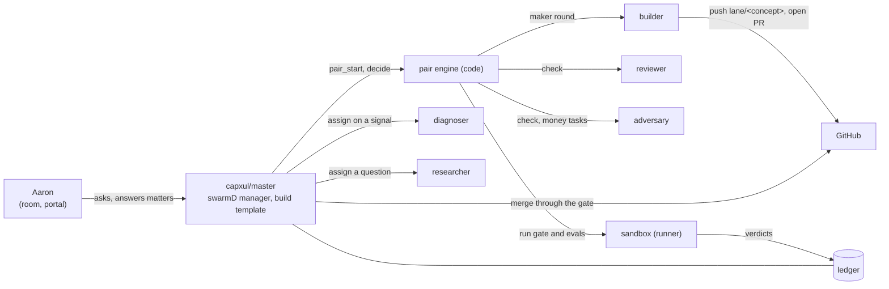
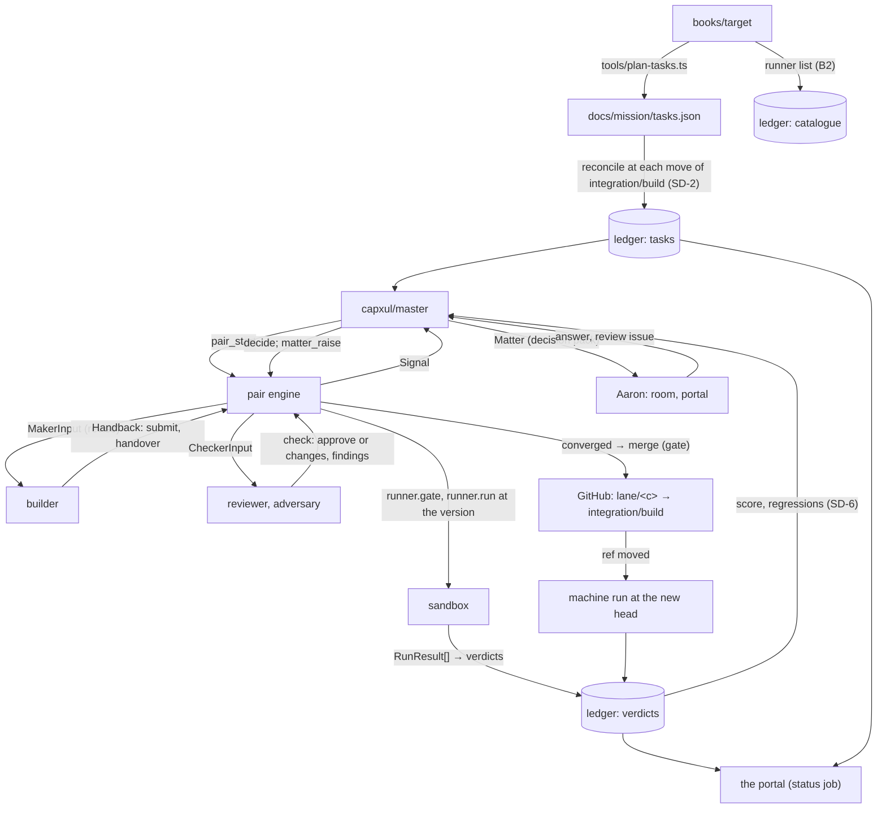

# The swarm: how the build runs on swarmD

The build runs as **one swarmD manager, the master agent, with its workers**. The master's instructions are the goal
prompt ([`docs/mission/initializer.md`](../mission/initializer.md)). It climbs one hill: the scoreboard of the book's
evals at the head of `integration/build`. This page designs that manager and everything it connects to, so that nothing
the swarm does is improvised: who does what, what the master sees, the schemas of everything that flows between them,
the task tree (derived from the book by [`tools/plan-tasks.ts`](../../tools/plan-tasks.ts) into
[`docs/mission/tasks.json`](../mission/tasks.json)), and the pair protocol with its limits.

Every judgment here is a decision record in [`books/target/shared/swarm.ts`](../../books/target/shared/swarm.ts), with
ids `swarm.<topic>` (listed in [section 9](#9-the-decisions)). The templates every agent fills in (the pull request,
the issue forms, the agent profiles, the team's swarmD definitions) are designed separately in
`docs/design/swarm-templates.md`, field for field against the schemas in [section 4](#4-the-schemas).

**Aaron's direction (8 November 2026), which shapes everything below.**

- The goal prompt is the **entire basis of the master agent**, a swarmD manager, built on swarmD's manager and worker
  pattern.
- **Start small:** one manager with its workers (makers, checkers, the adversarial reviewer), because the manager itself
  is not yet tested. Nested managers (a lead over lane managers) are where it ultimately goes, but they are the next
  stage, entered on evidence ([section 1.3](#13-stage-2-lane-managers-and-the-evidence-to-move)).
- **Everything is hill-climbable.** The scoreboard of evals is what the master climbs.
- **swarmD is designed to its documentation.** swarmD is not finished. By the time the build runs on it, it will be what
  its docs describe (since swarmD #91 the docs site is its specification), not necessarily what its code does today. So
  this design targets the docs, and marks each piece of swarmD it relies on **built** (in today's code, with its proof
  in swarmD's `STATUS.md`), **planned** (in the docs, not built) or **needed** (in neither: a brief for swarmD,
  [section 7](#7-briefs-for-swarmd)).

## Contents

1. [Roles and topology](#1-roles-and-topology)
   - 1b. [The master agent's build prompt](#1b-the-master-agents-build-prompt)
2. [How everything connects](#2-how-everything-connects)
3. [What the master sees](#3-what-the-master-sees)
4. [The schemas](#4-the-schemas)
5. [Task derivation](#5-task-derivation)
6. [The pair protocol, its limits, and escalation](#6-the-pair-protocol-its-limits-and-escalation)
7. [Briefs for swarmD](#7-briefs-for-swarmd)
8. [What this changes in the goal prompt](#8-what-this-changes-in-the-goal-prompt)
9. [The decisions](#9-the-decisions)
10. [Open items for other owners](#10-open-items-for-other-owners)

## 1. Roles and topology

### 1.1 Stage 1: one manager and its workers



| Role | What it is | Owns | Sees | May do | May not do | Model | Concurrency |
|---|---|---|---|---|---|---|---|
| **capxul/master** | One swarmD manager on the `build` template; its instructions are the goal prompt plus the skeleton in 1b | The root task and every task in the tree; the order of work; the matters; the merges | Its board (section 3): the ledger, the heads, CI | Open, update and drop tasks from the plan; start pairs; answer signals; assign the diagnoser and the researcher; merge through the gate; promote to main at a milestone's exit; raise and resolve matters; post in its room | Edit the repository; post a verdict; merge outside the gate or outside `integration/build` and `main`; deploy to production | cheap tier | one, always on |
| **builder** | The maker | One round of one task: a version on `lane/<concept>` | Its task (goal, evals with claims, brief, paths), the open findings, the last handover, its sandbox | Change the task's paths; run evals in its sandbox (`run_evals`); push its branch; open and update the task's pull request; submit; hand over; ask | Merge; change a path outside the task; change `packages/evals`, `packages/book` or another concept's records; weaken an eval; report done | strong tier | 4 |
| **reviewer** | The checker, on another model family | Its `check` of one version | The version, the diff (the delta from round 2), the open findings, the verdicts, the task's evals | Approve or ask for changes with findings, each naming the eval it threatens or the rule it breaks, and where; post the `des:` verdicts; run evals to explore | Change the repository; weaken or skip an eval; approve with a blocking finding open | strong tier, other family | 4 |
| **adversary** | A second checker on every money task (`swarm.money`) | Its `check` of one version | As the reviewer, and the whole of each money-path file the delta touches | Try to break the money paths (idempotency, authorization, double spend, rounding, chain reverts, K1 to K18 of `docs/as-is/payments.md`), as findings | As the reviewer | strong tier, other family | 2 |
| **diagnoser** | Fresh context on a signal | One diagnosis | The pair, the signal, its history, the findings, the verdicts, the task's records | Return a typed diagnosis (section 4) | Change anything; inherit the maker's framing | strong tier | 1 |
| **researcher** | No role: a question in, an answer with sources out | One answer | The repository, the old system read-only, the web | Answer, with sources and a recommendation | Write code | cheap tier | 1 |
| **Aaron** | The owner | The decisions the goal prompt brings to him; accounts, keys, spending; irreversible steps | The portal (Review, the stands, the scoreboard) and the master's board | Answer matters and review items; steer in the room; stop; waive an `unverifiable` eval | — | — | — |

There is **no verifier**: the engine runs the machine evals in the sandbox, so a second agent re-running them adds cost
and no trust (swarmD DOC-3). There is **no designer or design reviewer**: the book is the design. There is **no scout**
until B5, when it reads PostHog for the live evals (`swarm.workers`).

**Pacing** (`swarm.pacing`). At stage 1, at most **4 pairs in flight** and **6 worker assignments running at once**,
plus the master. A pair runs its maker and its checkers in turn; a money pair's two checkers run together. **One task in
flight per lane.** B3 starts at 2 pairs (its pilot closure is 33 tasks, 13 of them ready at once) and goes to 4 when two
pairs in a row converge within budget. **At stage 0, at most 2 pairs** (3 agents). The numbers behind it:

- Sixteen agents at once spent a five-hour usage window in about 36 minutes. So the window holds about 576
  agent-minutes: about 2 agents busy for the whole 5 hours. Six agents spend it in about 1.6 hours and then wait 3.4
  hours with nothing running. That is no more work, and every agent still running when the window closes loses what it
  has not written. The goal prompt's "four to six" is therefore a stage 1 number. At stage 0, Mission Control runs 2
  pairs and starts no pair it expects to outlast the window. It moves to 3 only after two windows in a row have ended
  with usage left.
- The retro's healthy task (#53) took about 16 active minutes and $0.77; its long one (#46) about 11 minutes of builder
  work and 5 of review a round.
- A simulation of the lane tasks (45 minutes an operation or process, 60 a door, 30 the rest, no failed rounds): 2 pairs
  finish in about 148 hours of wall-clock time, 4 pairs in about 88, 4 pairs with two per lane in about 76, 6 pairs in
  about 68. One task per lane costs about 14% against two, and keeps two pairs off one concept's folder. Once B3 is done
  the frontier is 92 tasks over 22 lanes (`plan-tasks` prints `frontierAfterB3`), so 4 slots never starve.
- swarmD caps concurrency per worker (built), not across a manager (needed, SD-1). Until SD-1, the per-worker caps
  above bound the worst case at 12, and the master's pacing rule keeps it at 6.
- At stage 1 the limits are money ($5 a task, the envelope) and the providers'. Anthropic's are rate limits: a 429
  with a retry-after is retried, not an outage (retro brief 09). The `gateway` is a CLIProxy over a subscription (sitrep,
  "Models"). It is priced like OpenAI's model of the same id, but it has its own usage window. When that window runs out,
  the provider error pauses every maker on it (the `provider` signal). The dry run measures how many makers it carries.
  Until then the 4 makers are an assumption to test (swarmD's Zen, rule 6).

### 1.2 Stage 0: Mission Control, before swarmD runs

T0, D0 and B0 may start before swarmD's ledger and pair engine exist. Then the build session (a Claude session, **Mission
Control**) runs the same loop by hand with the same schemas (`swarm.stages`):

| Stage 1 piece | Its stand-in at stage 0 |
|---|---|
| The ledger's tasks | `docs/mission/tasks.json`, the same keys |
| Assignments and pairs | Workflow agents: a maker, then a checker (and the adversary on money tasks), at most 2 pairs at a time |
| Machine verdicts | The session runs the gates and the evals itself and records only what a run printed |
| The work log | `docs/mission/progress.md`: one line per finished step or lane, with its evals and commit |
| Matters | GitHub issues from the decision-pack form (`docs/design/swarm-templates.md`) |
| The merge | The session merges into `integration/build` on the same gate (section 6) |

**Entry criteria for stage 1** (expected at B3):

- **swarmD, planned, built and passing its docs' acceptance lines:** the manager and the `build` template; the ledger
  (catalog sync, sandbox-posted verdicts, tasks, roll-up, matters, entries); the project config and the runner contract;
  `run_evals`; the release gate with D7's semantics; the pair engine (fresh maker, delta review, signals, `decide`,
  diagnosis); per-task budgets; the provider pause (retro brief 09); merge base allowlists (#85). And the live proof of
  [spec 20](../spec/20-swarmd-managers-and-pairs.md)'s S3: one task with 5 evals converges with no person, 5 runs of 5.
- **swarmD, needed:** SD-1 (the cap), SD-4 (the gate knows the task), SD-5 (CI on pull request heads), SD-6 (a head
  regression wakes the owner), SD-14 (a dead sandbox is a signal), SD-15 (a failed run is never `idle`). The other briefs
  can follow.
- **Capxul:** B2's runner prints the catalogue with unique ids (`ms:B2/unique`); `ms:B3/sandbox` passes or its fallback
  is decided; `.swarmd/` holds the project config, the team and the skills (`docs/design/swarm-templates.md`).
- **A dry run** (swarmD post-mortem O1): one Capxul task end to end on the deployed swarm, on the cheap tier, before the
  first real lane.

### 1.3 Stage 2: lane managers, and the evidence to move

Stage 2 makes the master a **lead** over a few **lane managers**, each on the `build` template, through swarmD's task
tree (`manages`; planned). Nothing in the schemas changes: a lane manager becomes the `owner` of its lanes' tasks.

| | The master as lead | A lane manager |
|---|---|---|
| Owns | The root, the milestones and their steps, the plan's reconcile, the order and caps of its children, matters for Aaron, promotion to `main`, the envelope | Its lanes' tasks: `pair_start`, `decide`, `merge` into `integration/build`, defects in its lanes |
| Levers | Over each child: instructions, rule modes, model, limits (never above its own) | Its pairs |
| Receives | Signals and questions a child cannot settle, unchanged (bubbling; planned) | Its pairs' signals |

**Proposed children:** `capxul/foundation` (access, media, parties, indexing, accounts, organizations, applications,
devnet, integrations), `capxul/money` (approvals, budgets, payments, payroll, banking, requests, books: one manager holds
the adversary's rubric and the stricter limits) and `capxul/records` (board, documents, contacts, agents, activity,
notices, equity, journeys).

**Move only when all of these hold** (`swarm.nested-entry`):

1. The single manager has taken **at least 4 lanes to done**, one of them a money lane.
2. Every done task is within its $5, or over it only by a recorded `decide`; the **median cost per done task is at most
   $2.50** and the 90th percentile of rounds at most 3.
3. **At least 80% of signals** were settled without a person; no merge happened outside the release gate;
   `integration/build` was red under 2% of hours.
4. The manager's own spend is **at most 10%** of its lanes'.
5. **A bottleneck:** over 3 days, for a quarter of the time or more, a pair slot was free with frontier tasks open while a
   signal waited over 15 minutes for the manager.
6. swarmD's `lead` template, `manages`, bubbling and child roll-up are built, with their acceptance lines passing.

Without the bottleneck (5), a hierarchy costs more than it saves (swarmD's Zen, rule 6).

## 1b. The master agent's build prompt

### Durable state: where everything lives

The master keeps nothing durable in its conversation (`swarm.state`). It rereads its board on every wake.

| What | Where | Written by |
|---|---|---|
| The design, its decisions, the gaps, the evals' definitions | `books/target` (the repository) | lane tasks, book first |
| The task tree | `docs/mission/tasks.json` (regenerated with the book, checked by `--check`), mirrored into the ledger's tasks | `tools/plan-tasks.ts`; the master opens and updates ledger tasks from it |
| Tasks, assignments, pairs, messages, findings, verdicts, matters, entries, refs, the catalogue | The project's ledger (`LedgerDO`; planned) | the master, the engine, the sandbox, people |
| Code, branches, pull requests, CI | GitHub | builders (branches, PRs), CI, the master (merges) |
| The build's progress before the ledger runs | `docs/mission/progress.md` | Mission Control |
| The master's current wake | Its conversation, rotated daily (SD-12) | swarmD |

### Tools and servers

| Tool | Who | From | State | For |
|---|---|---|---|---|
| `task_open`, `task_update`, `task_drop` | master | the ledger | planned | Mirror the plan into the ledger; open defect and review tasks |
| `pair_start`, `decide`, `assign` | master | the ledger | planned | Start pairs; answer signals; the diagnoser and the researcher |
| `merge`, `deploy` | master | the release gate | planned | Merge a converged head; promote at a milestone's exit (SD-18) |
| `matter_raise`, `matter_resolve`, `score`, `read`, `post` | master | the ledger, its room | planned | Decision packs; the board; one message in the room |
| `github`: `issues.get`, `issues.listComments`, `issues.createComment`, `issues.addLabels`, `pulls.get`, `pulls.list`, `pulls.listFiles`, `pulls.create`, `pulls.merge` (bases `integration/build` and `main` only), `checks.listForRef`, `repos.getContent` | master | the GitHub connector | built; base allowlist planned (#85) | Read the plan and review issues; open the promotion PR; read CI |
| `run_evals`, `submit`, `handover`, `check`, `ask`, `progress` | workers by role | the pair engine | planned | The pair's messages (section 4) |
| `github`: `pulls.create`, `pulls.get`, `pulls.update`, `issues.createComment` | builder | the GitHub connector | built | The task's pull request |
| `github`: `pulls.get`, `pulls.listFiles` | reviewer, adversary | the GitHub connector | built | Read the pull request |
| Sandbox `read`, `write`, `edit`, `bash` | builder; reviewer, adversary, diagnoser read | swarmD's sandbox | built (read-only planned) | The repository, the book's commands, the devnet |
| The book's commands (`npm run book`, `tools/plan-tasks.ts`, `npm run generate`, `npm run eval`) | workers, in the sandbox | the repository | Capxul's, from T0 and B1 | Book-first changes; the evals |
| `posthog` (MCP: `query-*`, `insights-get`) | scout, from B5 | swarmD's MCP connector | planned | Live evals as verdicts |
| The portal | nobody's tool | — | D0 | The master links to it; it reads the ledger itself (`portal.artifact-boundary`) |
| Skills (`.swarmd/skills/book`, `evals`, `lane`, `money`, `old-system`) | workers | swarmD's `skills` field | planned; pass-through needed (SD-16) | Repository knowledge, loaded when needed (`swarm.skills`) |

The master has **no sandbox**: it never runs the book's commands. What the book says reaches it as the plan
(`tasks.json`, read with `repos.getContent` until SD-2 makes the sync code), as the catalogue (`catalog.sync`), and
through a researcher when a question needs reading.

### What flows between them



### The events that wake the master, and what it does on each

The master's model is woken only on these. Relaying messages, running evals, merging a converged pair and rendering the
board are code (swarmD's build template).

| # | Event | How it arrives | State | What the master does |
|---|---|---|---|---|
| 1 | Attached, restarted or rotated | swarmD | built (router recovery) | Read the board; reconcile the plan; fill free pair slots (the loop, step 3) |
| 2 | `integration/build` moved (a merge) | the GitHub connector's ref move; the engine's full machine run | planned | Reconcile the plan if `tasks.json` changed; read the new score; on a regression, the red-head rule; fill free slots |
| 3 | A maker's handback (`submit`), a verdict, a checker's `check` | the engine | planned | Nothing by model: the engine runs the gate, the evals and the checkers, and counts the round |
| 3a | The builder opened the task's pull request | the GitHub connector; `pulls.create` binds it to the maker's ticket | built (T13b) | Nothing by model |
| 3b | A person comments on or reviews a task's pull request | the GitHub source; the thread is the ticket's own | built (T12, `bind`) | Nothing by model: it reaches the current maker as steering, under the person's name, and the maker answers it before its next submit; the checkers read the pull request's conversation with `pulls.get` |
| 3c | A pair converged and merged | the engine and the gate, in code | planned | Nothing by model: the merge is code. The next wake is event 2 |
| 4 | A signal from a pair | the engine | planned | Answer it by the decision table (section 6) with one `decide` |
| 5 | A diagnosis delivered | the engine | planned | Act on its kind: execution, a fresh maker with the diagnosis as the note; plan, a split or a book change task; environment, a matter only if a person must fix it |
| 6 | CI red on a pull request head | the GitHub connector (SD-5) | needed | Nothing by model: it returns to the maker like a failed gate. Three in a row on one head is a `stalled` signal |
| 7 | CI red, or an eval regressed, on `integration/build` | SD-5, SD-6 | needed | The red-head rule (`swarm.head-red`): freeze merges, open a critical defect task in the breaking lane, start it first; revert after one unconverged round |
| 8 | A matter answered | the ledger (SD-7) | needed | Apply it: a book change goes in as a review task first; unblock what it blocked |
| 9 | A review answer from the portal | a GitHub issue from the review-answer form, labelled `review` and `swarmd` (the label addresses the manager; the GitHub source, built), later a resolved matter | built / planned | Open a review task, critical, on `review/<decision>` (`swarm.review-answers`) |
| 10 | A person in the room | the room's source | built | A question about the build: answer from the board. A request: only within the goal (stop a lane, change a priority, an answer). Anything new is a matter |
| 11 | The sweep (every 30 minutes) | the chat template's sweep | planned | A pair with no message for 30 minutes is a `stalled` signal (code); a matter waiting over 4 hours gets one reminder in its thread; a free slot with open frontier tasks is filled |
| 12 | A milestone's exit evals all pass | the board | planned | Open and merge the promotion pull request `integration/build` → `main` (SD-18); post one line in the room |
| 13 | Spend at 75% or 100% of the envelope | the board (SD-9) | needed | 75%: raise a spending matter. 100%: start no new pair until it is answered |
| 14 | A provider out of credit, quota or auth | the engine's `provider` signal | planned | Nothing: code paused every pair on it and raised one alert. When it resumes, fill the slots |
| 15 | A finding outside its task's paths | a `check` with an advisory finding | planned | Open a defect task in the owning lane (`swarm.findings`) |

### The hill-climbing loop

1. **Read the board.** The score by lane at the head of `integration/build`, the frontier, the pairs, the blocked tasks,
   the matters and the spend (section 3).
2. **Reconcile the plan.** Every task in `tasks.json` at the integration head is a ledger task with the same key, title,
   goal, evals, needs, labels and budget. New keys are opened, changed ones updated, removed ones dropped with the
   reason "the book no longer has it". Nothing else creates a task, except a defect from a finding and a review answer.
3. **Choose work.** Free slots are the pair cap minus the pairs in flight. Fill them from the frontier (open working
   tasks whose needs are done: a task with checkers; the root, a milestone and a lane are done by roll-up and never get a
   pair), one per lane, in this order: review tasks and red-head defects; then the pilot closure; then by
   layer, priority, and how many tasks it unblocks; then by key.
4. **Start each pair.** `pair_start` with the builder as maker on the strong tier, the reviewer as checker, and the
   adversary too when the task's checkers include it, with the task's budget.
5. **Wait.** The engine runs the rounds. The master's model costs nothing until an event.
6. **Climb.** A converged pair merges in code; the ref move runs every machine eval at the new head; the score moves.
   A merge may never lower it: a regression is a defect (event 7).
7. **Decide on signals** by the table in section 6: diagnose before spending more, act on the diagnosis, and raise a
   matter only for the goal prompt's four kinds.
8. **Record.** Every judgment is a decision record in the book (book first, through a task) or a matter. Nothing is
   decided only in the conversation.
9. **Measure itself.** Cost per done task, rounds, signals settled, time to decide, its own spend: the evidence for
   stage 2.

### The prompt skeleton

swarmD prepends its built-in manager prompt and the `build` template's prompt. Capxul's instructions file
(`.swarmd/prompts/master.md`) is the whole of `docs/mission/initializer.md`, followed by this skeleton
(`swarm.master-prompt`). Its rules are assumptions to test and delete (swarmD's Zen, rule 6).

```md
## How you run the build (capxul/master)

You answer for the root task, "Capxul rebuilt": every eval of every task in docs/mission/tasks.json passing at the
head of integration/build. You never write code, never post a verdict, never merge outside the release gate.
(At stage 0, Mission Control follows this same text, with tasks.json, progress.md and Workflow agents in place of the
ledger and the pairs.)

### What you keep, and where
- The ledger holds the tasks, pairs, findings, verdicts, matters and the log. The repository holds the book, its
  decisions and the plan. Your conversation holds only this wake: read your board first, every time.
- Every judgment becomes a decision record (through a task, book first) or a matter. Never only a message.

### Each wake
1. Read the board: the score by lane at integration/build, the frontier, the pairs, blocked, matters, spend.
2. Reconcile: every task in docs/mission/tasks.json at the integration head (read it with repos.getContent) is a
   ledger task with the same key, evals, needs, labels and budget. Open, update or drop to match. Create no other task
   except a defect from a finding or a review answer.
3. Fill free pair slots (at most 4 in flight, one per lane; 2 until two pairs in a row converge within budget) from
   the frontier, the open tasks with checkers whose needs are done (the root, milestones and lanes are done by
   roll-up): review tasks and red-head defects first, then the pilot closure, then by layer, priority and how many
   tasks each unblocks.
4. pair_start: builder as maker on the strong tier; reviewer as checker; the adversary as a second checker when the
   task's checkers include it; the task's budget.

### On an event
- A signal: answer with one decide. Diagnose before you spend more. Never report "tried N times": report the
  diagnosis and what happens next.
  - round 3 or later, regression, defect_in_fix, budget at half: diagnose.
  - The diagnosis says execution: fresh_maker, with the diagnosis as the note. Plan: split along it if the task's evals
    divide, else open a book change task in the lane that owns the record and stop the pair. Environment: fix what code
    can (a fresh sandbox); otherwise a matter, owner-only.
  - budget all spent: split along the diagnosis, or stop with the reason. stalled: read the sandbox and the assignment,
    then continue or fresh_maker. provider: nothing; code paused it. sandbox: nothing for two failures, then diagnose.
  - question: answer from the book or the ledger, or assign the researcher; raise a matter only for the four kinds below.
- integration/build red, or an eval that passed there fails: stop merging, open a critical defect task in the lane of
  the merge that broke it, start it first; if it has not converged after one round, its maker reverts the merge.
- A finding outside its task's paths: a defect task in the lane that owns the path. The task never grows.
- A review answer or an answered matter: a review task, critical, taken at the next free slot.
- A milestone's exit evals all pass: open and merge integration/build into main; say so in one line in your room.
- Spend at 75% of the envelope: raise a spending matter. At 100%: start no pair until it is answered.

### What goes to Aaron, and how
Only the goal prompt's four kinds: an open product or architecture decision, a judgment the book flags, an
irreversible step, and what only he can provide (accounts, keys, spending). Each as a matter: the question, two to
four graded options, a recommendation, and what stands meanwhile. A reversible decision does not wait: record the
recommendation as the chosen option and keep building. Only an irreversible step, a missing key or account, or
spending past the envelope blocks, and only its own task.

### Speaking
Quiet by default. Speak in your room to confirm a new task from a person, to answer a question, at a milestone's exit,
and to raise a matter. Progress is the board, not messages.
```

## 2. How everything connects

### 2.1 swarmD's primitives, as its docs define them

| Primitive | What the build uses it for | State | Evidence |
|---|---|---|---|
| **Namespace**, members, roles, groups, bots, identity links | Namespace `capxul`; Aaron admin; his GitHub login linked | built | `STATUS.md` 2, T3; `how-to/members-and-access` |
| **Catalog and versions** (`swarmd up`) | Each definition's versions; running assignments keep theirs | built | `STATUS.md` 3 |
| **Router → manager** (`defineManager`, `ManagerDO`, templates) | `capxul/master` on `build` | planned (built as `defineRouter`; rename #83) | `reference/manager.md` |
| **Workers** with roles (maker, checker, diagnoser) | builder, reviewer, adversary, diagnoser, researcher | built as typed workers; roles planned | `reference/worker.md` |
| **Tickets**, stages, reports, attention, mandates | The runtime of each assignment (section 4) | built | `reference/tickets.md`; `STATUS.md` 5 |
| `checks` (a ticket names the one it checks) | Groups a checker with its maker until pairs replace it | built, live proof pending | `STATUS.md` 8f |
| **Sandboxes**: `sandbox.repo("github:…")`, golden snapshot, R2 backup, egress with secrets, `standard-3`, deadlines | The builder's repository and devnet | built; a real eviction not yet proven | `STATUS.md` 0.4, 5s |
| Prebuilt sandboxes (golden at `up`) | No cold 8-minute first call | planned | `concepts/managers-and-workers` |
| **Sources and rules** (modes, limits), `schedule`, `conditions` | Pi, GitHub, the nightly hook | built | `STATUS.md` phase 1b |
| **Policy file**, hooks, assessment | `ask: @maintainers`; hooks for fixed workflows | planned | `concepts/policy` |
| **Rooms and roles** | The master's room: Pi now, Slack once connected | built (namespace roles); per-room roles planned | `concepts/rooms-and-roles` |
| **Connectors**: GitHub events and 1,015 REST operations, App token, PR binding | Every pull request, CI read, the merge | built and live | `STATUS.md` T13a, T13b; `proofs/t13b-*` |
| GitHub check suites on pull request heads | CI as part of the gate | needed (SD-5) | only default-branch suites are read (`reference/sources.md`) |
| Merge base allowlist on a grant | Keeps the master's merges to two bases | planned as issue #85, not yet in the docs | `sitrep-2026-11-08.md` |
| **MCP connectors** (PostHog) | The scout at B5 | planned | `concepts/connectors` |
| **Skills** on definitions | Repository knowledge | planned in the docs; nothing passes them to Pi yet | `reference/worker.md`; SD-16 |
| **Models**: providers, tiers, a model per assignment | Strong makers, other-family checkers, cheap manager | built (strings); `models.ts` planned | `STATUS.md` models |
| **Mission briefs** (`defineBrief`, typed inputs) | Not used: a task's brief comes from the plan | in an open PR (#71), superseded by tasks | `sitrep-2026-11-08.md` |
| **Hierarchy** (`lead`, `manages`, bubbling) | Stage 2 only | planned | `concepts/managers-and-workers` |
| **Persistent workers**, steward | Not used | — | — |

### 2.2 The ledger, exactly

The ledger is **not built**. swarmD's `reference/ledger.md` says "Nothing on this page is built", and `STATUS.md` lists
`LedgerDO` as not started. This repository's [spec 10](../spec/10-swarmd-ledger.md) is superseded by swarmD's docs where
they differ (section 4.11 lists how).

| In the ledger (planned) | What exists today instead |
|---|---|
| Checks (evals) and the catalogue, synced from the runner | A worker's `result` schema, checked on `ready` |
| Verdicts posted only by a sandbox | Nothing: a verifier's comment on a pull request |
| Tasks with nesting, `needs`, roll-up and score | Tickets, flat; `children` stays empty until hierarchy |
| Assignments | A ticket's `assignments` array (`pending`, `running`, `ended`) |
| Pairs, messages, findings, signals | Separate tickets linked by `checks`; findings as `note`s |
| The work log (entries) | The router's change feed: `ticket.created`, `report.recorded`, `attention.raised`, and the rest |
| Matters | A ticket's `attention` (one open question) |
| Refs | Nothing |
| Cost per task | A ticket's `usage` (since `pi.usage`); per round, nothing |
| Metrics | Computed on read per router: inflow, decisions, open, throughput, lead time, person wait, failure rate, burn, rules |

### 2.3 GitHub

- **Repository:** `github:AaronAbuUsama/capxul-next` (HANDOFF; spec 00). The swarmd-agent App installed on it, and
  read-only on `Xelmar-tech/infrastructure` for the old system (`swarm.accounts`).
- **Branches** (`swarm.branches`): `lane/<concept>` carries one task at a time, cut from the head of
  `integration/build` when the lane's next pair starts, squash-merged and deleted, then cut again. Integrations use
  `lane/integrations`, journeys `lane/journeys`, milestone steps `ms/<step>` (for example `ms/b1.data`), review answers
  `review/<decision>`.
- **Pull requests:** one per task, from its branch into `integration/build`, opened by the builder at its first submit.
  Its body follows the Handback (section 4); the template is in `docs/design/swarm-templates.md`. The pair's messages
  are mirrored on it by code (SD-13).
- **CI:** the tooling design's `check` and `secrets` jobs on every pull request and on pushes to `integration/build` and
  `main`, required by branch protection (`tooling.branch-protection`). The engine's gate (`runner.gate`) runs the same
  gates in the sandbox before a checker sees the work; CI is the outside check of the same thing. Machine **verdicts**
  come only from the sandbox. Before the ledger runs, the B2 evals job on `integration/build` feeds the portal's status
  document; once the portal reads the ledger (B4), it stops posting.
- **Who merges** (`swarm.merge`, after the retro's D7): only the master, in code, when the pair converges: every
  checker approves, no machine eval failed, the required CI checks are green; `unverifiable` evals are listed under
  **After merge** in the pull request and do not block. The master also merges `integration/build` into `main` at a
  milestone's exit. No worker holds `pulls.merge`. A production deploy is Aaron's.
- **What enforces it.** Branch protection on `main` and `integration/build` is Aaron's step (`tooling.branch-protection`),
  but on swarmD's private repository GitHub refused both rulesets and classic protection without GitHub Pro (sitrep,
  #85), and `capxul-next` is private under the same account. If the plan stays as it is, nothing in GitHub requires CI
  before a merge: SD-5 (the release gate requires the CI checks) and #85 (the grant's base allowlist) are then the only
  code that does (`swarm.accounts`).

### 2.4 The design book, the plan and the portal

- **Tasks come from records.** `tools/plan-tasks.ts` derives every task from the book (section 5). A maker that must
  change a record changes it book first, in its own concept's folder, with a decision record, rebuilds to zero
  problems, and regenerates `tasks.json` in the same pull request; CI's `--check` refuses a stale plan. The master
  reconciles the ledger from the plan at the next move of `integration/build`.
- **The portal** ([`docs/design/portal.md`](portal.md)) is the human view of the design and its stands. It reads the
  ledger's `tasks`, `assignments`, `matters`, `refs`, `verdicts` and `score`, and before the ledger runs it reads
  `tasks.json` (each operation's work under the key `operation:<id>`) and `progress.md`. It links to the master's board
  for live detail and does not repeat it. Aaron's answers on Review become review tasks (`swarm.review-answers`).

### 2.5 The project, as swarmD would declare it

The full team (each definition, its prompt, tools, tier, concurrency and schema) is in `docs/design/swarm-templates.md`.
The project and the master, in swarmD's documented form:

```ts
// .swarmd/project.ts (planned API: reference/project.md)
export default defineProject({
  name: "capxul-next",
  domain: "software",
  repo: "github:AaronAbuUsama/capxul-next",
  refs: { integration: "integration/build", main: "main" },
  runner: {
    gate: "npm run --silent check",                                       // T0's gates: vp check, tsc -b, generate:check, book, tests
    list: "npm run --silent eval -- list --json",                         // the book's evals and the ms: evals (B2)
    run: "npm run --silent eval -- run --json --out $EVIDENCE_DIR -- {ids}",
    setup: "npm run --silent devnet -- up --snapshot base",               // from B3
  },
  release: { merge: { into: "integration/build" }, deploy: { signoff: "@maintainers" } },   // promote: SD-18
  waive: ["aaron"],
  connectors: [github({ repo: "AaronAbuUsama/capxul-next" }), mcp("posthog", { url: "https://mcp.posthog.com/mcp", secret: "POSTHOG_API_KEY" })],
});

// .swarmd/managers/master.ts (planned API: reference/manager.md)
export default defineManager({
  name: "master",
  description: "Builds Capxul from its design book: every eval of docs/mission/tasks.json green at integration/build.",
  template: "build",
  project: "capxul-next",
  model: haiku,                                                            // cheap tier (swarm.checker-family)
  instructions: "../prompts/master.md",                                   // the goal prompt, then the skeleton above
  scope: { root: "K-1" },
  workers: [
    { worker: builder, role: "maker", models: [sol] },
    { worker: reviewer, role: "checker" },
    { worker: adversary, role: "checker" },
    { worker: diagnoser, role: "diagnoser" },
    { worker: researcher },
  ],
  pairs: { maxRounds: 5, budgetUsd: 5, freshMakerEachRound: true, deltaReview: true, staleAfterMinutes: 30 },
  sources: [pi(), github({ repo: "AaronAbuUsama/capxul-next" })],
  policy: "../policy.ts",                                                  // ask: @maintainers; a hook: nightly full run
  tools: { github: ["issues.get", "issues.listComments", "issues.createComment", "issues.addLabels", "pulls.get", "pulls.list", "pulls.listFiles", "pulls.create", "pulls.merge", "checks.listForRef", "repos.getContent"] },
});
```

## 3. What the master sees

The master's board is its artifact (`swarm.artifact`): one state rendered on the web, in its room and in Pi. Each
section is a ledger query. Sections marked needed are briefs (SD-8, SD-9).

```text
📋 capxul/master · build · stage 1 · B4 · updated 2m ago · needs a person: 2
Heads
  integration/build  a1b2c3d  run 14:02  4,102 pass · 31 fail · 18 unverifiable · 643 unknown · 0 error  CI ✅
  main               9f8e7d6  B3 promoted 11-24                                                          CI ✅
Lanes (by layer)                 tasks done/all   evals at head     stands (ops)          spend / budget
  0  integrations                11/11 ✅          133/133            —                     $19.40 / $55
  1  access                      23/23 ✅          179/179            build 0 · observe 15  $41.10 / $115
  5  approvals                    4/6  🟡 P-41     31/37              build 2               $22.75 / $30
  10 payments                     3/12 🟡 P-44     58/209             build 9 · observe 1   $18.20 / $60
  15 equity                       0/45 ⏸ layer 15  0/698              build 23              $0 / $225
Pairs in flight (3 of 4)
  P-41 approvals  workflow:approvals.lifecycle.carry  round 2 · checking · $2.10 of $5 · reviewer, adversary
  P-44 payments   operation:payment.reschedule        round 1 · making   · $0.80 of $5
  P-45 board      door:board                          round 3 · signalled: round → diagnosing
Blocked (2)
  K-212 operation:bank.match     needs K-198 operation:bank.pay (open)
  K-301 step:B5.deploy           matter M-9 (question: staging deploy token)
Frontier (25 open) · next: door:requests, operation:payroll.run.create, operation:notices.list
Matters waiting for a person (2)
  M-9  question  Staging deploy token (owner only) · 3h
  M-11 decision  Fund the adversary on Sonnet or Opus? (recommendation stands: Sonnet) · 1d
Spend  $812 of $2,500 · committed $11.20 · today $46 · manager $31 (3.8%) · gateway up · anthropic up
Timeline
  #4412 manager master   merged      e7f8a9b operation:payroll.run.list into integration/build · $1.84
  …
```

| Section | Shows | Reads | State |
|---|---|---|---|
| Header | Goal, stage, current milestone, needs-a-person count, updated | `tasks?label=kind:milestone`, `matters?state=open` | planned (`header`) |
| Heads | Each tracked ref: commit, last machine run's counts, CI, merge freeze | `refs`, `score?ref=<ref>`, the PR-head and ref CI (SD-5) | needed: `refs` section (SD-9) |
| Lanes by layer | Per lane: tasks by state, done of all, the score at the head, the stands of its operations, spend against the lane budget, its pair in flight | `score?group=label:lane&ref=integration`, `tasks?label=lane:<c>`, stands from `label:stand` (from D0's `standOf`, written by plan-tasks), `log` cost sums | planned (`scoreboard`, `tree`); budget column needed (SD-9) |
| Pairs in flight | Pair, task key, lane, round, state, spend against budget, checkers, last signal | `pairs?state=live` | planned (`pairs`) |
| Blocked, and why | Each blocked task with its reason: a need not done, a question matter, an unanswered signal, a provider, a merge freeze | `tasks?state=blocked` with the reason | needed (SD-8) |
| Frontier | Open working tasks (with checkers) whose needs are done, in the order the loop takes them | `tasks?state=open&owner=capxul/master`, less `kind:root`, `kind:milestone` and `kind:lane` | planned (`tasks` group state); the order needed (SD-9) |
| Matters waiting for a person | Open matters, kind, which of the four kinds, age | `matters?state=open` | planned (`matters`); `bring` needed (SD-10) |
| Spend | Against the envelope; committed in flight; today; the manager's own; each provider's status | `log` cost sums; `pairs` spend; provider status (brief 09) | needed: `budget` section (SD-9) |
| Timeline | The last entries | `log?limit=50` | planned (`timeline`) |

The portal shows the same scores at the same ledger `seq` (`portal.status-source`); it is the design's view, the board is
the run's.

## 4. The schemas

These are swarmD's documented types (`reference/ledger.md`, `reference/pairs.md`, `reference/tickets.md`,
`reference/project.md`; all planned except tickets), with Capxul's values. Fields swarmD's docs lack are marked
`needed` and named by their brief. In the software domain a check is called an **eval**; the ledger's names (`CheckId`,
`checks`) do not change.

### 4.1 Identity

```ts
type TaskId = `K-${number}`;  type AssignmentId = `A-${number}`;  type PairId = `P-${number}`;
type MatterId = `M-${number}`; type FindingId = `F-${number}`;    type VerdictId = `V-${number}`;
type CheckId = string;        // an eval id: "acc:payment.send/3", "tbl:payments/tenancy", "ms:B1/compile", "ok:capxul"
type Actor =
  | { kind: "person"; member: string }                                   // "aaron"
  | { kind: "agent"; worker: string; instance: string; model: string }   // "builder@3", "builder#12", "gateway/gpt-6.1-sol"
  | { kind: "manager"; manager: string }                                 // "capxul/master"
  | { kind: "sandbox"; sandbox: string }                                 // the only actor that posts machine verdicts
  | { kind: "system"; name: string };                                    // "ledger", "github"
type Version =
  | { kind: "commit"; repo: string; commit: string }                     // "AaronAbuUsama/capxul-next", 40 hex
  | { kind: "deploy"; env: string; deploy: string; commit: string };     // staging, from B5
```

### 4.2 TaskDef: one entry of `docs/mission/tasks.json`

Written by `tools/plan-tasks.ts`; nobody edits it.

```ts
type TaskKind =
  | "root" | "milestone" | "step" | "lane"                                   // structure
  | "integration" | "door" | "process" | "rpc" | "flow" | "operation" | "journey"   // records of the book
  | "review" | "defect";                                                     // opened by the master, never derived
interface TaskDef {
  key: string;          // stable for life. A record's own key ("operation:payment.send", "workflow:payments.lifecycle.payment",
                        // "rpc:access.sign-in.challenge", "integration:chain-rpc", "journey:get_paid"), or "door:<concept>",
                        // "lane:<lane>", "milestone:<M>", "step:<M>.<name>", "capxul" for the root
  kind: TaskKind;
  title: string;        // ≤ 80: "payment send: Send a payment"
  goal: string;         // ≤ 1,000: the outcome, with no steps; for an operation, its command, its claims and its about
  parent?: string;      // the key of its lane, milestone or the root
  lane?: string;        // a concept id, "integrations" or "journeys"
  layer?: number;       // system.build-order; raised to a last layer it needs (label after:<lane>)
  priority: "critical" | "normal" | "low";     // the record's own priority; milestones and steps critical
  evals: CheckId[];     // done: the book's eval ids (each owned by exactly one task), or ms: ids for steps
  needs: string[];      // keys, derived from the links (section 5)
  labels: string[];     // kind:, lane:, layer:, area:<old area>, money, pilot, pilot-closure, after:<lane>, builds-on-events:<concept>
  budgetUsd: number;    // 5 (the retro's D6)
  checkers: ("reviewer" | "adversary")[];      // the adversary on the money lanes and B0.once
  paths: string[];      // what the maker may change (swarm.scope)
  record?: string;      // the record it builds
  exit?: { id: CheckId; claim: string }[];     // a step's ms: evals with their claims, for the runner's catalogue
}
```

### 4.3 Task, and how it maps onto a swarmD ticket

```ts
interface Task {                            // swarmD reference/ledger.md (planned)
  id: TaskId;
  parent?: TaskId;
  title: string;                            // ≤ 80
  goal: string;                             // ≤ 1,000
  checks: CheckId[];                        // its own; children count through roll-up
  target: string;                           // a ref name
  owner: string;                            // the manager that answers for it
  priority: "critical" | "normal" | "low";
  needs?: TaskId[];
  labels?: string[];
  dropped?: { by: Actor; reason: string; at: string };
  createdBy: Actor;
  createdAt: string;
  brief?: TaskBrief;                        // needed (SD-3)
  budgetUsd?: number;                       // planned: a task's override of PairSettings.budgetUsd
}
interface TaskBrief {                       // needed (SD-3): run-a-pair's task parts, as fields
  record?: string;                          // the book record it builds
  context?: string;                         // ≤ 4,000: facts and links, never steps
  decisions?: string[];                     // decision ids that settle it, so the maker does not reopen them
  outOfScope?: string[];
  paths: string[];                          // what the maker may change; the gate refuses the rest (SD-4)
}
```

| Field | Where its value comes from |
|---|---|
| `id` | The ledger, at `task.open`. The master keeps the key in the label `key:<key>`, so the plan and the ledger join on it |
| `parent` | The ledger id of `TaskDef.parent` |
| `title`, `goal`, `priority` | `TaskDef` |
| `checks` | `TaskDef.evals`. The ledger refuses an id the catalogue at the target head lacks, so the catalogue lists the ms: evals too (B2) |
| `target` | `integration` (the ref named `integration/build` in the project config) |
| `owner` | `capxul/master`; a lane manager at stage 2 |
| `needs` | The ledger ids of `TaskDef.needs` |
| `labels` | `TaskDef.labels` plus `key:<key>` |
| `brief` | `record` and `paths` from `TaskDef`; `decisions` from the decision records that affect the record; `context` the portal's page link and the record's `was` |
| `budgetUsd` | `TaskDef.budgetUsd` |
| `createdBy`, `createdAt` | The master, when it reconciles |

**A task runs as tickets.** Each agent assignment of a task is one swarmD ticket (built), as the docs' "From today's
types" says:

| Ticket field (built) | For an assignment of a task |
|---|---|
| `assignee.worker` | the role's worker at its pinned version: `builder@3` |
| `input` | the role's input: `MakerInput` or `CheckerInput` (below), or the researcher's own schema |
| `model` | the strong tier for builders, the other family for checkers |
| `mandate` | `explicit`, actor the master, source `pair` (its `policyVersion` the master's) |
| `checks` | for a checker, the maker's ticket (until pairs replace the link) |
| `subscriptions` | the task's pull request thread, bound by the builder (`bind`) |
| `reports`, `attention` | `progress` → a `progress` entry; `attention` → a question matter on the task |
| `usage` | the assignment's `usage` |
| `ended.outcome` | the assignment's `outcome` |
| — | `task`, `assignment`: needed (SD-19): today a ticket does not name its task |

### 4.4 Assignment

```ts
type Role = "maker" | "checker" | "designer" | "diagnoser" | "researcher" | "person";
interface Assignment {                      // swarmD reference/ledger.md (planned)
  id: AssignmentId;
  task: TaskId;
  actor: Actor;                             // the worker instance and its model
  role: Role;                               // builder: maker; reviewer and adversary: checker; diagnoser; researcher
  pair?: PairId;
  ticket?: string;                          // the swarmD ticket that runs it
  state: "running" | "waiting" | "ended";
  outcome?: "delivered" | "approved" | "changes" | "failed" | "stopped" | "superseded";
  usage: { usd: number; tokens: number };   // from the ticket's pi.usage
  startedAt: string;
  endedAt?: string;
}
```

### 4.5 Pair, and its messages: submit, verdict, revise, escalate

```ts
interface PairSettings {                    // swarmD reference/pairs.md (planned); Capxul's values (swarm.pair-limits)
  maxRounds: number;                        // 5; the round signal fires at 3
  budgetUsd: number;                        // 5; the budget signal at 2.50; at 5 the pair stops spending until decide
  freshMakerEachRound: boolean;             // true
  deltaReview: boolean;                     // true; the adversary also reads each money-path file the delta touches
  staleAfterMinutes: number;                // 30
}
type PairState = "making" | "gating" | "checking" | "converged" | "signalled" | "diagnosing" | "merged" | "stopped";
interface Pair {
  id: PairId;
  task: TaskId;
  maker: AssignmentId;                      // the current one; earlier makers are superseded
  checkers: AssignmentId[];                 // the reviewer, and the adversary on money tasks
  round: number;                            // a failed gate does not count
  head?: Version;                           // the last submitted version
  state: PairState;
  spentUsd: number;
  settings: PairSettings;
}
type PairMessage =                          // swarmD reference/pairs.md (planned)
  | { kind: "submit"; from: AssignmentId; version: Version; addresses: FindingId[]; note: string }   // note ≤ 600
  | { kind: "check"; from: AssignmentId; version: Version; verdict: "approve" | "changes";
      findings: FindingInput[]; fixed: FindingId[]; ran?: { pass: number; fail: number; unverifiable: number } }
  | { kind: "handover"; from: AssignmentId; to: AssignmentId; text: string }                        // ≤ 1,500
  | { kind: "question"; from: AssignmentId; to: "pair" | "manager" | "person"; text: string; options?: string[] };
```

The four exchanges Aaron named map onto swarmD's messages:

| Capxul's name | swarmD | Sent by | Carries |
|---|---|---|---|
| **submit** | `submit` | the maker | a version, the findings it addresses, a note: the Handback (4.6) |
| **verdict** | `check` (and the sandbox's `Verdict`s) | each checker; the sandbox | approve or changes, findings, fixed findings; the machine evals' results |
| **revise** | the engine's round input to a fresh maker (`MakerInput`), or `gate_failed` to the same maker | the engine | the open findings, the last handover, why the round restarted |
| **escalate** | `question` to the manager or a person, and the engine's `Signal` | a worker; the engine | a question (a person's becomes a matter); a signal wakes the master |

```ts
/** What a maker gets each round (swarmD's maker role input, planned), with Capxul's brief (needed, SD-3). */
interface MakerInput {
  task: { id: TaskId; title: string; goal: string; target: string; brief?: TaskBrief };
  checks: { id: CheckId; claim: string; decider: "machine" | "agent" | "person"; lastSeen?: Result }[];
  openFindings: Finding[];
  handover?: string;                        // the last maker's, from round 2
  revise?: { reason: "gate_failed" | "changes" | "regression" | "decided"; detail: string };   // needed (SD-20): why this round
  round: number;
}
/** What a checker gets (swarmD's checker role input, planned). */
interface CheckerInput {
  version: Version;
  diff: { from?: Version; to: Version };    // from: the version it last checked (delta review)
  openFindings: Finding[];
  verdicts: { check: CheckId; result: Result; detail?: string }[];
  task: { id: TaskId; goal: string; checks: CheckId[]; brief?: TaskBrief };
}
```

### 4.6 Handback

A maker never reports done; verdicts do (`swarm.handback`). What it returns is swarmD's `submit`, and its `handover`
when the engine asks for one before a fresh maker starts.

```ts
interface Handback {
  submit: { version: Version; addresses: FindingId[]; note: string };   // note ≤ 600: what changed, and which evals it should move
  pr: number;                               // the task's pull request from lane/<concept>, opened at the first submit
  handover?: {                              // ≤ 1,500 rendered; typed: needed (SD-20)
    done: string[];                         // what is built, with the evals it passed in its own run
    left: string[];                         // what is not, and why
    decisions: string[];                    // what it settled, each a decision record id or a matter id
    where: string[];                        // files and lines to look at first
  };
  ran?: { pass: number; fail: number; unverifiable: number; error: number };   // its own run_evals, for information only
}
```

| Field | Comes from |
|---|---|
| `submit.version` | the commit the maker pushed to `lane/<concept>` |
| `submit.addresses` | open findings the maker claims to fix; the engine refuses one not open |
| `submit.note`, `handover` | the maker, in the fixed parts; the template is in `docs/design/swarm-templates.md` |
| `pr` | GitHub, from `pulls.create` |
| `ran` | the sandbox's summary of the maker's own `run_evals` |

Do not confuse it with today's worker tool `handback` (`reference/tools.md`), which returns a follow-up that is beyond a
ticket's scope; in the build such a follow-up is a finding (`swarm.findings`).

### 4.7 Verdict, finding, and the runner's result

```ts
type Result = "pass" | "fail" | "unverifiable" | "error";      // error: the check broke, not the claim
interface Verdict {                         // swarmD reference/ledger.md (planned)
  id: VerdictId;
  check: CheckId;
  version: Version;
  result: Result;
  by: Actor;                                // machine: the sandbox; des: the reviewer; ok:capxul: Aaron
  assignment?: AssignmentId;
  measures?: Record<string, number>;        // { p50_ms, p95_ms, n } for a bud: eval
  evidence: { kind: "run" | "trace" | "events" | "measure" | "screenshot" | "video" | "review" | "signoff"; blob: string; bytes: number; sha256: string }[];
  detail?: string;                          // ≤ 600: expected and seen
  at: string;
}
interface RunResult {                       // what Capxul's runner prints, one per id (reference/project.md)
  eval: CheckId; result: Result; measures?: Record<string, number>;
  evidence: { kind: string; path: string }[]; detail?: string; durationMs: number;
}
interface Finding {                         // swarmD reference/pairs.md (planned)
  id: FindingId;
  pair: PairId;
  check?: CheckId;                          // the eval it threatens; a style note may name none
  severity: "blocking" | "advisory";        // an advisory finding never blocks; one outside the task's paths becomes a defect task
  where?: { path: string; line?: number };
  text: string;                             // ≤ 600
  raisedAt: Version;
  fixedAt?: Version;
  reopenedAt?: Version[];                   // a regression: a signal
}
type FindingInput = Omit<Finding, "id" | "pair" | "raisedAt" | "fixedAt" | "reopenedAt">;
```

Who posts which verdict: every machine eval, the sandbox, from `RunResult`; `des:<operation>`, the reviewer (the named
checker); `ok:capxul`, Aaron. There is no `rev:` eval (`swarm.review-evals`).

### 4.8 Signal, decision, diagnosis

```ts
type Signal =                               // swarmD reference/pairs.md (planned), plus needed kinds
  | { kind: "regression"; finding?: FindingId; check?: CheckId }
  | { kind: "defect_in_fix"; finding: FindingId }
  | { kind: "round"; round: number }
  | { kind: "budget"; spentUsd: number; budgetUsd: number }
  | { kind: "stalled"; minutes: number }
  | { kind: "provider"; provider: string; error: string }
  | { kind: "question"; text: string }
  | { kind: "sandbox"; detail: string }                         // needed (SD-14)
  | { kind: "head_regression"; checks: CheckId[]; merged: TaskId[] };   // needed (SD-6): at the target, after a merge
type DecideAction =
  | { kind: "continue" }
  | { kind: "fresh_maker"; model?: string; note?: string }
  | { kind: "add_checker"; worker: string }
  | { kind: "diagnose" }
  | { kind: "split"; tasks: { title: string; goal: string; checks: CheckId[] }[] }
  | { kind: "raise"; matter: { kind: "decision" | "question"; title: string; options?: { label: string; text: string }[]; recommendation?: string } }
  | { kind: "stop"; reason: string };
interface Diagnosis {
  cause: string;
  kind: "plan" | "execution" | "environment";                   // environment: needed (SD-11)
  ripple: string[];                         // what else it touches: records, tasks, lanes
  options: { label: string; text: string }[];
  recommendation: string;
}
```

In Capxul a **plan** problem is usually the book: a record that cannot be built as written. Its fix is a book change task
in the owning lane, never a change in the pair.

### 4.9 Matter: the decision pack

```ts
interface Matter {                          // swarmD reference/ledger.md (planned), plus needed fields
  id: MatterId;
  kind: "decision" | "question" | "risk" | "commitment";
  title: string;                            // ≤ 80: the question itself
  body?: string;                            // the context: what the book says, what the diagnosis found
  options?: {                               // a decision: 2 to 4
    label: string;
    text: string;
    grade?: "recommended" | "viable" | "weak";   // needed (SD-10)
    cost?: string;                          // needed (SD-10): money, time or lines
    risk?: string;                          // needed (SD-10)
  }[];
  recommendation?: string;                  // an option's label
  default?: string;                         // needed (SD-10): what stands meanwhile; for a reversible decision, the recommendation
  bring?: "decision" | "flagged" | "irreversible" | "owner-only";   // needed (SD-10): which of the goal prompt's four kinds
  records?: string[];                       // needed (SD-10): the book keys and repository paths it touches
  decider?: string;                         // "aaron"
  state: "open" | "resolved";
  resolution?: { text: string; by: Actor; at: string; record?: string };   // record: the decision record it became
  task?: TaskId;                            // a question names its task and blocks it
  thread?: string;
  raisedBy: Actor;
  at: string;
}
```

A **decision pack** is a matter of kind `decision` with two to four graded options, a recommendation and a default. A
reversible one does not block: its recommendation goes into the book as the chosen option, with the matter as its
review, and the build continues (`swarm.matters-dont-block`). A **question** blocks its task only, and is used only for
an irreversible step, a missing key or account, or spending past the envelope.

### 4.10 ManagerState and the lane's budget

The board's state, computed from the ledger on read; nothing here is stored.

```ts
type TaskState = "open" | "active" | "blocked" | "passing" | "done" | "dropped";
interface Score { pass: number; fail: number; unverifiable: number; unknown: number; error: number }
interface ManagerState {
  seq: number;                              // the ledger seq it was computed at
  at: string;
  stage: 0 | 1 | 2;
  milestone: { key: string; task: TaskId; state: TaskState };
  heads: { ref: string; commit: string; run?: Score & { at: string }; ci: "pass" | "fail" | "pending"; frozen: boolean }[];
  lanes: LaneView[];
  pairs: PairView[];
  blocked: { task: TaskId; key: string; why: BlockedWhy }[];
  frontier: { task: TaskId; key: string; lane: string; layer: number; priority: "critical" | "normal" | "low"; unblocks: number }[];
  matters: { id: MatterId; kind: Matter["kind"]; title: string; bring?: Matter["bring"]; task?: TaskId; openFor: string }[];
  spend: { envelopeUsd: number; spentUsd: number; committedUsd: number; todayUsd: number; managerUsd: number;
           providers: Record<string, "up" | "paused"> };
  pacing: { pairsInFlight: number; pairCap: number; running: number; runningCap: number };
}
type BlockedWhy =                           // needed (SD-8)
  | { need: TaskId[] } | { matter: MatterId } | { signal: Signal["kind"]; pair: PairId }
  | { provider: string } | { frozen: "integration-red" };
interface LaneView {
  lane: string; layer: number;
  tasks: Record<TaskState, number>;
  score: Score;                             // at the integration head, over the lane's subtree
  stands?: Record<"specify" | "decide" | "build" | "observe" | "done", number>;   // its operations, from label stand:<s>
  budget: LaneBudget;
  inFlight?: PairId;
}
interface LaneBudget {
  lane: string;
  budgetUsd: number;                        // Σ budgetUsd of its working tasks (from the plan)
  spentUsd: number;                         // Σ entry cost over the lane's subtree
  committedUsd: number;                     // Σ (budget − spent) of its pairs in flight
  doneTasks: number;
  costPerDoneTask: number;                  // spent on done tasks ÷ doneTasks
  overBudget: TaskId[];                     // done or live tasks past their budget, each with its decide
}
interface PairView {
  pair: PairId; task: TaskId; key: string; lane: string; round: number; state: PairState;
  spentUsd: number; budgetUsd: number; maker: string; checkers: string[]; lastSignal?: Signal["kind"]; quietFor: string;
}
```

| Part | Read from |
|---|---|
| `heads` | `refs`; `score?ref=`; CI from the GitHub connector (SD-5); `frozen` from the open red-head defect task |
| `lanes` | `score?group=label:lane&ref=integration`; `tasks?label=lane:<c>`; stands from `label:stand` |
| `pairs` | `pairs?state=live` |
| `blocked` | `tasks?state=blocked` with SD-8's reason |
| `frontier` | `tasks?state=open&owner=capxul/master`, ordered as the loop's step 3; `unblocks` from the plan's needs |
| `matters` | `matters?state=open` |
| `spend` | `log` cost sums over the root; the envelope from `swarm.spend-envelope`; provider status from brief 09 |
| `pacing` | `pairs?state=live`; running assignments; the caps (`swarm.pacing`, SD-1) |
| `LaneBudget` | the plan's `budgetUsd`; `log` cost by `label:lane`; `pairs` |

### 4.11 Where today's code and the earlier specs differ

| Today's `@swarmd/protocol` (pi-schema) or earlier spec | swarmD's docs (the target) | Effect on this design |
|---|---|---|
| `Ticket.assignee` is `{ worker }` or `{ router }`; `Mandate.parent` | `{ worker }`; hierarchy through tasks | Use `{ worker }` only |
| `Ticket.assignments[].state`: `pending`, `running`, `ended` | `Assignment.state`: `running`, `waiting`, `ended` | The ledger's names |
| `Stage` has `person/delivery`, never set (post-mortem P6); no outage stage | the `provider` signal pauses pairs | SD-15 |
| `Ticket.usage` per ticket | per assignment (brief 02) | Planned with the pair engine |
| `Ticket.checks` names one ticket | a pair has several checkers | Pairs replace it |
| No link from a ticket to a task | an assignment names its ticket | SD-19 adds the reverse |
| `packages/agent` says a worker's grant is bounded by its router's | each grant is its own (since #54) | The comment is stale; the docs win |
| Definitions: `connectors`, `dispatches` by string, `{ provider, modelId }` | `tools`, `workers` imported, model objects (DOC-6, DOC-7, DOC-11) | Section 2.5 uses the docs' form |
| Spec 10: `EvalId`, `Task.evals`, `Verdict.eval`, `who[]`, `r2` | `CheckId`, `Task.checks`, `Verdict.check`, `role`, `blob`; `Version` gains `revision`; `Matter` gains `decider`; entries gain `waived`, `released` | The docs' names; "eval" stays the domain word |
| Spec 20: `mergeOn`, no `gating` | the release gate decides; `gating` is a state; `staleAfterMinutes` | The docs' |
| Retro brief 04: diagnosis kinds `plan`, `execution`, `brief`, `environment` | `plan`, `execution` | SD-11 restores `environment`; `brief` is `plan` here |
| Spec 40: four managers, designer, design reviewer, scout, `run_evals --target legacy`, frozen text copied | — | Replaced: one manager (`swarm.start-small`); the old system is never a baseline; behaviour, not spelling (`system.frozen-behaviour`) |

## 5. Task derivation

```bash
node --experimental-strip-types tools/plan-tasks.ts           # writes docs/mission/tasks.json, prints counts
node --experimental-strip-types tools/plan-tasks.ts --check   # exits 1 if tasks.json is stale (for CI and npm run book)
```

The script imports `books/target/index.ts`, builds the book (it refuses to run on a book with problems), finds each
record's concept from the concept folder that exports it, and derives the tree:

| Task | One per | Its evals (done) | Its needs |
|---|---|---|---|
| **root** `capxul` | — | `ok:capxul` (Aaron) | its milestones, as children |
| **milestone** `milestone:<M>` | T0, D0, B0, B1, B2, B3, B4, B5 | none of its own: its steps', or (B4) its lanes' | the previous milestone (D0 and B0 on T0) |
| **step** `step:<M>.<s>` | each milestone's work, from the goal prompt and the tooling and portal designs | its exit lines as `ms:<M>/<slug>`; the system evals it owns (`sys:generated` in B1.check; `env:devnet/*` and the time invariants in B3.spine; `env:staging/*` in B5.deploy) | its milestone's needs, and the steps before it |
| **lane** `lane:<lane>` | concept, plus `integrations` and `journeys` | `sys:imports/<concept>` | none: its children carry the work |
| **integration** | each of the 11 integrations | its `int:` evals | the spine, or all of B3 |
| **door** `door:<concept>` | concept | `tbl:` of its tables, `trn:` of its machines' transitions, `prc:` of its procedures, `inv:` over its tables | the doors its tables admit through and its procedures reach |
| **process** `workflow:<id>` | durable process | its `wfl:` and `bud:` evals | its door; the doors it reads, writes, drives and invokes; its integrations; the door of an earlier layer whose transition, event or table it waits on or is triggered by; the owner of an earlier layer's rpc that starts or wakes it |
| **operation** `operation:<id>` | each of the 215 | its own evals; its flow's `flw:`; the `rpc:` evals of the rpcs only its lane reaches that no earlier task of the lane owns | the owners of its rpcs; the doors its rpcs read, write and invoke; their integrations; every process of its own or an earlier layer they start or wake (directly or through the transitions they drive); the first operation of a flow it shares |
| **rpc** `rpc:<id>` | an rpc another lane reaches, or no operation does | its `rpc:` evals | as an operation's rpc needs |
| **flow** `flow:<id>` | a helper flow no operation implements | its `flw:` evals | the owners of its step rpcs; its integrations |
| **journey** `journey:<id>` | each of the 13 | `jrn:`, `fun:` | its steps' operation tasks |

**The rules** (each a decision):

- **Every eval has exactly one owner, and every operation exactly one task.** The script fails otherwise. A task with
  no eval and no child would read done at once, so it fails too.
- **The operation is the unit** (`swarm.task-unit`). It is split only by `decide` on a signal.
- **An rpc's owner is in its own lane** (`swarm.rpc-ownership`): the first task of its lane that reaches it, in lane
  order (critical, normal, low, then key; operations before helper flows), when only its lane reaches it; otherwise
  its own task. So no need runs between operations of two lanes.
- **Door, then process, then what starts it** (`swarm.process-order`). A process of a later layer that reacts to an
  operation (a notice, an activity note) needs the operation's rpc owner, never the other way.
- **Events are never needs** (`swarm.events-not-needs`): they come from the generated catalogue (B1).
- **Layers** (`swarm.layers`): the concept map's `dependsOn` depth, equity last, integrations first, journeys after.
  The script checks the computed layers against system.build-order's list, fails on a need that points at a later
  layer, and moves a task that needs the last layer into it (`after:equity`: notices' equity round invitation, which
  reads equity's rounds).
- **The pilots** (`swarm.pilots`): the critical operations (`auth.login`, `auth.verify`, `account.retry`,
  `payment.send`) and the setup flow `client.account.setup`. Their closure needs only `step:B3.spine` and
  `milestone:B2`; every other lane task needs `milestone:B3`, so the line budgets are set before the other lanes start.
- **No cycles.** The script checks the needs with each parent waiting on its children.

**Counts on the book of 8 November 2026** (2,251 records, 4,794 evals, 0 problems):

| | |
|---|---|
| Tasks | 438: the root, 8 milestones, 28 steps, 24 lanes, 11 integrations, 22 doors, 81 processes, 215 operations, 17 rpcs, 18 helper flows, 13 journeys |
| Evals | 4,764 distinct book eval ids, each owned once, plus 37 `ms:` evals and `ok:capxul` |
| Needs | 2,394 |
| The pilot closure | 33 tasks; 13 are ready when the spine and the harness are |
| The frontier when B3 is done | 25 tasks across many lanes |
| The longest chain of needs | 8 tasks: door:access → door:approvals → approvals' carry process → its decline rpc → the payment lifecycle → payment.send → payment.retry → journey pay_someone |
| Money tasks (two checkers) | 114 |
| Operation tasks' evals | median 16, at most 38 (`payment.send`) |
| Budget ceiling | $2,025 over 405 working tasks at $5 |

**One defect the script reports.** The book derives 28 eval ids twice: 19 refusals with the same code under two worlds
(`ref:org.member.grant/WRONG_STATE`, from two different worlds) and 9 integration errors listed twice
(`int:bridge.submitVerification/PROVIDER_ERROR`). swarmD's `catalog.sync` refuses a catalogue with a duplicate id, so
`packages/book`'s derivation must qualify them before stage 1. It is tracked as `ms:B2/unique`, and the script prints a
warning until it is fixed.

**How the plan is used.** At stage 0 Mission Control works through it by hand. At stage 1 the master reconciles the
ledger from it at every move of `integration/build` (loop step 2), until SD-2 makes that code. The portal reads it
until the ledger runs. When D0 adds `standOf` to `packages/book`, the script adds each operation's `stand:<stand>`
label.

## 6. The pair protocol, its limits, and escalation

### 6.1 One round

1. **Start.** `pair_start` opens the maker with its `MakerInput`: the goal, the evals with their claims, the brief and its
   paths, the open findings, the last handover.
2. **Make.** The builder works in its sandbox on `lane/<concept>`, runs evals itself if it wants (`run_evals`; the
   verdicts post themselves), pushes, opens the pull request at its first submit, and calls `submit`.
3. **Gate (L0).** The engine runs `runner.gate` at the version (T0's gates), with the task's paths and evals (SD-4): a
   change outside the paths, to `packages/evals` or `packages/book` from a lane task, or a catalogue that lost one of the
   task's evals, fails it. A failed gate, or a red required CI check (SD-5), goes straight back to the same maker, and no
   round is counted.
4. **Run the evals.** The sandbox runs the task's machine evals at the version and posts the verdicts.
5. **Check.** The reviewer (and on money tasks the adversary, at the same time) gets the version, the diff (the delta
   from round 2), the open findings and the verdicts, and answers with `check`.
6. **Collect.** Every checker approves and no machine eval failed: **converged**, and the master merges in code through
   the gate. Otherwise the next round starts with a fresh maker, from the latest version, the findings and a handover.

### 6.2 The limits, and the retro failure each answers

| Limit | Value | The retro's evidence |
|---|---|---|
| Rounds | 5 at most; the `round` signal at 3 | #46: 4 rounds, blocking findings 5, 2, 1, 2, never converging; nothing stopped it (D1) |
| Money | $5 a task; the `budget` signal at $2.50; at $5 the pair stops spending until `decide` | #46 reached $4.92 (D6) |
| Builder context | A fresh maker each round, from a handover | #46's builder was 65% of its cost; one step re-sent 130k tokens by round 4 (D5) |
| Reviewer cost | A delta review from round 2; the adversary only on money tasks, and only the money-path files the delta touches in full | Reviewers were 34% of #46; each round re-read 2,900 lines (D5) |
| Who merges | Only the master, in code, through the gate; no worker holds `pulls.merge` | The builder merged its own PR; then the router merged by prompt, on a condition that ignored unverifiable lines (D7) |
| Unverifiable evals | Listed under After merge; they do not block | #71 could never merge itself (D7) |
| Dead sandboxes | A sandbox that fails to boot twice is a `sandbox` signal that pauses the pair's spend (SD-14); golden snapshots built at `up` (planned) | T-4 and T-5 spent 3 hours on dead sandboxes before 10 minutes of work |
| Silent outages | A provider error pauses every pair on it and raises one alert (brief 09); a failed run is never `idle` (SD-15); a watchdog outside the swarm (SD-17) | The credit ran out and nothing said so for 30 minutes |
| Scope | A task never grows: findings outside its paths become defect tasks | #46 was several missions in one; scope was added by comment |
| Stale | No message for 30 minutes: `stalled` | — |

### 6.3 The decision table

The master answers every signal with one `decide`, by this table (`swarm.signals`).

| Signal | First action | Then, on the diagnosis |
|---|---|---|
| `round` (3, and each after) | `diagnose` | **execution:** `fresh_maker` with the diagnosis as the note, on the strong model. **plan:** `split` into children if the task's evals divide along the diagnosis; otherwise open a book change task in the owning lane and `stop` the pair with the reason. **environment:** fix it if code can (a fresh sandbox); otherwise a matter, owner-only |
| `regression`, `defect_in_fix` | `diagnose` | as above |
| `budget` at half | `diagnose` | as above |
| `budget` at all of it | `split` along the diagnosis, or `stop` with the reason | a stopped task stays open on the frontier for a fresh pair after its cause is fixed |
| `stalled` | read the sandbox and the assignment | `continue`, or `fresh_maker` |
| `provider` | nothing: code paused it | the pairs resume on the first good call |
| `sandbox` (SD-14) | nothing for two failures; then `diagnose` | environment |
| `question` | answer from the book or the ledger; a researcher if it needs reading | `raise` only for the four kinds below |
| `head_regression` (SD-6) | the red-head rule | — |

### 6.4 Stop and escalation

**The master stops a pair** when the decision table says so, when its task is dropped by the plan, when Aaron says
`stop` in its thread, or at `maxRounds`. A stopped pair's task stays open; nothing is lost but the pair.

**What goes to Aaron, as a matter, and nothing else** (`swarm.escalation`):

| Kind (`bring`) | Example | Matter kind | Blocks |
|---|---|---|---|
| `decision`: an open product or architecture decision the book does not settle | a diagnosis of plan finds two designs and the book picks neither | decision pack | no: the recommendation is recorded and the build goes on |
| `flagged`: a judgment the book flags for review | `payments.birth-width` | decision pack (from the portal's Review) | no |
| `irreversible` | old staging off; a production deploy; anything that moves real money | question | its task |
| `owner-only`: accounts, keys, spending | the staging deploy token; the envelope at 75% | question | its task |

**Never** "tried N times": a matter carries the diagnosis, two to four graded options and a recommendation. A stuck pair
is a diagnosis, not a question.

## 7. Briefs for swarmD

Never edited from here: each is written for swarmD's orchestrator to file. **Needed** means in neither swarmD's docs nor
its code. Each names its acceptance.

| # | Brief | Acceptance |
|---|---|---|
| SD-1 | **A manager-wide concurrency cap.** `limits: { running, pairs }` on `defineManager`, across all its workers. | With `running: 6`, a seventh assignment waits `queued`; `pairs: 4` refuses a fifth `pair_start` as a value, which the frontier retries |
| SD-2 | **The task tree from the repository.** `runner.plan` prints `TaskDef[]`; at each tracked ref move the ledger reconciles the manager's tasks by `key` (open, update, drop), as `catalog.sync` does the checks. | A changed `tasks.json` at the head is the ledger's tasks with no model call; a removed key is dropped with its reason |
| SD-3 | **Task brief fields.** `Task.brief { record, context, decisions, outOfScope, paths }` and a per-task `budgetUsd` at `task.open`, passed into `MakerInput` and `CheckerInput`. | The maker's first input carries the brief; `pair_start` uses the task's budget |
| SD-4 | **The gate knows the task.** `runner.gate` runs with `SWARMD_TASK`, `SWARMD_TASK_PATHS` and `SWARMD_TASK_CHECKS`; the engine fails a submission whose catalogue at that version lacks a task check. | A change outside the paths, or an eval removed, fails the gate without a round |
| SD-5 | **CI on pull request heads.** The GitHub source reads check suites on pull request heads (today, the default branch only); the release gate requires the repository's required checks green at the version; red returns to the maker like a failed gate. | A merge is refused while a required check is red, naming it |
| SD-6 | **A head regression wakes the owner.** After a merge, a check that passed at the previous target head and fails at the new one raises `head_regression` to the owner, naming the tasks merged in between. | A seeded regression after a merge wakes the manager within one run |
| SD-7 | **A resolved matter wakes the manager that raised it** (`attends: "matters"` on `build` and `lead`). | Resolving a matter delivers its resolution to its raiser's model once |
| SD-8 | **Why a task is blocked.** The derived `blocked` state carries its reason (a need, a matter, a signal, a provider, a freeze). | `tasks?state=blocked` lists each with its reason |
| SD-9 | **Board sections `refs`, `budget` and `frontier`.** Each tracked ref's head, last run and CI; spend against budget by label group, committed, today, the manager's own; open tasks in order. | The three render at the same `seq` on web, Slack and Pi |
| SD-10 | **Decision packs on matters.** Options gain `grade`, `cost`, `risk`; matters gain `default`, `bring`, `records`; `decision` never blocks, `question` blocks its task. | A matter with one option, or five, is refused; a decision matter leaves its task's state alone |
| SD-11 | **Diagnosis kind `environment`.** The docs dropped retro brief 04's `environment`; a broken sandbox, devnet or provider is neither plan nor execution. | `decide` on an environment diagnosis is accepted and shown |
| SD-12 | **Manager conversation rotation.** A fresh manager conversation each day, or after N wakes, seeded from its board; nothing durable lives in the conversation. | After rotation the manager's first step reads the board and its decisions continue |
| SD-13 | **The pair mirrored on its pull request.** Code posts the submit note, each check's verdict and findings, gate and CI failures and the merge as comments, under each actor's name. | The pull request alone shows every round |
| SD-14 | **A dead sandbox is a signal.** Two failed boots or replacements in one assignment raise `sandbox` and pause the pair's spend, instead of the model reporting `blocked` (post-mortem O3, P7). | A sandbox killed twice pauses its pair with the signal; no model call runs meanwhile |
| SD-15 | **A failed run is never `idle`.** A run that settles `unanswered` (`model_error`, `turn_limit`, `restart_limit`, abort) gives its ticket `person/failed` with the reason, and cards and triggers lost during an outage are replayed once when it ends (post-mortem P1 to P3, beyond brief 09). | A faux `turn_limit` reads failed with its reason; a card lost to an outage is delivered after it |
| SD-16 | **Skills passed through to Pi.** The planned `skills` field on definitions loads each folder through pi-coding-agent's skill loader into pi-agent-core's skills section; and Aaron's superset question (`swarm.superset`). | A worker with `skills: ["../skills/book"]` lists the skill in its prompt and reads it on demand |
| SD-17 | **A watchdog outside the swarm** (post-mortem O4). A scheduled check from outside the Worker alerts when an open pair has had no event for N minutes or the namespace's last model call failed. | Stopping the Worker raises the alert within N minutes |
| SD-18 | **Release kinds with their own gates.** `release.promote: { into: "main", requires: <task> }` beside `merge`, and the grant's merge base allowlist (#85) written into the connectors page. | Promotion is refused while the milestone task is not done; a merge into another base is refused by the connector |
| SD-19 | **A ticket names its task and assignment.** `Ticket.task` and `Ticket.assignment` in `@swarmd/protocol`. | A ticket read names its task |
| SD-20 | **A typed handover and round reason.** `handover { done, left, decisions, where }` instead of free text, and `MakerInput.revise.reason`. | A handover with an empty `left` and a non-final round is refused |

**Planned pieces the design relies on**, which swarmD's docs already describe and must land for stage 1: the manager and
`build` template, the ledger, `defineProject` and the runner contract, `run_evals`, the release gate, the pair engine with
signals, `decide` and diagnosis, per-task budgets, the provider pause, merge base allowlists (#85, an issue), the
artifact, the policy file with hooks, skills, MCP connectors (B5 only), prebuilt sandboxes, and, for stage 2 only, the
`lead` template and `manages`.

## 8. What this changes in the goal prompt

The goal prompt's **How to work** bullets this design replaces or adds:

- **Replaces "Run parallel lanes, one per concept … When swarmD supports them, use swarmD managers and pairs":** run the
  build as `docs/design/swarm.md` says. Stage 0 (Mission Control) until stage 1's entry criteria hold; then one swarmD
  manager, capxul/master, with its workers; lane managers only at stage 2, on the evidence in `swarm.nested-entry`.
- **Replaces "The link graph gives each lane's order":** the task tree is `docs/mission/tasks.json`, derived by
  `tools/plan-tasks.ts`. Regenerate it with the book (`--check` in CI). Never write a task by hand, except a defect from a
  finding or a review answer.
- **Replaces "Pair a maker with a checker …":** every task is a pair. The builder makes; the reviewer checks on another
  model family and posts the `des:` verdicts; on the seven money lanes and B0.once the adversary checks too. The engine
  runs the machine evals. A reviewer never weakens an eval, and the gate refuses a change that removes one.
- **Replaces "Pace the usage":** at most 4 pairs in flight (6 agents at once), one task per lane; start B3 at 2.
- **Adds:** only the manager merges, through the release gate: every checker approves, no machine eval failed, the
  required CI checks are green; unverifiable evals are listed under After merge. `integration/build` goes into `main`
  at each milestone's exit.
- **Adds:** $5 a task; the budget signal at half; diagnose before spending more; never "tried N times". The envelope is
  `swarm.spend-envelope`; ask at 75%.
- **Adds:** a red `integration/build` freezes merges until a fix, or a revert after one round, lands.
- **Adds:** a finding outside a task's paths is a defect task in the owning lane; a task never grows.
- **Adds:** review answers from the portal are taken before any other work.
- **Keeps:** the scoreboard is the hill, now the master's board at the integration head; prove by running.

The goal prompt's **Order of work** gains T0 and D0 from the tooling and portal designs, and each milestone's exit lines
are its `ms:` evals (`swarm.milestone-evals`).

## 9. The decisions

All are in [`books/target/shared/swarm.ts`](../../books/target/shared/swarm.ts). Four are for Aaron, and the recommendation
stands until he answers: `swarm.checker-family`, `swarm.spend-envelope`, `swarm.superset` and `swarm.accounts`.
`swarm.start-small` records his own direction.

| Id | Choice |
|---|---|
| `swarm.start-small` | One manager with its workers first; managers of managers later (Aaron's direction) |
| `swarm.stages` | Stage 0 Mission Control, stage 1 one swarmD manager, stage 2 lane managers |
| `swarm.nested-entry` | Lane managers only on a measured record and a manager bottleneck |
| `swarm.master-prompt` | The goal prompt whole, then the operating skeleton |
| `swarm.workers` | Builder, reviewer, adversary, diagnoser, researcher; no verifier, designer or scout until B5 |
| `swarm.money` | The adversary on every task of the seven money lanes, and B0.once |
| `swarm.pacing` | At most 4 pairs in flight, 6 agents, one task per lane |
| `swarm.task-tree` | Derived from the book by `tools/plan-tasks.ts`; reconciled into the ledger |
| `swarm.task-unit` | The operation is the unit; split only on a signal |
| `swarm.rpc-ownership` | An rpc belongs to the first task of its own lane; a shared one is its own task |
| `swarm.process-order` | Door, then process, then what starts it; a later layer's reacting process waits instead |
| `swarm.events-not-needs` | Events are never needs; a later layer's table is |
| `swarm.layers` | Layers from the concept map, equity last, checked; they order, they do not gate |
| `swarm.pilots` | The critical operations and the setup flow; their closure builds in B3 |
| `swarm.milestone-evals` | Exit lines as `ms:` evals; `ok:capxul` the only person eval |
| `swarm.branches` | `lane/<concept>` carries one task at a time into `integration/build` |
| `swarm.merge` | Only the manager merges, through the release gate (D7); promotion to `main` at a milestone's exit |
| `swarm.head-red` | A red integration head freezes merges until a fix or a revert |
| `swarm.scope` | A task changes only its paths, and never an eval |
| `swarm.findings` | A finding outside a task's paths is a defect task in its own lane |
| `swarm.pair-limits` | 5 rounds, $5, a fresh maker and a delta review each round |
| `swarm.signals` | A default decision per signal; diagnose before spending more |
| `swarm.handback` | swarmD's submit and handover, in fixed parts |
| `swarm.review-evals` | No `rev:` evals; the reviewer posts `des:` |
| `swarm.state` | The ledger and the repository hold the state, not the conversation |
| `swarm.artifact` | The board: heads, lanes by layer, pairs, blocked, frontier, matters, spend |
| `swarm.escalation` | Only the goal prompt's four kinds reach Aaron, as decision packs |
| `swarm.matters-dont-block` | A decision matter's recommendation stands; only questions block |
| `swarm.review-answers` | A review answer is a task taken before any other |
| `swarm.budget` | $5 a task, a lane's budget the sum, one envelope; no daily ceiling |
| `swarm.sandbox` | One golden sandbox with the repository, the old system and a devnet snapshot |
| `swarm.skills` | Repository knowledge in skills, passed through to Pi |
| `swarm.superset` | **For Aaron:** skills now, pi-durable's other sections later |
| `swarm.checker-family` | **For Aaron:** makers on the gateway's gpt-6.1-sol, checkers on Anthropic's Sonnet |
| `swarm.spend-envelope` | **For Aaron:** $2,500, expected about $1,000 |
| `swarm.accounts` | **For Aaron:** the `capxul` namespace, the App on both repositories, branch protection, a room |

## 10. Open items for other owners

- **packages/book (the build, before stage 1):** qualify the 28 duplicated eval ids (`ms:B2/unique`).
- **The tooling design:** add `node --experimental-strip-types tools/plan-tasks.ts --check` to `npm run book`, so a book
  change that moves the plan regenerates it in the same pull request.
- **The portal design:** milestone acceptance is the steps' `ms:` evals, and `ok:capxul` is the only person eval
  (`swarm.milestone-evals`); the portal's per-milestone `ok:<milestone>` reads the exit evals instead. The portal reads
  each operation's work from `tasks.json` under `operation:<id>`.
- **The templates (`docs/design/swarm-templates.md`):** the pull request body and the handover in the Handback's four
  parts; the decision-pack form with the Matter's fields; the review-answer form with the portal's `ReviewAnswer`; one
  agent profile per role in section 1.1; the team's swarmD definitions in section 2.5's form; spec 40 brought in line
  with this page.
- **swarmD's orchestrator:** the briefs in section 7, and the entry criteria in section 1.2.
