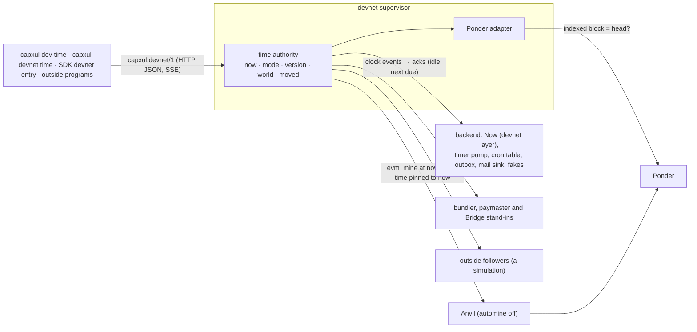
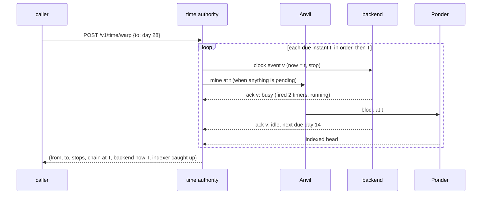

# One clock

Status: designed 8 November 2026, from Aaron's direction of the same day. Records:
`books/target/shared/time.ts` (the rules and the invariants), `books/target/devnet/` (the time
authority, its protocol and its flows) and the `devnet-control` integration in
`books/target/shared/external.ts`. Every judgment below is a decision record; its id is given in
brackets.

> "The concept of time and the clock should be cohesive throughout the code base. When you set a
> time somewhere, that should be the same for block time, and it should be the same for everything
> else. And it should be accessible as part of the protocol, on the devnet side, because we need to
> expose this. Other people are going to be building on top of this; in fact we're already building
> something on top of this, and we needed to drive the time from outside." (Aaron, 8 November 2026)

## Why this needs designing

The old system named three times and gave them one owner (ADR-0041), but only after the fact. On
23 October 2026 the backend read `Date.now()` in 317 places, and the migration took the rest of
the month. What it ended with still had seams:

- **Two clocks on a devnet.** The backend's time was the wall clock plus an offset, set through
  the deployment's admin API. Anvil kept its own clock, which ran on with the wall between blocks.
  The two were said to "agree" within two seconds, and a warp that left them further apart failed.
- **A scheduler on the wall.** Scheduled runs fired on the wall clock. A warp had to shift every
  pending run that carried a `businessDueMs`.
- **A warp that jumped.** A warp mined one block at its target and then ran everything that had
  fallen due, all at the target. A dated payment due on day 10 of a 28-day warp settled on day 28.
- **Polling outside the system.** Vending-bench (`packages/vending-bench`) runs a simulated year
  of a vending business whose money moves on Capxul. It drives devnet time from outside. Its
  bridge reads both clocks and takes the earlier of them (`devnet-world.ts:542`). It skips a warp
  when the running chain has already passed the engine's minute, and it polls until a payment
  looks done (`waitUntil`).

The rebuild has no code yet, so the clock can be built in from the first commit.

## 1. The model

### One now

Capxul has **one clock**. Its reading, **now**, is the instant every product decision is made at
[`time.one-clock`]. Setting it once sets it for everything:

| Reads now | How |
|---|---|
| The chain's block time | On a devnet the supervisor mines every block at now [`devnet.only-miner`]. On staging the chain's time is a fact read from blocks (§2). |
| The backend | The `Now` service is read once per rpc (`RequestTime`) and once per workflow step (`StepTime`), then passed down [`time.read-once`]. |
| Durable workflow timers and crons | Each due time is an instant on the clock. One pump fires what is due, so nothing is ever shifted [`time.durable-timers`]. |
| Ponder's indexed rows | They carry the block's timestamp. On a devnet that is the now the block was mined at. |
| The bundler and paymaster stand-ins | `validAfter` and `validUntil` are signed from now. A window is checked at the chain's next block time, which is now [`devnet.stand-ins-follow`]. |
| The mail sink | `sent_at` is now: it is a backend layer and reads `Now`. |
| The Bridge stand-in | Every event and object is dated at now. Its own scheduled answers are instants. |
| The Core SDK, the CLI, the MCP server and the React SDK | They take now from the backend's answers, never from their own clock [`time.clients-take-server-now`]. |

Two things follow:

- **A time that reaches the chain is a whole second.** This covers a `validUntil`, a cliff, a
  budget period or a close. A due instant for one is rounded up to the second
  [`time.chain-judged-deadlines`].
- **A row's id that carries a time (a ULID) takes the instant of its request or step.** So ids
  sort the way their rows' times do.

### What stays on real elapsed time

Real elapsed time *measures* the system and *protects* it. It never *decides* anything. It is
always a duration or a deadline for waiting. It is never an instant that a row keeps or that a
product rule compares [`time.real-elapsed`].

| On real time | Why |
|---|---|
| A call's per-attempt timeout and its retries' backoff (each integration's `timeoutMs` and `retries`) | A warp cannot make a node answer sooner. |
| A workflow run's own `timeoutMs` and `retries`. The `timeoutMs` of a `chain` or `indexer` wait. | These measure how long Capxul's own machinery (the node, Ponder) may lag. |
| Span timestamps and durations, and so every budget | A budget measured on a frozen clock would read zero. |
| The engine's leases, heartbeats and poll intervals, and the outbox relay's and Ponder's polling | Infrastructure. |
| A client's patience: how long a `wait` step polls before it gives up | A person's patience is real time. |
| An infrastructure rate limit (requests a second from one address) | It protects real capacity. |
| A vendor's envelope: a webhook signature's freshness, a vendor-issued token's expiry, a certificate | The vendor checks it against its own clock. |

**Envelope in real time, payload on now.** The Bridge stand-in signs its webhook with the real
time and dates the deposit it reports at now.

**What a person is promised in time is on now.** That includes Capxul's own expiries: a session,
a sign-in code and its resend cooldown, an assistant grant and a key's grace window. It also
includes the `timeoutMs` of every `person`, `signal` and `timer` wait. A month warped past a
30-day session ends that session, as a month would.

**The guard.** Effect's own `Clock` stays the real clock in every layer (§4). Product code gets an
instant only from `Now`, and the lint enforces it (§4, T0).

### Compared with ADR-0041

| ADR-0041 | Kept or changed |
|---|---|
| One owner of time, one read at the boundary, passed down (D3) | **Kept.** It is the `Now` service. There is one read per rpc and one per step. |
| Chain time is read from the block, never computed (D1) | **Kept.** On staging a deadline the chain enforces is judged by the head. |
| Tests swap the clock. The devnet's time program owns chain time, the offset and the stand-ins. `start-at` is a one-off rewind. | **Kept**, with `Now.test`, the time authority and `start-at` on a fresh world. |
| A lint on direct reads (D4) | **Kept and tightened.** It is at zero from the first commit, with no per-folder counts. It also covers Postgres `now()` and Effect's `DateTime.now`. |
| Three named times: business, chain and wall | **Changed.** There is one clock. Chain time is a block's timestamp, a fact and not a clock. On a devnet the two are equal by construction. Wall time is not a third instant anyone reads: it is real elapsed time, durations only. |
| A devnet's business time is the wall plus an offset | **Changed.** There is no offset. The authority holds now directly, running or frozen, and the chain never runs a clock of its own. |
| The scheduler fires on the wall. A warp shifts the runs that carry `businessDueMs` (D6). | **Changed.** Timers and crons are due at instants on the one clock, so nothing is shifted. |
| Sessions, sign-in codes, JWTs and ULID prefixes on the wall | **Changed.** Capxul's own expiries and ids are on now. Only vendor-checked envelopes stay real. |
| Clients read the devnet's offset from the backend | **Changed.** Clients take now from every answer. |
| The devnet's clock is reached through an SDK-internal socket contract | **Changed.** It is a public, versioned protocol (§3). |
| A warp jumps, then runs everything due at its target | **Changed.** A warp is a barrier that stops at every due instant on the way. |

## 2. Who owns the clock

### On a devnet: one time authority

The supervisor's **time authority** holds the devnet's clock
[`devnet.supervisor-owns-time-and-worlds`, revised in place]. The clock has five parts:

- **now**;
- **mode**: running or frozen;
- **version**, which rises with every change;
- **world**: an epoch that changes at `up` and at every restore;
- **moved**: whether a warp, step or start-at has moved this world's clock.

Its now *is* the chain's block time. Each part of the stack follows it as described below.

#### The chain

The supervisor is the chain's **only miner** [`devnet.only-miner`].

- Anvil runs with automine off. The supervisor watches its pending transactions and mines each
  batch at once with `evm_mine` at now.
- It pins Anvil's own time to now at every change, so an `eth_call` or a gas estimate at
  `pending` sees now.
- If Anvil will not mine two blocks in the same second, the authority first **ticks** now forward
  one second. That way a block's time is still now and time never goes back.
- A warp, a step and a start-at each mine a block at their target.

#### The backend

Its devnet `Now` layer is the follower `backend`. At boot it takes the clock from the protocol,
and it does not serve until it has one. Frozen, now is the clock's now. Running, it is the last
event's now plus the real time since that event, read on the same machine.

At every clock event the backend takes the new now and runs its timer and cron pump. It
acknowledges the event as idle only when all three of these hold:

- no due timer is unfired;
- no workflow step is running;
- its outbox is delivered.

It also reports its next due instant.

#### The workflow engine's timers and crons

These are the runtime's own (§4), so they follow the backend's `Now` with nothing else to move.

#### Ponder

Ponder follows the chain by construction: its rows carry the blocks' timestamps. The supervisor's
Ponder adapter is a follower that is idle when Ponder's indexed block is the head. Its own polling
runs on real time. B3 sets it to 100 ms, or to a WebSocket subscription to new heads, so a stop
does not wait half a second for each block.

#### The stand-ins

Each stand-in follows the authority [`devnet.stand-ins-follow`]:

- **The mock paymaster** signs windows from now.
- **The bundler stand-in** checks a window and simulates at the chain's next block time, which is
  now. Alto checks windows against its own wall clock. So alto runs only if it can be given that
  time. Otherwise B3 writes a Capxul bundler stand-in, with a decision record.
- **The Bridge stand-in** dates its payloads at now. Its scheduled answers are its next due. It
  signs its envelopes with the real time.
- **The mail sink, and the Chainlink and PostHog fakes,** are backend layers that read `Now`.

#### The clients

Every rpc answer carries the now its transaction read. The Core SDK keeps the latest as
`client.now()`.

- The CLI and MCP render relative times against an answer's own now.
- No client decides on time.
- A relative span goes to whoever owns now. A warp's `6h` goes to the supervisor, which resolves
  it.

#### The mode

The clock runs or stands still [`devnet.clock-modes`]:

- **Running** is what `capxul-devnet up` starts with for a person at the keyboard: a code expires
  and a timer fires on its own.
- **Frozen** means now moves only by a warp, a step, a start-at, a restore or a tick. The eval
  devnet, the world builder and every simulation use it.

### On staging and production: the host's clock, and chain time as a fact

- **Now is the host's clock** (NTP), read through the same `Now` service with its live layer.
- **The chain's time is read from blocks and never computed.** This covers indexing's rows and
  `chain-rpc.getBlock`.
- **A timer for a deadline the chain enforces fires at now.** If the head has not reached the due
  second (a simulation reverts as too early), the timer re-arms for the shortfall instead of
  failing [`time.chain-judged-deadlines`]. Payroll's, equity's and approvals' timers "by the
  chain's clock" work this way. On a devnet the head and now are equal at every settle, so the
  re-arm never happens there.
- **Drift is watched** [`time.drift-watch`] with two signals, both riding on reads that are already
  made:
  - Every read of the chain head records `time.chain_lag_ms` (now minus the head's timestamp) on
    its span.
  - Each transaction records `time.db_skew_ms` (the backend's now minus Postgres'
    `clock_timestamp()`), read in the round trip that sets the tenant.

  B5 adds live evals and alerts for each:
  - chain lag outside −2 s to +60 s for five minutes. A negative lag means a deadline the chain
    enforces can pass before Capxul acts. A large positive lag means a stale node.
  - any host's skew beyond one second. Skew would reorder rows and fire timers early or late
    across instances.

## 3. The devnet time protocol, for people building on Capxul

`capxul.devnet/1` is the supervisor's control protocol [`devnet.time-protocol`]. The
`devnet-control` integration books it.

### Transport and clients

- **Transport.** HTTP JSON on loopback. It uses the bearer token that the supervisor writes to an
  owner-only handoff file. The file sits beside the control socket and holds the address and the
  token. The same requests work on the owner-only Unix socket without a token.
- **Clients.** All of these are clients of the one protocol:
  - The Core SDK's Node-only devnet entry (`connectDevnet()`) is the typed client. Its types are
    generated from the protocol's schema in `packages/devnet`.
  - `capxul dev time …` and `capxul-devnet time …` are thin clients.
  - A Python engine can speak the HTTP directly.

### Versioning

- Every answer names `protocol: "capxul.devnet/1.<minor>"`.
- A field added is a minor version.
- A field removed or a meaning changed is `/v2`. It is served beside `/v1` until no client uses
  `/v1`, and it carries a decision.

### Endpoints

| Request | Does | SDK method (flow) |
|---|---|---|
| `GET /v1/time` | The clock, the chain head, the backend's now, Ponder's position, each follower, and whether they agree | `devnet.time.show` (`dev time`) |
| `POST /v1/time/warp {by \| to, jobs}` | Moves now forward by a span or to an instant, as a barrier | `devnet.time.warp` (`dev time warp`) |
| `POST /v1/time/start-at {at}` | Sets a fresh world's story at an earlier instant | `devnet.time.startAt` (`dev time start-at`) |
| `POST /v1/time/step {limit?}` | Moves now to the next instant anything is due, not past `limit`, and settles there | `devnet.time.step` |
| `POST /v1/time/settle` | Waits until everything due at now has run, without moving now | `devnet.time.settle` |
| `POST /v1/time/freeze` | Holds now at the next whole second, never back | `devnet.time.freeze` |
| `POST /v1/time/resume` | Lets now run on at the real rate | `devnet.time.resume` |
| `GET /v1/time/events?after=<version>` | Server-sent events for each clock change (`warp`, `stop`, `step`, `tick`, `settle`, `freeze`, `resume`, `start-at`, `restore`, `up`), each with its version, now, mode and world | `devnet.time.watch` |
| `POST /v1/followers {name, ackTimeoutMs}`, then `GET /v1/followers/<id>/events` and `POST /v1/followers/<id>/ack {version, idle, nextDue}` | Joins as a follower that the barrier waits for | `devnet.time.follow` |

**Errors** use the target's codes in one shape, `{ error: { code, message, details } }`:

- `INVALID_INPUT`: a target not later than now, a start-at date not earlier than now, or a step
  limit not later than now.
- `WRONG_STATE`: a start-at once the clock has moved, or a follower name already in use.
- `WORK_DIED`: a stop that did not settle in time. It names the stop and the busy followers.
- `WRONG_ENVIRONMENT`: the client finds no handoff file.
- `PROVIDER_ERROR`: the supervisor timed out.

### Followers

A follower joins under a name and takes every clock event. It acknowledges each version, saying
whether it is idle and giving its own next due instant [`devnet.followers`].

- **The built-in followers** are the backend, Ponder (through the adapter), and the bundler,
  paymaster and Bridge stand-ins.
- **An outside program joins the same way.** Its happenings then become stops of the warp. During
  its stop the clock stands still, so it acts at exactly that instant.
- **A follower that misses an acknowledgement** fails the barrier and is dropped.
- **The backend's follower channel is the runtime's, not an rpc.** This follows the precedent of
  `rules.outbox`. An rpc that only the supervisor called would be unreached (P2).

### What a warp does

A warp is a **barrier that stops at every due instant on the way** [`devnet.warp-barrier`].

1. A warp from now to T builds a list of stops, in order:
   - every durable timer's due instant;
   - every run of an hourly-or-slower cron (the daily sweep and the daily notices);
   - every follower's next due instant;
   - then T itself.
2. At each stop the clock stands at that instant, and then:
   - a block is mined there when anything is pending;
   - the backend fires what is due and runs it;
   - each minute-scale sync that is due runs once;
   - the authority waits until every follower is idle and Ponder has indexed the head. It repeats
     this until nothing changes.
3. `jobs: false` skips the crons. Timers still fire, because they are due.
4. A cron that fails is named in the answer and does not undo the warp, as the frozen page says.
5. A stop that does not settle in time fails the warp with `WORK_DIED`. The clock stays at the
   last stop that settled, and nothing rolls back.

Step and settle are special cases:

- **Step** is one stop: the next due instant.
- **Settle** is a stop at now.

The minute-scale syncs (flags, Bridge catch-up, prices, the added-token scan) read the current
state of an outside system. So one run per stop is the same as one run per minute. Stopping at
every minute would make a year 525,600 stops. The two calendar crons make a year about 730 stops:
minutes of work. The `background` budget (15 s p95) holds for the warps evals use, from a day to a
month.

### Guarantees

| # | Guarantee |
|---|---|
| G1 | **Never backward.** Within a world, now never decreases for any follower (`inv:time.monotonic`). There are two exceptions. A `start-at` on a fresh world is the story's one move back. A restore replaces the world and carries a new `world` epoch, so a subscriber can tell it from a move [`devnet.start-at`]. |
| G2 | **One value when settled.** After any time call returns, the backend's now, every follower's now and Ponder's indexed head time equal the authority's now. When the call mined, the chain head is at that second (`inv:time.one-now`). Every block is mined at now, and no block is later than now (`inv:time.blocks-at-now`). |
| G3 | **A warp is a barrier.** When a warp to T returns, the chain has a block at T and the backend reads T. Every durable timer due by T has fired once, with its step reading its own due instant. Every hourly-or-slower cron run due by T has run once, at its scheduled instant. Everything they caused has settled: the outbox is delivered, waits are woken and Ponder has indexed that block (`inv:time.due-fires-once`). |
| G4 | **Frozen is deterministic.** In frozen mode now moves only by the caller's calls, and by ticks, which are a function of the blocks mined. So the same calls from the same world, each followed by a settle, give the same block timestamps, row times and timer firings (`inv:time.frozen-deterministic`). |
| G5 | **Failure is visible.** A barrier that cannot settle fails with `WORK_DIED`, names what is busy and leaves the clock at the last settled stop. |
| G6 | **Refusals.** Each is the frozen behaviour: a warp target not later than now is `INVALID_INPUT`; both or neither of a duration and `--to` is `INVALID_INPUT` (checked by the SDK); a start-at date not earlier than now is `INVALID_INPUT`; a start-at after the clock moved is `WRONG_STATE`; off a devnet is `WRONG_ENVIRONMENT`. |

### What vending-bench can rely on for a deterministic simulated year

1. Boot with `capxul-devnet up --start-at <the simulation's day 1, 00:00 UTC> --frozen`. The old
   bridge's "next midnight on the same weekday after the devnet's own time" goes away.
2. Then either of these:
   - **Warp per moment.** For each engine moment, `warp --to` that minute, act (deposit, collect,
     pay), then `settle`. Each warp is a barrier, so no polling is left, and no warp is ever skipped
     because a running chain got there first.
   - **Follow.** Join as a follower whose next due is the engine's next event, and make one
     `warp --to <day 365>`. The warp stops at each of the engine's moments. The engine acts there
     on a standing clock and acknowledges idle.
3. Either way, two runs of one seed see the same block timestamps, the same invoice due dates and
   the same expiries.

What it cannot rely on:

- span durations, which are real time;
- the order of its own concurrent actions that it does not settle between;
- the random bits of ids;
- outside services that are not followers, such as a real Bridge sandbox or Openfort.

Capxul's own expiries are on now, so an agent's 30-day session ends 30 simulated days in. The
harness signs the agent in again, or the agent uses its own key.

## 4. What the runtime and the code must do

### The rules

1. **One `Now` service.** `packages/runtime/src/time/` holds `Now` and is the only code that reads
   a clock [`time.read-once`]. It has three layers:
   - `Now.live`: the host's clock;
   - `Now.devnet`: the follower `backend`;
   - `Now.test`: an instant the test sets, or one that follows Effect's `TestClock` for timer
     logic.
2. **One read per rpc.** The generated router reads `Now` once when an rpc's transaction begins and
   provides the instant as `RequestTime`. Procedures run in the invoker's transaction with the same
   instant, and the answer carries it.
3. **One read per step.** The generated step wrapper reads `Now` once when a step begins and
   provides it as `StepTime`. The step's result is journaled, so a replay sees the same instant
   (`inv:time.replay-same-time`).
4. **Workflow bodies are deterministic.** Effect Workflow replays a body when its instance resumes.
   A body reads no clock. It takes instants from:
   - its trigger: a transition's `at`, a chain event's block time or a cron run's scheduled
     instant;
   - its steps' results.

   It waits on time only with `Timers.until(name, at)`. A transition's outbox event carries its
   transaction's instant.
5. **Timers and crons** [`time.durable-timers`]:
   - **A timer.** `Timers.until` stores the timer (instance, wait name, due instant) in the
     runtime's timers table. The body awaits the timer's durable deferred. One pump fires every
     timer due at now. It completes the deferred through the engine's `deferredDone`, where a
     second completion is a no-op. The pump runs on every clock change and on a short poll.
   - **A cron.** A cron is a row of the runtime's cron table: its expression and its next run as an
     instant. Each run starts the cron's workflow with the execution id `cron/<name>/<instant>` and
     is given that instant. A run missed while the clock jumped runs once.
   - **Waits.** A wait's `timeoutMs` is a timer on now for `person`, `signal` and `timer` waits. It
     is real time for `chain` and `indexer` waits.
6. **Effect's `Clock` stays real.** Spans, logs, timeouts, `Schedule` and sleeps keep real time.

### How a driven clock reaches Effect 4.1.2 (read in `node_modules/effect`)

- **`Clock`** is a `Context.Reference` (`"effect/Clock"`). Its default `ClockImpl`
  (`internal/effect.ts:6374`) reads `Date.now()` and `process.hrtime`. It offers
  `currentTimeMillis`, `currentTimeNanos`, `monotonicTimeNanos` and a `sleep` built on
  `setTimeout`. `DateTime.now` is `Clock.currentTimeMillis`.
  - The tracer stamps every span's start and end with the fiber's `currentTimeNanosUnsafe()`
    (`:6086`, `:6140`). Loggers stamp with `currentTimeMillisUnsafe()` (`:6723`).
  - So a driven `Clock` provided everywhere would date spans in the story's time and, frozen,
    measure every span as zero. That is why `Now` is a separate service.
- **`TestClock`** (`testing/TestClock.ts`) starts at the epoch. `adjust` and `setTime` wake sleeps
  earliest first, the same order the warp barrier keeps. It tracks wall and monotonic nanos
  separately. It drives `Now.test` in unit tests of timer logic.
- **`DurableClock.sleep({name, duration, inMemoryThreshold = 60 s})`** takes a duration:
  - At or under the threshold, it runs `Effect.sleep` inside an activity. That is real time: not
    durable across a crash and not moved by a warp.
  - Over it, it calls `engine.scheduleClock`. `ClusterWorkflowEngine` (`:896`) computes
    `wakeUp = DateTime.now + duration` from the calling fiber's `Clock`. It persists a
    `Workflow/-/DurableClock` message whose `DeliverAt` is `wakeUp`.
- **The message storage** delivers a message when `deliver_at <= clock.currentTimeMillisUnsafe()`.
  Here `clock` is the `Clock` captured when the `MessageStorage` layer was built
  (`MessageStorage.ts:700`, `:785`). Sharding reads storage every `entityMessagePollInterval`
  (10 s by default) or on `Sharding.pollStorage`. The SQL storage's lease (`last_read` ten minutes)
  uses Postgres `NOW()`, which is real time and rightly so.
- **`ClusterCron.make`** schedules each run at `Cron.next(cron, DateTime.now)` with `DeliverAt`.
  It reschedules from `DateTime.now`. With the default `skipIfOlderThan` of one day it skips a run
  delivered more than a day late, so a 28-day warp would skip every daily run.

The engine-native path would need five seams in Effect's unstable cluster code:

1. a now-reading `Clock` (with real `sleep` and real monotonic time) given to the
   `MessageStorage` layer;
2. the same `Clock` around every scheduling call;
3. `inMemoryThreshold: 0`;
4. `skipIfOlderThan: forever`, plus a query of the engine's message table for the warp's stops;
5. `pollStorage` on every clock change.

The design chooses the wake router's own timers table instead. A due instant is one more key on
the router that `rules.process-wakeups` already needs. B0 may overturn this with measurements.

### T0's lint rules

These are at zero from the first commit [`time.no-direct-reads`, `inv:time.no-direct-reads`]:

1. Outside `packages/runtime/src/time/`, no `Date.now()`, no `new Date()` without an argument, no
   `performance.now()` and no `process.hrtime`.
2. Outside the same folder, no `Clock.currentTimeMillis`, `Clock.currentTimeNanos`,
   `Clock.clockWith`, `DateTime.now`, `DateTime.nowAsDate` or `DateTime.nowUnsafe`.
3. In an rpc handler or a procedure, no `Now`: only `RequestTime`.
4. In a workflow body:
   - no `Now`: only `StepTime` inside steps, and `Timers.until`;
   - no `Effect.sleep`, `Effect.timeout`, `DurableClock.sleep`, `ClusterCron` or `Schedule`.
5. In product SQL, a predicate, a migration or a column default, no `now()`, `current_timestamp`,
   `clock_timestamp()`, `transaction_timestamp()` or `localtimestamp`. A row's time is a
   parameter.
6. In Ponder handlers, only `event.block.timestamp`.
7. In the Core SDK, the CLI, MCP and the React SDK, only `client.now()` for an instant.
8. Allowed everywhere: measuring real elapsed time (`Effect.timed`, timeouts and `Schedule` inside
   a step or a call) and formatting or parsing an instant (`new Date(ms)`, `Date.parse`).

## 5. The records

### Shared rules: `books/target/shared/time.ts`

Decisions:

- `time.one-clock`, Aaron's direction, as designed here;
- `time.real-elapsed`;
- `time.read-once`;
- `time.durable-timers`;
- `time.clients-take-server-now`;
- `time.chain-judged-deadlines`;
- `time.drift-watch`;
- `time.no-direct-reads`.

Invariants, each giving an L3 eval `inv:<id>`:

| Invariant | Check | Statement |
|---|---|---|
| `time.one-now` | property | After a time call returns on a devnet, the backend's now, every follower's now and Ponder's indexed head time equal the authority's now. When the call mined, the chain head is at that second. |
| `time.blocks-at-now` | property | Every devnet block has the authority's now, to the second, as its timestamp. No block is later than now. |
| `time.monotonic` | fuzz | Within one world epoch, no component reads a now earlier than any now read before it. |
| `time.due-fires-once` | property | When a warp or step to T returns, every durable timer due by T has fired once, its step reading its due instant. Every hourly-or-slower cron run due by T has run once, at its scheduled instant. |
| `time.replay-same-time` | fuzz | A workflow killed at any point and resumed reads the same instants and drives the same transitions. |
| `time.no-direct-reads` | static | Only `packages/runtime/src/time/` reads a clock. |
| `time.frozen-deterministic` | property | On a frozen devnet, the same calls from the same world, each followed by a settle, give the same block timestamps, row times and timer firings. |

### The devnet concept: `books/target/devnet/`

**`flows.ts`**

- The three frozen time commands' flows are rewritten for one clock:
  - `devnet.time.show` returns `clock`, `chain`, `backend.now`, `indexer`, `followers` and
    `agree`. That keeps the frozen fields: chain, backend, indexer and agree.
  - `devnet.time.warp` returns `from`, `to`, `moved`, `stops`, `chain`, `backend` (with `jobs` and
    `timersFired`), `indexer` and `clock`.
  - `devnet.time.start-at` is rewritten the same way.
- Six protocol flows are added with surface `sdk`: `devnet.time.freeze`, `resume`, `step`,
  `settle`, `watch` and `follow`.
- New shapes are added: `Clock`, `ClockMode`, `ChainHead`, `Follower` and `ClockEvent`. The
  offsets are gone.
- The snapshot flows save and restore the clock: its now and mode, under a new world epoch on
  restore.

**`decisions.ts`**

- `devnet.supervisor-owns-time-and-worlds` is **revised in place**: one time authority whose now
  is the chain's block time.
- New decisions: `devnet.only-miner`, `devnet.clock-modes`, `devnet.warp-barrier`,
  `devnet.time-protocol`, `devnet.followers`, `devnet.deterministic-worlds`, `devnet.start-at` and
  `devnet.stand-ins-follow`.
- Revised: `devnet.jobs` (a warp no longer calls it), `devnet.control-refusals` and
  `devnet.dropped` (the call names), `devnet.fault-switches` (a still clock is the frozen mode,
  not a switch), `devnet.budgets` and `devnet.supervisor-steps` (the new flows, and `poll` for
  streams).

**`jobs.ts`**

- `devnet.jobs.run` runs every cron once, whether due or not. It fires the timers due at now that
  the pump has not fired, and reports `timersFired`. A warp no longer calls it.

**`worlds.ts`**

- Worlds are built at the eval epoch on a frozen clock: one second before each step and a settle
  after it.
- `empty-devnet` boots with `up --start-at <eval epoch> --frozen`.
- `people-with-keys` drops its clock hold and release, because a frozen step gives both keys one
  instant.

**`data.ts` and `processes.ts`**

- Comments only.

### The `devnet-control` integration: `books/target/shared/external.ts`

- It is now the supervisor's public protocol.
- Calls: `snapshotSave`, `snapshotRestore`, `snapshotList`, `timeRead`, `timeWarp`,
  `timeStartAt`, `timeStep`, `timeSettle`, `timeFreeze`, `timeResume`, `timeWatch` and
  `timeFollow`. These replace `clockShow`, `clockWarp` and `clockStartAt`.
- New failures:
  - the barrier's `WORK_DIED`;
  - step's `INVALID_INPUT`;
  - a duplicate follower's `WRONG_STATE`.
- Each failure is an eval: `int:devnet-control.<call>/<code>`.
- `chain-rpc.getBlock`'s text now names the drift watch. No new chain-rpc call is needed: the head
  read already exists.

### The operations

The three frozen time operations keep every behaviour:

- **`dev time`** shows the chain's time and block, the backend's clock, whether the indexer has
  caught up, and whether they agree.
- **`dev time warp`**:
  - moves everything forward together, by a duration or to a date (a date alone means 09:00 UTC);
  - mines a block at the new time;
  - runs the jobs that fell due unless `--no-jobs`;
  - reports a failed job without undoing the warp;
  - refuses a target not later than now, and both or neither of a duration and `--to`.
- **`dev time start-at`**:
  - sets the story back once, on a fresh world, and mines a block there;
  - refuses a date not earlier than now, and a clock already moved.

What changed is spelling, which `system.frozen-behaviour` frees: the output shapes, and that "both
clocks" are one clock. The operations' records are unchanged: 0 problems and 0 breaches.

## 6. What each milestone must do about time

**B0, the durable-execution spike, must also prove:**

1. A router timer (`Timers.until`) fires exactly once at its due instant, including after the
   instance is killed while waiting and resumed.
2. With `Now.test` frozen, nothing fires. Setting now past three timers fires them in due order,
   each step reading its own due instant as `StepTime`.
3. A body that branched on a step's `StepTime` takes the same branch on replay.
4. Completing a timer's durable deferred twice is a no-op.
5. A cron row runs once per stop with its scheduled instant, and runs once after a jump over many
   runs.
6. Idle detection works: a counter of running steps, the outbox depth and the earliest unfired
   timer.
7. The engine-native alternative is measured: `DurableClock` with a now-reading `Clock` given to
   the `MessageStorage` layer, `inMemoryThreshold: 0`. It is recorded as rejected or kept, in a
   decision.
8. On the pinned Anvil:
   - whether two blocks may share a timestamp (which decides the tick rule);
   - that `evm_mine` takes a timestamp;
   - mining latency with automine off;
   - that `eth_call` and `eth_estimateGas` at `pending` see the pinned time.

**T0, the lint, enforces** the eight rules in §4 at zero from the first commit, including Postgres
`now()` in migrations and defaults.

**B1, the generated clock layer, generates:**

- `RequestTime` per rpc in the router;
- `StepTime` per step and `Timers.until` per `timer` wait in the workflow skeletons, with each
  wait's `timeoutMs` as a timer on now or a real timeout, by the wait's kind;
- the cron table's rows from `trigger.cron`, marked calendar (hourly or slower) or sync;
- `now` in every rpc answer envelope and `client.now()` in the SDK client;
- migrations with no time default.

The `Now` service and its three layers are hand-written in `packages/runtime/src/time/`, about 200
lines.

**B2, worlds built with warps:**

- The eval devnet boots at the eval epoch, frozen.
- The world builder warps one second before each step and settles after it [`devnet.deterministic-worlds`].
- A world's manifest keeps its now, mode and `moved`.
- The harness restores worlds frozen and never sleeps for product time: an eval that needs "ten
  minutes later" warps.
- Each `inv:time.*` eval gets a runner.
- A world step that waits on a timer warps past it. For example, approvals' 30-second bounce
  fires at `dev time warp 30s`.

**B3, the devnet, builds:**

- the time authority and the `capxul.devnet/1` server in `packages/devnet`;
- the SDK devnet client generated from its schema;
- the `capxul dev time` and `capxul-devnet time` thin clients;
- Anvil with automine off, mined on pending at now, with the tick rule;
- the followers: the backend's `Now.devnet` with its pump and idle report, the Ponder adapter
  (with polling at 100 ms or WebSocket heads), and the bundler, paymaster and Bridge stand-ins;
- the bundler stand-in decision (alto given the time, or a Capxul stand-in);
- snapshots that carry the clock;
- the warp barrier with its stops, settle and `WORK_DIED`.

**B5 adds** the drift-watch live evals and alerts (chain lag and host skew) on staging.

## Open points for the owners of other files

- **The bundler and paymaster prose.** `component_bundler_paymaster` and `environment_devnet` (in
  `foundation.ts`) and the `bundler` integration's `fake` (in `external.ts`) still say "alto
  behind the mock paymaster". That holds only if alto can be given the devnet's now
  (`devnet.stand-ins-follow`). B3 decides, and the owner corrects the prose.
- **The control handoff.** `environment_devnet.config` lists `DEVNET_CONTROL_SOCKET`. The protocol
  adds an owner-only handoff file beside the socket with the HTTP address and token. The variable
  can stay as the socket's path.
- **Ponder's polling.** `environment_devnet` says Ponder polls every 500 ms. B3 should make it
  100 ms or WebSocket heads, so a warp's stops do not each wait half a second.
- **A stale name.** `docs/decisions/target-architecture.md` names `clockStartAt`. The call is now
  `timeStartAt`.
- **The judgments report.** It is regenerated from the records, so it updates on its next run.
