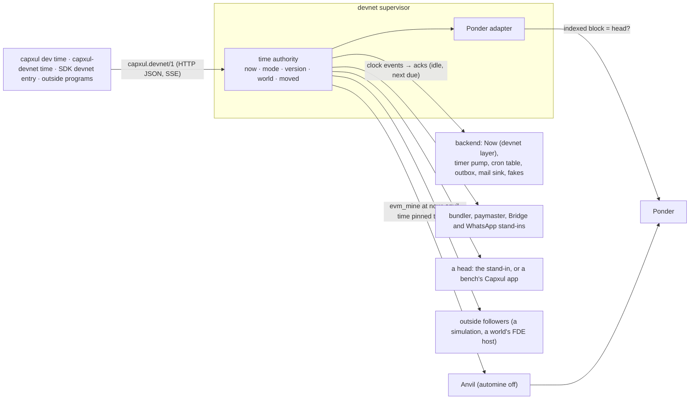
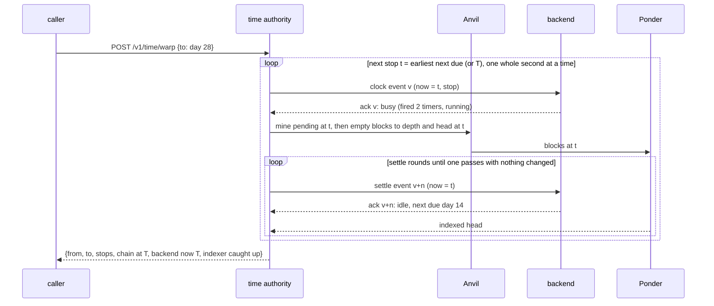
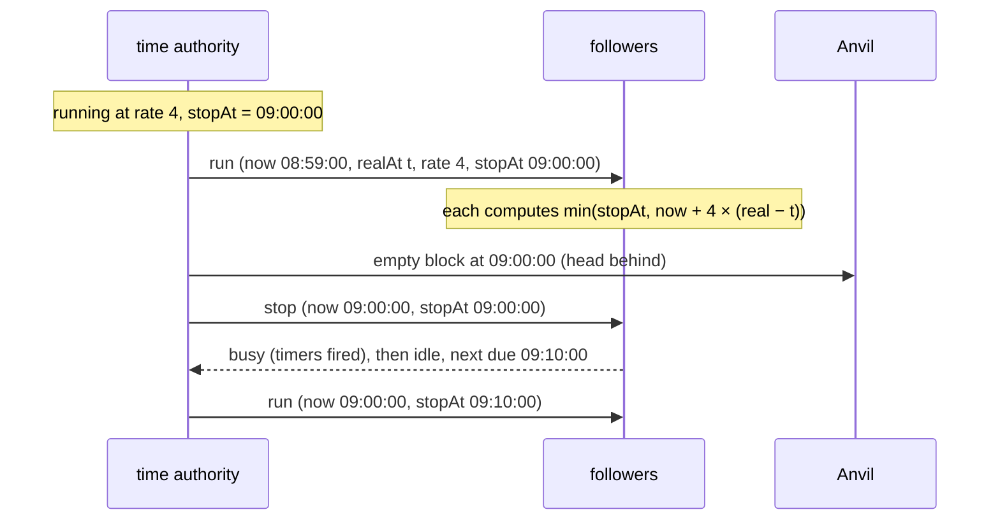
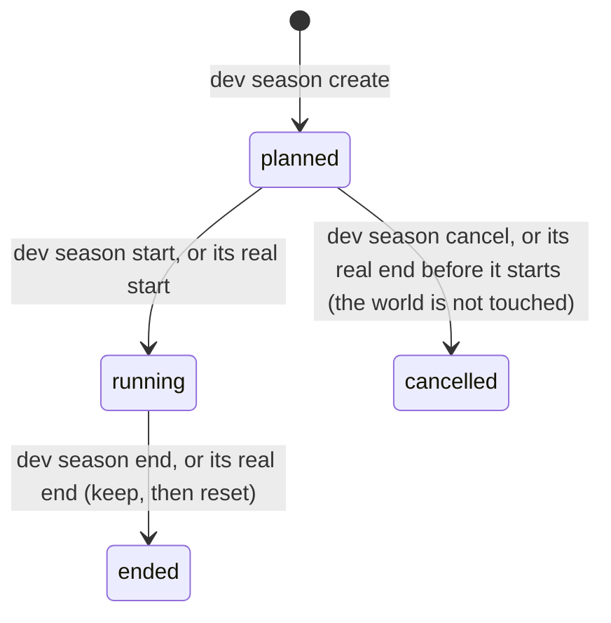

# One clock

Status: designed 8 November 2026, from Aaron's direction of the same day, and revised the same day after an
adversarial review (the settle test, whole-second stops, depth waits, sessions across warps, chain-judged
deadlines, vendor envelopes, lifecycle timeouts and the vending-bench year). Extended the same evening for
`aaron.world-clock` (section 7): a clock rate, running stops, every outside channel in its world, and the shared
world. Revised the same evening after a truth review against Frappe's sources and Meta's Cloud API: the head's hooks
(how every process takes the clock, its jobs between stops, its own email and the direct host-clock reads), a due
report's lead in real time, a remote follower's error at high rates, follower grants and the WhatsApp stand-in's
number read and window. Extended on 9 November 2026 for `aaron.seasons` (section 8): a shared world's time runs in
seasons that start from a known world, run at a rate, jump on a real-time schedule and end in a reset, with the
`dev season` commands, players, the reset a player sees, and followers that save and restore their own state. Records:
`books/target/shared/time.ts` (the rules and the invariants), `books/target/devnet/` (the time
authority, its protocol and its flows) and the `devnet-control` integration in
`books/target/shared/external.ts`. Every judgment below is a decision record; its id is given in
brackets.

> "The concept of time and the clock should be cohesive throughout the code base. When you set a
> time somewhere, that should be the same for block time, and it should be the same for everything
> else. And it should be accessible as part of the protocol, on the devnet side, because we need to
> expose this. Other people are going to be building on top of this; in fact we're already building
> something on top of this, and we needed to drive the time from outside." (Aaron, 8 November 2026)

## Why this needs designing

The old system named three times and gave them one owner (ADR-0041), but only after the fact. On
23 October 2026 the backend read `Date.now()` in 317 places, and the migration took the rest of
the month. What it ended with still had seams:

- **Two clocks on a devnet.** The backend's time was the wall clock plus an offset, set through
  the deployment's admin API. Anvil kept its own clock, which ran on with the wall between blocks.
  The two were said to "agree" within two seconds, and a warp that left them further apart failed.
- **A scheduler on the wall.** Scheduled runs fired on the wall clock. A warp had to shift every
  pending run that carried a `businessDueMs`.
- **A warp that jumped.** A warp mined one block at its target and then ran everything that had
  fallen due, all at the target. A dated payment due on day 10 of a 28-day warp settled on day 28.
- **Polling outside the system.** Vending-bench (`packages/vending-bench`) runs a simulated year
  of a vending business whose money moves on Capxul. It drives devnet time from outside. Its
  bridge reads both clocks and takes the earlier of them (`devnet-world.ts:542`). It skips a warp
  when the running chain has already passed the engine's minute, and it polls until a payment
  looks done (`waitUntil`).

The rebuild has no code yet, so the clock can be built in from the first commit.

## 1. The model

### One now

Capxul has **one clock**. Its reading, **now**, is the instant every product decision is made at
[`time.one-clock`]. Setting it once sets it for everything:

| Reads now | How |
|---|---|
| The chain's block time | On a devnet the supervisor mines every block at now [`devnet.only-miner`]. On staging the chain's time is a fact read from blocks (§2). |
| The backend | The `Now` service is read once per rpc (`RequestTime`) and once per workflow step (`StepTime`), then passed down [`time.read-once`]. |
| Durable workflow timers and crons | Each due time is an instant on the clock. One pump fires what is due, so nothing is ever shifted [`time.durable-timers`]. |
| Ponder's indexed rows | They carry the block's timestamp. On a devnet that is the now the block was mined at. |
| The bundler and paymaster stand-ins | `validAfter` and `validUntil` are signed from now. A window is checked at the chain's next block time, which is now [`devnet.stand-ins-follow`]. |
| The mail sink | `sent_at` is now: it is a backend layer and reads `Now`. |
| The stand-in WhatsApp | Every message and webhook is dated at now [`devnet.whatsapp-stand-in`]. |
| A connected Frappe head | On a devnet or a shared world, Frappe's `now_datetime` is the world's now, its jobs run on it and its email goes to the sink, through the Capxul app's hooks [`devnet.head-follows-world`]. |
| A world's hosted FDEs | In a shared world, each agent's timers are instants on the world's clock [`devnet.fde-host-follows-world`]. |
| The Bridge stand-in | Every event and object is dated at now. Its own scheduled answers are instants. |
| The Core SDK, the CLI, the MCP server and the React SDK | They take now from the backend's answers, never from their own clock [`time.clients-take-server-now`]. |

Four things follow:

- **A time that reaches the chain is a whole second.** This covers a `validUntil`, a cliff, a
  budget period, a vote's end or a close [`time.chain-judged-deadlines`].
- **Every due instant is a whole second, rounded up.** That covers a timer's `at` and a cron's
  run, so a warp's stops are whole seconds and a stop's block is at its instant exactly
  [`time.durable-timers`].
- **A row's id that carries a time (a ULID) takes the instant of its request or step.** So ids
  sort the way their rows' times do. ULIDs increment within one instant, so rows made at one
  frozen instant keep the order they were made in.
- **No key rests on an instant alone.** On a frozen clock many requests share one instant: a
  world step, an eval, a stop's whole cascade. So a key or a uniqueness rule also carries an id
  or a sequence, and every order by time has a tie-break [`time.read-once`]. Two cases in the book
  today are a cron's manual run (§4) and two price rounds scripted at one instant (open points).

### What stays on real elapsed time

Real elapsed time *measures* the system and *protects* it. It never *decides* anything. It is
always a duration or a deadline for waiting. It is never an instant that a row keeps or that a
product rule compares [`time.real-elapsed`].

| On real time | Why |
|---|---|
| A call's per-attempt timeout and its retries' backoff (each integration's `timeoutMs` and `retries`) | A warp cannot make a node answer sooner. |
| A workflow run's own `timeoutMs` and `retries`: they bound one run's work between its waits. The `timeoutMs` of a `chain` or `indexer` wait. | These measure how long Capxul's own machinery (the node, Ponder) may lag. A bound on how long an object may live in the story is not a run timeout: it is a `timer` wait on now (open points). |
| Span timestamps and durations, and so every budget | A budget measured on a frozen clock would read zero. |
| The engine's leases, heartbeats and poll intervals, and the outbox relay's and Ponder's polling | Infrastructure. |
| A client's patience: how long a `wait` step polls before it gives up | A person's patience is real time. |
| An infrastructure rate limit (requests a second from one address) | It protects real capacity. |
| A vendor's envelope: a webhook signature's freshness, a vendor-issued token's expiry, a certificate | The vendor checks it against its own clock. |

**Envelope in real time, payload on now.** The Bridge stand-in signs its webhook with the real
time and dates the deposit it reports at now. Checking an envelope's freshness, or putting a
timestamp into a vendor's request, needs a real *instant*, not a duration. That instant comes from
`RealTime`, beside `Now` in `packages/runtime/src/time/`. Only integration layers call it, and its
value is never stored in a row or compared with a product time.

**What a person is promised in time is on now.** That includes Capxul's own expiries: a session,
a sign-in code and its resend cooldown, an assistant grant and a key's grace window. It also
includes the `timeoutMs` of every `person`, `signal` and `timer` wait. A month warped past a
30-day session ends that session, as a month would. So after a warp that ends sessions, the world
builder and the eval harness sign the world's people in again by the mail sink's code
[`devnet.sessions-across-warps`]. Three worlds need it today: `org-with-agreements` warps 31 days,
and `org-with-option-active` and `org-with-sale-offered` warp 400 days.

**The guard.** Effect's own `Clock` stays the real clock in every layer (§4). Product code gets an
instant only from `Now`, and the lint enforces it (§4, T0).

### Compared with ADR-0041

| ADR-0041 | Kept or changed |
|---|---|
| One owner of time, one read at the boundary, passed down (D3) | **Kept.** It is the `Now` service. There is one read per rpc and one per step. |
| Chain time is read from the block, never computed (D1) | **Kept.** On staging a deadline the chain enforces is judged by the head. |
| Tests swap the clock. The devnet's time program owns chain time, the offset and the stand-ins. `start-at` is a one-off rewind. | **Kept**, with `Now.test`, the time authority and `start-at` on a fresh world. |
| A lint on direct reads (D4) | **Kept and tightened.** It is at zero from the first commit, with no per-folder counts. It also covers Postgres `now()` and Effect's `DateTime.now`. |
| Three named times: business, chain and wall | **Changed.** There is one clock. Chain time is a block's timestamp, a fact and not a clock. On a devnet the two are equal by construction. Wall time is not a third instant anyone reads: it is real elapsed time, durations only. |
| A devnet's business time is the wall plus an offset | **Changed.** There is no offset. The authority holds now directly, running or frozen, and the chain never runs a clock of its own. |
| The scheduler fires on the wall. A warp shifts the runs that carry `businessDueMs` (D6). | **Changed.** Timers and crons are due at instants on the one clock, so nothing is shifted. |
| Sessions, sign-in codes, JWTs and ULID prefixes on the wall | **Changed.** Capxul's own expiries and ids are on now. Only vendor-checked envelopes stay real. |
| Clients read the devnet's offset from the backend | **Changed.** Clients take now from every answer. |
| The devnet's clock is reached through an SDK-internal socket contract | **Changed.** It is a public, versioned protocol (§3). |
| A warp jumps, then runs everything due at its target | **Changed.** A warp is a barrier that stops at every due instant on the way. |

## 2. Who owns the clock

### On a devnet: one time authority

The supervisor's **time authority** holds the devnet's clock
[`devnet.supervisor-owns-time-and-worlds`, revised in place]. The clock has seven parts:

- **now**;
- **mode**: running or frozen;
- **rate**: the world seconds that pass in each real second while it runs, 1 to 60 (section 7);
- **next stop** (`stopAt`): while running, the next due instant the clock will stand at (section 7);
- **version**, which rises with every change;
- **world**: an epoch that changes at `up` and at every restore;
- **moved**: whether a warp, step or start-at has moved this world's clock.

Its now *is* the chain's block time. Each part of the stack follows it as described below.

#### The chain

The supervisor is the chain's **only miner** [`devnet.only-miner`].

- Anvil runs with automine off. The supervisor watches its pending transactions and mines each
  batch at once with `evm_mine` at now.
- It pins Anvil's own time to now at every change, so an `eth_call` or a gas estimate at
  `pending` sees now.
- **On a frozen clock every move ends with the head at now.** A stop of a warp or step, a
  start-at, a freeze that moved now and a restore each end by mining an empty block at now, when
  nothing else was mined at that second. So `latest` reads now, and chain-rpc reads at `latest` on
  every environment, with no devnet branch. Without this, a stop that mined nothing would leave
  every contract view that computes from `block.timestamp` reading the past: Agreements' released
  pay, Budgets' period, `Governor.state`.
- **A stop opens with the head at its second** (added for the world clock). When the head is
  earlier, the authority mines an empty block at the stop's instant before it sends the stop event.
  A timer for a deadline the chain enforces fires as the stop opens and checks the head; mined only
  at the stop's end, the head would be a block short of its second and the timer would re-arm past
  its own instant. It then waits inside the stop only for Ponder to index that block.
- **Depth waits end inside the stop** [`devnet.mine-to-depth`]. No block follows a quiet one, so a
  reader waiting for a fact to be k blocks deep would wait forever. Payments settle at the
  deployment's finality depth and confirm at twice it, approvals land at it, and books' added-token
  scan stops k below the head. So each stop ends by mining empty blocks at now until its newest
  block with a transaction is 2k deep. With k = 0 it mines none.
- **A stop mines several blocks in one second.** Its cascade (a timer's transaction, then the one
  its indexed fact wakes, then the depth blocks) needs the pinned Anvil to accept equal
  timestamps. B0 measures it. If Anvil refuses, the authority **ticks** now forward one second
  before such a block. That keeps time forward, but it carries a stop's later work past its
  instant, and how many ticks a stop takes depends on how its transactions batch, which is
  timing. G3 and G4 then hold only for stops that mine once, and B3 records how mining is made
  deterministic before anything relies on them.

#### The backend

Its devnet `Now` layer is the follower `backend`. At boot it takes the clock from the protocol,
and it does not serve until it has one. Frozen, now is the clock's now. Running, it is the clock's
now plus the rate times the real time since the clock's `realAt`, the instant on the authority's real
clock when now held that value, and never past the clock's next stop (section 7.4). Every follower computes it the same way, so they all read one function of
one real clock. Timing from its own receipt of an event would make a follower trail the authority
by the event's delivery, and a block mined at the authority's second could then be later than the
backend's now.

At every clock event the backend takes the new now and runs its timer and cron pump. It
acknowledges the event as idle only when all of these hold:

- no due timer is unfired;
- no workflow run or step is executing;
- the engine's message storage holds nothing deliverable that has not been processed: a resume, a
  deferred's completion, a new execution or a run's retry;
- its outbox is delivered;
- its wake router has consumed every indexed row up to the block Ponder has indexed.

The third and fifth close two gaps where "no step running, outbox delivered" is idle while work is
still coming. Effect's cluster persists a message and only then reads it, so there is a gap after
the pump completes a timer's deferred, or the relay starts a workflow, and before the run begins.
The other gap is between Ponder indexing a block and the router routing its rows.

It also reports its next due instant: its earliest unfired timer, or its next hourly-or-slower
cron run.

#### The workflow engine's timers and crons

These are the runtime's own (§4), so they follow the backend's `Now` with nothing else to move.

#### Ponder

Ponder follows the chain by construction: its rows carry the blocks' timestamps. The supervisor's
Ponder adapter is a follower that is idle when Ponder's indexed block is the head. Under an armed
`indexer hold` it is idle at the held block instead: an armed fault switch's held state counts as
settled, or the `requests-indexer-behind` world could never be built. Its own polling runs on real
time. B3 sets it to 100 ms, or to a WebSocket subscription to new heads, so a stop does not wait
half a second for each block.

#### The stand-ins

Each stand-in follows the authority [`devnet.stand-ins-follow`]:

- **The mock paymaster** signs windows from now.
- **The bundler stand-in** checks a window and simulates at the chain's next block time, which is
  now. Alto checks windows against its own wall clock. So alto runs only if it can be given that
  time. Otherwise B3 writes a Capxul bundler stand-in, with a decision record. The bundler
  stand-in is idle when its mempool is empty and no bundle is in flight.
- **chain-rpc** reads at `latest`, as on staging. On a frozen devnet that is a block at now.
- **The Bridge stand-in** dates its payloads at now. Its scheduled answers are its next due. It
  signs its envelopes with the real time.
- **The mail sink, and the Chainlink and PostHog fakes,** are backend layers that read `Now`.

#### The clients

Every rpc answer carries the now its transaction read. The Core SDK keeps the latest as
`client.now()`.

- The CLI and MCP render relative times against an answer's own now.
- No client decides on time.
- A relative span goes to whoever owns now. A warp's `6h` goes to the supervisor, which resolves
  it.
- `client.now()` is the latest answer's now plus the real time since that answer. It is stale
  after a warp the client did not see. So a client renews a session or refreshes a token when the
  backend refuses it, never only on its own reading. Examples are an agent's 24-hour session after
  a two-day warp, and an assistant's access token.

#### The mode

The clock runs or stands still [`devnet.clock-modes`]:

- **Running** is what `capxul-devnet up` starts with for a person at the keyboard: a code expires
  and a timer fires on its own. It runs at the clock's rate, 1 unless set, and stands at each due
  instant on the way (section 7).
- **Frozen** means now moves only by a warp, a step, a start-at, a restore or a tick. The eval
  devnet, the world builder and every simulation use it.

### On staging and production: the host's clock, and chain time as a fact

- **Now is the host's clock** (NTP), read through the same `Now` service with its live layer.
- **The chain's time is read from blocks and never computed.** This covers indexing's rows and
  `chain-rpc.getBlock`.
- **A timer for a deadline the chain enforces is due at the first second at which the chain's own
  rule gives the new answer** [`time.chain-judged-deadlines`]. That second is read off the
  contract:
  - v4 Agreements' offer expiry (`block.timestamp >= offerExpiresAt`) and Budgets' `payAt`
    (`block.timestamp < payAt` reverts) change at the deadline second itself.
  - OpenZeppelin's Governor keeps a vote Active through its deadline second, so a vote's end is
    due at `voteEnd + 1`. A timer due at `voteEnd` fires at a stop whose block is at `voteEnd`,
    where `Governor.state` still answers Active.
  - The EntryPoint's `validAfter` bound is read off the pinned EntryPoint the same way.
- **When the timer fires it checks the head.** While the head has not reached the due second (on
  staging it trails now), the timer re-arms for the shortfall instead of acting or failing. It acts
  once Ponder has indexed that head. A lapse needs no chain call, so nothing would revert to say it
  is early. Without the check, a payee's accept mined in the deadline's last second could land
  after the backend had already lapsed the offer. Payroll's, equity's and approvals' timers "by
  the chain's clock" work this way.
- **A span of chain-dated facts is half-open**, `[start, end)`, as the v4 Calendar's periods are:
  a month's books, a budget period. A process that closes one waits the same way, until the head
  and Ponder are past its end.
- On a devnet the head is at now at every settled stop. With due seconds set by this rule, the
  re-arm never happens there.
- **Drift is watched** [`time.drift-watch`] with two signals, both riding on reads that are already
  made:
  - Every read of the chain head records `time.chain_lag_ms` (now minus the head's timestamp) on
    its span.
  - Each transaction records `time.db_skew_ms` (the backend's now minus Postgres'
    `clock_timestamp()`), read in the round trip that sets the tenant.

  B5 adds live evals and alerts for each:
  - chain lag outside −2 s to +60 s for five minutes. A negative lag means a deadline the chain
    enforces can pass before Capxul acts. A large positive lag means a stale node.
  - any host's skew beyond one second. Skew would reorder rows and fire timers early or late
    across instances.

## 3. The devnet time protocol, for people building on Capxul

`capxul.devnet/1` is the supervisor's control protocol [`devnet.time-protocol`]. The
`devnet-control` integration books it.

### Transport and clients

- **Transport.** HTTP JSON on loopback. It uses the bearer token that the supervisor writes to an
  owner-only handoff file. The file sits beside the control socket and holds the address and the
  token. The same requests work on the owner-only Unix socket without a token. The server answers
  only a loopback `Host` and no cross-origin request, so a web page on the same machine cannot
  drive it.
- **Every clock it answers carries `realAt`**, the authority's real time when now held that value,
  with the clock's `rate` and next stop (`stopAt`). On a running clock every reader computes now as
  `min(stopAt, now + rate × (real time − realAt))` (section 7.4).
- **A shared world** serves the same requests over HTTPS at its own address, with a world grant as
  the bearer token, each answered by the grant's role (section 7.6).
- **One move at a time.** A warp, step, settle, start-at, freeze, resume or rate change while another
  move runs is `WRONG_STATE`, and the refusal names the running move. Reads and watches always answer.
- **Clients.** All of these are clients of the one protocol:
  - The Core SDK's Node-only devnet entry (`connectDevnet()`) is the typed client. Its types are
    generated from the protocol's schema in `packages/devnet`.
  - `capxul dev time …` and `capxul-devnet time …` are thin clients.
  - A Python engine can speak the HTTP directly.

### Versioning

- Every answer names `protocol: "capxul.devnet/1.<minor>"`.
- A field added is a minor version.
- There is no support window and no parallel version (Aaron, 8 November 2026). A field removed or
  a meaning changed fixes every client in the same change and cuts everyone over at once, with a
  decision.

### Endpoints

| Request | Does | SDK method (flow) |
|---|---|---|
| `GET /v1/time` | The clock, the chain head, the backend's now, Ponder's position, each follower, and whether they agree | `devnet.time.show` (`dev time`) |
| `POST /v1/time/warp {by \| to, jobs}` | Moves now forward by a span or to an instant, as a barrier | `devnet.time.warp` (`dev time warp`) |
| `POST /v1/time/start-at {at}` | Sets a fresh world's story at an earlier instant | `devnet.time.startAt` (`dev time start-at`) |
| `POST /v1/time/step {limit?}` | Moves now to the next instant anything is due, not past `limit`, and settles there | `devnet.time.step` |
| `POST /v1/time/settle` | Waits until everything due at now has run, without moving now | `devnet.time.settle` |
| `POST /v1/time/freeze` | Holds now at the next whole second, never back | `devnet.time.freeze` |
| `POST /v1/time/resume` | Lets now run on at the clock's rate, through the running stops | `devnet.time.resume` |
| `POST /v1/time/rate {rate}` | Sets the rate a running clock runs at, 1 to 60 (section 7.2) | `devnet.time.set` (`dev time set --rate`) |
| `GET /v1/time/events?after=<version>` | Server-sent events for each clock change (`warp`, `stop`, `step`, `tick`, `settle`, `freeze`, `resume`, `rate`, `run`, `due`, `start-at`, `save`, `restore`, `up`), each with its version, now, `realAt`, mode, rate, `stopAt`, world and season, and on a `save` or `restore` the world's name | `devnet.time.watch` |
| `POST /v1/followers {name, ackTimeoutMs, stateful?}`, then `GET /v1/followers/<id>/events`, `POST /v1/followers/<id>/ack {version, idle, nextDue}` and, between events, `POST /v1/followers/<id>/due {nextDue}` | Joins as a follower that the barrier and the running stops wait for | `devnet.time.follow` |
| `POST /v1/mail {message}` | Keeps an email a connected bench's Email Queue sends in the mail sink, dated at now, on the head's follower grant (section 7.5) | none: the Capxul Frappe app's mail hook |
| `/v1/seasons…` | A shared world's seasons: eleven requests (section 8.9) | `devnet.seasons.*` (`dev season …`) |

Every answer's clock also carries `realNow`, the authority's real time as it answered, from which a follower on
another machine measures its offset (section 7.4).

**Errors** use the target's codes in one shape, `{ error: { code, message, details } }`:

- `INVALID_INPUT`: a target not later than now, a start-at date not earlier than now, a step
  limit not later than now, or a rate that is not a whole number from 1 to 60.
- `WRONG_STATE`: a start-at once the clock has moved, a follower name already in use, or a move
  (a rate change included) while another move runs.
- `ROLE_PERMISSION_DENIED`: in a shared world, a joiner's grant asking to move the clock, follow it,
  save or restore the world, or change a season, or a follower grant asking to move it (sections 7.6 and 8.3).
- `WORK_DIED`: a stop that did not settle within its limit (60 s of real time by default). It
  names the stop and the busy followers.
- `WRONG_ENVIRONMENT`: the client finds no handoff file.
- `PROVIDER_ERROR`: the supervisor timed out.

### Followers

A follower joins under a name and takes every clock event. It acknowledges each version, saying
whether it is idle and giving its own next due instant, later than now or none
[`devnet.followers`]. Its handler may call Capxul (the CLI, the SDK, its own transactions, which
the supervisor mines at now), but it never moves the clock and never calls settle: it would wait
on itself. It acknowledges busy instead.

- **The built-in followers** are the backend, Ponder (through the adapter), and the bundler,
  paymaster and Bridge stand-ins.
- **An outside program joins the same way.** Its happenings then become stops of the warp. During
  its stop the clock stands still, so it acts at exactly that instant.
- **A follower that misses an acknowledgement** fails the barrier and is dropped.
- **A follower that keeps world state** outside the chain and Postgres (a real bench, the world's FDE namespace) joins
  `stateful` and saves and restores that state with every world (section 8.6).
- **The backend's follower channel is the runtime's, not an rpc.** This follows the precedent of
  `rules.outbox`. An rpc that only the supervisor called would be unreached (P2).

### What a warp does

A warp is a **barrier that stops at every due instant on the way** [`devnet.warp-barrier`].

1. A warp from now to T moves through **stops**, each a whole second (T is rounded up). The next
   stop is chosen *after* each stop settles, as the earliest of:
   - every follower's next due instant (the backend's is its earliest unfired timer or its next
     run of an hourly-or-slower cron: the daily sweep and the daily notices);
   - T itself.

   So a timer that one stop's work sets for before T is a stop too, such as a dated payment's
   day-ahead timer set at the stop that created the payment. A list built when the warp starts
   would miss it.
2. At each stop the clock stands at that instant, and then:
   - the backend fires what is due and runs it;
   - each minute-scale sync that is due runs once;
   - the supervisor mines what is pending at that second, and ends with the head there and its
     depth blocks mined;
   - the authority runs **settle rounds**. A round is a `settle` event: a new version, with now
     unchanged. The stop has settled when, in one round, all of these hold: every follower
     acknowledged the round idle; Anvil holds no pending transaction; Ponder has indexed the head
     (or the block an armed indexer hold keeps it at); and nothing was mined and no follower
     reported busy since the round began. Otherwise another round runs. A round whose
     acknowledgements all postdate its start, with nothing mined meanwhile, cannot pass in the gap
     between Ponder indexing a fact and the wake it causes.
3. `jobs: false` skips the crons and moves each skipped cron's next run past T, so none runs late.
   A cron left due would run on the pump's next poll, right after the warp. Timers still fire,
   because they are due.
4. A cron that fails is named in the answer and does not undo the warp, as the frozen page says.
5. A stop that does not settle within its limit (60 s of real time by default) fails the warp
   with `WORK_DIED`. The clock stays at the last stop that settled, and nothing rolls back.
6. A warp whose caller goes away stops at its next settled stop. On a running clock the warp holds
   now at each stop and lets it run on from T, at its rate, when it returns.

Step and settle are special cases:

- **Step** is one stop: the next due instant.
- **Settle** is a stop at now.

The minute-scale syncs (flags, Bridge catch-up, prices, the added-token scan) read the current
state of an outside system. So one run per stop is the same as one run per minute. Stopping at
every minute would make a year 525,600 stops. The two calendar crons make a year about 730 stops:
minutes of work. The `background` budget (15 s p95) holds for the warps evals use, from a day to a
month.

### Guarantees

| # | Guarantee |
|---|---|
| G1 | **Never backward.** Within a world, now never decreases for any follower (`inv:time.monotonic`). There are two exceptions. A `start-at` on a fresh world is the story's one move back. A restore replaces the world and carries a new `world` epoch, so a subscriber can tell it from a move [`devnet.start-at`]. |
| G2 | **One value when settled.** After any time call returns on a frozen clock, the backend's now and every follower's acknowledged now equal the authority's now, the chain head's time is that second, and Ponder has indexed the head (`inv:time.one-now`). On a running clock they agree as one function of the authority's real clock, its rate and its next stop, and between stops the head may trail now, as on staging. Every block is mined at now, and no block is later than now, except the blocks mined before a start-at (`inv:time.blocks-at-now`). |
| G3 | **A warp is a barrier.** When a warp to T returns, the chain has a block at T and the backend reads T. Every durable timer due by T has fired once, with its step reading its own due instant, including timers set by the work on the way. Unless `jobs` was false, every hourly-or-slower cron run due by T has run once, at its scheduled instant. Everything they caused has settled: the outbox is delivered, waits are woken and Ponder has indexed the head (`inv:time.due-fires-once`). |
| G4 | **Frozen is deterministic.** In frozen mode now moves only by the caller's calls. So the same calls from the same world, each followed by a settle, give the same block timestamps, row times and timer firings (`inv:time.frozen-deterministic`). Two things the run does not control must hold: the pinned Anvil mines several blocks in one second, so no tick is needed (B0), and the script stays below the infrastructure rate limits, which run on real time. |
| G5 | **Failure is visible.** A barrier that cannot settle fails with `WORK_DIED`, names what is busy and leaves the clock at the last settled stop. |
| G6 | **Refusals.** Each is the frozen behaviour: a warp target not later than now is `INVALID_INPUT`; both or neither of a duration and `--to` is `INVALID_INPUT` (checked by the SDK); a start-at date not earlier than now is `INVALID_INPUT`; a start-at after the clock moved is `WRONG_STATE`; off a devnet is `WRONG_ENVIRONMENT`. |
| G7 | **A rate is a ceiling.** On a running clock at rate r, now advances at most r seconds a real second and stands only at stops (`inv:time.rate-ceiling`). |
| G8 | **A running clock stops where something is due.** Every due instant known at least one real second of running ahead (r world seconds at rate r) is a stop: the head is mined to that second before the backend fires what is due there, and, at a stop that settles within its limit, each timer's step reads its due instant (`inv:time.running-stops`). |
| G9 | **Nothing leaves a world.** A devnet's and a shared world's mail and WhatsApp stay in the sink and the stand-in; staging mails only its own mailboxes (`inv:time.world-channels`). |

### What vending-bench can rely on for a deterministic simulated year

1. **Fix day 1 against the pinned fork, not the running devnet.** The engine's start date is
   2026-01-05 (`world_facts.py`), which is before the pinned fork block's time. The eval epoch never
   predates a block the fork already has [`devnet.deterministic-worlds`]. So day 1 is the first UTC
   midnight on the engine's start weekday at or after the fork block's time. That is the old
   bridge's `anchorAfter`, taken against a fixed instant instead of the devnet's own running time,
   so it is the same on every run. A day 1 before the fork works only if B0 shows that Ponder and
   the forked contracts accept local blocks older than the forked history.
2. **Boot before day 1 and build the world on 1-second steps.** Boot with
   `capxul-devnet up --start-at <day 0, 09:00 UTC> --frozen`. Build the business's people,
   Organizations and Budgets with the world builder's rule of one second before each step and a
   settle after it. Then `warp --to <day 1, 00:00>`. Otherwise the whole set-up shares day 1's
   first instant with the engine's first moment.
3. Then drive the story in bounded calls. Each call waits at most ten minutes (the caller's
   patience on `timeWarp`). A year with an agent thinking at every simulated day takes hours, so
   one year-long call cannot work.
   - **Warp per moment.** For each engine moment, `warp --to` that minute, act (deposit, collect,
     pay), then `settle`. Each warp is a barrier, so no polling is left, and no warp is ever skipped
     because a running chain got there first.
   - **Follow.** Join as a follower whose next due is the engine's next event, with an `ackTimeoutMs`
     long enough for the agent's turn. Then call `step --limit <day 365>` in a loop, or warp a day
     at a time. Each call stops at the engine's moments, and the engine acts there on a standing
     clock and acknowledges idle. It needs a second thread or process: the one that calls `step`
     blocks, while the follower's handler answers the events.
4. Either way, two runs of one seed see the same block timestamps, the same invoice due dates and
   the same expiries, given G4's two conditions.

What it cannot rely on:

- span durations, which are real time;
- the order of its own concurrent actions that it does not settle between;
- the random bits of ids;
- outside services that are not followers, such as a real Bridge sandbox or Openfort;
- a burst faster than the infrastructure rate limits, which run on real time.

Capxul's own expiries are on now, so an agent's 30-day session ends 30 simulated days in. The
harness signs the agent in again, or the agent uses its own key, whose 24-hour session the SDK
renews on the refusal [`time.clients-take-server-now`].

## 4. What the runtime and the code must do

### The rules

1. **One `Now` service.** `packages/runtime/src/time/` holds `Now` and is the only code that reads
   a clock [`time.read-once`]. It has three layers:
   - `Now.live`: the host's clock;
   - `Now.devnet`: the follower `backend`;
   - `Now.test`: an instant the test sets, or one that follows Effect's `TestClock` for timer
     logic.
2. **One read per rpc.** The generated router reads `Now` once when an rpc's transaction begins and
   provides the instant as `RequestTime`. Procedures run in the invoker's transaction with the same
   instant, and the answer carries it.
3. **One read per step.** The generated step wrapper reads `Now` once when a step begins and
   provides it as `StepTime`. The step's result is journaled, so a replay sees the same instant
   (`inv:time.replay-same-time`).
4. **Workflow bodies are deterministic.** Effect Workflow replays a body when its instance resumes.
   A body reads no clock. It takes instants from:
   - its trigger: a transition's `at`, a chain event's block time or a cron run's scheduled
     instant;
   - its steps' results.

   It waits on time only with `Timers.until(name, at)`. A transition's outbox event carries its
   transaction's instant.
5. **Timers and crons** [`time.durable-timers`]:
   - **A timer.** `Timers.until` stores the timer (instance, wait name, due instant) in the
     runtime's timers table. The due instant is a whole second, rounded up. The body awaits the
     timer's durable deferred. One pump fires every timer due at now. It completes the deferred
     through the engine's `deferredDone`, where a second completion is a no-op. The pump runs on
     every clock change and on a short poll.
   - **A timer that lost its race** (a signal cut its wait short) is cancelled in the step that saw
     the winner. So it neither fires nor becomes a warp's stop.
   - **A cron.** A cron is a row of the runtime's cron table: its expression and its next run as an
     instant. Each scheduled run starts the cron's workflow with the execution id
     `cron/<name>/<instant>` and is given that instant. A run missed while the clock jumped runs
     once. A manual run (`dev jobs run`) has its own id, `cron/<name>/manual/<request id>`.
     Keyed by the instant alone, a second `dev prices set` at one frozen instant would find the
     first one's run and sync nothing.
   - **Waits.** A wait's `timeoutMs` is a timer on now for `person`, `signal` and `timer` waits. It
     is real time for `chain` and `indexer` waits.
   - **A workflow's own `timeoutMs`** bounds one run's work between its waits, in real time. A bound
     on an object's life in the story is a `timer` wait instead.
6. **Effect's `Clock` stays real.** Spans, logs, timeouts, `Schedule` and sleeps keep real time.
7. **`RealTime` is for envelopes only.** `packages/runtime/src/time/` also exports `RealTime`, the
   real clock's instant. Only an integration layer's envelope code calls it: a webhook's freshness,
   a timestamp signed into a vendor's request.

### How a driven clock reaches Effect 4.1.2 (read in `node_modules/effect`)

- **`Clock`** is a `Context.Reference` (`"effect/Clock"`). Its default `ClockImpl`
  (`internal/effect.ts:6374`) reads `Date.now()` and `process.hrtime`. It offers
  `currentTimeMillis`, `currentTimeNanos`, `monotonicTimeNanos` and a `sleep` built on
  `setTimeout`. `DateTime.now` is `Clock.currentTimeMillis`.
  - The tracer stamps every span's start and end with the fiber's `currentTimeNanosUnsafe()`
    (`:6086`, `:6140`). Loggers stamp with `currentTimeMillisUnsafe()` (`:6723`).
  - So a driven `Clock` provided everywhere would date spans in the story's time and, frozen,
    measure every span as zero. That is why `Now` is a separate service.
- **`TestClock`** (`testing/TestClock.ts`) starts at the epoch. `adjust` and `setTime` wake sleeps
  earliest first, the same order the warp barrier keeps. It tracks wall and monotonic nanos
  separately. It drives `Now.test` in unit tests of timer logic.
- **`DurableClock.sleep({name, duration, inMemoryThreshold = 60 s})`** takes a duration:
  - At or under the threshold, it runs `Effect.sleep` inside an activity. That is real time: not
    durable across a crash and not moved by a warp.
  - Over it, it calls `engine.scheduleClock`. `ClusterWorkflowEngine` (`:896`) computes
    `wakeUp = DateTime.now + duration` from the calling fiber's `Clock`. It persists a
    `Workflow/-/DurableClock` message whose `DeliverAt` is `wakeUp`.
- **The message storage** delivers a message when `deliver_at <= clock.currentTimeMillisUnsafe()`.
  Here `clock` is the `Clock` captured when the `MessageStorage` layer was built
  (`MessageStorage.ts:700`, `:785`). Sharding reads storage every `entityMessagePollInterval`
  (10 s by default) or on `Sharding.pollStorage`. The SQL storage's lease (`last_read` ten minutes)
  uses Postgres `NOW()`, which is real time and rightly so.
- **`ClusterCron.make`** schedules each run at `Cron.next(cron, DateTime.now)` with `DeliverAt`.
  It reschedules from `DateTime.now`. With the default `skipIfOlderThan` of one day it skips a run
  delivered more than a day late, so a 28-day warp would skip every daily run.

**So does a sleeping instance wake when the injected clock jumps?** On the engine-native path it
does not. Its message is read again only on the storage poll (10 s) or an explicit `pollStorage`,
and a sleep of 60 s or less is a real in-memory sleep that a warp never reaches. On the chosen
path the pump calls `deferredDone`. That persists the completion, then opens the local storage
latch (`Sharding.notifyLocal`), or notifies the owning runner. The instance resumes at once, and
the barrier's idle test counts the persisted message until the run takes it.

The engine-native path would need five seams in Effect's unstable cluster code:

1. a now-reading `Clock` (with real `sleep` and real monotonic time) given to the
   `MessageStorage` layer;
2. the same `Clock` around every scheduling call;
3. `inMemoryThreshold: 0`;
4. `skipIfOlderThan: forever`, plus a query of the engine's message table for the warp's stops;
5. `pollStorage` on every clock change.

The design chooses the wake router's own timers table instead. A due instant is one more key on
the router that `rules.process-wakeups` already needs. B0 may overturn this with measurements.

### T0's lint rules

These are at zero from the first commit [`time.no-direct-reads`, `inv:time.no-direct-reads`]:

1. Outside `packages/runtime/src/time/`, no `Date.now()`, no `new Date()` without an argument, no
   `performance.now()` and no `process.hrtime`.
2. Outside the same folder, no `Clock.currentTimeMillis`, `Clock.currentTimeNanos`,
   `Clock.clockWith`, `DateTime.now`, `DateTime.nowAsDate` or `DateTime.nowUnsafe`.
3. In an rpc handler or a procedure, no `Now`: only `RequestTime`.
4. In a workflow body:
   - no `Now`: only `StepTime` inside steps, and `Timers.until`;
   - no `Effect.sleep`, `Effect.timeout`, `DurableClock.sleep`, `ClusterCron` or `Schedule`.
5. In product SQL, a predicate, a migration or a column default, no `now()`, `current_timestamp`,
   `clock_timestamp()`, `transaction_timestamp()` or `localtimestamp`. A row's time is a
   parameter.
6. In Ponder handlers, only `event.block.timestamp`.
7. In the Core SDK, the CLI, MCP and the React SDK, only `client.now()` for an instant.
8. `RealTime` only in an integration layer's envelope code, and never into a row.
9. Allowed everywhere: measuring real elapsed time (`Effect.timed`, timeouts and `Schedule` inside
   a step or a call) and formatting or parsing an instant (`new Date(ms)`, `Date.parse`). The
   drift watch's one `clock_timestamp()` read lives in `packages/runtime/src/time/`.

## 5. The records

### Shared rules: `books/target/shared/time.ts`

Decisions:

- `time.one-clock`, Aaron's direction, as designed here;
- `time.real-elapsed`;
- `time.read-once`;
- `time.durable-timers`;
- `time.clients-take-server-now`;
- `time.chain-judged-deadlines`;
- `time.drift-watch`;
- `time.no-direct-reads`;
- `time.worlds` and `time.world-channels`, for `aaron.world-clock` (section 7);
- `time.seasons`, for `aaron.seasons` (section 8).

Invariants, each giving an L3 eval `inv:<id>`:

| Invariant | Check | Statement |
|---|---|---|
| `time.one-now` | property | After a time call returns on a frozen devnet, the backend's now and every follower's acknowledged now equal the authority's now, the chain head's time is that second, and Ponder has indexed the head. |
| `time.blocks-at-now` | property | Every devnet block has as its timestamp the authority's now, to the second, when it was mined. No block is later than now, except the blocks mined before a start-at. |
| `time.monotonic` | fuzz | Within one world epoch, no component reads a now earlier than any now read before it. |
| `time.due-fires-once` | property | When a warp or step to T returns, every durable timer due by T has fired once, its step reading its due instant. Unless `jobs` was false, every hourly-or-slower cron run due by T has run once, at its scheduled instant. |
| `time.replay-same-time` | fuzz | A workflow killed at any point and resumed reads the same instants and drives the same transitions. |
| `time.no-direct-reads` | static | Only `packages/runtime/src/time/` reads a clock. |
| `time.frozen-deterministic` | property | On a frozen devnet, the same calls from the same world, each followed by a settle, give the same block timestamps, row times and timer firings. |
| `time.rate-ceiling` | property | On a running devnet at rate r, now advances by at most r seconds a real second, and stands still only at a stop. |
| `time.running-stops` | property | On a running devnet, every due instant known at least one real second of running ahead is a stop at which the chain head reaches that second and, when the stop settles within its limit, every durable timer due then fires once, its step reading its due instant. |
| `time.world-channels` | property | On a devnet or a shared world every email and WhatsApp message sent, a connected head's own email included, is in its sink or stand-in at the world's now; on staging no email goes to an address outside the deployment's mailboxes. |
| `time.season-schedule` | property | A planned season with a start, unless cancelled first, starts once at or after that instant; each warp of a running season runs once at or after its instant, as a barrier, or is recorded skipped, failed, cut or removed; the season ends once at or after its real end, no warp of it run after. |
| `time.season-reset` | property | When a season ends, `<name>-end` holds the world as it stood when the end began, and the world equals its reset world (chain, Postgres, Ponder, every stateful follower) frozen at its now under a new epoch, with no session, message or balance of the season left in it. |

### The devnet concept: `books/target/devnet/`

**`flows.ts`**

- The three frozen time commands' flows are rewritten for one clock:
  - `devnet.time.show` returns `clock`, `chain`, `backend.now`, `indexer`, `followers` and
    `agree`. That keeps the frozen fields: chain, backend, indexer and agree.
  - `devnet.time.warp` returns `from`, `to`, `moved`, `stops`, `chain`, `backend` (with `jobs` and
    `timersFired`), `indexer` and `clock`.
  - `devnet.time.start-at` is rewritten the same way.
- Six protocol flows are added with surface `sdk`: `devnet.time.freeze`, `resume`, `step`,
  `settle`, `watch` and `follow`.
- New shapes are added: `Clock`, `ClockMode`, `ChainHead`, `Follower` and `ClockEvent`. The
  offsets are gone. `Clock` and `ClockEvent` carry `realAt` (and, since section 7, `rate` and `stopAt`).
- The snapshot flows save and restore the clock: its now and mode, under a new world epoch on
  restore.

**`decisions.ts`**

- `devnet.supervisor-owns-time-and-worlds` is **revised in place**: one time authority whose now
  is the chain's block time.
- New decisions: `devnet.only-miner`, `devnet.mine-to-depth`, `devnet.clock-modes`,
  `devnet.warp-barrier`, `devnet.time-protocol`, `devnet.followers`, `devnet.deterministic-worlds`,
  `devnet.sessions-across-warps`, `devnet.start-at` and `devnet.stand-ins-follow`.
- Revised: `devnet.jobs` (a warp no longer calls it), `devnet.control-refusals` and
  `devnet.dropped` (the call names), `devnet.fault-switches` (a still clock is the frozen mode,
  not a switch), `devnet.budgets` and `devnet.supervisor-steps` (the new flows, and `poll` for
  streams), and `devnet.scripted-prices` (a rate replaced at one frozen instant).

**`jobs.ts`**

- `devnet.jobs.run` runs every cron once, whether due or not, each under its own manual execution
  id. It fires the timers due at now that the pump has not fired, and reports `timersFired`. A
  warp no longer calls it.

**`worlds.ts`**

- Worlds are built at the eval epoch on a frozen clock: one second before each step and a settle
  after it.
- `empty-devnet` boots with `up --start-at <eval epoch> --frozen`.
- `people-with-keys` drops its clock hold and release, because a frozen step gives both keys one
  instant.
- After a warp step that ends sessions, the builder signs the world's people in again. Its three
  long warps say so: `org-with-agreements` (31 days), `org-with-option-active` and
  `org-with-sale-offered` (400 days).

**`data.ts` and `processes.ts`**

- Comments only.

### The `devnet-control` integration: `books/target/shared/external.ts`

- It is now the supervisor's public protocol.
- Calls: `snapshotSave`, `snapshotRestore`, `snapshotList`, `timeRead`, `timeWarp`,
  `timeStartAt`, `timeStep`, `timeSettle`, `timeFreeze`, `timeResume`, `timeWatch` and
  `timeFollow`. These replace `clockShow`, `clockWarp` and `clockStartAt`.
- New failures:
  - the barrier's `WORK_DIED`;
  - step's `INVALID_INPUT`;
  - a duplicate follower's `WRONG_STATE`;
  - a move while another move runs, `WRONG_STATE`, on warp, step, settle, start-at, freeze and
    resume.
- Each failure is an eval: `int:devnet-control.<call>/<code>`.
- `chain-rpc.getBlock`'s text now names the drift watch. No new chain-rpc call is needed: the head
  read already exists.

### The operations

The three frozen time operations keep every behaviour:

- **`dev time`** shows the chain's time and block, the backend's clock, whether the indexer has
  caught up, and whether they agree.
- **`dev time warp`**:
  - moves everything forward together, by a duration or to a date (a date alone means 09:00 UTC);
  - mines a block at the new time;
  - runs the jobs that fell due unless `--no-jobs`;
  - reports a failed job without undoing the warp;
  - refuses a target not later than now, and both or neither of a duration and `--to`.
- **`dev time start-at`**:
  - sets the story back once, on a fresh world, and mines a block there;
  - refuses a date not earlier than now, and a clock already moved.

What changed is spelling, which `system.frozen-behaviour` frees: the output shapes, and that "both
clocks" are one clock. The operations' records are unchanged: 0 problems and 0 breaches.

## 6. What each milestone must do about time

**B0, the durable-execution spike, must also prove:**

1. A router timer (`Timers.until`) fires exactly once at its due instant, including after the
   instance is killed while waiting and resumed.
2. With `Now.test` frozen, nothing fires. Setting now past three timers fires them in due order,
   each step reading its own due instant as `StepTime`.
3. A body that branched on a step's `StepTime` takes the same branch on replay.
4. Completing a timer's durable deferred twice is a no-op.
5. A cron row runs once per stop with its scheduled instant, and runs once after a jump over many
   runs.
6. Idle detection works, and closes both gaps: a counter of executing runs and steps; the engine
   message storage's count of deliverable, unprocessed messages (shown non-zero between a pump's
   `deferredDone` and the run, and between an outbox start and the run); the outbox depth; the
   earliest unfired timer; and the wake router's cursor against Ponder's indexed block.
7. The engine-native alternative is measured: `DurableClock` with a now-reading `Clock` given to
   the `MessageStorage` layer, `inMemoryThreshold: 0`. It is recorded as rejected or kept, in a
   decision.
8. On the pinned Anvil:
   - whether two blocks may share a timestamp (which decides the tick rule);
   - that `evm_mine` takes a timestamp;
   - mining latency with automine off;
   - that `eth_call` and `eth_estimateGas` at `pending` see the pinned time.

   Equal timestamps are a gate, not a detail. If Anvil refuses them, G3 and G4 hold only for stops
   that mine once, and B3 records how mining is made deterministic before any eval relies on them.
9. On the pinned Ponder, that a block dated before blocks already indexed (`dev time start-at`
   after `up`) has every event indexed. Ponder orders checkpoints by block time first. If it does
   not, start-at is only `up --start-at`, with a decision record.

**T0, the lint, enforces** the nine rules in §4 at zero from the first commit, including Postgres
`now()` in migrations and defaults.

**B1, the generated clock layer, generates:**

- `RequestTime` per rpc in the router;
- `StepTime` per step and `Timers.until` per `timer` wait in the workflow skeletons, with each
  wait's `timeoutMs` as a timer on now or a real timeout, by the wait's kind, and each due instant
  rounded up to the second;
- a workflow's own `timeoutMs` as a real bound on one run's work between waits;
- the cron table's rows from `trigger.cron`, marked calendar (hourly or slower) or sync;
- `now` in every rpc answer envelope and `client.now()` in the SDK client;
- migrations with no time default.

The `Now` service and its three layers are hand-written in `packages/runtime/src/time/`, about 200
lines.

**B2, worlds built with warps:**

- The eval devnet boots at the eval epoch, frozen.
- The world builder warps one second before each step and settles after it [`devnet.deterministic-worlds`].
- A world's manifest keeps its now, mode and `moved`.
- The harness restores worlds frozen and never sleeps for product time: an eval that needs "ten
  minutes later" warps.
- Each `inv:time.*` eval gets a runner.
- A world step that waits on a timer warps past it. For example, approvals' 30-second bounce
  fires at `dev time warp 30s`.
- After a warp that ends sessions, the builder and the harness sign the world's people in again
  [`devnet.sessions-across-warps`].

**B3, the devnet, builds:**

- the time authority and the `capxul.devnet/1` server in `packages/devnet`;
- the SDK devnet client generated from its schema;
- the `capxul dev time` and `capxul-devnet time` thin clients;
- Anvil with automine off, mined on pending at now, every frozen move ending with the head at now,
  the depth blocks of `devnet.mine-to-depth`, and the tick rule only as B0 leaves it;
- the followers: the backend's `Now.devnet` with its pump and idle report, the Ponder adapter
  (with polling at 100 ms or WebSocket heads), and the bundler, paymaster and Bridge stand-ins;
- the bundler stand-in decision (alto given the time, or a Capxul stand-in);
- snapshots that carry the clock;
- the warp barrier: stops chosen one at a time, whole seconds, settle rounds, `jobs: false`
  moving skipped crons past the target, one move at a time, a stop's limit and `WORK_DIED`;
- the protocol's loopback-only `Host`, no cross-origin answers, and `realAt` in every clock;
- for the world clock (section 7): the rate route and `dev time set`, `rate`, `stopAt` and `realNow`
  in every clock, the running stops with their limit, due reports, the stand-in WhatsApp, and the
  shared world's gateway and grants.

**B5 adds** the drift-watch live evals and alerts (chain lag and host skew) on staging.

## 7. Worlds: a rate, the channels, and the shared world

> "This should be its own self-contained world: a devnet, a staging network, or a shared world where you
> control the clock, where every hour the clock moves forward four. Emails, everything should all sync up with the
> world clock." (Aaron, 8 November 2026, `aaron.world-clock`)

### 7.1 Three worlds, each with one clock [`time.worlds`]

| World | Its clock | Who controls it | Its channels |
|---|---|---|---|
| Devnet | The supervisor's: frozen, or running at a rate | Whoever runs it, on one machine | All stand-ins: nothing leaves the machine |
| Shared world | A devnet's supervisor on a host: frozen, or running at a rate, in seasons (section 8) | Its owner alone | All stand-ins: nothing leaves the world |
| Staging | Its hosts' clock (NTP), rate 1, never moved | No one: Base Sepolia's time is the sequencer's | The real services, held to the world's own parties |
| Production | Its hosts' clock | No one | The real services |

A clock is controlled only where Capxul mines the chain. On Base Sepolia neither the sequencer's time nor its pace
is Capxul's, so a warp or a rate there would put now away from the chain's time: the two clocks section 1 removed.
So staging keeps the real clock and is self-contained by its channels, and a controlled world that others share is
a shared world. **For Aaron:** the ruling lists a staging network among the worlds whose clock is controlled. The
recommendation above stands until he answers.

### 7.2 The rate [`devnet.clock-rate`]

The clock gains a seventh part, **rate**: the seconds of world time that pass in each real second while it runs.

- It is a whole number from 1 to 60. It is 1 at `up`, unless `capxul-devnet up --rate <n>`.
- **Set and changed** by `POST /v1/time/rate {rate}` (devnet-control's `timeRate`). The CLI command is
  `dev time set --rate <n>` (operation `dev.time.set`, booked under `rules.new-operations` for `aaron.world-clock`;
  SDK method `devnet.time.set`). The supervisor's own client mirrors `dev time`'s verbs:
  `capxul-devnet time set --rate <n>`.
- In a shared world only the owner sets it. A joiner's call is `ROLE_PERMISSION_DENIED`, booked from the world
  `shared-world-joiner` (7.6).
- A change takes effect at once. The authority reads now at the change and sends a `rate` event (a new version,
  now, `realAt` and the rate), so every follower runs on at the new rate from the same instant. Nothing moves back
  and nothing is mined.
- It is a move: during a warp, step, settle, start-at, freeze or resume it is `WRONG_STATE`. That is a race no saved
  world holds, so, as for the frozen `dev time` commands, it is not a booked refusal.
- A frozen clock keeps its rate for when it resumes. Freeze, resume and every warp keep it. A saved world keeps
  its rate with its now and mode; a restore sets it. Every eval world is built and restored frozen at rate 1.
- A rate never changes a warp: a warp moves as far as it is told, at the barrier's pace.

**Why 60.** What still runs on real time (section 1) costs the rate's multiple in world time. At 60 a Ponder poll
of 100 ms is six world seconds and a vendor's 2 s p95 is two world minutes. Past that the story stops reading as
time passing, and a faster story is a warp, which is a barrier.

**What a rate does to people.** Everything a person is promised on now shortens in real time by the rate. At rate 4
a sign-in code's five minutes last 75 real seconds, and an approval's window a quarter of its length. So a world
whose people sign in by emailed codes runs at 5 or less. That is the owner's choice, not a refusal.

### 7.3 A running clock stops where something is due [`devnet.running-stops`]

Before the rate, a running devnet ran free between moves. That left two defects, which the rate would multiply:

- **The head never reached a due second.** The supervisor mines only what is pending, so on a quiet running devnet
  no block follows. A timer for a deadline the chain enforces re-arms until the head reaches its second
  (`time.chain-judged-deadlines`), which then never happens.
- **Timers fired late.** A timer fired on the pump's next poll, its step reading a now past its due instant. At
  rate 4 a 250 ms poll is a world second.

So a running clock moves through the same stops a warp does, at its rate's pace:

1. Every clock event carries `stopAt`, the next stop: the earliest next due any follower reported (the backend's
   earliest unfired timer or next calendar cron run, a head's next daily job, a simulation's next happening).
   Every follower caps its now at it (7.4).
2. When now reaches `stopAt`, the clock stands there (a `stop` event). The head is mined to that second first
   (`devnet.only-miner`, revised), then the backend fires what is due, pending transactions and the depth blocks
   are mined at that second, and settle rounds run, as at a warp's stop.
3. A running stop waits at most its limit, 5 s of real time by default. Then the clock runs on from that instant at
   its rate (a `run` event, naming the next `stopAt` and, when the limit cut the stop short, the followers still
   busy). A cut-short stop is reported, never a failure: no caller waits on it. In a shared world people act while
   the clock stands, so a stop that waited for a quiet round could hold for good.
4. A follower that learns of an earlier due between stops (an rpc stored a timer) reports it at once
   (`POST /v1/followers/<id>/due`). The authority lowers `stopAt` with a `due` event. An instant less than one real
   second of running ahead (`rate` world seconds) is too close to announce before a follower's now could pass it: a
   world second is 17 ms of real time at rate 60, less than an event's delivery to a remote follower. So the
   authority stops one real second of running ahead instead. The backend's pump fires that timer when now reaches
   it, and the stop brings the head past its second, so a chain-judged timer that re-armed acts there.
5. The minute-scale syncs (flags, Bridge catch-up, prices, the added-token scan) run on their own schedule on now and
   are never stops.

The rate is therefore a ceiling: now never runs faster, and loses each stop's settle time (G7). A running world is
still not deterministic; `time.frozen-deterministic` is the frozen clock's.

### 7.4 Following at a rate [`devnet.follow-at-a-rate`]

- **Frozen**, now is the clock's `now`.
- **Running**, now is `min(stopAt, now + rate × (t − realAt))`, where `t` is the reader's real time on the
  authority's real clock. A stop's event has `stopAt` equal to `now`, so the clock stands. The cap is what keeps a
  follower from computing a now past the instant the authority is about to stand at, and then reading an earlier
  one there.
- **A follower on another machine** (a shared world's real Frappe bench, its FDE host) measures its offset from the
  authority's real clock. Every answer carries `realNow`, the authority's real time as it answered. The follower
  takes its offset from a `GET /v1/time` round trip at join and every minute, as NTP does. It never reads a now
  earlier than one it read: it holds at the last until the computed now passes it. The error is half a round trip
  times the rate: 0.2 world seconds at rate 4 over a 100 ms round trip, but 3 at rate 60. The cap keeps it from
  carrying the follower past a stop, and the hold from reading back; between stops its dates differ from the
  authority's by it. So a world with a remote follower runs at a rate that keeps the error under a world second
  (20 or less at a 100 ms round trip), its owner's choice as with sign-in codes. Timing from its own receipt instead
  would trail by the delivery time times the rate: 100 ms is 0.4 world seconds at rate 4.
- **Due reports** between events, as in 7.3.
- **When a follower acknowledges.** Machinery (the backend, Ponder, a head's jobs, the stand-ins) acknowledges a
  stop idle when its work is done. An actor (a hosted FDE, a simulation's agent) acknowledges once it has taken the
  stop's work, not when its thinking ends, so the world never waits on a model; the FDE is not on the critical path
  (`aaron.fde-anyone`). A simulation that needs its agent's whole turn at one instant runs the clock frozen and
  steps it, as vending-bench does (section 3).

### 7.5 Every outside channel belongs to its world [`time.world-channels`]

| Channel | Devnet | Shared world | Staging |
|---|---|---|---|
| Mail | The sink, both ways (`capxul-devnet mail receive` for an inbound email), a connected bench's own email included | The sink; a joiner reads only its own mailboxes | Resend, only to `MAIL_ALLOWED_RECIPIENTS` (domains and addresses); any other address is refused before Resend as Resend refuses a recipient (`INVALID_INPUT`), and the notice records the failure. A head's own email is held to the same list by the Capxul app's mail hook |
| WhatsApp | The stand-in | The stand-in | Only a Meta test number, which sends only to the recipients registered with it, so staging's connect admits no other |
| The Frappe head | The stand-in, or a local bench, following the clock | The stand-in, or a real bench following over HTTPS | A site on its host's clock |
| The FDE host | The stand-in host | The world's own namespace, following its clock | Capxul's host on the real clock |
| Bridge, bundler and paymaster, Chainlink, PostHog | Stand-ins and fakes that follow (`devnet.stand-ins-follow`). Bridge's sandbox, which a banking eval may use, does not follow, so that eval never relies on Bridge's own times | The stand-ins only: never Bridge's sandbox | The real services |

Every message is dated at the world's now. A vendor's envelope (a webhook's signature, a token's expiry) stays
real, as section 1 says. An email dated next March from a world at rate 4, sent to a real inbox, would be a false
message in the real world, so nothing a devnet or a shared world sends leaves it (G9).

**Mail, both ways** [`devnet.mail-sink`]. On a devnet and in a shared world the sink keeps what is sent and what is
received, as the `mail` integration's fake says. A sent message keeps its sender's name, its Reply-To and its threading
headers (Message-ID, In-Reply-To, References), as a CRM mailbox sends them. `capxul-devnet mail receive --to <mailbox>
--from <address|"Name <address>"> --subject <subject> [--in-reply-to <Message-ID>] <text>` keeps an inbound email at the
world's now, with a Message-ID of its own, and posts its signed `email.received` event to the CRM's mail route as Resend
does; the fake's `getReceived` reads it back. The frozen `dev mail list` and `dev approve` read only the mail sent.

**WhatsApp** [`devnet.whatsapp-stand-in`]. The stand-in imitates the routes of Meta's WhatsApp Cloud API that Capxul
and Frappe's WhatsApp app call, at the deployment's `WHATSAPP_API_URL`. A head's WA Settings take that address as
`whatsapp_api_url`, so neither side forks.

- Its state is two devnet tables. `whatsapp-numbers` holds a business number per Organization, with devnet keys, the
  webhook it posts to and its account's templates. `whatsapp-messages` holds every message either way, at the world's
  now, with any webhook of it not yet answered 200.
- It serves every route both clients call (frappe/whatsapp `api/whatsapp.py`): messages and media sent, and an inbound
  message marked read; the account's templates listed, made, read, changed and deleted; the app's subscription to the
  account (`subscribed_apps`, which Capxul's connect makes); and the number read (display number, verified name,
  quality rating), which Capxul's connect and daily check make.
- `capxul-devnet whatsapp number add <org> [--webhook <url>]` makes a number, the next from +447700900100 up (Ofcom's
  drama range), so a rebuilt world makes the same. It writes `<org>-whatsapp.json` in the working directory (number id,
  business id, token, app secret, verify token), the key file `org crm whatsapp connect --key-file` reads.
  `whatsapp number webhook <number> <url>` points the number at a route, the one connect prints or a head's handler,
  after the GET handshake, as Meta checks a callback. `whatsapp number remove <number>` deletes it with its messages.
- Each account holds Meta's sample template `hello_world` (en_US, approved), as a Meta test number does, and every
  template made through it, approved at once.
- A send is answered with its `wamid` and followed at once by its `sent` and `delivered` status webhooks.
- It judges Meta's rules on the world's now: a free-form message to a number that has not written in the last 24
  hours is refused with code 131047, a template the account does not hold with 132001. So an eval sees Meta's own
  refusal mapped (`contacts.whatsapp-window`) without a fault, and a warp past the window closes it at once.
- `capxul-devnet whatsapp receive <number> --from <E.164> [--name <profile name>] <text>` posts an inbound message,
  the name as the webhook's contact profile, and `whatsapp read <wamid>` posts a `read` status, each signed with the
  number's app secret, as Meta does.
- A webhook its route does not answer 200 is redelivered on the world's clock after 1, 5 and 30 minutes, then every
  6 hours for 7 days: the stand-in's fixed form of Meta's decreasing retries.
- `capxul-devnet fault whatsapp down|refuse|clear` arms its switch.
- It follows the clock: idle once every webhook it posted has been answered, whatever the answer, with its earliest
  redelivery as its next due. A refused route (a disconnected account) never holds a stop.

**The Frappe head** [`devnet.head-follows-world`]. The Capxul app makes a head's now, its jobs and its mail the
world's with Frappe's own hooks and no fork, when its site config names a world (`capxul_world`: the protocol's
address and a follower grant, or a devnet's handoff file). Measured on the develop branches of 8 November 2026:
Frappe, ERPNext, Frappe HR and Frappe CRM read time through `frappe.utils.data.now_datetime` in about 700 calls
outside tests (with Frappe's `now`, `nowdate`, `today`, `getdate()` and `get_datetime()`, which call it), and 88
modules of those apps and the WhatsApp app import that function by name.

1. **The clock.** The app replaces the code of `frappe.utils.data.now_datetime`. Every module that imported that one
   function then reads the world's now in the site's time zone, and so do the functions that call it. Rebinding the
   module attribute alone would miss those imports. The replacement is made when the app's clock module is
   imported, and Frappe imports it in every process through the app's hooks: `before_request` (web workers),
   `before_job` (RQ workers) and the Scheduled Job Type class the app names in `override_doctype_class`, which the
   scheduler loads before it asks `is_event_due` (`model/document.py:170`). Putting it in `hooks.py` would not do:
   outside developer mode Frappe reads app hooks from its cache and never imports an app's `hooks.py` in a new
   process (`__init__.py:1050`). The new code computes now by 7.4's formula from the clock event cached in the
   site's Redis, read once per request or job (those hooks clear it), and elsewhere (a scheduler tick, a console) at
   the first read in each Frappe context. With no clock cached a request answers 503 (`ServiceUnavailableError`) and
   any other reader fails, as the backend serves no request without one.
2. **The direct reads.** A few modules read the host's clock themselves. Those whose reads decide something get
   their `datetime` and `date` names (the module or its classes, as each imports them) rebound to world-clock
   stand-ins: the CRM's deal status log (`crm_status_change_log.py:54`), ERPNext's stock freeze by days
   (`stock_ledger_entry.py:505`), the service-level agreement's user time and the bulk-transaction log, Frappe HR's
   interview reminder (`interview.py:261`), and Frappe's unreplied-email notice (`email_account.py:994`) and session
   end (`sessions.py:417`). Reads that only protect or measure (the monitor, backups, Sentry, telemetry, OAuth
   tokens, cookies) stay real (`time.real-elapsed`). Frappe HR's one SQL `CURDATE()`, an employee dashboard's
   one-year window (`employee_master.py:177`), stays the database's and is named so. B3 runs a static scan of the
   pinned apps: every direct read is rebound or named real with its reason.
3. **The jobs.** `bench --site <site> capxul follow`, run beside the workers, joins as `head:<site>`, writes each
   event to the cache, and at a stop enqueues every Scheduled Job Type due at the world's now (`is_event_due` reads
   `now_datetime`) and waits for those jobs. It then acknowledges idle with its next daily-or-slower job as its next
   due (`devnet.head-warp-stops`). Between stops it enqueues the due job types every world minute (60/rate real
   seconds): Frappe's own scheduler wakes on the real clock every 240 s (`scheduler_tick_interval`,
   `utils/scheduler.py:44`), which at rate r leaves a job up to 4r world minutes late, an hourly sweep at rate 60
   every four world hours. `is_event_due` and the job's id (`scheduled_job||<name>`) keep each due run to one, with
   Frappe's scheduler left running.
4. **The mail.** Frappe's Email Queue sends every head email (ERPNext's and Frappe HR's notifications, auto email
   reports) over the site's own SMTP account. The app's `override_email_send` hook (`email_queue.py:248`) takes each
   message instead and hands it to the world's supervisor (`POST /v1/mail`, on the head's follower grant), which
   keeps it in the mail sink dated at the world's now. Nothing reaches SMTP. The CRM's own conversations never go
   through the head (`contacts.conversations-head-sync`).
5. **Off a world** (staging, production) the clock part is not installed and Frappe reads its host's clock. On
   staging the mail hook stays: it sends through the site's own account only to `MAIL_ALLOWED_RECIPIENTS` and raises
   for any other address, so the Email Queue records the failure.

freezegun was rejected, though Frappe's own tests use it (`tests/classes/context_managers.py:29`): it scans every
loaded module on each start, freezes `time.time` and the monotonic clock (which Frappe's Redis locks, RQ and its
scheduler heartbeat need real), and has no rate. Point 2 keeps its technique to the few modules that decide on the
host's clock.

**The hosted FDE** [`devnet.fde-host-follows-world`]. A world that hosts real FDEs (a shared world; a devnet's evals
keep the stand-in) has its own namespace on the FDE host, named by `FDE_HOST_URL`. That namespace joins the world's
clock as one follower, `fde-host`. Each agent's timer (a follow-up it promised, a wake-up) is an instant on the
world's now. The namespace reports the earliest as its next due, and at a stop starts each due timer's turn, then
acknowledges once those turns are taken. A turn runs in real time, and what the FDE does through Capxul is dated by
Capxul's now when it lands. "I will check the invoice in three days" fires three world days later: at rate 4,
18 real hours. This is a requirement on swarmD's agent timers (open points).

### 7.6 The shared world [`devnet.shared-world`, environment `shared-world`]

Superseded on 9 November 2026 by `aaron.seasons`: a shared world's time runs in seasons, and a joiner uses it only
while a season they play runs (section 8). The grants, what is shared and how the world is reached, below, still hold.

A shared world is a devnet's whole stack (the supervisor, its chain, Postgres, Ponder, the stand-ins and the
backend's devnet build) on a host its owner chooses, behind the world's gateway at its own HTTPS address. It is
started with `capxul-devnet up --shared <name> --public <host> [--rate <n>] [--frozen]`.

**Who may join.**

- **The owner**, who started it, holds the owner grant. They move the clock and set its rate, save and restore the
  world, arm faults, script gates and prices, play people (`dev approve`) and admit followers
  (`capxul-devnet world grant --follower <name>`).
- **A joiner** joins only by a grant the owner makes for their email (`capxul-devnet world grant <email>`): a file the
  owner hands over outside the world, never by the world's mail. The grant names its holder's mailboxes and carries
  their dev signers' keys, never the seed, so a joiner signs as themselves only: `dev approve --as` anyone else finds
  no signer (`WRONG_ENVIRONMENT`, as with no handoff). A joiner reads only their own mail and notices in the sink, may
  watch the clock but not follow or move it (`ROLE_PERMISSION_DENIED`), and otherwise uses Capxul as on staging,
  seeing what their own principal may read: their authority is their hats', as anywhere.
- **The gateway** refuses a joiner's call to any devnet-only rpc but the two mail reads with `ROLE_PERMISSION_DENIED`
  before the backend, and hands those reads the grant's mailboxes (`devnet.devnet-only-rpcs`); the supervisor refuses
  its owner-only protocol calls the same way.
- **The grants** and `WORLD_GRANT_KEY` stay on the world's host outside its snapshots, so a restore changes no one's
  access. `capxul-devnet world revoke <email|name>` ends a grant at the gateway.
- **A follower** (a real bench, the world's FDE namespace) holds a follower grant the owner makes
  (`capxul-devnet world grant --follower <name>`): it follows the clock under that name and never moves it.
- **For Aaron:** who may join. The recommendation (only people the owner grants by email, the owner alone moving
  the clock) stands until he answers.

**What is shared.** One chain, one backend and its data, one clock and its rate, one mail sink, one stand-in
WhatsApp, the heads and the FDE namespace. Nothing leaves it: no real email, message or Base Sepolia transaction,
and Bridge runs only as its local stand-in, never Bridge's sandbox, whose dates are its own real clock's.

**How it is reached.** A joiner's CLI uses `CAPXUL_BOOTSTRAP_URL`, with `CAPXUL_WORLD_GRANT` naming its grant file,
which the SDK sends with every request. The CLI's devnet scope admits
a shared world as the devnet build it is; staging and production stay refused, as the frozen pages say. The
protocol is the same `capxul.devnet/1`, over HTTPS with the grant as the bearer token. A joiner's CLI home stays on
its own machine, outside the world's snapshots, so after a restore a joiner the world holds no session for signs in
again.

**Its eval world.** `shared-world-joiner` (in `books/target/devnet/worlds.ts`) is `empty-devnet` served as a shared
world on the eval machine, its gateway on loopback, with every command run as a joiner, Ana. `dev time set`'s
`ROLE_PERMISSION_DENIED` starts from it.

### 7.7 Records changed

- **`books/target/shared/time.ts`:** `time.worlds` (for Aaron) and `time.world-channels`; invariants
  `time.rate-ceiling`, `time.running-stops` and `time.world-channels`; `time.one-now` and `time.monotonic` read
  the rate and the stops.
- **`books/target/shared/foundation.ts`:** `environment_devnet` (the rate, the stand-ins, Ponder at 100 ms, the
  handoff file, `WHATSAPP_API_URL`); `environment_staging` (a world on the real clock, `MAIL_ALLOWED_RECIPIENTS`,
  `WHATSAPP_API_URL`); the new `environment_shared_world`.
- **`books/target/shared/external.ts`, `devnet-control`:** the call `timeRate`; `rate`, `stopAt` and `realNow` in
  the clock read; due reports on `timeFollow`; a shared world's HTTPS and grants; `ROLE_PERMISSION_DENIED` for a
  joiner's move, follow, save or restore.
- **`books/target/devnet/`:** the flow `devnet.time.set` and the operation `dev.time.set`; `rate` and `stopAt` in
  `Clock` and `ClockEvent` (with the reasons `rate`, `run` and `due`), `realNow` in `Clock`, `rate` in `Snapshot`;
  the tables `whatsapp-numbers` and `whatsapp-messages`; the mail reads scoped by grant; the decisions
  `devnet.clock-rate`, `devnet.running-stops`, `devnet.follow-at-a-rate`, `devnet.whatsapp-stand-in`,
  `devnet.head-follows-world`, `devnet.fde-host-follows-world` and `devnet.shared-world`; revised in place:
  `devnet.supervisor-owns-time-and-worlds`, `devnet.only-miner`, `devnet.clock-modes`, `devnet.warp-barrier`,
  `devnet.time-protocol`, `devnet.followers`, `devnet.stand-ins-follow`, `devnet.devnet-only-rpcs`,
  `devnet.fault-switches` and `devnet.budgets`.
- **`books/target/devnet/` (review):** the mail sink both ways (`devnet.mail-sink` revised: direction, From name,
  Reply-To and threading headers, `capxul-devnet mail receive`); the WhatsApp stand-in's routes, numbers, key file,
  templates, webhook control, `--name` and redelivery; the shared world's grant file, revoke, grant storage and gateway
  refusals; the world `shared-world-joiner` and `dev time set`'s joiner refusal.
- **`docs/design/new-commands.md`:** `dev time set`, section 5.6, its pack in sections 1 and 4, and the G4 term
  World owner.

## 8. Seasons [`aaron.seasons`; `devnet.seasons`, `time.seasons`]

> "Agreed with all, but we need a shared world that gets time jumps and resets, as part of a season, like a game
> sort of thing." (Aaron, 9 November 2026, `aaron.seasons`)

A shared world's time runs in seasons, like a game: a season starts from a known world, runs its clock at a rate,
jumps time on a schedule and ends in a reset, after which the next season starts. This supersedes 7.6's open-ended
shared world (`devnet.shared-world`). 7.6's grants, what is shared and how the world is reached still hold; what
changes is who may use the world when (8.3).

### 8.1 What a season is [`devnet.seasons`]

A season is a record the world's supervisor keeps on the world's host, outside the world's snapshots, beside the
grants. No restore changes it, so it survives the restores that start and end it.

| Field | What it holds |
|---|---|
| `name` | Lowercase letters, digits and hyphens, up to 36 characters, never reused, so that `<name>-end` is a world's name. |
| `from` | The saved world it starts from (`--snapshot`): a known world. |
| `reset` | The saved world its end restores: its own `from` unless another is named, typically the next season's start. |
| `rate` | The world seconds per real second its clock runs at from its start, 1 to 60 (`devnet.clock-rate`). |
| `startAt` | The real instant it starts itself, or none: then its owner starts it with `dev season start`. |
| `endAt` | The real instant it ends itself. Every season ends. |
| `warps` | Its jumps: each a warp of the clock at a real instant, by a span or to a world date (8.4). |
| `players` | The emails that play it, each holding a world grant (8.3). |
| `state` | `planned`, `running`, `ended` (it ran, and its world was kept and reset), or `cancelled` (taken back before it ran), with when it started and ended and the world epoch it ran in. |
| `final` | Once a running season has ended: `<name>-end`, the world saved as it stood (8.5). |

Its start, end and jumps are **real times**, because players plan their days around them. That relates world time to
real time once, as the rate does. No product decision reads it: inside the world everything reads now, and a jump is
a warp, so what falls due on the way runs at its own instant (`time.seasons`).

- **One at a time.** At most one season runs. A planned season's window may not overlap another's (`INVALID_INPUT`,
  naming it). Starting a season while another runs is `WRONG_STATE`.
- **The clock names it.** The clock read and every clock event carry `season`: the season running in this world
  epoch, or null.
- **The owner's own controls stay** for an unscheduled move: `dev time warp`, `dev time set --rate`, and the SDK's
  freeze and resume. A restore (`dev snapshot restore`) or a start-at while a season runs is `WRONG_STATE`: end the
  season first, since either would replace or rewind its world under its players.
- **A local devnet** may run seasons too. It has no grants, so no players: everyone on its machine is its owner.

### 8.2 The commands

Eleven commands under `dev season`, in the grammar of `new-commands.md` section 2: a season's own verbs on the group, and
G2's second noun for what a season keeps (`warp`, `player`). Each is an operation beyond the 215, booked under
`rules.new-operations` for `aaron.seasons` (`books/target/devnet/operations.ts`). Its SDK method is its words
(`dev season warp add` is `devnet.seasons.warps.add`).

| Command | What it does | Who |
|---|---|---|
| `dev season create <name> --snapshot <world> --end <when> [--start <when>] [--rate <n>] [--reset <world>] [--player <email>]… [--warp <when>=<span\|date>]…` | Plans a season. Nothing in the world moves. | World owner |
| `dev season change <name> [--start <when>] [--end <when>] [--rate <n>] [--reset <world>]` | Changes its fields: all four while it is planned, the end and the reset while it runs (a running clock's rate is `dev time set`'s). | World owner |
| `dev season start <name> [--confirm]` | Starts it now, as its real start would (8.5). Previews and asks. | World owner |
| `dev season end <name> [--confirm]` | Ends a running season now, as its real end would: keeps its world, then resets (8.5). Previews and asks. A planned season is refused, naming `cancel`. | World owner |
| `dev season cancel <name>` | Takes back a planned season: it never runs, and nothing in the world changes. A running season is refused, naming `end`. | World owner |
| `dev season show` | The current season (running, else the next planned, else the last ended), whether you play it, its next warp and the clock. | Anyone in the world, between seasons too |
| `dev season list [--after <cursor>] [--limit <n>]` | Every season, a page at a time, with its worlds, rate, window, players, and what each warp did. | Anyone in the world |
| `dev season warp add <season> ( \| --to <date>) --at <when> [--every ]` | Schedules a jump; with `--every`, one each real interval until the season ends, at most 500. | World owner |
| `dev season warp remove <season> <warp>` | Takes a jump out before it runs. It stays listed as `removed`. | World owner |
| `dev season player add <season> <email>` | Lets a grantee play it, at once if it runs. | World owner |
| `dev season player remove <season> <email>` | Stops them playing, at once. What they made stays in the world. | World owner |

`<when>` is an ISO 8601 instant with its zone, or `+` (`+2h`, `+28d`) from now, in real time, which the
supervisor resolves against its own real clock. "World owner" is G4's term: on a local devnet anyone on the machine,
in a shared world the holder of the owner grant.

Why these words:

- **A jump is a warp.** G3 has no `jump`, and a season's jump is exactly `dev time warp`'s barrier, so
  `dev season warp add` reads as a warp scheduled. A jump now is `dev time warp`.
- **`start`, `end` and `cancel`** are the season's lifecycle verbs, as in `verify start`, `org payroll agreement end`
  and `payment cancel`. A planned season is cancelled, not ended, as the 215 withdraw an offered agreement rather than
  end it: G3 gives each verb one meaning, so `end` always resets the world, and a script that meant to drop a planned
  season that has since started is refused rather than resetting it. Cancel changes nothing in the world, so, like
  `payment cancel`, it does not preview.
- **`list` is paged** as every list is (G5, G9): `--limit` from 1 to 100, 20 unless given, and `--after` the cursor
  a page gave. A world that runs a season a week gathers dozens a year.
- **`show`** reads the world's one current season, a singleton (G3); `list` reads them all.
- **The flags keep G5.** The starting world is `--snapshot`, the CLI's word for a saved world, since `--from` names
  only a budget. A scheduled warp takes its span, or `--to <date>`, as `dev time warp` does, since `--by` is a review
  date.
- **`start` and `end` preview and ask** (G5), since nothing undoes either. `--confirm` answers yes in a script;
  a script without it is `CLI_USAGE`, and a person's no is `CANCELLED`.

Refusals (G6): `INVALID_INPUT` for a bad value or a name nothing has; `WRONG_STATE` when the season's state does not
allow the step (a name used before, starting a running season, ending a planned one, cancelling a running one,
changing an ended or cancelled one); `ROLE_PERMISSION_DENIED` for a joiner's grant on any season command but `show`
and `list`; `WRONG_ENVIRONMENT` off a devnet. Each is booked from a world (8.8).

**For Aaron:** the eleven commands, that a season's times are real times, that seasons never overlap, and that only the
people its owner names play it (`devnet.seasons`). The recommendation stands until he answers.

### 8.3 Players [`devnet.season-players`]

- **The grants are 7.6's.** The owner grant. A joiner's grant, made for an email (`capxul-devnet world grant <email>`)
  and handed over outside the world, carrying only its holder's own dev signers' keys. A follower grant, for a real
  bench or the world's FDE namespace. All stay on the host outside the snapshots; `world revoke` ends one.
- **A player** is a joiner whose email the owner adds to a season (`--player`, `dev season player add`).
- **The gateway admits a joiner's backend calls**, and the two mail reads scoped to their mailboxes, only while a
  season they play runs and the world is not moving:
  - between seasons: `WRONG_STATE`, naming the next season and its start;
  - in a season they do not play: `ROLE_PERMISSION_DENIED`;
  - while the world moves (a jump, the owner's warp, a season's start or end): `WRONG_STATE`, naming the move (8.4).
- **The supervisor's reads answer every grant at any time:** `dev time`, the clock's watch, `dev season show` and
  `list`. That is how a player learns when to come back.
- **Removing a player** closes the gateway to them at once. What they made stays in the world, and their grant stays
  for the seasons they still play.
- Inside the world a player signs only as themselves, and their authority is their hats', as anywhere
  (`authority.md`).

A game's players are its season's: someone who played the last season need not be in the next. Admitting by season
at the gateway keeps each grant one file, made once. Between seasons the world is the reset world waiting for the next
start, which restores its starting world anyway, so a joiner's writes there would be lost.

### 8.4 Jumps [`devnet.season-jumps`]

A jump is a warp (`devnet.warp-barrier`) that the supervisor runs at a real instant.

- **At its instant**, if the season runs, the supervisor warps by the span or to the date. It is a barrier through
  every due instant on the way, so a month's dated payments settle, its notices are sent and its periods close on
  their own days. The clock keeps its mode and its rate.
- **One move at a time.** A jump that falls due while another move runs (the owner's warp; a running stop is not a
  move) runs when that move ends. Its `ranAt` says when.
- **Outcomes.** `done`; `skipped` when its target is not later than now; `failed` when a stop does not settle within
  its limit, as a warp fails, naming the stop and the busy followers, with the clock at the last settled stop and the
  season running on; `cut` when the season's end stops it at its next settled stop; `removed`.
- **People during a jump.** A barrier settles only in a round where nothing was mined and no follower was busy, so
  people acting during it would keep a busy shared world from ever settling its own jumps. While the world moves,
  the gateway refuses a joiner's backend call `WRONG_STATE`, naming the move. The supervisor's reads answer. A
  month's jump takes seconds; holding the calls instead would leave a client waiting minutes for a year's.
- **A supervisor that was down** when jumps fell due runs each once, late and in order, when it returns, unless the
  season's end has come too: then they are skipped and the season ends.
- **Sessions.** A jump ends sessions as any warp does (`devnet.sessions-across-warps`). One of 30 days or more ends
  every person's, so a player signs in again by the code the sink holds; one of a day or more ends every agent's,
  which its SDK renews by signing its challenge again.

### 8.5 The start, the end and the reset [`devnet.season-reset`]

**Start** (`dev season start`, or at its real start):

1. The supervisor restores `from`: the chain, Postgres (every schema, the devnet tables with the stand-ins' state
   included), Ponder's checkpoint and the clock, frozen at that world's now while it works, under a new world epoch.
   Every stateful follower restores its own state (8.6).
2. It sets the clock's rate to the season's and lets it run.
3. It arms the season's jumps and end on its real clock.
4. The gateway admits the season's players.

**End** (`dev season end`, or at its real end) of a running season:

1. The gateway stops admitting the season's players.
2. A jump in progress stops at its next settled stop (`cut`); the jumps still scheduled are `skipped`.
3. The clock freezes.
4. The world is saved as `<name>-end`, its last state, every stateful follower saving its own.
5. The season's reset world is restored, frozen at its now under a new world epoch, every stateful follower restoring
   its own. It stays so until the next season starts.

A planned season is not ended but cancelled (`dev season cancel`), which touches nothing; so is one whose real end
comes before it starts.

**What a player finds after a reset.** One rule gives all of it: the reset world comes back whole.

| | After the reset |
|---|---|
| Sessions | Gone: the world holds only the sessions it was saved with. The CLI home on the player's own machine holds a token the world does not know, so once a season they play runs, their first command is `NOT_AUTHENTICATED` and they sign in again with the code the sink holds for them. An agent signs its challenge again, if the world holds it. |
| Mail | The reset world's sink. The season's mail is gone from it, kept only in `<name>-end`, which only the owner restores. A player's `dev mail list` shows what the reset world held for them, then the next season's mail. |
| Money | The reset world's: every balance, Safe, payment, escrow, budget and bank deposit. The chain, Postgres, Ponder and the stand-ins' tables come back together. Nothing real ever moved: the chain is the world's own Anvil, and Bridge is its stand-in. |
| Everything else they made | Their Organizations, contacts, CRM records, HR records and head documents: the reset world's. |
| Their grant | Kept: it is on the host, outside the snapshots. |
| Their CLI home | Kept, on their own machine. A saved `use org` that names an Organization the new world lacks is refused until they choose again. |
| The clock | The reset world's now, frozen, under a new epoch, `season` null, until the next season starts. A watcher sees `restore`. |

A season's earnings cannot carry into the next: carrying a player's money would be a second, invented ledger beside
the chain's. Signing in again is what `devnet.sessions-across-warps` already has a world's people do after a long
warp.

### 8.6 Followers that keep world state [`devnet.stateful-followers`]

A world's snapshot holds the chain, Postgres and Ponder. A real Frappe bench following the world keeps its site's
database on its own host, and the world's FDE namespace keeps its agents' conversations, memory and timers on the FDE
host. Left alone, a restore (so every season's start and reset) would leave them in another world's state: a bench
answering the document family with last season's documents, an FDE remembering conversations that never happened.

- Such a follower joins **`stateful`** (`devnet.followers`; the SDK's `devnet.time.follow` takes `stateful`).
- When a world is saved, the authority sends a **`save`** event naming it. Each stateful follower saves its own state
  under that name before it acknowledges: a bench with `bench --site <site> backup --with-files`, which the Capxul app
  keeps under the world's name; the FDE namespace with swarmD's own save of its agents. The world's manifest lists
  them (`Snapshot.followers`).
- When a world is restored, with the clock frozen at its now, a **`restore`** event names it. Each stateful follower
  restores its own state from that name before it acknowledges, and the backend and Ponder start only after.
- A restore while a stateful follower is joined that the world's manifest lacks is `WRONG_STATE` before anything
  changes, naming it. A world never comes back half restored.
- A stateful follower that joins later is told the world it must hold, and restores it before it follows.
- The stand-ins need none of this: their state is in devnet's tables, inside every snapshot.

### 8.7 Every channel on the season's clock [`time.seasons`, `time.world-channels`]

Everything in the world follows its one clock (7.5), and a season is that clock's schedule. Each channel, at a jump
and at the reset:

| Channel | During a season | At a jump | At the reset |
|---|---|---|---|
| The chain, the backend, its timers and crons, Ponder | Follow the clock at the season's rate, with the running stops (7.3) | Stop at every due instant: each block, timer and calendar cron at its own second | Restored with the reset world |
| Mail | The sink, dated at now; players read their own mailboxes | Each notice due on the way is sent on its day | The sink is the reset world's; the season's mail is kept in `<name>-end` |
| WhatsApp | The stand-in, dated at now, its 24-hour window judged on now | Redeliveries fire at their instants; a jump past a window closes it | Restored (devnet tables) |
| The stand-in head | Follows (devnet tables) | Its daily jobs on their days | Restored (devnet tables) |
| A real Frappe bench | Follows by the Capxul app's hooks (7.5) | Its due Scheduled Job Types at each stop (`devnet.head-warp-stops`) | Restores its own backup of the reset world (8.6) |
| The FDE | The stand-in host (devnet tables), or the world's namespace following the clock | Each agent's timer starts its turn at its instant | The namespace restores its agents as the reset world held them (8.6) |
| Bridge, bundler and paymaster, Chainlink, PostHog | Stand-ins and fakes that follow (`devnet.stand-ins-follow`) | At their instants | Their scripted state restored (devnet tables) |
| A simulation following the clock | Its own happenings are stops | Stops at its own next due | Sees `restore` with the new epoch; restores its own state if it joined stateful |
| A player's own machine | Their CLI home and their grant | Their calls refused while the world moves; after a jump of 30 days or more their session has ended and they sign in again (8.4) | Kept; their sessions are unknown to the new world (8.5) |

Nothing a season sends leaves the world, and nothing it sent survives its reset except in the world its end keeps.

### 8.8 Worlds [`devnet.season-worlds`]

Four worlds join the catalogue (`books/target/devnet/worlds.ts`):

| World | Holds |
|---|---|
| `shared-world-owner` | `shared-world-joiner` with commands run as the owner, and Dana granted too; no season. |
| `season-planned` | s1 planned: from `person-with-funded-safe` (Dana with 1,000 USDC), rate 4, ending two real hours on, w1 a 30-day jump an hour on, Dana its player. |
| `season-running` | s1 started; Dana signed in from her own CLI home and paid Sam 5 USDC (995 left). |
| `season-ended` | s1 ended: `s1-end` saved, the world reset to `person-with-funded-safe`, frozen; Dana's own CLI home still holds her s1 session. |

- **Built each time.** Grants and seasons live outside the snapshots, and a season's real times are right only just
  after they are made, so each is built by its steps on a fresh shared world on the eval machine every time an eval
  uses it.
- **The eval machine's seed and a copy of its store.** The shared world runs with the eval machine's seed, so each
  person's dev signer is the one their catalogued Safe was set up with. It serves a copy of the eval machine's store,
  made fresh with the world and thrown away with it: every catalogued world is saved in it, and nothing a season saves
  there reaches another eval (an `s1-end` left behind would refuse the next `dev season create s1`).
- **Players' own homes.** A player's command runs from that player's own CLI home, which the harness keeps outside
  the snapshots as their machine would be. That is what makes a reset's `NOT_AUTHENTICATED` observable.
- **The only running worlds.** `devnet.deterministic-worlds` freezes every other world; a season is the clock running
  on a real schedule, so these claims say "about" where real seconds count.

### 8.9 The protocol [`devnet.season-protocol`]

Eleven requests of `capxul.devnet/1`, each a call of `devnet-control`:

| Request | Call | Grants |
|---|---|---|
| `GET /v1/seasons?after=&limit=` | `seasonList` (a page and the next cursor) | Every grant |
| `GET /v1/seasons/current` | `seasonCurrent` | Every grant |
| `POST /v1/seasons` | `seasonCreate` | Owner |
| `POST /v1/seasons/<name>/change` | `seasonChange` | Owner |
| `POST /v1/seasons/<name>/start` (`check` answers what it would do and changes nothing) | `seasonStart` | Owner |
| `POST /v1/seasons/<name>/end` (`check` likewise) | `seasonEnd` | Owner |
| `POST /v1/seasons/<name>/cancel` | `seasonCancel` | Owner |
| `POST /v1/seasons/<name>/warps` | `seasonWarpAdd` | Owner |
| `POST /v1/seasons/<name>/warps/<id>/remove` | `seasonWarpRemove` | Owner |
| `POST /v1/seasons/<name>/players` | `seasonPlayerAdd` | Owner |
| `POST /v1/seasons/<name>/players/<email>/remove` | `seasonPlayerRemove` | Owner |

- Their failures are `INVALID_INPUT`, `WRONG_STATE` and `ROLE_PERMISSION_DENIED` as each season flow says, beside
  the protocol's own (`WRONG_ENVIRONMENT`, `PROVIDER_ERROR`).
- Start and end are barriers the size of a restore (p95 10 s); the rest are clock calls.
- The clock read and every clock event carry `season`. The events gain `save`, and `snapshot` names the world on a
  `save` or a `restore`. `Follower` gains `stateful`; `Snapshot` gains `followers` and `season`.
- **The calls.** `devnet-control` (`books/target/shared/external.ts`) lists the eleven calls. Until it did, each season
  flow kept `calls` empty and listed the supervisor's answers in its own `errors`. The surface pass's build added the
  calls on 9 November 2026, and each flow now names its call. A flow's own errors are only what the SDK refuses before
  any call (`devnet.season-protocol`).

### 8.10 Records changed

- **`books/target/shared/time.ts`:** `time.seasons`; invariants `time.season-schedule` and `time.season-reset`;
  `time.worlds`, `time.world-channels` and `time.monotonic` name the seasons.
- **`books/target/devnet/`:**
  - `flows.ts`: the shapes `Season`, `SeasonState`, `SeasonWarp` and `SeasonWarpState`; eleven flows
    `devnet.seasons.*`; `season` in `Clock` and `ClockEvent`, `save` and `snapshot` in `ClockEvent`, `stateful` in
    `Follower`, `followers` and `season` in `Snapshot`; `devnet.time.follow` takes `stateful`; the snapshot flows
    save and restore stateful followers' state.
  - `operations.ts`: the eleven `dev season` operations.
  - `worlds.ts`: `shared-world-owner`, `season-planned`, `season-running` and `season-ended`; `shared-world-joiner`
    says no season runs there.
  - `decisions.ts`: new `devnet.seasons` (for Aaron), `devnet.season-players`, `devnet.season-jumps`,
    `devnet.season-reset`, `devnet.stateful-followers`, `devnet.season-protocol` and `devnet.season-worlds`; revised
    in place `devnet.supervisor-owns-time-and-worlds`, `devnet.followers`, `devnet.time-protocol`,
    `devnet.devnet-only-rpcs`, `devnet.clock-rate`, `devnet.own-refusal-worlds` and `devnet.budgets`;
    `devnet.shared-world` says it is superseded.
  - `mail.ts`, `data.ts`: a joiner reads its own mail only while a season it plays runs; a reset restores the
    devnet tables.

## Open points for the owners of other files

- **The bundler and paymaster prose.** `component_bundler_paymaster` and `environment_devnet` (in
  `foundation.ts`) and the `bundler` integration's `fake` (in `external.ts`) still say "alto
  behind the mock paymaster". That holds only if alto can be given the devnet's now
  (`devnet.stand-ins-follow`). B3 decides, and the owner corrects the prose.
- **The control handoff.** Done in the world-clock pass: `environment_devnet` names the handoff file
  beside the socket, and `DEVNET_CONTROL_SOCKET` stays as the socket's path.
- **Ponder's polling.** Done in the world-clock pass: `environment_devnet` says 100 ms or new heads.
- **A stale name.** `docs/decisions/target-architecture.md` names `clockStartAt`. The call is now
  `timeStartAt`.
- **The judgments report.** It is regenerated from the records, so it updates on its next run.
- **Lifecycle-length workflow timeouts** (`time.real-elapsed`). These workflows size `timeoutMs` as
  the object's life in the story, not as one run: access (91 days), approvals (370), payments (400,
  and 1 for movements), requests (400), organizations (30 and 365), banking (90, 90 and 2) and
  applications (31). Payroll's years-long agreement process has 2 minutes. Each owner turns a
  lifecycle bound into a `timer` wait on now and gives the run a real bound for one run's work.
- **The vote's end** (`time.chain-judged-deadlines`). Equity's `vote-end` timer waits for
  "voteEnd, by the Governor's clock". The Governor answers Active through that second, so the
  timer is due at `voteEnd + 1`.
- **A dated send's first second.** Approvals' `day` timer waits "until its `send_after`, the first
  moment its window lets it land". That moment is read off the pinned EntryPoint's `validAfter`
  comparison: `validAfter` itself, or one second after it.
- **Price rounds at one instant** (`time.read-once`). `book-prices` is keyed by pair and time, and
  books keeps the first of two rounds at one time. On a frozen clock, a rate replaced at the
  instant it was set must still win. Books keeps the later round (by round id) for an equal time.
- **The devnet's finality depth.** `environment_devnet` should name it. Whatever it is,
  `devnet.mine-to-depth` makes depth waits end inside a stop.
- **The staging gateway's window check.** The old aa-gateway judged "validAfter must be in the
  future" against the later of the latest block and the host clock. In the target, its now is the
  host's clock, and the chain's head judges the window (`time.chain-judged-deadlines`). The
  `bundler` integration's owner records which.
- **The world clock's asks** (section 7), each for the owner of another file:
  - **The mail integration** (`external.ts`, `mail`): on staging the layer sends only to
    `MAIL_ALLOWED_RECIPIENTS` and refuses any other address before Resend with the failure it already
    has (`INVALID_INPUT`, "Resend refused the recipient address"); its `fake` should also name a shared world.
  - **The WhatsApp integration** the CRM books: its `fake` is the stand-in (`devnet.whatsapp-stand-in`), its
    base URL is `WHATSAPP_API_URL` (already in the devnet, staging and shared-world environments), and its
    secrets (the access token, the app secret) go into the environments' `secrets`. On staging its connect admits
    only a Meta test number, or staging's WhatsApp is not held to its world.
  - **`frappe-head`'s `fake` and component `frappe-app`** (`external.ts`, `foundation.ts`): the head follows
    by the hooks of `devnet.head-follows-world` (the code replacement imported through `before_request`,
    `before_job` and `override_doctype_class`, the rebound direct reads, the follower's world-minute enqueue and the
    `override_email_send` mail hook), and a real bench may follow a shared world over HTTPS.
  - **`fde-host`** (`external.ts`) and the swarm design: a world's namespace follows its clock
    (`devnet.fde-host-follows-world`); swarmD's agent timers must take an instant on an outside clock and a
    follower that fires them.
  - **Applications' bootstrap envelope and the CLI's devnet scope:** a shared world's bootstrap says it is the
    devnet build, and the SDK sends the joiner's grant with every request (`devnet.shared-world`).
  - **`docs/design/new-commands.md` totals:** section 5.6 adds one command; the counts in its opening and
    section 1 are the assembly's to recount once this batch's other commands land.
- **The seasons' asks** (section 8), each for the owner of another file:
  - **`devnet-control`** (`external.ts`): the eleven season calls of 8.9, each with its failures; `ROLE_PERMISSION_DENIED`
    for a joiner on all but `seasonList` and `seasonCurrent`; `snapshotRestore` and `timeStartAt` refuse
    `WRONG_STATE` while a season runs, and `snapshotRestore` when a joined stateful follower is missing from the
    world's manifest; `snapshotSave` and `snapshotRestore` ask stateful followers to save and restore; `timeFollow`
    takes `stateful`; `timeRead` and `timeWatch` carry `season`. Then the eleven season flows name their calls and drop
    the answers those calls' failures carry (`devnet.season-protocol`).
  - **The command surface** (`shared/surface.ts`, `command-surface.md`): the eleven `dev season` commands as rows of
    the devnet group, which grows from 16 to 27 commands, 391 in all; `new-commands.md` gains a section for them and
    names a season's `start`, `end` and `cancel` among G3's lifecycle verbs.
  - **`environment_shared_world`** (`foundation.ts`): its time runs in seasons, and a joiner uses it only while a
    season they play runs (`devnet.season-players`).
  - **The Frappe app and `frappe-head`** (`foundation.ts`, `external.ts`): `bench --site <site> capxul follow` joins
    stateful and answers `save` and `restore` with Frappe's own backup and restore (`devnet.stateful-followers`).
  - **`fde-host` and the swarm design:** a world's namespace joins stateful; swarmD must save and restore a
    namespace's agents under a world's name, beside its timers on an outside clock.
  - **Access and applications:** prose that names `devnet.shared-world` (`access/flows.ts`,
    `applications/bootstraps.ts`) now names `devnet.season-players`; the CLI treats a session the world no longer
    knows as signed out, as it already does (`time.seasons`).

