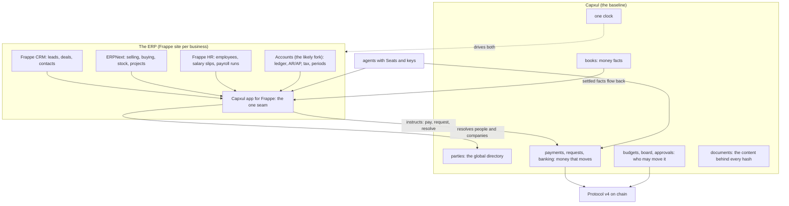
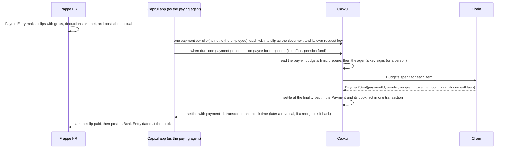

# The ERP on Capxul

> **Speculative. Thinking only, not the build.** This note is the long-term vision, written down on
> the main line so that what we build now does not block it. Nothing in it is a record, nothing in it
> changes the baseline, and nothing in it is scheduled. The main line now is the baseline of the new
> product (the rebuilt Capxul, `books/target`) and the starter kit. Where the vision would need the
> baseline to change, this note asks Aaron a question instead of changing anything.

**How this note reads the rulings.** The authority for "speculative" is Aaron's message of 8 November
2026, quoted below, which came after the rulings recorded in `books/target/shared/rulings.ts`. Those
records still read as a redesign on the main line: `aaron.erp-on-capxul` chose `around-frappe`
("the protocol is designed around Frappe now"), `aaron.frappe-shape` chose `core-four` ("The
redesign is on the main line, book first, before the build"), and `aaron.books-first-principles`,
`aaron.crm-frappe-shape`, `aaron.projects`, `aaron.fde-agent` and `aaron.frappe-head` follow from
them. Their `SUPERSEDED` list also sends `books.facts-without-chart` and `payroll.scope` to be
rewritten in Frappe's shapes. This note reads all of them as the vision, as the later message says.
Bringing those records into line with that message is for whoever owns the rulings, not for this
note. Where one of them touches Capxul's core (the directory, the books, payroll), it is a question
for Aaron below (questions 1 and 6).

Status: written 8 November 2026. The core checks in section 7 are the part that matters for the
main line. Everything before them explains the picture they are checked against. Later the same
day the CRM lane recorded checks C13, C14, C15 and C27, and questions 1 and 5, as decision records
(`parties.outside-companies`, `parties.frappe-identity`, `contacts.frappe-shape` and
`parties.mailbox-for-life`). Their rows and questions below now point at those records. Two of them
are for Aaron.

> "The goal is we're going to build an agentic ERP that runs on stablecoins... an opinionated front
> end to Capxul, but tailored to real business. Right now all of this is very speculative. I don't
> want the work on this to be on the main line. I want the thinking on this to be on the main line,
> making sure that whatever we build supports that longer-term vision, but I don't want that to be
> the thing that we're building right now. The main thing that we're building right now is the
> baseline for the new product and, just as important, that starter kit."
> (Aaron, 8 November 2026, transcribed from speech)

## What this note used

- **Skills:** `fde-frappe:frappe-stack` (which Frappe app and DocType owns each need) and
  `fde-frappe:implement-erpnext` (the partner procedure, the settings to decide first, and
  `references/limits.md`, what ERPNext and Frappe HR do not do). The skills name Habitat's existing
  sync: it adds its Capxul fields to ERPNext with Custom Fields (`build-on-frappe`) and posts Capxul
  payments as Payment Entries against a "Capxul Treasury" account of type Bank, with "Capxul
  Clearing" and "Capxul Suspense" accounts (`frappe-stack`). That is prior art for section 3. Its
  code was not read, so nothing here says how it handles currency or reversals.
- **Real doctypes**, cloned shallow into `/tmp` on 8 November 2026 and read as data:
  `frappe/erpnext` at `6b946b0f`, `frappe/hrms` at `88161025`, `frappe/crm` at `2cecd300`, and the
  `frappe/frappe` framework (sparse: `frappe/utils`, `scheduled_job_type`, `tests/classes`) at
  `1a7ea577`. Field lists below are from their DocType JSON; behaviour is from their Python.
- **The baseline:** the records named in each check, in `books/target`.
- **The old system**, read only: the v4 contracts in `/home/user/factory/packages/contracts/v4`
  (`IPayments.sol`, `Budgets.sol`).

## The picture

The ERP is an opinionated front end to Capxul for a real business. Running on stablecoins is just
how it runs: every payment it makes or receives is a Capxul payment on chain. Frappe and ERPNext
supply the business documents (quotes, orders, invoices, stock, projects, payslips) and the ledger.
Capxul supplies the money and everything that must be true about it.

The line between the two is one rule: **Capxul owns what the chain makes true; the ERP owns what
the business means by it.**

| Capxul owns (the truth of money) | The ERP owns (the meaning of money) |
|---|---|
| That money moved: the Payment, its payment id, the transaction, the block and its time | Which account it posts to, which invoice it pays, which cost centre and project it belongs to |
| Who may move it: hats, budgets, Board, approvals, all on chain | Who may raise a document and approve it as a business step (Frappe roles and Workflows) |
| The exact content behind each hash on chain (documents) | The document itself as the business works on it: the invoice, the payslip, the order |
| One money fact per money occurrence, never edited, reversed forward | The ledger: accrual, receivables and payables, tax, periods, closing, revaluation, reports |
| Who someone is and where they get paid: the global directory | The relationship: lead, deal, customer, supplier, employee, notes, owner |
| Now, on one clock | When a document is due, posted and reported, on the same clock |

Money never moves because the ERP says so in its own database. The ERP asks Capxul; Capxul asks the
chain; the chain decides; the settled fact comes back and the ERP books it.

## 1. Which Frappe apps, as they are or forked

The order of preference is the `build-on-frappe` skill's: configuration first, then Custom Fields
and Property Setters, then hooks and overridden classes in a custom app, and a fork only where the
product must feel like one thing and the lighter tools cannot get there. "Ideally nothing" is
forked.

| App | As it is, or forked | Why |
|---|---|---|
| Frappe Framework | As it is | DocTypes, REST, permissions, Workflow, Notification, the scheduler. Nothing in it touches money. |
| ERPNext Selling, Buying, Stock, Manufacturing, Projects, Assets, Quality, POS | As it is | They make documents (Quotation, Sales Order, Purchase Order, Delivery Note, Timesheet, Work Order). None of them moves money; they hand an invoice to Accounts. |
| ERPNext Accounts | Most likely forked, after a stretch as a custom app | It is where the bank lives, and on Capxul the bank is a Safe. See below. |
| Frappe HR (HRMS) | As it is, with one step replaced by the Capxul app | It computes gross, deductions and net well and in many shapes. Only its payment step (a "Bank Entry" Journal Entry) becomes a Capxul payment run (section 4). |
| Frappe CRM | As it is, with a Party link | It holds the relationship. The global directory is linked to it, not merged into it (section 2). |
| Helpdesk | As it is | No money. |
| A Capxul app for Frappe | New | The one seam: Custom Fields (a Party on every party DocType, a payment id and transaction on every money document), the instruction calls, the follower of settled facts, the posting job and, on a devnet, the clock follower. Habitat's sync is the first version of this. |

**Why Accounts is the likely fork.** ERPNext's accounting assumes a bank that the business does not
control and reads after the fact: a Payment Entry is drafted and submitted by a person, and later a
Bank Transaction from a statement is reconciled to it (Payment Entry has `clearance_date`,
`reference_no`, `reference_date`; Bank Transaction has `status`
`Pending|Settled|Unreconciled|Reconciled|Cancelled`). On Capxul the order is the other way round
and the bank is exact:

- **A payment is the settlement.** A Payment Entry should exist, submitted, only once the chain has
  settled the payment; it should never be submitted by a person beforehand, and it should be
  cancelled only by a reversal Capxul recorded. The instruction before it is a Payment Request
  (whose `status` is `Draft|Requested|Initiated|Partially Paid|Payment Ordered|Paid|Failed|Cancelled`)
  or a Payment Order, both standard in ERPNext, not a draft Payment Entry.
- **Reconciliation goes away.** There is no statement to match: the settled fact carries the
  payment id, the transaction and the block. The Bank Reconciliation Tool, Bank Clearance and Bank
  Transaction import are replaced by posting from facts (and `limits.md` already warns that
  semi-automatic bank reconciliation errored in Frappe's own demo).
- **The bank account is a Safe and a token.** Each Safe and stablecoin is a Bank Account linked one
  to one to a ledger account in the token's currency (USDC as an account currency, with the block's
  USD rate). Habitat's sync already books against one such account, "Capxul Treasury"; whether it
  keeps a currency per token was not checked.
- **Who may pay is on chain.** Submitting a payment in Frappe must not imply authority. The approval
  is Capxul's (the payer's own Safe, a budget's hat, the Board).
- **Posting is automatic and exactly once.** Every money fact posts one voucher, keyed by the
  fact's id, and a reversal posts a reversing entry (Journal Entry has `reversal_of`).

All of this can begin as the Capxul app (Custom Fields, `doc_events`, an overridden Payment Entry
class, a hidden Bank Reconciliation workspace). It becomes a fork only where the forms and the flow
must read as Capxul's own: paying a Purchase Invoice from its own page, seeing the chain's status on
the voucher, never seeing "reconcile".

**Projects** need nothing from Capxul. A Timesheet becomes a Sales Invoice in ERPNext; the invoice
becomes a Capxul request; the payment's fact posts with the project as an accounting dimension that
the ERP's document carries. Capxul's money fact has no dimension and needs none. (`aaron.projects`
records a projects concept in every Organization. Under Aaron's later message that is part of the
vision, and this note finds nothing the baseline needs for it.)

## 2. People and companies: the global directory meets Frappe CRM

Frappe is one site per business (or several companies in one site). Every Contact, CRM Lead, CRM
Deal and CRM Organization lives in one site and is that business's private record. Capxul's
directory is global: one Party for each identity Capxul can name and pay, across every tenant, and
it holds nothing private (`parties.directory-tenancy`, `parties.mailbox-digest`).

So the two are two layers, not one table:

- **Identity (global, Capxul).** Who someone is, where they get paid, and the name and photo they
  show everyone: `parties` (`kind`, `handle`, `display_name`, `photo_file_id`, `safe_address`,
  `mailbox_digest`, `owner_kind`, `owner_id`).
- **Relationship (per business, the ERP).** What this business knows and does with them: the CRM
  Organization's `website`, `industry`, `territory`, `annual_revenue`; the Lead's `status`,
  `lead_owner`, `source`, `email`, `mobile_no`; the Deal's `probability`, `deal_value`,
  `expected_closure_date`; notes, tasks and calls. Capxul's own per-tenant layer is `contacts` (an
  owner's book: `label`, `visibility`), which the CRM's records extend.

| Capxul | Frappe |
|---|---|
| Party, kind `person` (found by mailbox digest; provisional until they complete their profile) | Contact; and Employee, Customer or Supplier through Frappe's links |
| Party, kind `organization` (a Capxul Organization, with its company Safe) | CRM Organization; Customer or Supplier |
| Party, kind `agent` | A Frappe User for the agent, and the Party on whatever it acts for |
| Party, kind `address` (an outside wallet) | A Supplier or Customer paid at a wallet |
| `contacts` entry (an owner's label and visibility) | The CRM's Contact or Organization in that business's site |

The Capxul app adds one Custom Field, the Party id, to CRM Organization, Contact, Customer,
Supplier and Employee. Resolving a handle, a mailbox or an address to a Party
(`parties.resolve-recipient`) is how the ERP dedupes a counterparty across tenants and learns where
to pay them; it never copies the directory into the site. A won deal makes a Customer as Frappe CRM
already does (ERPNext CRM Settings `create_customer_on_status_change`), and the Customer keeps the
deal's Party.

The fit has one hole, and it is in the core: the directory today holds only identities Capxul can
pay. A person who is not on Capxul is already there once someone names their mailbox (a
provisional Party, by digest, with no name). A company that is not on Capxul (a prospect, a
supplier paid by bank) has no Party of its own: an `organization` Party is a Capxul workspace born
with its company Safe, and every Party has a `safe_address`, so such a company is at most a nameless
`address` Party for a wallet it is paid at, and nothing if it is paid only by bank. A global CRM of
companies needs them. That is check C13 and question 1, now recorded as `parties.outside-companies`:
such a company stays a private CRM Organization entry, with no Party, in each Organization's book
until it is on Capxul (for Aaron).

This two-layer reading is the note's, not the record's: `aaron.crm-frappe-shape` asks for the
global directory "in Frappe CRM's shape". Frappe CRM's own records hold each business's private
knowledge, which a global directory cannot hold (`parties.directory-tenancy`). The parties concept is
Capxul's core, so which reading Aaron meant is part of question 1. The CRM lane has since recorded
this reading as `parties.frappe-identity`: each Party is the identity half of a Frappe Contact or
CRM Organization. `contacts.frappe-shape` gives each Organization's book the other half, in Frappe
CRM's doctypes, with or without a head.

## 3. Accounting on a Frappe fork, from first principles

A ledger posts an entry when it can answer six questions about money: what happened, exactly once;
when; how much of what; between whom; for what; and whether it still stands. Capxul must record the
answers. Everything else is the ledger's.

**What Capxul must record so a ledger can post it** (and where the baseline records it today):

| The ledger needs | The baseline records it in |
|---|---|
| One record per money occurrence, with a key that is the same whoever reaches it | `book-facts.money_key` (`payment:<v4 payment id>` or `transfer:<chain>:<tx>:<log>`) with `generation`, unique per Organization (`books.money-key`); `fact_id` |
| Every such record delivered once and in an order it can follow | Not yet: the facts list is ordered by when money happened, not when it was recorded. `recorded_at` is stored but is a time column with no index, and activity's gap-free change log covers Payments and Movements, not the facts (check C5) |
| When it happened: the block's time | `book-facts.occurred_at`; the facts list's `blockTime` (`books.facts.list`) |
| How much of what | `amount_raw`, `asset_id`, `symbol`, `decimals`; `usd_value` at the rate in force at the block, once (`usd_rate`, `usd_source`) |
| Which bank it moved in and out of | The invoker passes the Safe (`MoneySide.safe_address`), but `book-facts` has no Safe column and the fact's read does not show it. For an Organization it is its company Safe (`organizations.safe_address`; the books' `safe` accounts are "one per company Safe and asset", `book-accounts.role`), so the ERP can map it (check C6) |
| Between whom | `counterparty`, a string the record does not pin to a Party id (check C6) |
| For what | `source_kind` and `source_id` (a Payment, a deposit, a payout, a Movement, an agreement, an asset) and, on the Payment, `document_hash`, whose content is in `documents` |
| Whether it still stands | A `reversed` fact naming the one it cancels (`reverses_fact_id`); a re-settle is the next generation |
| Proof | `tx_hash`, `block_number`, `chain_id` on the fact; the Payment's `settled_tx_hash`, `settled_log_index`, `settled_block_hash` |

**What the ledger owns:** the chart of accounts and which account each fact posts to; accrual
(receivables and payables, invoices and bills, advances); tax and withholding; cost centres,
projects and other dimensions; the posting date in the company's time zone, fiscal years, periods
and their closing; the functional currency, exchange rates and revaluation; the reports; and the
matching of payments to invoices (Payment Entry `references`, allocation).

The baseline already draws the line in the right place. A money fact names no account: the account
is chosen when the books are read (`books.account-at-posting`), and facts are kept from the first
money whether or not a chart exists (`books.facts-without-chart`). Recording never refuses
(`books.record-money-fact`, `errors: []`), so a settlement never waits on any ledger, Capxul's or
the ERP's.

**How the facts would post.** The Capxul app reads each new fact and posts one voucher, with the
fact's id as a Custom Field (unique), the transaction as `reference_no` (a Payment Entry) or
`cheque_no` (a Journal Entry), and the block's date as the posting date:

| Fact kind (`book-facts.kind`) | Voucher in the ERP |
|---|---|
| `payment_settled`, out | Payment Entry (Pay) against the Purchase Invoice or Expense Claim it paid; credit the Capxul Treasury account of the Safe and token. A payslip's net is a Bank Entry Journal Entry against its Payroll Entry instead, because a Payment Entry cannot reference a Payroll Entry (section 4) |
| `payment_settled` or `payment_received`, in | Payment Entry (Receive) against the Sales Invoice the request was issued for |
| `deposit_received` (a bank deposit, or outside money in) | Journal Entry to the receivable it matched, else to a suspense account until someone decides |
| `payment_sent_outside` (outside money out) | Journal Entry from a suspense account until classified |
| `payout_returned` | Journal Entry reversing the payout's posting |
| `opening_balance` (a token added with a balance) | Opening Journal Entry |
| `reversed` | A reversing Journal Entry (`reversal_of`), or cancellation of the voucher it posted. This includes a Movement fact that a Payment, deposit or payout later claims: the Movement is reversed and the claim posts as the next generation (`books.record-money-fact`), so a voucher posted to suspense is reversed, never edited |

Three things follow for the ledger, none of which the baseline must change for:

- **Posting date.** ERPNext posts by date in the site's time zone; a fact is an instant. The ledger
  converts. A fact for a closed period (a late scan, a reversal) posts on the first open date with
  the original instant kept on the voucher.
- **Currency.** Facts carry USD at the block's rate, never revalued. A company whose functional
  currency is not USD converts with its own rates and revalues in the ERP (ERPNext's Exchange Rate
  Revaluation), as it does for any foreign-currency bank account.
- **Two sets of books.** Capxul's books concept (chart, annotations, reports, QuickBooks export)
  stays on the main line for businesses that use Capxul alone. A business on the ERP posts from
  the same facts into ERPNext's ledger, so its Capxul chart would go unused. Whether the ERP fills
  Capxul's annotations or ignores them is a later question, not this one.

## 4. Payroll, and how a payslip comes from on-chain pay in both directions

**Frappe HR today.** A Salary Structure Assignment gives an employee a structure; a Payroll Entry
(`start_date`, `end_date`, `payroll_frequency`, `payment_account`, `payroll_payable_account`)
makes one Salary Slip per employee with `earnings` and `deductions` (rows of Salary Detail:
`salary_component`, `amount`), `gross_pay`, `total_deduction` and `net_pay`. Submitting the slips
posts an accrual Journal Entry (`make_accrual_jv_entry`, called from
`submit_salary_slips_for_employees`: expenses up, payroll payable and each deduction's account up;
`payroll_entry.py:619`, `:1865`). Paying it is a separate "Bank Entry" Journal Entry
(`make_bank_entry`: debit Payroll Payable for the run's net pay, per employee when Payroll Settings
says so, credit the bank), linked by `reference_type` Payroll Entry
(`hrms/payroll/doctype/payroll_entry/payroll_entry.py:1093`, `:1196`). A Bank Entry needs a
`cheque_no` and `cheque_date` (`journal_entry.py` `validate_cheque_info`). The bank entry pays only
the net: each deduction stays a liability on its component's account until someone pays it, which
Frappe HR does not do. A Salary Slip's `status` is `Draft|Submitted|Cancelled|Withheld`: Frappe HR
has no "paid" on the slip itself; a run is paid when its bank entries exist (`has_bank_entries`).

**The vision replaces only the bank entry.** Frappe HR keeps computing; Capxul pays; the settled
facts come back.

Step by step:

1. **Compute (the ERP).** Frappe HR makes the slips exactly as it does today, including tax,
   pension and every other deduction, and posts the accrual.
2. **Instruct (ERP to Capxul).** For each slip the Capxul app asks Capxul to pay the net to the
   employee's Party. Each payment carries the payslip as its document (a PDF or JSON file of at most
   128 KB, whose hash goes on chain) and a request key made from the site and the slip, so asking
   twice can never pay twice (`payment-commands.request_key`, K1). Deductions are paid when they
   fall due, usually once a period for the whole run: one payment per payee (a tax office through
   a bank payout, from the payroll budget with `--from`; a pension fund at its Party), carrying
   that component's schedule for the period as its document, keyed by site, run and component.
   Its posting debits the component's liability account, not Payroll Payable.
3. **Authorize (Capxul and the chain).** The payments come from the payroll department's budget.
   An agent whose Seat holds that budget's spending allowance signs with its own key, so a run
   needs no person, and it can never pay more than the budget has left for the period, as the Board
   or the holder of the budget above set it (`PAYROLL_BUDGET_EXCEEDED`). Which agent that is
   matters: an Organization may hold one agent of its own (`aaron.seats`), and `aaron.fde-agent`
   gives that place to its Forward Deployed Engineer, so the Capxul app acts either as that agent
   or as an agent on a Seat. A business that wants a person to approve each run has them sign.
   A Board payment (`--as-directors`) is not a fit for payroll as the baseline stands: an immediate
   one cannot spend from a budget, and it takes no request key from the caller
   (`payments.commands.propose`), so a crashed and repeated instruction could open a second
   proposal.
4. **Pay (Capxul on chain).** Each item is one `Budgets.spend`; the chain emits one `PaymentSent`
   with the payment id and the payslip's hash.
5. **Settle (Capxul).** Payments settles each Payment from its indexed `PaymentSent` at the
   finality depth, every term checked, and writes its book fact (`payment_settled`, keyed
   `payment:<payment id>`, with the block's time and the transaction) in the same transaction.
6. **Come back (Capxul to ERP).** The Capxul app reads the settled facts: the payment id, the
   transaction, the block's time. On the slip it fills Custom Fields (payment id, transaction,
   block time, Capxul status "paid") and it posts the Bank Entry Journal Entry that `make_bank_entry`
   would have made, one per slip instead of one per run: debit Payroll Payable for the employee
   (reference Payroll Entry), credit the Capxul Treasury account, posting date the block's date,
   `cheque_no` the transaction and `cheque_date` the block's date. A run is paid when every slip
   is. The app checks that itself, because `has_bank_entries` is true as soon as the first slip's
   entry exists.
7. **If the chain takes it back.** A reorg below finality reopens the Payment and reverses its book
   fact (`payments.reorg`); the app reverses the entry and the slip reads unpaid until the
   payment settles again, as the next generation.
8. **If it never lands.** A lapsed approval leaves the Payment `needs_retry`; a retry pays the same
   payment id, so it still cannot pay twice.

**The other direction: pay that starts on chain.** Capxul's own payroll today is pay agreements
(v4 Agreements: a salary, stream or retainer from a budget, released over time, collected by the
payee; `payroll.scope`). There the chain is the source and the ERP follows it. Each collection is a
`PaymentSent` (kind 4, `Budgets.sol` `KIND_COLLECTION`) that payments births as a Payment, and
payroll's write keeps its payment id, its window and the block's time
(`agreement-writes.payment_id`, `landed_at`, `args.period_start`, `args.period_end`). The ERP makes
the pay record from it: the period it covers, the rate from the agreement's terms document (every
collection carries that document's hash), gross equal to what was collected, already paid, dated
at the block. This is the payslip the baseline already previews (`payroll/shapes.ts` `Payslip`:
`periodStart`, `periodEnd`, `rate`, `gross`, `token`, `terms`). An agreement pays the whole released
amount to the payee, so there is no withholding on chain: this direction suits contractors,
retainers and anyone paid gross. Employees whose tax is withheld are paid the first way.

In Frappe this record is not a plain Salary Slip. A Salary Slip needs an Employee with a submitted
Salary Structure Assignment, and on every save it works its earnings out again from the structure
(`salary_slip.py` `set_salary_structure_assignment`, `calculate_net_pay`). So the Capxul app writes
one of two things. For a payee who is an Employee, it writes a slip whose structure takes its one
earning from the collection (for example an Additional Salary of the collected amount). For a
contractor, or another Organization as payee, which ERPNext keeps as a Supplier, it writes a
Purchase Invoice and the Payment Entry that pays it. Which one is the ERP's choice, made when it is
built.

## 5. One clock for the larger system

The baseline has one clock (`time.one-clock`): every product decision reads one now, and on a
devnet that same instant is the chain's block time. The ERP would run on it too, by three rules:

- **Money's times are Capxul's.** When money moved is the block's time, never the ERP's. A payment
  due on a day is a Capxul dated payment (a `Budgets.schedule` for a budget), whose timer fires on
  the one clock; the ERP never schedules money with its own scheduler.
- **Documents' times are the ERP's, on the same clock.** Due dates, posting dates, payroll periods,
  Auto Repeat and reminders are Frappe's, read through `frappe.utils`.
- **The ERP takes now from Capxul when it acts on Capxul.** Every Capxul answer carries the
  backend's now (`time.clients-take-server-now`), so the Capxul app never decides a Capxul expiry
  or window from Frappe's clock.

On staging and production both sides read their host's clock, as Capxul already does.

On a devnet (and in a simulation like vending-bench's year of a business) the Frappe site joins
the clock as a follower. The protocol is already public and language-free: `capxul.devnet/1` over
HTTP JSON (`devnet.time-protocol`), and "an outside program joins the same way, so a simulation's
own happenings become stops" (`devnet.followers`). The Frappe side is small because Frappe already
has the seams:

- **Now.** ERPNext and Frappe HR read time almost only through Frappe's helpers (about 420
  argument-less calls of `now_datetime()`, `nowdate()`, `getdate()` or `today()` outside tests,
  and 43 of Frappe's `now()`, all of which go through `now_datetime()`; against about 8 direct reads of the
  host clock, such as Frappe HR's interview reminder and ERPNext's bulk-transaction log).
  `now_datetime()` reads the host clock in the site's time zone (`frappe/utils/data.py:373`), and
  Frappe's tests already freeze it (`frappe/tests/classes/context_managers.py:29`, `freeze_time`).
  The follower sets that one place to the devnet's now; the few direct reads would need a patch or
  stay on the host clock.
- **Due work.** Frappe's scheduler wakes every 4 minutes of real time
  (`frappe/utils/scheduler.py:26`) and runs each Scheduled Job Type whose next run is due:
  `is_event_due(current_time)` compares `get_next_execution()` with now
  (`scheduled_job_type.py:103`, `:120`). The follower runs that check at each stop instead and
  acknowledges idle when its job queues are empty. Its next due instant cannot be the earliest
  `get_next_execution()` of every job. Frappe's `All` jobs run every scheduler tick (`hooks.py`:
  the email queue's flush; Frappe HR's interview reminder), and ERPNext has 15-minute crons, so the
  next due would always be minutes away and a simulated year would be over 100,000 stops. The
  barrier's own rule is the model (`devnet.warp-barrier`): the backend reports only timers and
  hourly-or-slower crons, and runs its minute-scale work once at each stop. The Frappe follower
  would do the same. Even then Frappe HR's hourly jobs alone make about 8,760 stops a simulated
  year, against the barrier's budget of about 730. Which Frappe jobs count as stops is not decided
  here (section 8).

A warp then stops at every instant something is due on either side (`devnet.warp-barrier`): a
Capxul timer, a Frappe daily job, a payroll run's date. A simulated year produces an ERP ledger dated
in the story's time, because every voucher is dated at its fact's block and every block is mined
at now.

## 6. The agentic part

An agent is a first-class Capxul user: its own account and Safe, owned by a person or an
Organization, signing with its own key (`concept agents`). It can hold a Seat
(`org-members.kind` `human|agent`) and be offered allowances (`org-invitations.grantee_kind`,
`offers`), so it can pay from a budget within the limit the chain enforces.
A machine signs in with its key in one step, and a warp never signs it out (`aaron.machine-login`).
Every company has ten Seats, each may hold one agent, and the company may hold one agent of its own
(`aaron.seats`).

That is enough for the ERP's agents: one agent runs the Capxul app (payroll, paying approved bills,
issuing requests for invoices), and a Seat's agent works for its holder. The Organization's own
agent is a single place, and `aaron.fde-agent` gives it to the Forward Deployed Engineer, so the
Capxul app is either that agent or an agent on a Seat. The ERP's Frappe roles decide who may raise
and approve a document; the chain decides whether money may move. People who use the ERP but never
move money need no Seat, and payees (employees, suppliers) are not Seats at all.

That moves one thing from Capxul to the ERP: who may read the money. The Capxul app reads the
books' facts and the Payments as an active Seat of the Organization, and the site then shows them
under Frappe's permissions. So Capxul's Seats decide who reads Capxul, and the site's roles decide
who reads what the app copied into it. Writing a company's contact book needs its People hat
(`aaron.contacts-permissions`), so the app's agent must wear it to sync contacts back.

## 7. Core checks

Each check is a place where today's baseline would fit or block the vision, with the record and
field that show it. **Fits** needs nothing. **Fits with a mapping** needs only the ERP side to map
it. **Blocks** would need the baseline to change, so it is a question for Aaron below; nothing has
been changed.

| # | Check | Verdict | Evidence | What it means |
|---|---|---|---|---|
| C1 | A money fact is independent of any chart | Fits | `book-facts` names no account (`books.account-at-posting`); facts kept with or without a chart (`books.facts-without-chart`, which `SUPERSEDED` sends to `aaron.books-first-principles`: question 6) | Any ledger can post Capxul's facts to its own accounts. |
| C2 | One key per money occurrence | Fits | `book-facts.money_key` and `generation`, unique index `by_org_money_key`; `books.money-key` | The ledger's posting is idempotent by the fact's id; a replay or a second writer never posts twice. |
| C3 | Corrections are new facts | Fits | `book-facts.kind` `reversed`, `reverses_fact_id`; invariant `books.facts-append-only` | Maps to a reversing Journal Entry (`reversal_of`); nothing is edited after the ledger read it. |
| C4 | Capxul never waits on the books | Fits | `books.record-money-fact` and `books.reverse-money-fact`: `errors: []`, "It never refuses and makes no outside call" | A ledger that is down or behind never stops a settlement. |
| C5 | A ledger can follow every fact exactly once | **Blocks** | `books.facts.list` pages "oldest first by when they happened" on index `by_org_occurred` (`org_id`, `occurred_at`, `fact_id`); facts have no machine and so no event (`books.machines`, P7); facts come from several writers in their own transactions (payments' settlement, banking's deposits, books' minute scan of added tokens, `books.added-token-scan`); `book-facts.recorded_at` exists but is a time column with no index; `activity.change-log` itself rules that "a time column cannot promise exactly once" and gives activity a gap-free `seq` instead, but its feed (`activity.changes.read`) covers Payments and Movements only, not deposits, payouts' returns, added tokens, opening balances or a Movement fact a deposit later claims | A ledger tailing the facts by their time can skip one that commits after it has read past that time. Question 2. |
| C6 | A settled payment's read is enough to post it | Fits with a mapping | `payments.settled_at` is not said to be the block's time; `PaymentView.receipt` has `chain_id` and `tx_hash` only (`payments/ledger.ts`); `BookFact` has `blockTime` and `txHash` but not the Safe or log index (`books/facts.ts`), and `book-facts` stores no Safe; `book-facts.counterparty` is a string, not pinned to a Party id | The ERP reads the fact (`--source` the Payment) for the block's time, and takes the Organization's one company Safe as the bank; which Party should be explicit. Folded into question 2. |
| C7 | An instruction can be repeated safely | Fits | `payment-commands.request_key`, unique `by-request-key`, compared by `request_digest` (K1); but "A Board payment takes no request key from the caller" (`payments.commands.propose`) | The slip's name is the request key: a crashed or repeated run never pays twice, on the routes that take a key (a member's or agent's payment from a budget or their own Safe). A Board payment would need its own guard; the ERP does not use it for payroll. |
| C8 | Each payment carries the business document | Fits with a mapping | `payments.document_hash` per Payment; `DOCUMENT_KINDS` is `memo|invoice|terms|receipt` (`documents.kinds` dropped the Payslip); `ReceiptContent` takes a PDF, PNG, JPEG or JSON file of at most 128 KB (`SendInput.document`) | The payslip goes on chain as a receipt file's hash. A typed payslip kind would let Capxul render and check it; later, not now. |
| C9 | A payroll run is one approval with a payslip per item | **Blocks** (one approval per run) | `SendInput` has one `to`, one `amount` and one `document` (`payments/commands.ts`); several items appear only in prose, for a personal payment (`payments.commands.prepare`: "`sendBatch` for several items of `--input`"); a budget payment is one `Budgets.spend` per item | Today a run is one payment per slip, each its own approval: fine for an agent signing with its key, heavy for a person. Question 3. |
| C10 | A budget can pay someone who has no account yet | **Blocks** (payroll to new hires) | `payments.claim-escrow-routes` (chosen `own-safe-or-board`: a budget spend to a mailbox with no Safe is `INVALID_RECIPIENT`); `operation payment.send` refusal `INVALID_RECIPIENT` | A new employee must claim their Capxul account before the first run, or be paid by the Board. That decision already asks Aaron the same question; question 4 adds payroll's weight. |
| C11 | Agents can move money within on-chain limits | Fits | `org-members.kind` `human|agent`; `org-invitations.grantee_kind` `human|agent` with allowances in `offers`; `aaron.seats`; `aaron.machine-login` | An agent holding the budget's allowance runs payroll and bills without a person, bounded by the budget. |
| C12 | Seats are enough for an ERP | Fits | `aaron.seats` (ten Seats, one agent each, plus the company's agent; `org-members.seat_use` `seat|owner-seat|organization`); payees are paid at a mailbox, Party or Safe, never by Seat (`agreements.payee_email`, `agreements.payee_party_id`, `payments.payee_safe`) | Only people and agents who move money need Seats; employees and suppliers do not. Each further ERP agent rides on its owner's Seat (one per Seat) or takes a Seat of its own; the company's own place is the FDE's (`aaron.fde-agent`). |
| C13 | The global directory can hold companies and people not on Capxul | **Settled** by `parties.outside-companies` (for Aaron) | `parties.kind` is `person|agent|organization|address`; every Party has `safe_address` (not null); an `organization` Party is born only with a Capxul Organization (`machine_party.t.register`); a `person` is known only by mailbox (`mailbox_digest`), and one not on Capxul is a `provisional` Party once named (`machine_party.t.name_person`); an outside wallet is a nameless `address` Party (`name_address`) | People not on Capxul are in the directory by mailbox. A company joins it once it is on Capxul (its handle) or is paid at a wallet (its address). Until then each Organization keeps it as a private CRM Organization entry with no Party (`contacts.private-entries`). Naming companies before they join is the decision's `by-domain` option, which needs a domain proof first. Question 1. |
| C14 | The directory leaks nothing a CRM keeps private | Fits, settled by `parties.frappe-identity` | `parties.directory-tenancy` (global, "it holds nothing private"); `parties.mailbox-digest` (a digest, never the mailbox); `parties.frappe-identity` (a Party holds only the identity half of a Frappe Contact or CRM Organization: its name, picture and mailbox digest) | Emails, phones, notes, leads and deals stay in each Organization's book (contacts), under Frappe's field names, and in a connected head's site. |
| C15 | The address book extends to a CRM | Fits, settled by `contacts.frappe-shape` | One table per Frappe CRM doctype: `contacts` (Contact and CRM Organization entries, a `doctype` column, `party_id` null for a private entry), `leads`, `deals` and `deal-contacts`; changing an Organization's CRM needs its People hat (`aaron.contacts-permissions`, `contacts.crm-permission`); a connected head syncs by contacts' own process (`contacts.head-sync`) | Each Organization's CRM is in Frappe CRM's shapes from its first day, with or without a head. A head's Contact, CRM Organization, Customer, Supplier and Employee carry the Party as the Custom Field `capxul_party`. The agent that works or syncs the CRM wears the People hat. |
| C16 | Capxul's pay agreements and Frappe HR's payroll can both exist | Fits with a mapping | `agreements` (`rate`, `period`, `release`, `terms_hash`); `payroll.scope` (runs, items and groups dropped from the baseline; listed in `SUPERSEDED` for `aaron.frappe-shape`, question 6); `Payslip` shows `gross` only (`payroll/shapes.ts`) | Agreements pay gross on chain; withheld payroll is Frappe HR's run paid by budget spends. The ERP records both (section 4). |
| C17 | A collection can become a paid pay record | Fits with a mapping | `agreement-writes.payment_id`, `landed_at` (the block's time), `args.period_start`, `args.period_end`; `agreement_transitioned.occurred_at`; `payroll.collection-payment-id` | Each collection is one record, keyed by its payment id: a Salary Slip only for an Employee with a Salary Structure Assignment, else a Supplier's Purchase Invoice and its Payment Entry (section 4). |
| C18 | Posting dates, periods and currency are the ledger's | Fits | `organizations` has `country` but no time zone, functional currency or fiscal year; `book-charts.template` `us-services`, `basis` `cash`; books' reports cut at "the end of `asOf`'s day" with no time zone named (`books/reports.ts`) | ERPNext owns them. Capxul's own reports should say whose day they cut at; a clarification for the books owner, not a blocker. |
| C19 | Facts value stablecoins the way a ledger can use | Fits | `book-facts.usd_value`, `usd_rate`, `usd_source` at the block's rate; `book-prices` pairs `USDC/USD`, `EUR/USD`, `ETH/USD`, `BTC/USD` | USD at the block, once; other functional currencies are converted and revalued in the ERP. |
| C20 | An ERP invoice can be a Capxul request | Fits with a mapping | `InvoiceContent.lines` are `description`, `quantity` (an integer), `unit_amount_raw`, adding up exactly (`documents/procedures.ts`); `requests.invoice.lines` | ERPNext's fractional quantities, taxes and discounts map to lines that are totals. The ERP's own invoice file cannot be the request's document (a request carries a Memo or an Invoice envelope); later, not now. |
| C21 | An outside system can learn what changed | Fits | `rules.outbox` (events go to the relay, not to outside apps); `activity.changes.read` (a sealed `seq` cursor over Payments and Movements); `payments.ledger.watch` (live) | The Capxul app pulls; Capxul needs no outbound webhooks for the ERP. |
| C22 | A Python ERP can reach Capxul | Fits with a mapping | The Core SDK is TypeScript (`component core-sdk`); the CLI prints `--json` for every operation; the devnet clock is HTTP JSON (`devnet.time-protocol`) | The Capxul app calls the CLI as its agent, or runs a small TypeScript sidecar. |
| C23 | The ERP can run on the one clock | Fits | `time.one-clock`; `devnet.followers`; `devnet.warp-barrier`; `time.clients-take-server-now`; `time.chain-judged-deadlines` (a fact's time is its block's; periods are half-open) | Frappe joins as a follower (section 5). |
| C24 | Money authority stays on chain | Fits | `concept budgets` ("It answers, from the chain, who may spend"); `concept approvals` ("It never decides authority: the chain does") | No Frappe role can move money; a Frappe Workflow is a business step before Capxul's approval. |
| C25 | The ERP's businesses keep books | Fits | `book-facts`: "Only Organizations keep facts; a person's rows keep none" | A business is an Organization; a sole trader on a personal Safe is out of scope for the ERP. |
| C26 | A payment's kind tells the ledger what it is | Fits with a mapping | `PaymentKind` `bill|one-off|reimbursement|transfer` (kinds 0 to 3) and 4 for a collection (`Budgets.sol` `KIND_COLLECTION`, `MAX_PREPARED_KIND`) | There is no salary kind; the ledger classifies by its own document, not by the kind. |
| C27 | An employee keeps their pay after they leave | Fits with a condition, settled by `parties.mailbox-for-life` (for Aaron) | A person's Safe is a pure function of their mailbox (`concept accounts`; `parties.safe_address`); sign-in is an emailed code (`concept access`); `parties.mailbox-for-life`: a Party's `mailbox_digest` never changes and nothing moves it | Pay an employee at a mailbox they keep, never at a work address that ends with the job: Frappe HR's Employee `personal_email`, never `company_email`. Moving an account to a new mailbox would be a later capability, designed across access, parties and accounts. Question 5. |

### Questions this raises for Aaron

1. **The directory (C13). Recorded as `parties.frappe-identity` (the reading) and
   `parties.outside-companies` (companies), the second for you.** You ruled the directory global,
   a global CRM of people and companies, in Frappe CRM's shape. Today it holds only identities
   Capxul can pay: every Party has a Safe. A person not on Capxul is in it once someone names their
   mailbox, but a company is in it only once it is a Capxul Organization. Frappe CRM's own records
   (leads, deals, contacts, with emails, phones and notes) are each business's private knowledge,
   and the directory holds nothing private. So this note reads your ruling as: the directory links
   one to one to Frappe CRM's Organization and Contact by a Party id, and the private fields stay in
   each business's site. Is that what you meant? And should the directory also name companies that
   are not on Capxul (a prospect, a supplier paid by bank), or do those stay private in each
   business's CRM until they join? The records keep the reading, with one change: the private half
   lives in each Organization's own book, in Frappe CRM's doctypes (`contacts.frappe-shape`), as
   well as in a connected head's site. They also keep such companies private until they join.
   Naming them earlier would mean keying them by a web domain the company later proves, which needs
   a domain proof Capxul does not have yet.
2. **A feed of facts a ledger can follow (C5, C6).** An outside ledger would post Capxul's money
   facts. Today they can be read only in the order money happened, which can skip a fact recorded
   late. Should the books keep each Organization's facts in the order they were recorded (a gap-free
   sequence, as activity's change log already has for Payments and Movements, but not for deposits,
   payouts' returns or added tokens), with each fact's read naming its block time, Safe and
   counterparty Party?
3. **One approval for a payroll run (C9).** Should paying several people from one budget in one
   approval, each payment with its own document (a payslip each), be part of the baseline's payment
   send? Without it a run is one approval per person.
4. **Paying a new hire (C10).** Must every employee claim their Capxul account before their first
   pay from a budget, or should a budget be able to pay someone who has no account yet? This is the
   question `payments.claim-escrow-routes` already asks, with payroll as the case that needs it.
5. **A person's mailbox for life (C27). Recorded as `parties.mailbox-for-life`, for you.** A
   person's Safe and sign-in hang on one mailbox, and nothing moves them to another. Is that the
   rule for good (so the ERP must pay at a mailbox the employee keeps), or will a person be able to
   move their account to a new mailbox? The record chooses one mailbox for life: whoever pays
   people pays at a mailbox the person keeps (Frappe HR's `personal_email`). Moving would be a
   capability designed first across access, parties and accounts, with a guard against a work
   mailbox given to someone else.
6. **Books and payroll in Frappe's shapes (C1, C16).** Your rulings recorded earlier on
   8 November send two baseline records to be rewritten in Frappe's shapes now:
   `books.facts-without-chart` (to `aaron.books-first-principles`) and `payroll.scope` (to
   `aaron.frappe-shape`). Your later message keeps the ERP work off the main line. This note finds
   that today's books already give a Frappe ledger what it needs (facts with no account, one key
   per occurrence, reversed and never edited), apart from the feed in question 2, and that Frappe HR
   needs nothing from Capxul's payroll beyond its agreements. Do those two records stay as they are
   until the ERP is built?

## 8. Not decided here, and not now

- Whether Accounts is ever forked, or stays the Capxul app's overrides.
- How ERP sites are hosted: one Frappe site per Organization, or several companies in one site.
- Whether a business on the ERP keeps Capxul's own chart and annotations, or the ERP fills them.
- A typed payslip document and an ERP invoice document on chain (C8, C20).
- Tax and withholding payees beyond what a bank payout already carries.
- Which of Frappe's scheduled jobs count as stops when a site follows the devnet clock, and which
  run once at each stop (section 5).
- Whether a pay record from an agreement collection is a Salary Slip or a Purchase Invoice
  (section 4).
- A guard against a repeated Board payment, if the ERP ever pays through the Board (C7).
