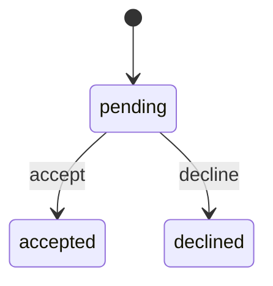

<!-- Generated by `pnpm generate` (packages/blueprint-tools, its pages) from packages/blueprint/src. Do not edit. -->
# The thing `invitation`

Rendered from `src/things/invitation/` by `pnpm generate`: each verb's file, in its `verbs/`, holds its
declaration and its promises. Do not edit it by hand: a test fails when this page and its sources differ. What the
runner checks on every call, and the starting worlds a promise is in, are in [index.md](index.md).

## At a glance

Commands:

- `capxul invitation send`
- `capxul invitation list`
- `capxul invitation accept`
- `capxul invitation decline`

SDK calls:

- `capxul["invitation.send"]`
- `capxul["invitation.list"]`
- `capxul["invitation.accept"]`
- `capxul["invitation.decline"]`

Refusals, with their exit codes (every call can also be refused by sign-in, `NotSignedIn`, exit 3):

- `OrgNotFound`, exit 2
- `CannotManagePeople`, exit 4
- `AlreadyAMember`, exit 2
- `AlreadyInvited`, exit 2
- `NotImplemented`, exit 6
- `InvitationNotFound`, exit 2
- `NotYourInvitation`, exit 4
- `InvitationClosed`, exit 2

Events:

- `member_invited`
- `invitation_accepted`
- `invitation_declined`

## Count

| Operation | Claims | Old, word for word | Old, rewritten | New | Old, not kept |
|---|---|---|---|---|---|
| `invitation.send` | 4 | 0 | 0 | 4 | 0 |
| `invitation.list` | 1 | 0 | 0 | 1 | 0 |
| `invitation.accept` | 3 | 0 | 0 | 3 | 0 |
| `invitation.decline` | 2 | 0 | 0 | 2 | 0 |

## Machines

Declared in the thing's `lifecycle.ts` (the format is the toolkit's). Core moves each thing only through its machine's
`step`, the database refuses a state the machine does not have, and the runner checks that each thing's events
form a path through it.

### `invitation`

- States: `pending`, `accepted`, `declined`. Its `invitation` field names it in each event and refusal below.
- Starts `pending`, made by `invitation.send`, which sends `member_invited`.

| Move | From | To | Made by | Sends | From any other state |
|---|---|---|---|---|---|
| `accept` | `pending` | `accepted` | `invitation.accept` | `invitation_accepted` | `accepted`: unchanged; `declined`: refused, `InvitationClosed` |
| `decline` | `pending` | `declined` | `invitation.decline` | `invitation_declined` | `accepted`: refused, `InvitationClosed`; `declined`: refused, `InvitationClosed` |

## 1. `invitation.send`

- Served by: the world group.
- Refusals: `OrgNotFound`, `CannotManagePeople`, `AlreadyAMember`, `AlreadyInvited`, `NotImplemented`, and `NotSignedIn` from sign-in.
- Emits: `member_invited`.
- Budget: 1,500 ms, provisional, excluding waking a parked world. Basis: reads of the company's board and members and of the world's cast in its database, then one write.

1. The founder invites a person by email to be a member: the invitation is pending at once, and there is nothing to sign. *(thin line)*
   - In: `founded`.
   - Observes: invitation.send as dana, Northwind's founder, of olga@cast.test as a member answers an invitation pending, naming Northwind, that email, the role and dana. It asks for no approval: the world's history gains one member_invited and nothing else, the chain's head is unchanged while the world's clock is frozen, and invitation.list as olga holds the invitation, pending.
   - Old: none; this claim is new.
2. An email no person of the world signs in with is invited all the same: the invitation waits for whoever signs up with it.
   - In: `founded`.
   - Observes: invitation.send as dana of rex@elsewhere.test answers an invitation pending for that email, and no person of the cast lists it with invitation.list.
   - Old: none; this claim is new.
3. Only the company's founder may invite; another Director, and anyone else, is refused, and nothing is sent.
   - In: `founded`.
   - Observes: As eli, a Director who is not the founder, as sam, a member with no permission, and as olga, who is not a member, invitation.send is refused with CannotManagePeople naming Northwind and the caller, who is not the founder org_founded names in the world's history. The history shows no new entry for a refused call. As dana, the founder, it answers an invitation she sent.
   - Refusals: `CannotManagePeople`.
   - Old: none; this claim is new.
4. A person who already belongs to the company, and an email whose invitation is still pending, are refused.
   - In: `founded`.
   - Observes: invitation.send as dana of sam@cast.test (a member) and of eli@cast.test (a Director) is refused with AlreadyAMember naming the person; a second invitation of olga@cast.test while hers is pending, with AlreadyInvited naming the pending invitation. Once she has declined, dana invites her again; once she has accepted, she is refused with AlreadyAMember. A company nobody founded is refused with OrgNotFound, and an address that is not an email with PayloadRejected. The world's history shows no new entry for any of them.
   - Refusals: `AlreadyAMember`, `AlreadyInvited`, `OrgNotFound`.
   - Old: none; this claim is new.

## 2. `invitation.list`

- Served by: the world group.
- Refusals: `NotImplemented`, and `NotSignedIn` from sign-in.
- Emits: none.
- Budget: 1,000 ms, provisional, excluding waking a parked world. Basis: one read of the world's database.

1. A person lists every invitation sent to their email, whatever its state, oldest first, and only those. *(thin line)*
   - In: `founded`.
   - Observes: invitation.list as olga after dana invites her answers that invitation, pending, from dana for Northwind; after she declines it and accepts dana's second, it answers both, the first declined then the second accepted. rex@elsewhere.test's invitation is listed to nobody of the cast. As sam it answers none. Every invitation it lists is to the caller's email, and the world's history gains no entry.
   - Old: none; this claim is new.

## 3. `invitation.accept`

- Served by: the world group.
- Refusals: `InvitationNotFound`, `NotYourInvitation`, `InvitationClosed`, `NotImplemented`, and `NotSignedIn` from sign-in.
- Emits: `Accepted`: `invitation_accepted`; `AlreadyAccepted`: none.
- Budget: 1,500 ms, provisional, excluding waking a parked world. Basis: a read of the invitation and the caller's cast entry in the world's database, then one write.

1. The invitee accepts and is a member at once; nothing is signed and nothing reaches the chain or the company's site. *(thin line)*
   - In: `founded`.
   - Observes: invitation.accept as olga of dana's second invitation, pending, answers Accepted: the invitation accepted and olga a member. The world's history gains one invitation_accepted naming olga and nothing else, and the chain's head is unchanged while the world's clock is frozen. org.member.list then lists olga as a member, and org.member.grant as dana of issue-invoices for olga is proposed, not refused with NotAMember.
   - Old: none; this claim is new.
2. Accepting again answers the same, and changes nothing.
   - In: `founded`.
   - Observes: invitation.accept as olga of the invitation she accepted answers AlreadyAccepted with the same invitation and member, and the world's history gains no entry.
   - Old: none; this claim is new.
3. An invitation that is not the caller's, one no longer pending, and one nobody sent are each refused, and nothing changes.
   - In: `founded`.
   - Observes: invitation.accept as sam of olga's invitation is refused with NotYourInvitation naming it and sam; as olga of the invitation she declined, with InvitationClosed in state declined; of an id nobody issued, with InvitationNotFound. The world's history shows no new entry, and olga is not a member until she accepts. A cancelled invitation is refused the same way, with InvitationClosed in state cancelled, once invitation.cancel can cancel one.
   - Refusals: `NotYourInvitation`, `InvitationClosed`, `InvitationNotFound`.
   - Old: none; this claim is new.

## 4. `invitation.decline`

- Served by: the world group.
- Refusals: `InvitationNotFound`, `NotYourInvitation`, `InvitationClosed`, `NotImplemented`, and `NotSignedIn` from sign-in.
- Emits: `invitation_declined`.
- Budget: 1,500 ms, provisional, excluding waking a parked world. Basis: a read of the invitation and the caller's cast entry in the world's database, then one write.

1. The invitee declines; the invitation is closed and they do not join. *(thin line)*
   - In: `founded`.
   - Observes: invitation.decline as olga of dana's invitation answers it declined. The world's history gains one invitation_declined naming neither olga nor her email, and org.member.list as dana does not list her.
   - Old: none; this claim is new.
2. An invitation that is not the caller's, one no longer pending, and one nobody sent are each refused, and nothing changes.
   - In: `founded`.
   - Observes: invitation.decline as sam of olga's invitation is refused with NotYourInvitation; as olga a second time, with InvitationClosed in state declined; of an id nobody issued, with InvitationNotFound. The world's history shows no new entry.
   - Refusals: `NotYourInvitation`, `InvitationClosed`, `InvitationNotFound`.
   - Old: none; this claim is new.
