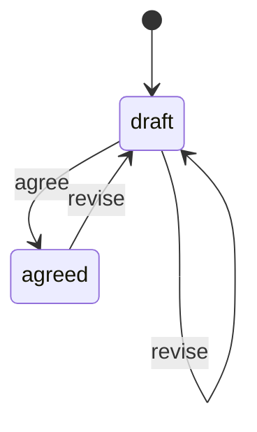
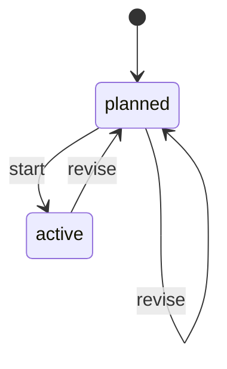
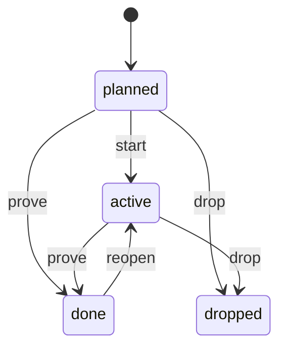
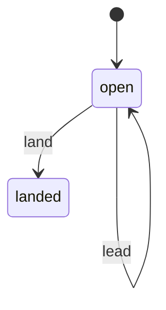
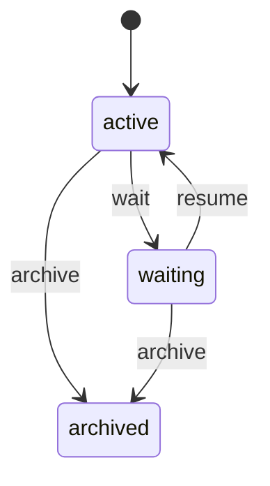
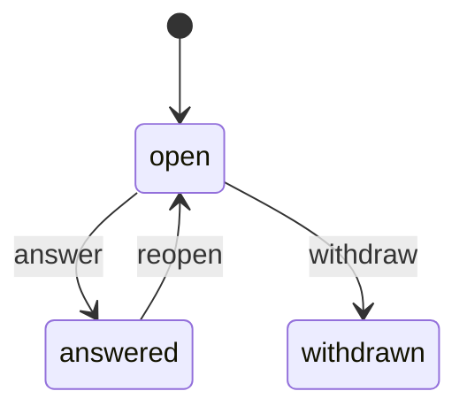
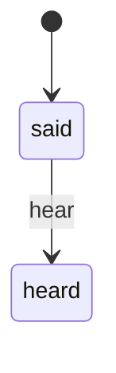

<!-- Generated by spikes/sitrep/src/main.ts generate. Do not edit. -->
# The conductor's things

## plan

States: draft, agreed. Starts draft, by `plan.write`.

| Event | Made by | Who may |
|---|---|---|
| plan_written | `plan.write` | agent, person |
| plan_agreed | `plan.agree` | person |
| plan_revised | `plan.revise` | agent, person |

## milestone

States: planned, active. Starts planned, by `milestone.plan`.

| Event | Made by | Who may |
|---|---|---|
| milestone_planned | `milestone.plan` | agent, person |
| milestone_started | `milestone.start` | agent |
| milestone_revised | `milestone.revise` | agent, person |

## step

States: planned, active, done, dropped. Starts planned, by `step.plan`.

| Event | Made by | Who may |
|---|---|---|
| step_planned | `step.plan` | agent, person |
| step_started | `step.start` | agent |
| step_proven | `step.prove` | pipeline |
| step_reopened | `step.reopen` | pipeline |
| step_dropped | `step.drop` | person |

## lane

States: open, landed. Starts open, by `lane.open`.

| Event | Made by | Who may |
|---|---|---|
| lane_opened | `lane.open` | agent |
| lane_led | `lane.lead` | agent |
| lane_landed | `lane.land` | pipeline, agent |

## thread

States: active, waiting, archived. Starts active, by `thread.start`.

| Event | Made by | Who may |
|---|---|---|
| thread_started | `thread.start` | agent |
| thread_waiting | `thread.wait` | agent |
| thread_resumed | `thread.resume` | agent, person |
| thread_archived | `thread.archive` | agent, person |

## ask

States: open, answered, withdrawn. Starts open, by `ask.open`.

| Event | Made by | Who may |
|---|---|---|
| ask_opened | `ask.open` | agent |
| ask_answered | `ask.answer` | person |
| ask_reopened | `ask.reopen` | person |
| ask_withdrawn | `ask.withdraw` | agent |

## sitrep

States: said, heard. Starts said, by `sitrep.say`.

| Event | Made by | Who may |
|---|---|---|
| sitrep_said | `sitrep.say` | agent |
| sitrep_heard | `sitrep.hear` | person |

